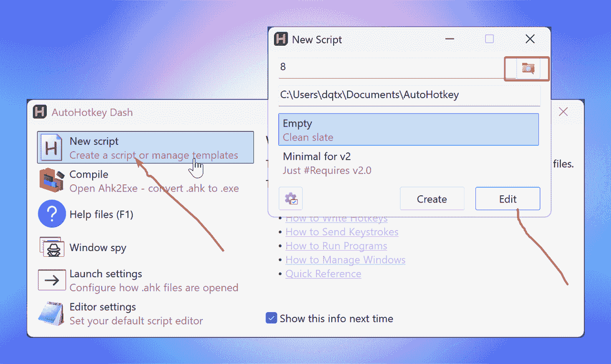
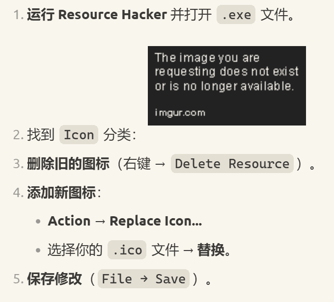
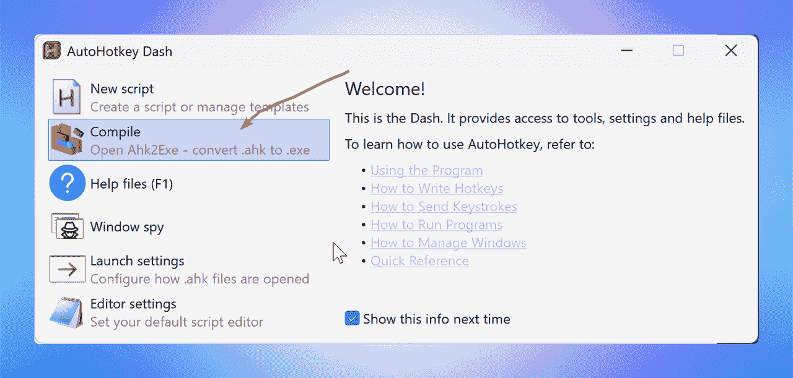
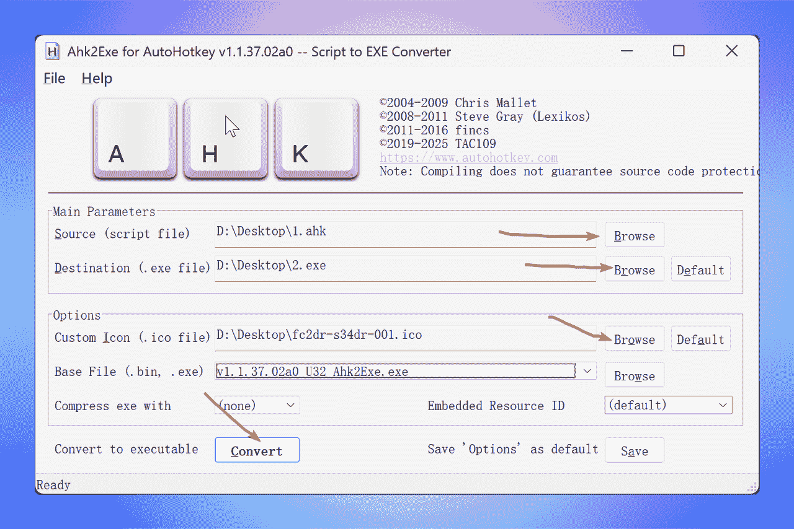

# AutoHotkey将代码转换EXE

> 来源：[https://xodnytdcaw.feishu.cn/docx/L4tSdFI77oWOJKxW9Eoc9lOJn5e](https://xodnytdcaw.feishu.cn/docx/L4tSdFI77oWOJKxW9Eoc9lOJn5e)

## 安装

安装[AutoHotkey](https://www.autohotkey.com/)

## 制作脚本（借助AI）

> **帮我制作一个exe小**工具修改HOSTS文件，使用AutoHotkey

```
Run, notepad.exe C:\Windows\System32\drivers\etc\hosts,, RunAs
```

新建脚本，选择输出目录，名称，之后选择编辑并保存



脚本转换EXE

选择脚本

输出目录

上传软件图标

> 图标豆包制作

> [在线转换图标icon文件](https://www.aconvert.com/cn/icon/)    256×256 尺寸的.ico 图标

>

[注意；图标先也可以不上传的话，](https://www.angusj.com/resourcehacker/)生成后，可用Resource Hacker进行更换



## 转换EXE





## 延伸

还有那些制作exe的软件

[Visual Studio](https://blog.csdn.net/qq_39030256/article/details/132413839)  [参考2](https://www.cnblogs.com/bEngi1/p/12360305.html)

[**Python**](https://blog.csdn.net/m0_63203517/article/details/124383678)**   参考2**

| 命令 | 作用 |
| --- | --- |
| pip install pyinstaller | 安装打包工具 |
| pyinstaller --onefile --windowed edit_hosts.py | 生成单个无黑窗的 .exe |

更换图标

```
pyinstaller --onefile --windowed --icon=myicon.ico edit_hosts.py
```