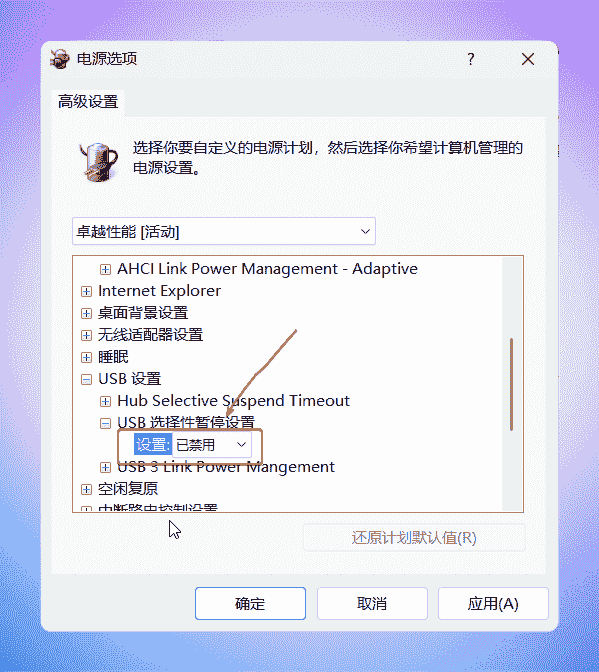
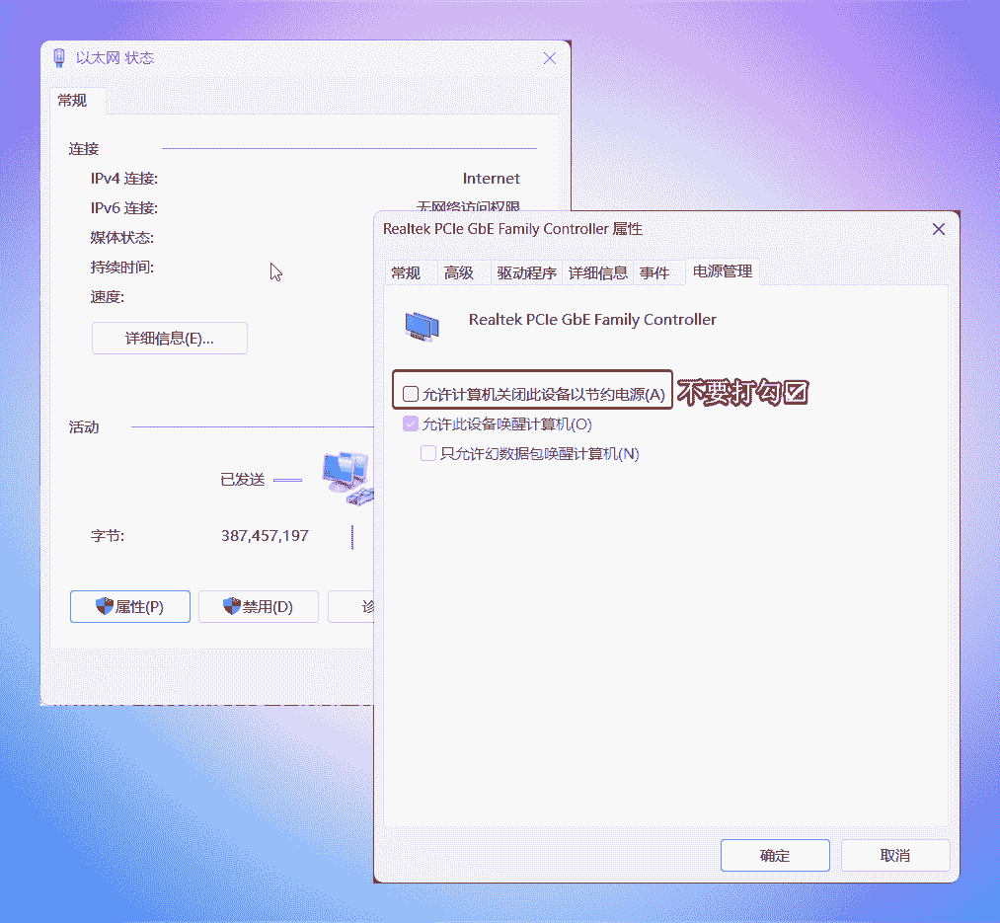

# 台式电脑无线鼠标拖动卡顿和迟滞

> 来源：[https://xodnytdcaw.feishu.cn/docx/W9W0dTor0oMiA5xWoRRcuuoenId](https://xodnytdcaw.feishu.cn/docx/W9W0dTor0oMiA5xWoRRcuuoenId)

## 解决办法

## 1.鼠标usb接收器避免信号干扰

|  |  |
| --- | --- |
| 错误❌ | 正确✅ |
| 蓝牙适配器和鼠标接收器的信号（两者都用 2.4GHz 频段）干扰 | 比如一个插前置、一个插后置 |

## 2.重新插拔显示器连接主机显卡的DP/hdm线

## 3.禁用USB选择性暂停设置



## 4.关闭网卡节约用电

```
ncpa.cpl
```

属性-配置-电源管理



## 5.禁用可编程中断控制器

win+X打开设备管理器---系统设备----可编程中断控制器---右键禁用


## 6.其他问题

+   更新鼠标驱动问题

+   鼠标**光学传感器区域**不要有异物

检查清单