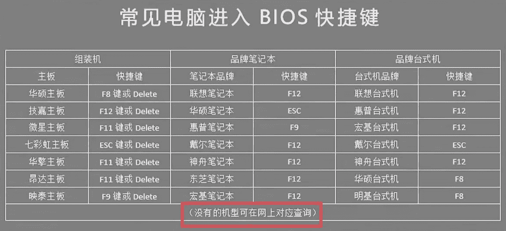

# 常用软件/命令汇总

> 来源：[https://xodnytdcaw.feishu.cn/docx/KIRidnNwso0osqxzzEVcbJy2nEd](https://xodnytdcaw.feishu.cn/docx/KIRidnNwso0osqxzzEVcbJy2nEd)

## 1、绿色软件

| 办公 | [Office2024](https://mp.weixin.qq.com/s/HxUCRo9Zoyog5dAr7r_pWw)  [Adobe全家桶](https://www.yuque.com/islandgg13/tdg1oz/dzmses?)  [Honeyview ](https://mp.weixin.qq.com/s/UZxfp8DzU-0Fvgyt4wrz3g)  [PotPlayer](https://mp.weixin.qq.com/s/U5JsMtwEjCRiFXvA1O3fUg)  [PDF阅读器](https://www.sumatrapdfreader.org/download-free-pdf-viewerhttps://www.sumatrapdfreader.org/download-free-pdf-viewer)   [github加速](https://steampp.net/)   [duckduckgo浏览器](https://duckduckgo.com/) |
| --- | --- |
| 效率 | [PixPin](https://pixpin.cn/)   [Listary](https://mp.weixin.qq.com/s?__biz=MzI0NjYxNTM3NQ==&amp;mid=2247486045&amp;idx=1&amp;sn=41b49ee061309d99200f3b87b60cc677&amp;chksm=e9bdd67ddeca5f6be6f65c4aa0eadad9655289de2e598360758e89e75d08e6e3b1676298eb90&amp;token=1699368062&amp;lang=zh_CN#rd)  [Pot](https://mp.weixin.qq.com/s?__biz=MzI0NjYxNTM3NQ==&amp;mid=2247486198&amp;idx=1&amp;sn=36a2eb0d3dae2e0da805feb8578a6cf7&amp;chksm=e9bdd6d6deca5fc07390105703355a4a7b97a2df79a41e4874b77d1a247ccf3355c799c480af&amp;token=1699368062&amp;lang=zh_CN#rd)   [WinRAR](https://wwzq.lanzouq.com/iVmy31z4e30d)  [HiBit](https://www.hibitsoft.ir/)  [Geek](https://wwzq.lanzouq.com/isMLb1z4fjaf)   [flix](https://flix.center/)   [LANDrop](https://landrop.app/)   火绒安全   联想电脑管家 |
| 下载 | [IDM](https://mp.weixin.qq.com/s?__biz=MzI0NjYxNTM3NQ==&amp;mid=2247486164&amp;idx=1&amp;sn=fa7f364df368edc25e59e60b98458fa5&amp;chksm=e9bdd6f4deca5fe2bff7b42cfa31e30f538b79eb84b622f5702bb37870c517af4a3d2e866571&amp;token=1699368062&amp;lang=zh_CN#rd)  [NDM](https://mp.weixin.qq.com/s/oliaTMsJoGbj267GqPh2sg)   [ABdown](https://github.com/amir1376/ab-download-manager)  [imFile](https://github.com/imfile-io/imfile-desktophttps://github.com/imfile-io/imfile-desktop)  [Motrix](https://github.com/agalwood/Motrix)  [Gopeed](https://github.com/GopeedLab/gopeed)  [m3u8下载](https://github.com/nilaoda/N_m3u8DL-CLI/blob/master/README_ENG.md)  [阿里「小白羊」](https://github.com/gaozhangmin/aliyunpan/releases/tag/v3.13.3)   [蓝奏云](https://github.com/chenhb23/lanzouyun-disk) |
| 解析 | [视频号](https://github.com/putyy/res-downloader)  [📕](https://github.com/JoeanAmier/XHS-Downloader)  [B站](https://github.com/leiurayer/downkyi?tab=readme-ov-file)  [TikTok](https://github.com/JoeanAmier/TikTokDownloader)   [油管](https://github.com/KurtBestor/Hitomi-Downloader)  [KD主页批量下载](https://pan.xunlei.com/s/VNx1ygAXsKBbnkQhvF5uD9ihA1?pwd=sern) [喜马拉雅](https://github.com/Diaoxiaozhang/Ximalaya-Downloader) |
| 音乐 | A[lger](http://fonger.top/)Mu[sicP](https://lxmusic.toside.cn/download)l[a](https://musicfree.upup.fun/)y[er 方](https://pan.xunlei.com/s/VNyULsI9vc-eRGmqriAt20t8A1?pwd=qrd2)格音[乐  落](https://github.com/th-ch/youtube-music)雪音[乐   ](https://github.com/iAJue/MoeKoeMusic)🐧[音乐  油管音乐](https://github.com/Hiram-Wong/ZyPlayer)  酷我音乐  ZyPlayer |
| 投屏 | [安卓scrcpy ](https://github.com/Genymobile/scrcpy/releases/tag/v2.4)  [苹果敖软投屏 ](https://pan.xunlei.com/s/VNyULZPUngJuahN32a77Ya3nA1?pwd=dtie)    远程：[rustdesk](https://github.com/rustdesk/rustdesk/releases/tag/1.3.6)   [AnyDesk](https://4275.com/jmz10r)   虚拟机： [VMware ](https://pan.xunlei.com/s/VNx22514hRNwmF3UM72WjAYBA1?pwd=mmk5)  [雷电模拟器](https://www.423down.com/14102.html) |
| PDF | [PDF合并转换](https://www.pdfgear.com/zh/) [万兴PDF专家](https://pan.xunlei.com/s/VNx29JxInCbcdOvMrILKTHc8A1?pwd=ukkc)  [PDF24 Creator](https://creator.pdf24.org/listVersions.php)  Acrobat-Pro-DC2024最新版 |
| 图像 | [照片换脸](https://pan.xunlei.com/s/VNx1z_e3tlDNapY50MlHy5G-A1?pwd=bhfs)  [黑白照上色](https://pan.xunlei.com/s/VNx1zYbrld8i4AqACiad_xRXA1?pwd=uunf)  [图片管理 ](https://pan.xunlei.com/s/VNx1zWglCmZoV5LwnWBl83XVA1?pwd=jk7x) [CrazyTalk](https://pan.xunlei.com/s/VNx1zUQMibeMWZ3ypVnAp_B2A1?pwd=4rh6)   [巨应壁纸](https://github.com/GiantappMan/livewallpaper/releases/tag/v3.0-alpha.1)  L[ively ](https://livelywallpapers.net/Cartoon/)Wallpaper 动态壁纸下载 |
| 笔记 | [Typora激活工具包](https://pan.xunlei.com/s/VNx22RGJjdahLXw6IhahLJ2OA1?pwd=zj64)  [Notepad++ 8.5](https://pan.xunlei.com/s/VNx22cWrJR5RfGNKqgZ6146gA1?pwd=qdmz)  [代码托管](https://www.codecopy.cn/)  [Obsidian](https://obsidian.md/)    [L](https://logseq.com/)[ogseq](https://logseq.com/)    [Notion](https://www.notion.com/) |
| 录频 | [录GIF](https://pan.xunlei.com/s/VNx20qH75Z2jZX-Twz-BPqrXA1?pwd=j686)   F[astSt](https://pan.xunlei.com/s/VNx22qMtxa9Mq8wrdy3B303pA1?pwd=asi9)one[Capt](https://shuitunapp.com/)u[re  敖软投屏   鼠](https://github.com/mulaRahul/keyviz)标美[化  Keyvi](https://pan.xunlei.com/s/VNr8oFubhENNY8eypZl_jWafA1?pwd=ngat)z[按键可](https://pan.xunlei.com/s/VNx23UPGo2zFo1tMZjPA6OD7A1?pwd=hi3e)视化 [ Bandic](https://github.com/xfgryujk/blivechat?tab=readme-ov-file)am OBS   OBS弹幕助手 |
| 检测 | [U盘检测 ](https://www.grc.com/validrive.htm) [ 键盘检测](https://pan.xunlei.com/s/VNxkGsGJTEEynQ2M_al9RfaXA1?pwd=vzb7#)  [图吧工具箱](https://www.tbtool.cn/) [入梦工具箱](https://gitcode.com/gh_mirrors/rm/RM-Toolbox)  [KMS系统激活](https://github.com/zbezj/HEU_KMS_Activator/releases) |
| 优化 | [桌面图标小箭头取消](https://wwzq.lanzouq.com/iXnjY1ykoo5e)  [一键禁用系统更新](https://pan.xunlei.com/s/VNxBGVaDpvI3LeUe8M_XpxMhA1?pwd=9qsc#)  [彻底关闭Defender](https://wwzq.lanzouq.com/ieefU2anb7pe)  [彻底禁用系统更新](https://github.com/tsgrgo/windows-update-disabler)  [网速优化](https://www.speedguide.net/downloads.php) |
| 辅助 | [宽带测速](https://pan.xunlei.com/s/VNx1y9eRnCbcdOvMrILKQHbAA1?pwd=xbyz)   [SoftCnKiller](https://wwzq.lanzouq.com/ikf5j2ancdgh) lO[bitU](https://pan.xunlei.com/s/VNx1xGS5sKBbnkQhvF5uCnPSA1?pwd=rtwu)ni[nsta](https://pan.xunlei.com/s/VNx23BBlk76q9hL8ynCnWSmFA1?pwd=frgy)ller  C盘清理  文件加密 |
| 其他 | [驱动总裁](https://pan.xunlei.com/s/VNxBLuZltai5YXoYQkJtRz8nA1?pwd=znqq#)  [DriverBooster驱动](https://www.uy5.net/download/list/?u_user=1&amp;path=00019700101000000001/1611iptRY1EL0552023011810483286j/1611iptRY1EL078202210220137074zo/1611iptRY1EL0782022102201370757z)   [DirectX修复](https://pan.xunlei.com/s/VNx1wpsY1V6BBoXVv8otUCQ-A1?pwd=2cwz)  [微软运行库](https://pan.xunlei.com/s/VNxC7gpQY2N_LVGhD60m3vNXA1?pwd=4azj)     .NET Framework 3.5 |

▼

|  |  |  |  |
| --- | --- | --- | --- |
| Listary | 75元 | [点此购买](https://lizhi.shop/site/products/id/58?cid=wbm93g4b) | 本地文件搜索工具 |
| Typora | 89元 | [点此购买](https://lizhi.shop/site/products/id/520?cid=wbm93g4b) | Markdown 编辑器 所见即所得 支持 Latex 公式 |
| PixPin | 179元 | [点此购买](https://lizhi.shop/site/products/id/799?cid=wbm93g4b) | 截图，翻译贴图标注工具 |
| IDM | 59元 | [点此购买](https://lizhi.shop/site/products/id/325?cid=wbm93g4b) | Windows高速下载软件 |
| Xmind | 319元 | [点此购买](https://lizhi.shop/site/products/id/47?cid=wbm93g4b) | 全平台思维导图软件 一键演示导图 支持智能配色 |
| AdGuard | 30元 | [点此购买](https://lizhi.shop/site/products/id/31?cid=wbm93g4b) | 多平台广告拦截软件 |
| 图图记账 | 65元 | [点此购买](https://lizhi.shop/site/products/id/615?cid=wbm93g4b) | IPhone专用，高颜值简洁易用记账 App |

> **正版软件推荐>>>****      **[**Windows正版系列软件**](https://lizhi.shop/site/search_list?category_id=1&cid=wbm93g4b&order_by=2)

## 2，重装系统

| U启**工具** | [Rufus](https://rufus.ie/zh/)   [balena](https://etcher.balena.io/)  [Ventoy](https://www.ventoy.net/cn/download.html)   [WePE](https://www.wepe.com.cn/download.html) |
| --- | --- |
| **镜像下载** | [微软官网](https://www.microsoft.com/zh-cn/software-download/)  [Cmdpe](https://www.cmdpe.com/post/246.html)   [Massgrave](https://massgrave.dev/windows_ltsc_links)   [itellyou](https://msdn.itellyou.cn/?ang=2h-cn)  [极简系统 ](https://www.sysmini.com/)  [uupdump](https://uupdump.net/)   [CYegats](https://kdocs.cn/l/cgTGWjbUVnMf)  [uupdump中文站](https://uupdump.cn/) |
| **实用教程** | [删除U盘的EFI分区方法](https://web.okjike.com/originalPost/6639f4b1a922aa28d0fa4dec)    [E盘合并到D盘](https://www.bilibili.com/video/BV1hd4y1m7BP/?spm_id_from=333.337.search-card.all.click&amp;vd_source=206031f494850e57fd6c92ace02b1bed) |

## 3、🪜

| 客户端 | [Clash Verge](https://github.com/clash-verge-rev/clash-verge-rev/releases)     Or    [v2rayN](https://github.com/2dust/v2rayN) |
| --- | --- |
| 付费机场 | 9.9 元 / 月 400 G 流量 |
| 免费节点 | [节点1](https://clashvpn.org/clash-subscribe-links-github-repo/)  [节点2 ](https://github.com/zxlhhyccc/Sub)   [节点3](https://clash-verge.github.io/free-nodes/) |
| 网站 | [chrome拓展](https://chromewebstore.google.com/)  [Youtube](https://www.youtube.com)  [Gmail](https://mail.google.com) [测速speedtest](https://www.speedtest.net/zh-Hans) [维基本科](https://zh.wikipedia.org/wiki/Wikipedia:%E9%A6%96%E9%A1%B5)  [Steam](https://store.steampowered.com)   [Google地球](https://earth.google.com/web)   [TED](https://www.ted.com)   Spotify    GitHub |

## 4、一行代码

> **Powershell命令代码**

> irm https://get.activated.win | iex        先输入3，等会再输入1，激活Windows系统

> irm https://get.activated.win | iex        先输入2，等会再输入1，激活Office

> iex(irm is.gd/idm_reset)                      先输入1 ，之后输入 9，激活IDM（挂魔法）

> powercfg -duplicatescheme e9a42b02-d5df-448d-aa00-03f14749eb61------开启电源卓越性能

> 恢复传统右键菜单

> reg add "HKCU\Software\Classes\CLSID\{86ca1aa0-34aa-4e8b-a509-50c905bae2a2}\InprocServer32" /f /ve

> [去除小箭头命令](https://mp.weixin.qq.com/s?__biz=MzI0NjYxNTM3NQ==&mid=2247485067&idx=1&sn=1b7956141b53cda8b2fbf91beb88a51a&chksm=e9bddaabdeca53bd2024c01bba9e8909f7d0ba251b0fe5e922c34ef0247fd39c9b9d5cd8e94d&token=1014334193&lang=zh_CN#rd)

> 激活offcie/Windows命令

> Eventvwr.msc--日志

> control------打开控制面板

> ipconfig---------ip地址查询

> regedit-----打开注册表

> ipconfig /flushdns-------清理NDS缓存

> curl 4.ipw.cn---查询本机外网IPv4地址

> shell:startup--------自启动文件夹

> Winver-----查看Windows版本

> ncpa.cpl-----网络适配器

> route print------路由表

> control system-------查看计算器基本信息

> msinfo32--------查看系统信息

> dxdiag--------------电脑配置信息

> msconfig----打开系统配置

> ncpa.cpl----打开网络链接

> control--------------打开控制面板

> shell:AppsFolder------电脑安装的全部软件

> dir/s------------------磁盘检查

> cls-----------------清屏

> osk-----打开屏幕键盘

> mrt----恶意软件删除工具

> cleanmgr /sagerun----系统垃圾清理

> wmic bios get serialnumber----电脑序列号查询

> regsvr32 dbghelp.dll----命令提示符注册dll

> taskkill /f /im taskmgr.exe----强制关闭任务管理器

> firewall.cpl--------------------------------打开防火墙

> services.msc-----打开服务列表窗口

> Sfc /scannow -----修复系统文件

> DISM /Online /Cleanup-Image /ScanHealth-----损坏镜像修复

> 管理员运行：netsh wlan show profiles

> 再运行：netsh wlan show profile name="WiFi网络名称" key=clear    -----无线网密码查询

## 5、常用快捷快

> Win＋D-----------------------------------返回桌面（笔记本电脑，触控板三指下滑）

> Win+R-------------------------------------返打开运行功能

> Win＋L-------------------------------------锁屏

> Win+I-------------------------------------打开设置界面

> Win+E--------------------------------------返打开我的电脑

> Win+“+/-”----------------------------------返放大/缩小屏幕

> Win＋左右方向------------------------------返分屏

> Win＋v ----------------------------------返查看历史剪贴板

> Win＋句号----------------------------------返特殊符号/emoji

> Win＋H----------------------------------返语音输入

> Alt＋F4----------------------------------返关闭窗口/关机

> ctrl+shift+Esc-------------------------------打开任务管理器

## 6、Windows知识

---

[Windows11关掉安全中心](https://wenda.so.com/q/1666736893212289?src=140&q)    [彻底关闭Defender](https://wwzq.lanzouq.com/ieefU2anb7pe)

[Windows11关闭防火墙](https://baijiahao.baidu.com/s?id=1763016212505807722&wfr=spider&for=pc)

Windows11快捷方式箭头去除「管理员」

[这些“Win+R”骚操作绝了！](https://mp.weixin.qq.com/s?__biz=MzI0NjYxNTM3NQ==&mid=2247484659&idx=1&sn=f7da2757e9f563103b75fcc8adfb7f57&chksm=e9bdd8d3deca51c55c228cd3c38afe92e986d8a3911790714763f26f5ad7046c7f4a9a387e8b&token=562466873&lang=zh_CN#rd)

Windows关闭账户控制怎么关？

[安装PS基础设置](https://kdocs.cn/l/camYZ7UK6kgi)

## [点此以此鼓励作者](https://xodnytdcaw.feishu.cn/wiki/FutmwKWlRi8ZCsk7Mylc92RanHd)