# potplayer/Vlc：安装与设置

> 来源：[https://xodnytdcaw.feishu.cn/docx/O8iUdL6IZoS2QFx33G6cDaL2nve](https://xodnytdcaw.feishu.cn/docx/O8iUdL6IZoS2QFx33G6cDaL2nve)

Po**tplayer**于Vlc都是开源的电脑播放器，但是可以播放么m3u文件，然而直播源可以以m3U形式存在，所以，你只有有个c。ZyPlayer也是一款轻量级的高颜值视频客户端，不过他主要通过导入json视频源看影视类，你可以理解它是一款电脑端的点播神器。下面正文，会针对这3款软件的安装于设置展开讨论

# 一.Potplayer

> 官网网站下载

> https://potplayer.tv/

> https://potplayer.daum.net/

> 迅雷云盘下载地址

> [h](https://pan.xunlei.com/x/VOc0pCO4asKx2_T6pxDX9fZ0A1?pwd=hj3h#)ttps://pan.xunlei.com/x/VOc0pCO4asKx2_T6pxDX9fZ0A1?pwd=hj3h#

## 1.基本设置

关闭软件更新

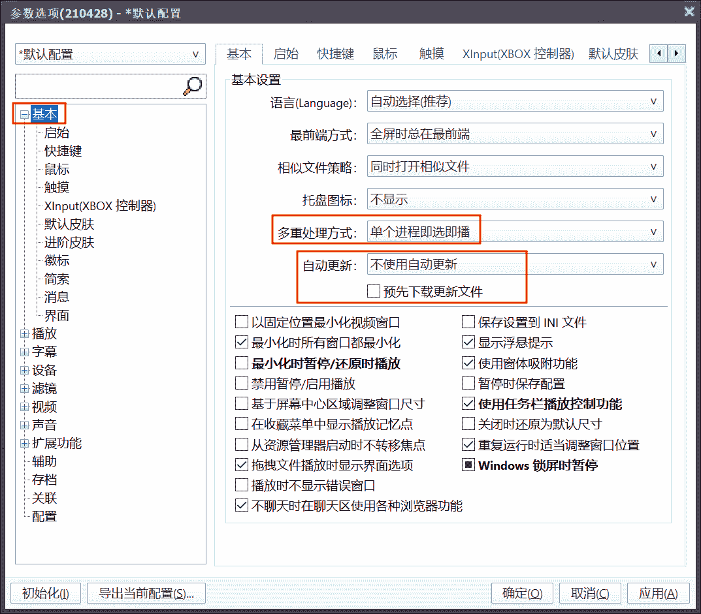

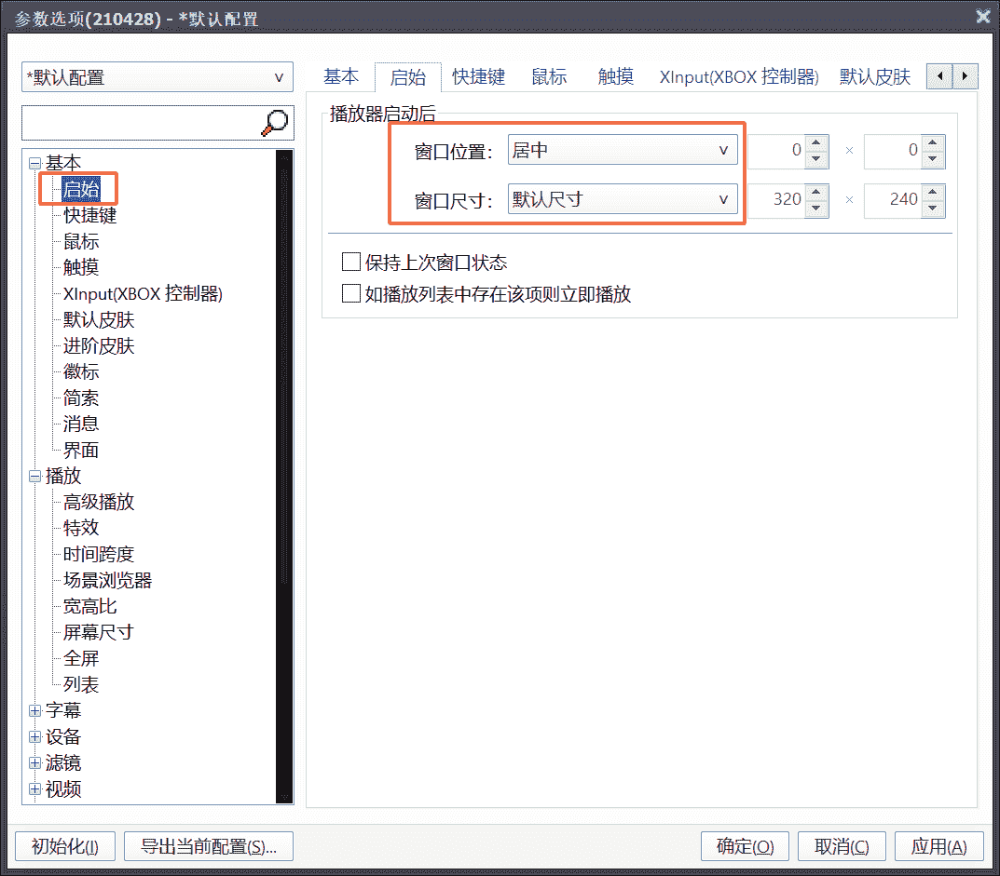

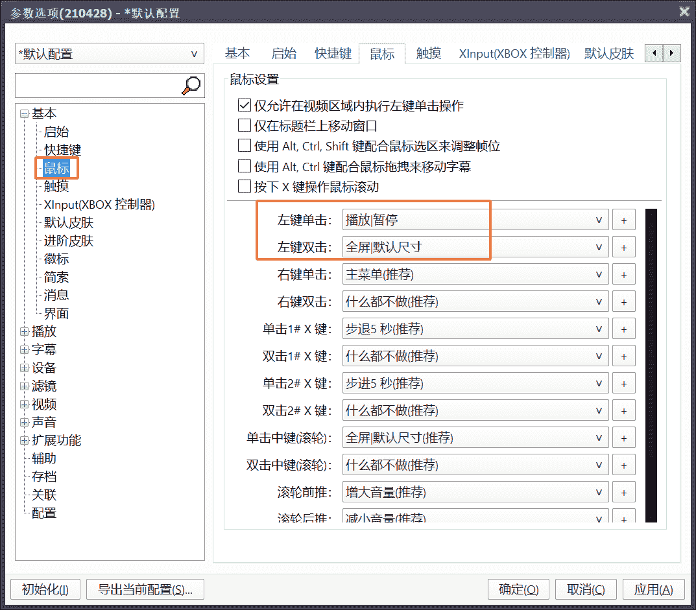

皮肤位置：D:\software\PotPlayer\Skins

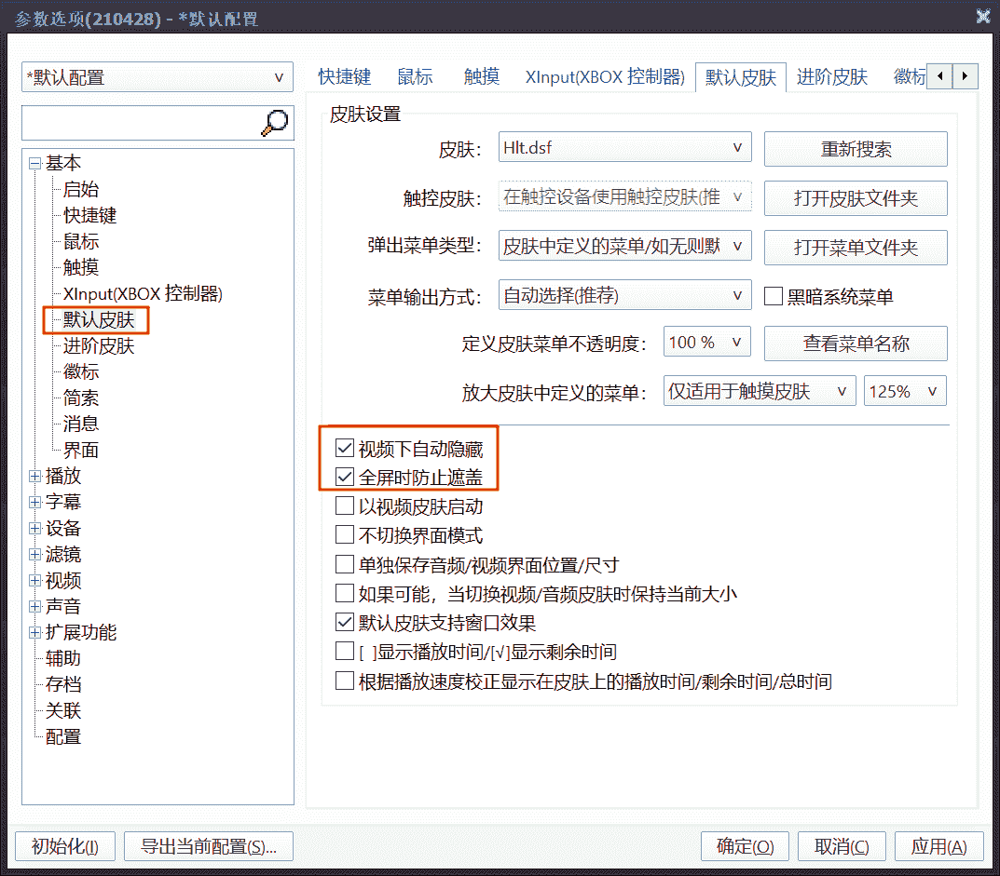

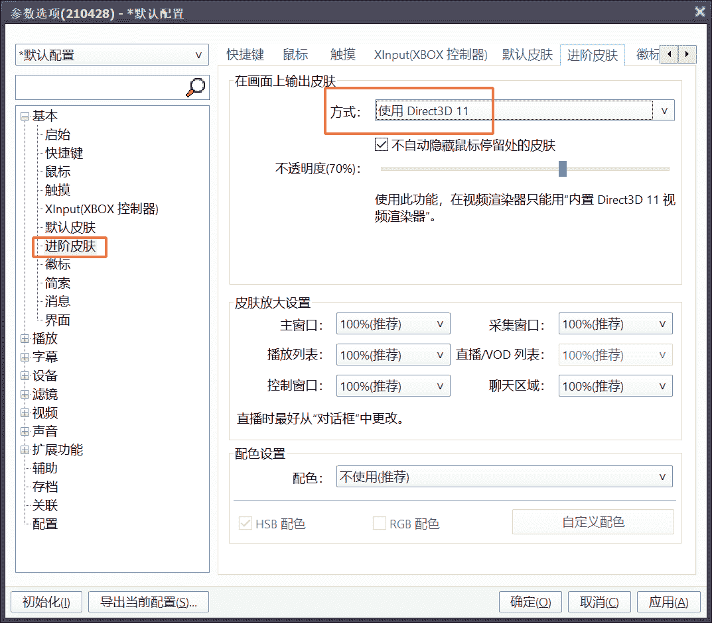

## 2.播放设置

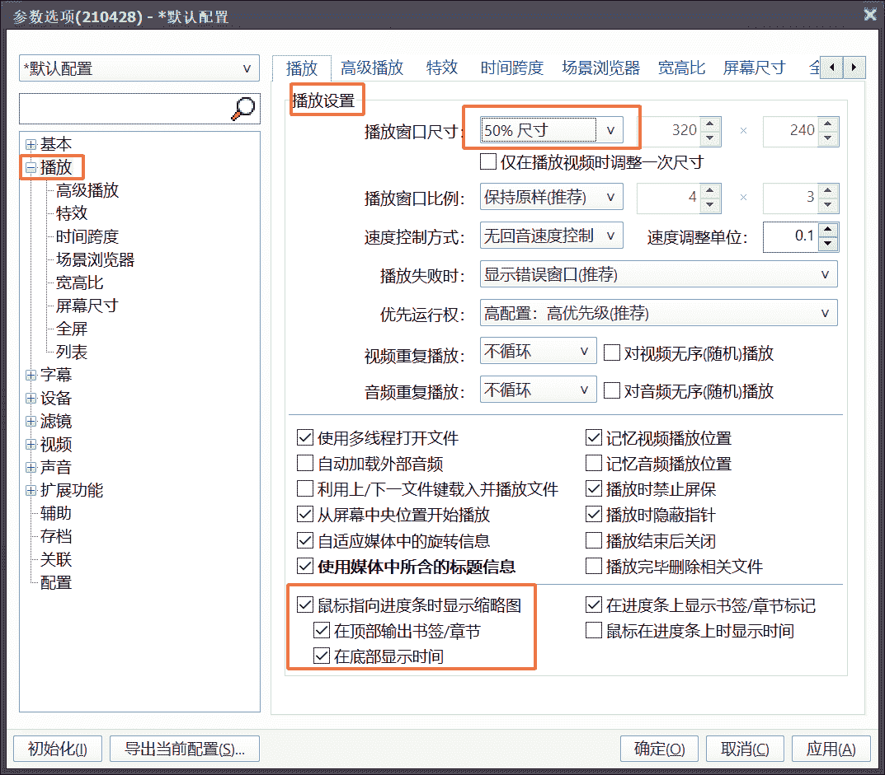

## 3.视频设置

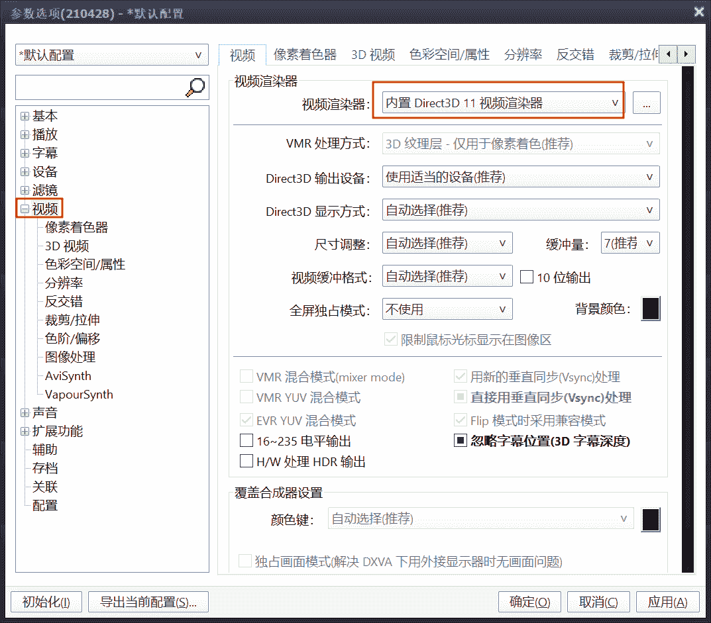

## 4.声音设置

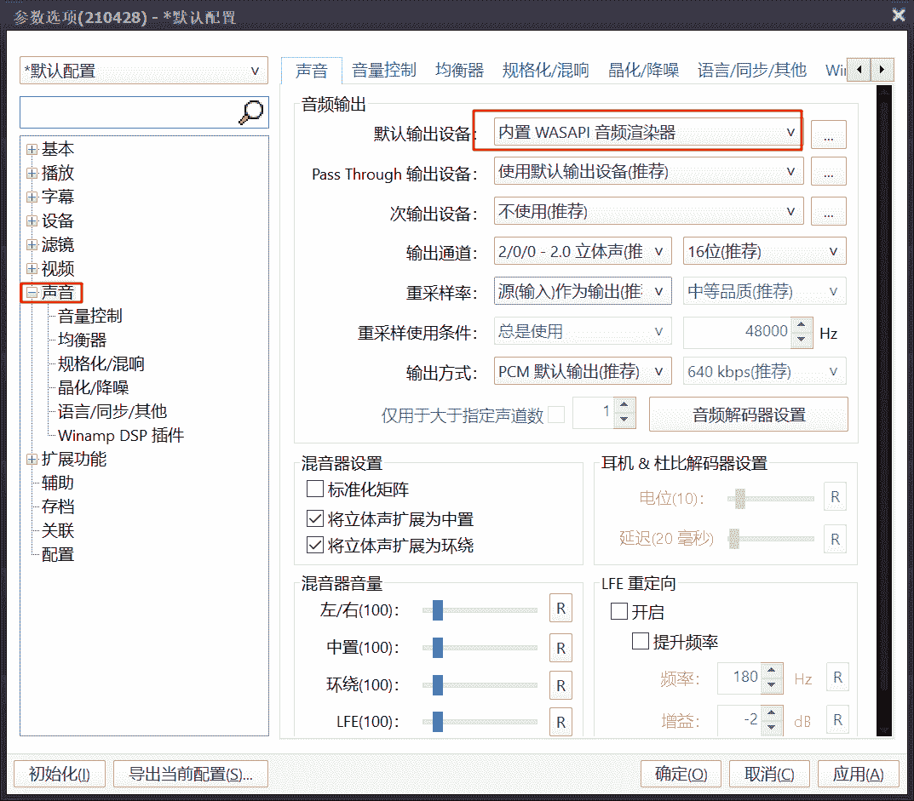

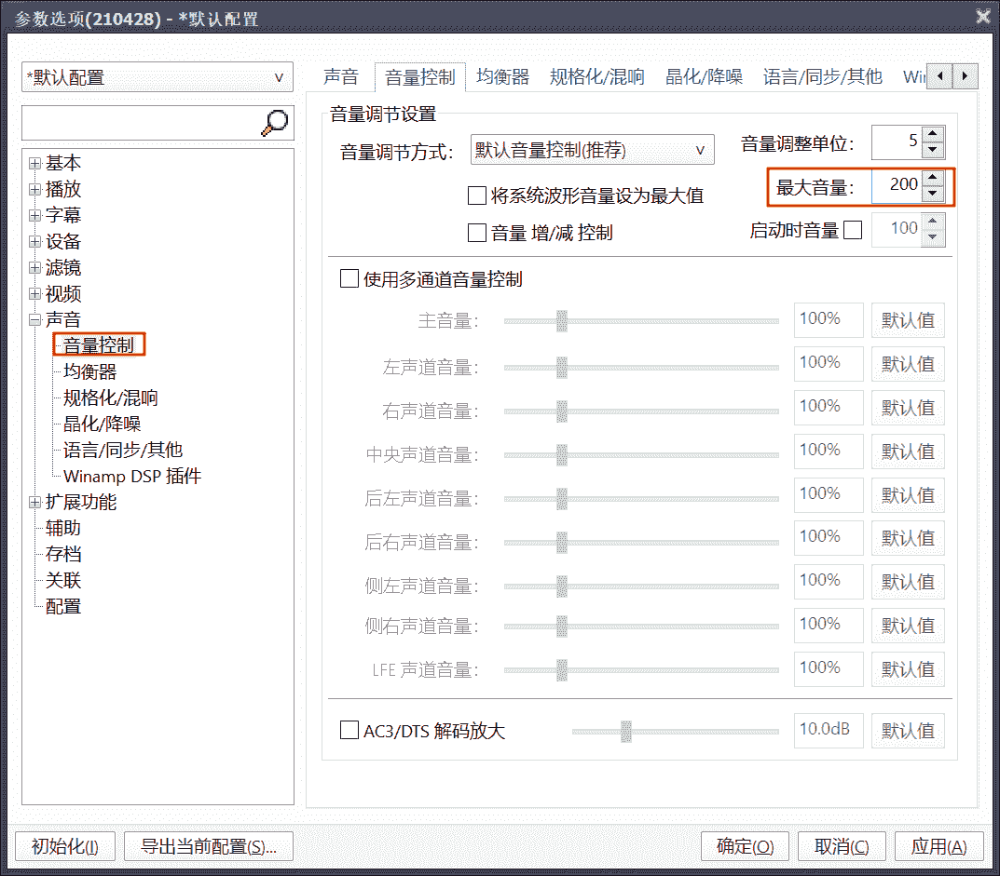

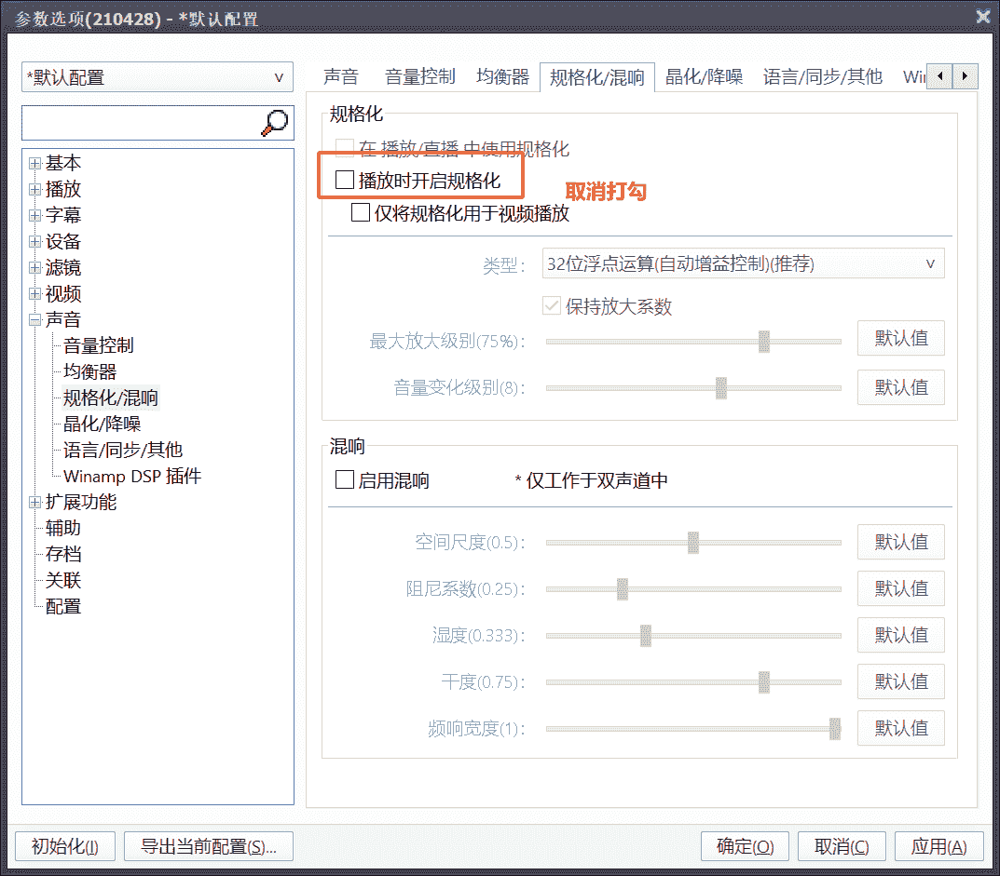

## 5.potplayer常见问题

#### [不显示视](https://www.codecguide.com/download_k-lite_codec_pack_standard.htm)频缩略图，解决办法:安装k-lite codec pack，点击下载

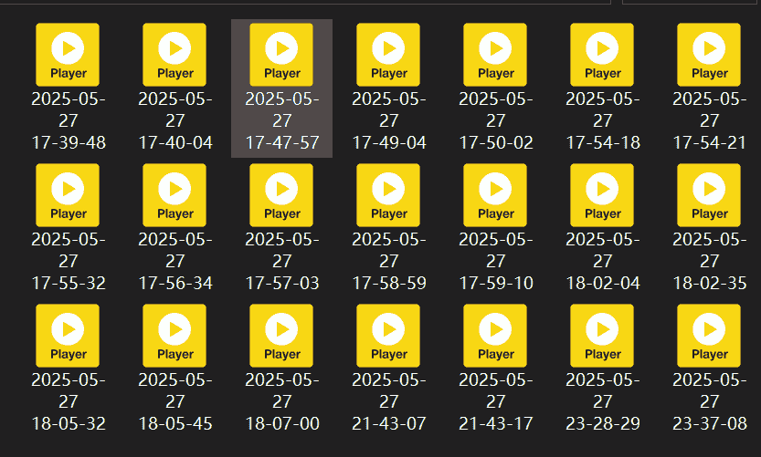

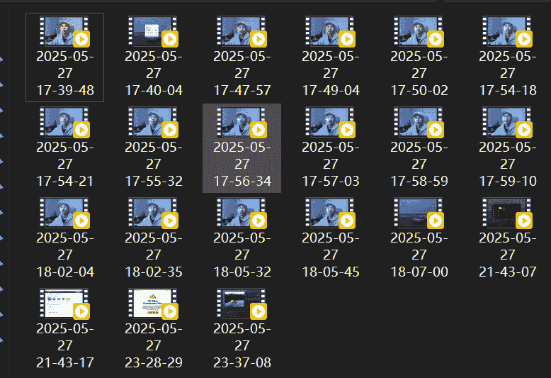

#### 打开文件那么很慢，解决办法

1.视频渲染器Direct3D 11改成自动选择

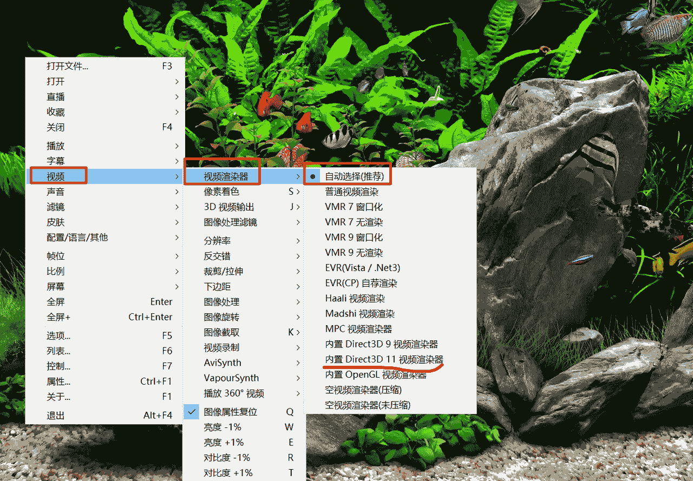

# 二.VLC（直播）

## 下载&安装

https://www.videolan.org/

## 2，皮肤/乱码问题

5款自用精选衣服

[h](https://pan.xunlei.com/x/VOc0pL0rtyeceWVRwdwToTMfA1?pwd=7bqi#)ttps://pan.xunlei.com/x/VOc0pL0rtyeceWVRwdwToTMfA1?pwd=7bqi#

🔔

中文乱码问题：

借助脚本https://github.com/linsui/vlt_zh

python vlt_zh.py [vlt 文件路径或所在目录] [字体文件路径]

使用方法：

1，下载vlt_zh.py  下载FusionX2_B_VLC.vlt 皮肤，这两个都放在桌面

下载字体[MiSans](https://hyperos.mi.com/font/zh/details/sc/)字体，安装后文件路径：C:\Users\Administrator\AppData\Local\Microsoft\Windows\Fonts\MiSans-Bold.ttf

2，运行脚本

python vlt_zh.py FusionX2_B_VLC.vlt "C:\Users\Administrator\AppData\Local\Microsoft\Windows\Fonts\MiSans-Bold.ttf"

# 三.ZyPlayer（点播）

## 下载地址

[https://github.com/Hira](https://github.com/Hiram-Wong/ZyPlayer/tags)m-Wong/ZyPlayer/tags

## zyplayer基础配置，添加json视频源

[https://zhuanlan.zh](https://zhuanlan.zhihu.com/p/4858371822)ihu.com/p/4858371822

# 四.Potplayer/Vlc直播源

## M3U直播源文件：

下载地址：[点此下载](https://pan.xunlei.com/x/VOc0uy5mHvKh72Gm-JSTYdDfA1?pwd=g3ry#)

下载后拖到Potplayer/Vlc就可以播放了，也可以用Potplayer/Vlc打开方式观看

## ZyPlayerjson源

[这篇文章文末有](https://zhuanlan.zhihu.com/p/4858371822)

# 五.QuickLook

QuickLook-快速文件预览工具

选中任意文件，按下键盘空格键，立即弹出预览窗口，再次按空格键关闭预览窗口。

https://github.com/QL-Win/QuickLook