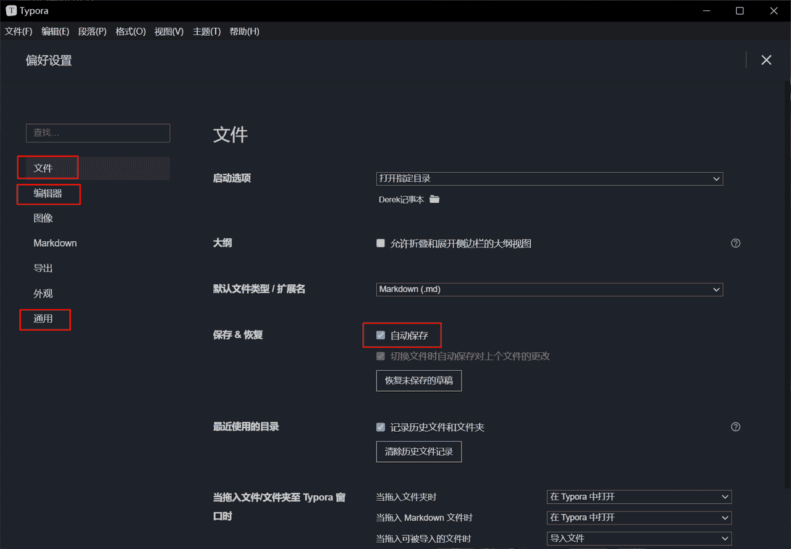
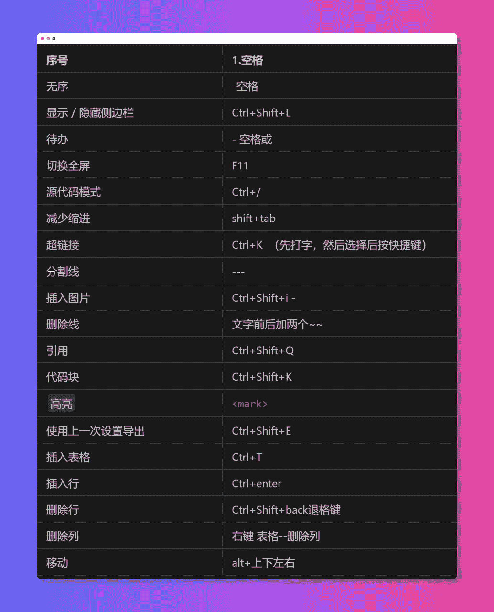
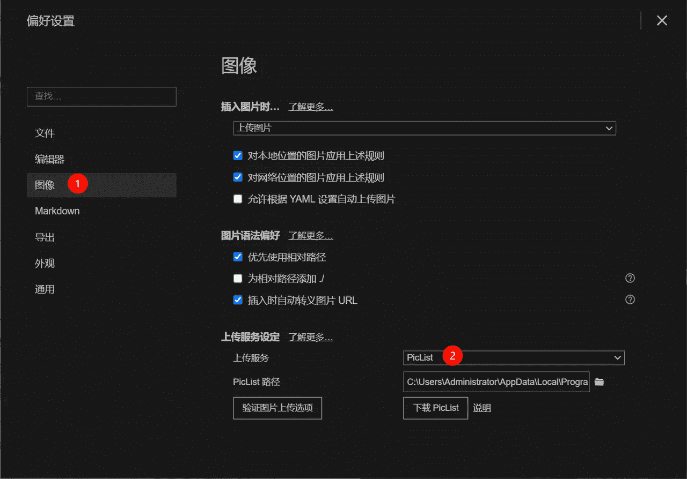
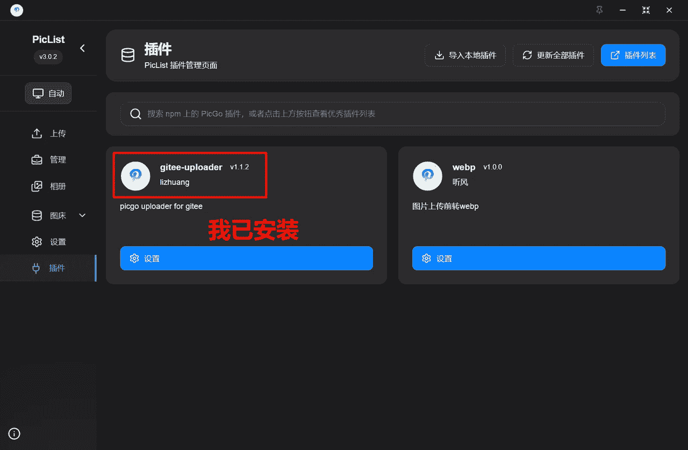
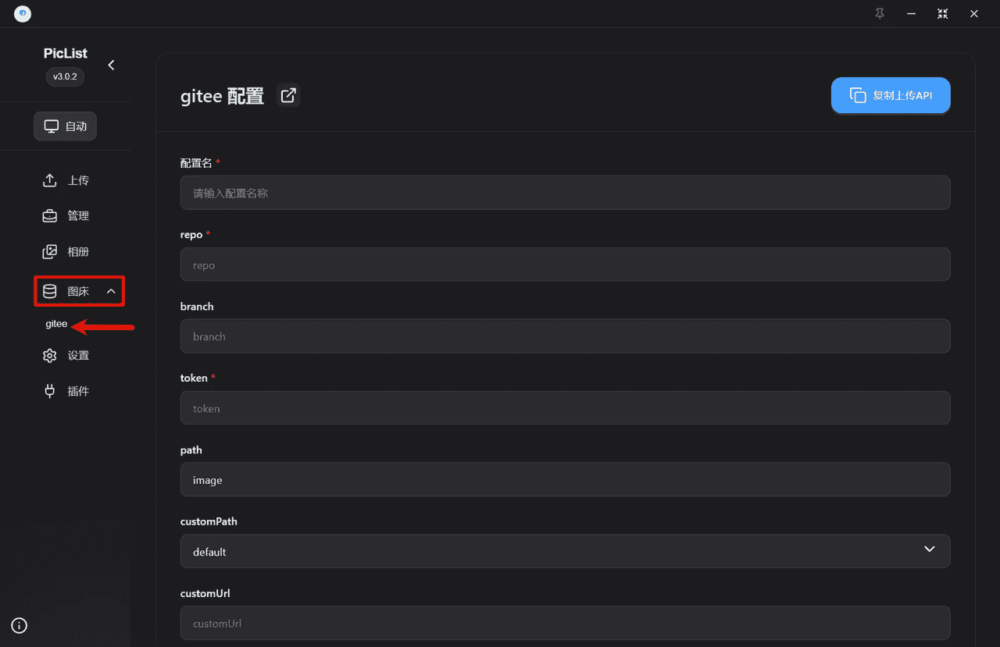
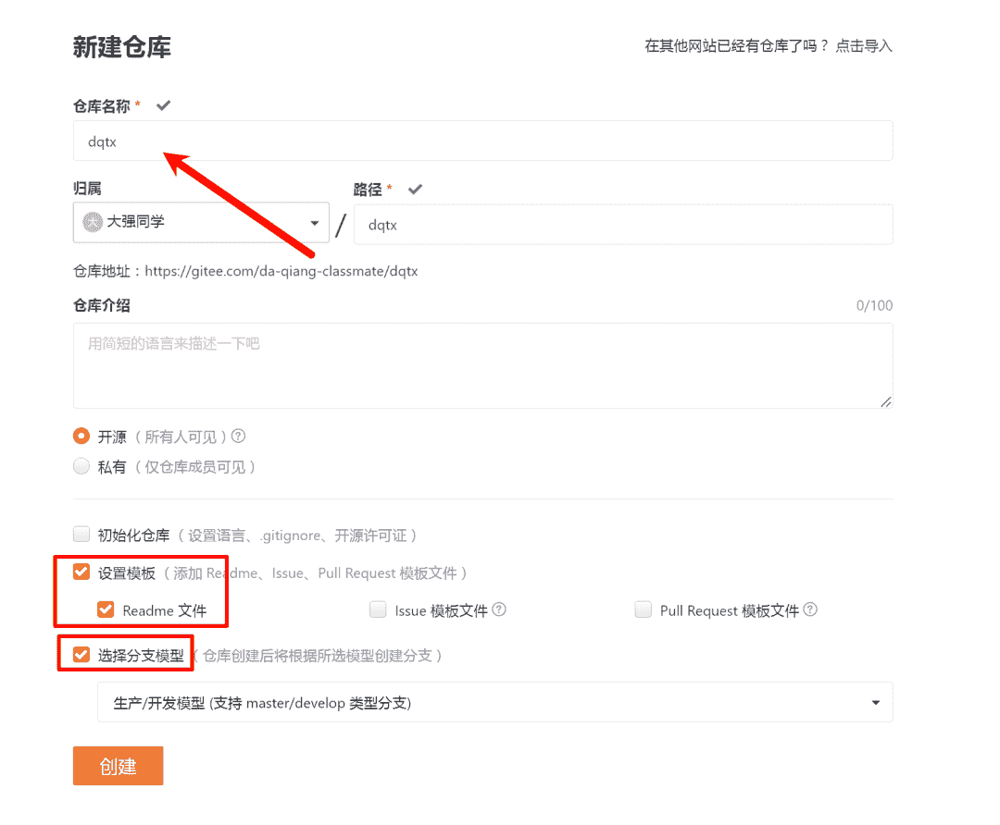
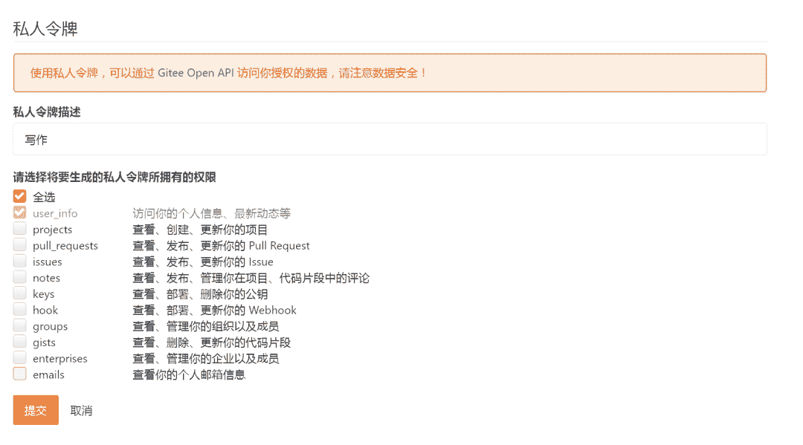
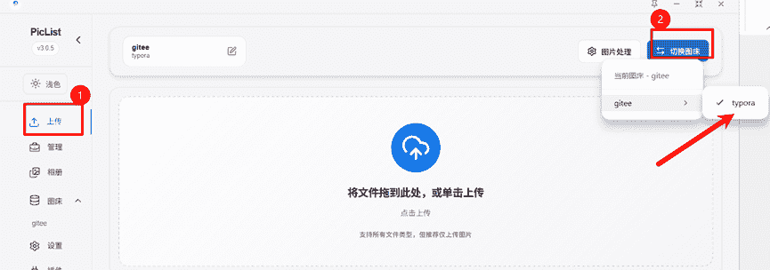

# Typora安装+激活教程

> 来源：[https://xodnytdcaw.feishu.cn/docx/XqRJddO2no4nwZx9PmHceJNhnUb](https://xodnytdcaw.feishu.cn/docx/XqRJddO2no4nwZx9PmHceJNhnUb)

## 一.安装激活

购买链接：[点此直达](https://xhslink.com/m/6WsMUhWP3yK)

赠品：[1](https://pan.quark.cn/s/1c73ead72301)[**6套主题包（下载**](https://pan.quark.cn/s/1c73ead72301)后打开会自动解压到主题文件夹目录） phycat主题

typora官方中文站：https://typoraio.cn/

## 二.软件设置

> 打开软件，文件，偏好设置

+   文件-启动选项/保存

+   编辑器-不使用拼写检查

+   通用-取消“自动检查更新”打勾



## 三.常用快捷键

### Markdown中创建待办事项列表

### Typora中使用Mermaid代码绘制流程图



## 四..图床配置

打开 **Typora**，依次进入 文件 → 偏好设置 → 图像，在上传服务中选择 **PicList**。

不过因为我们还没有安装 PicList，所以接下来需要先安装软件



### 4.1安装PicList

有两种方式可以安装：

1.**命令行安装**（推荐）

```
winget install Kuingsmile.PicList
```

1.  **安装包安装**

下载安装包后直接运行即可：

下载地址：[h](https://github.com/Kuingsmile/PicList/releases/tag/v3.0.6)ttps://github.com/Kuingsmile/PicList/releases/tag/v3.0.6

### 4.2安装插件（Gitee 图床支持）

PicList 默认没有内置 Gitee 图床，所以需要单独安装插件。打开 PicList，点击左侧 **插件，搜索 gitee 并安装。

> ⚠️注意：

> gitee插件版本：gitee-uploaderv1.1.2

> webp:v1.0.0  (安装这个插件可以压缩图片大小，从而解决mdnice排版后粘贴👸号不显示图片的问题，不过上传GIF图片就会变静态图片)



### 4.3配置插件

> 👋

+   配置名：随便起个名字，方便区分

+   repo：仓库名（如 用户名/仓库名）

+   branch：master 或主分支名

+   token：Gitee 生成的私人令牌

+   path：存放图片的目录（例如 image）

+   customPath：可选，自定义路径规则

TIPS：为了让界面更简洁，建议把用不到的图床隐藏，只保留 Gitee。

进入 **设置 → 上传**，往下找到 **“请选择显示在菜单的图床”**，取消勾选不需要的选项，只留下 Gitee。



打开 [Gitee 官网](https://gitee.com/) 注册并登录账号，点击右上角 **+号 → 新建仓库，**勾选 “设置模板” 与 “选择分支模型”按照下图示例完成仓库创建



之后点击个人头像，点设置-私人令牌，生成新令牌



### 4.4注意事项

##### 图片上传异常:配置完插件，点上传，切换图床，不然上传不了，

👋

常见上传不了错误检测

1.  插件安装的版本不对

1.  没有切换图床



##### 开启自启动/快捷键配置

设置-通用-启动和快捷键-设置快捷键

F1(ShareX截图)---双击自动复制----C trl +Shi f t +L（自动上传图传）


更多图床配置问题参考

[ht](https://www.bilibili.com/video/BV1z1vNzSEGH/?spm_id_from=333.1387.upload.video_card.click)tps://www.bilibili.com/video/BV1z1vNzSEGH/?spm_id_from=333.1387.upload.video_card.click

[https://mp.weixin.qq.com/s/hU](https://mp.weixin.qq.com/s/hU-KUUOTPW4Cer1sOpZaQA)-KUUOTPW4Cer1sOpZaQA

[https://blog.csdn.net/2402_82616859/article/details/145331736?fromshare=blogdetail](https://blog.csdn.net/2402_82616859/article/details/145331736?fromshare=blogdetail&sharetype=blogdetail&sharerId=145331736&sharerefer=PC&sharesource=2402_82616859&sharefrom=from_link)&sharetype=blogdetail&sharerId=145331736&sharerefer=PC&sharesource=2402_82616859&sharefrom=from_link

## 6.排版工具

### 排版工具

https://editor.mdnice.com/

https://editor.huasheng.ai/

https://wechat.bmpi.dev/

### 2.在线转图片网站

https://any2card.com/zh/create

https://md2card.com/zh/editor