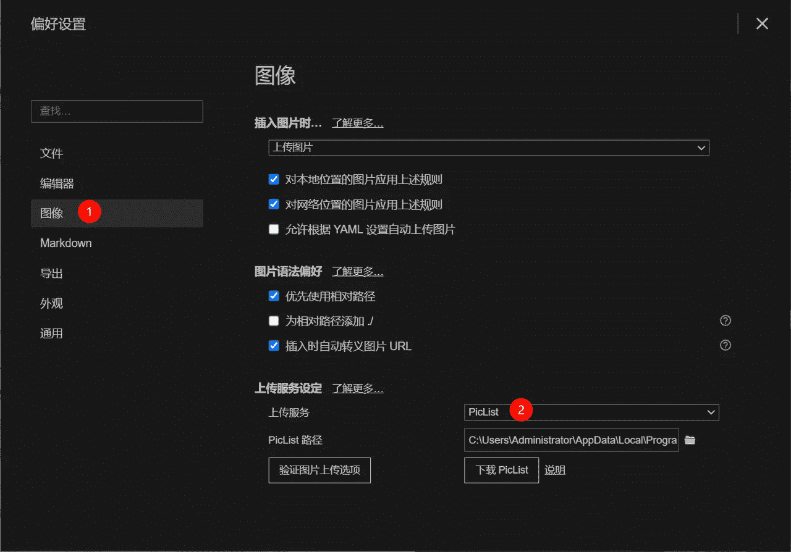
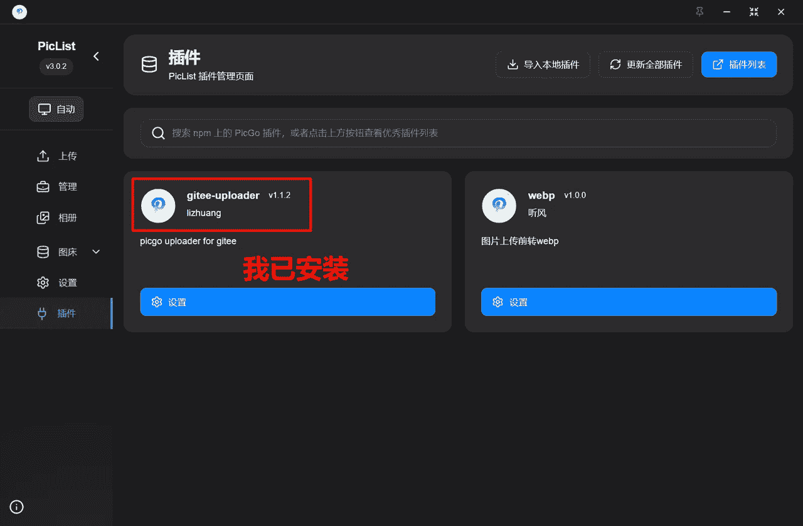
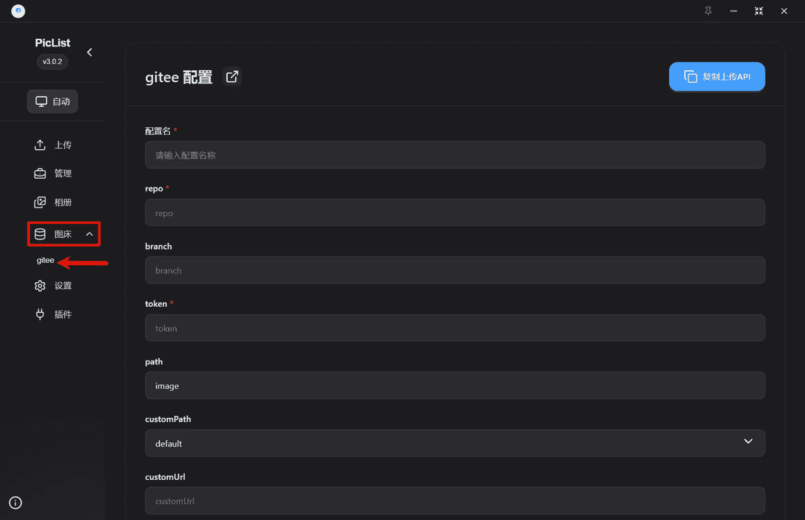
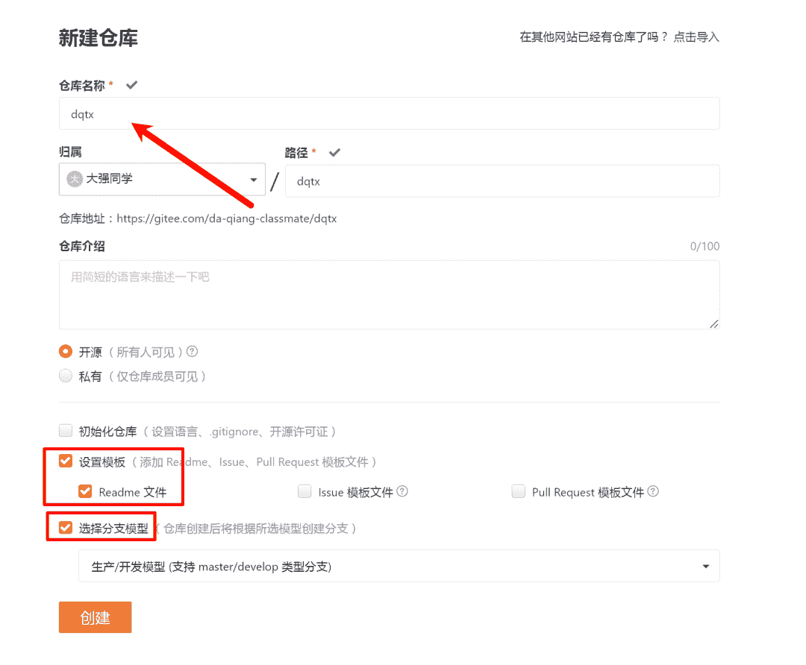
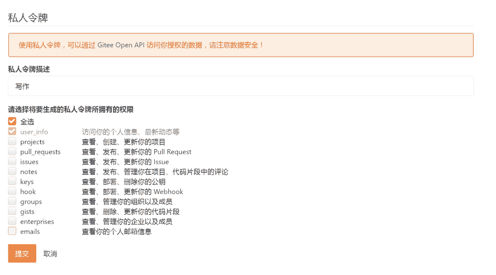
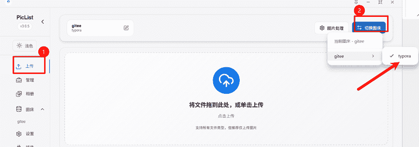

# Typora + PicList + Gitee 图床完整配置教程

> 来源：[https://xodnytdcaw.feishu.cn/docx/TwHvdmYA7oJ2pSxzqtucCYsKnvc](https://xodnytdcaw.feishu.cn/docx/TwHvdmYA7oJ2pSxzqtucCYsKnvc)

**如果你经常写**** Markdo**wn 文档，那么 Typora 是一款非常好用的编辑器。而在图片管理方面，推荐搭配免费的图床工具 PicList，它支持一键上传图片到各类图床。我自己的方案是：Typora + PicList + Gitee，写作体验非常流畅。

> 完整教程：https://www.kdocs.cn/l/coAvmzIKX92E

打开 **Typora**，依次进入 文件 → 偏好设置 → 图像，在上传服务中选择 **PicList**。

不过因为我们还没有安装 PicList，所以接下来需要先安装软件



### 安装PicList

有两种方式可以安装：

1.**命令行安装**（推荐）

```
winget install Kuingsmile.PicList
```

1.  **安装包安装**

下载安装包后直接运行即可：

下载地址：[h](https://github.com/Kuingsmile/PicList/releases/tag/v3.0.6)ttps://github.com/Kuingsmile/PicList/releases/tag/v3.0.6

### 安装插件（Gitee 图床支持）

PicList 默认没有内置 Gitee 图床，所以需要单独安装插件。打开 PicList，点击左侧 **插件，搜索 gitee 并安装。

> ⚠️注意：

> gitee插件版本：gitee-uploaderv1.1.2

> webp:v1.0.0  (安装这个插件可以压缩图片大小，从而解决mdnice排版后粘贴👸号不显示图片的问题，不过上传GIF图片就会变静态图片)



### 配置插件

+   配置名：随便起个名字，方便区分

+   repo：仓库名（如 用户名/仓库名）

+   branch：master 或主分支名

+   token：Gitee 生成的私人令牌

+   path：存放图片的目录（例如 image）

+   customPath：可选，自定义路径规则

>

> TIPS：为了让界面更简洁，建议把用不到的图床隐藏，只保留 Gitee。

> 进入 **设置 → 上传**，往下找到 **“请选择显示在菜单的图床”**，取消勾选不需要的选项，只留下 Gitee。



打开 [Gitee 官网](https://gitee.com/) 注册并登录账号，点击右上角 **+号 → 新建仓库，**勾选 “设置模板” 与 “选择分支模型”按照下图示例完成仓库创建



之后点击个人头像，点设置-私人令牌，生成新令牌



### 注意事项

##### 图片上传异常

> 常见上传不了错误检测

1.  插件安装的版本不对

1.  没有切换图床



##### 开启自启动/快捷键配置

设置-通用-启动和快捷键-设置快捷键

F1(ShareX截图)---双击自动复制----C trl +Shi f t +L（自动上传图传）


## 拓展：AWS S3--Cloudflare R2&全球CDN图床

文字教程：https://gdfr.dpdns.org/r2-guide/

视频教程：https://www.youtube.com/watch?v=vD6ns5UEETs