# VMware Pro 17安装黑苹果macOS15

> 来源：[https://xodnytdcaw.feishu.cn/docx/WZrFdfxo2o1dqvxaXLoczwMhnAd](https://xodnytdcaw.feishu.cn/docx/WZrFdfxo2o1dqvxaXLoczwMhnAd)

如果没有苹果电脑，却需要用macOS软件，又不方便借别人的，那就可以安装虚拟机版macOS，不影响原有Windows系统。本教程以VMware Pro 17安装macOS 15为例，从安装到操作都有详细截图，步骤清晰，跟着做基本都能成功。

## 1.下载

下载地址：

[h](https://pan.xunlei.com/s/VOaUEwbb7FobphNhKkiRXCzpA1?pwd=tfbx#)ttps://pan.xunlei.com/s/VOaUEwbb7FobphNhKkiRXCzpA1?pwd=tfbx#

## 2.安装VMware

选中“VMware_17.6.1-24319023_Setup.exe”这个文件，右键使用管理员身份运行

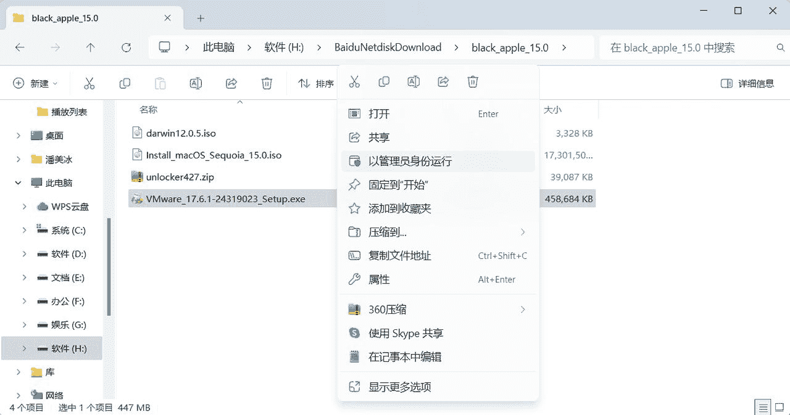

启动安装向导界面了，点击“下一步”按钮

**VMware17 激活许可证**

```
MC60H-DWHD5-H80U9-6V85M-8280D
JU090-6039P-08409-8J0QH-2YR7F
5Y012-8HL8P-0J8U0-032Q6-93KKF
```

## 3.安装Unlocker

### 关闭VMware相关进程

打开Windows系统的任务管理器，在进程里，把带VM开头的进程全部“结束任务”

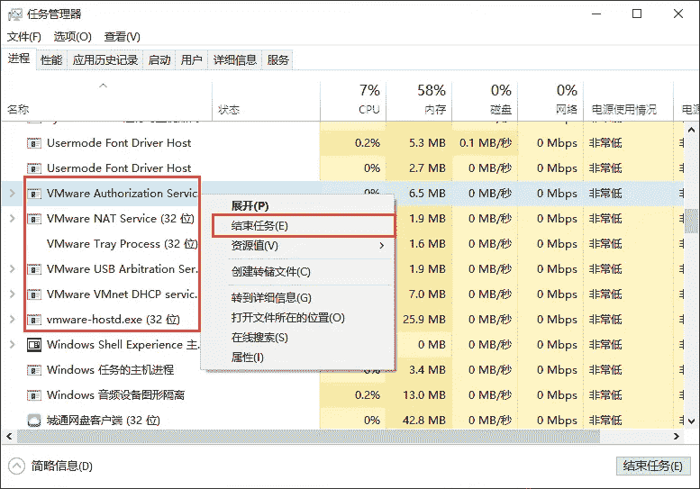

### 安装Unlocker

我们知道VMware默认是不支持引导macOS的，所以我们需要借助第三方的工具让它支持。把之前下载得到的“unlocker427.zip”文件解压，我这里是使用360压缩进行解压

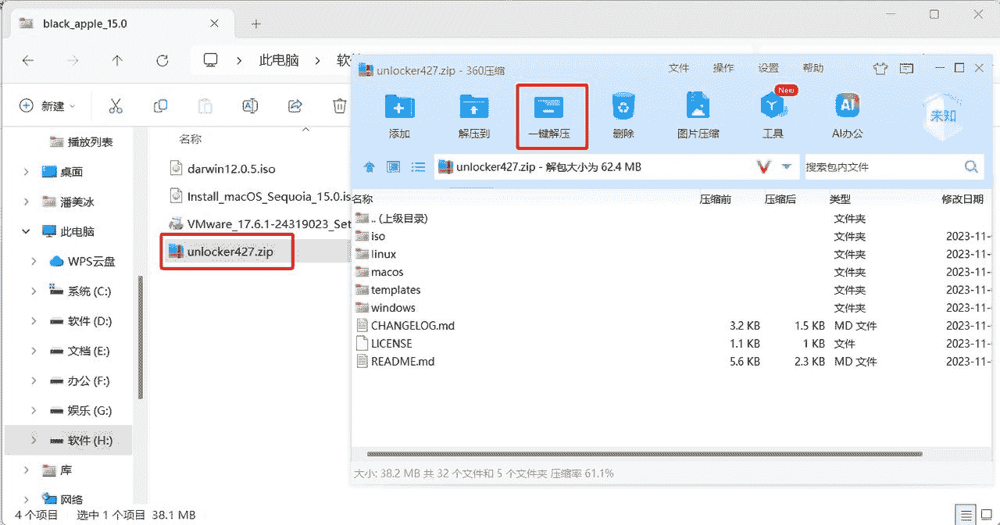

解压得到的文件中有个“windows”文件夹，该文件夹里面有个“unlock.exe”文件，选中它，右键，以管理员身份运行

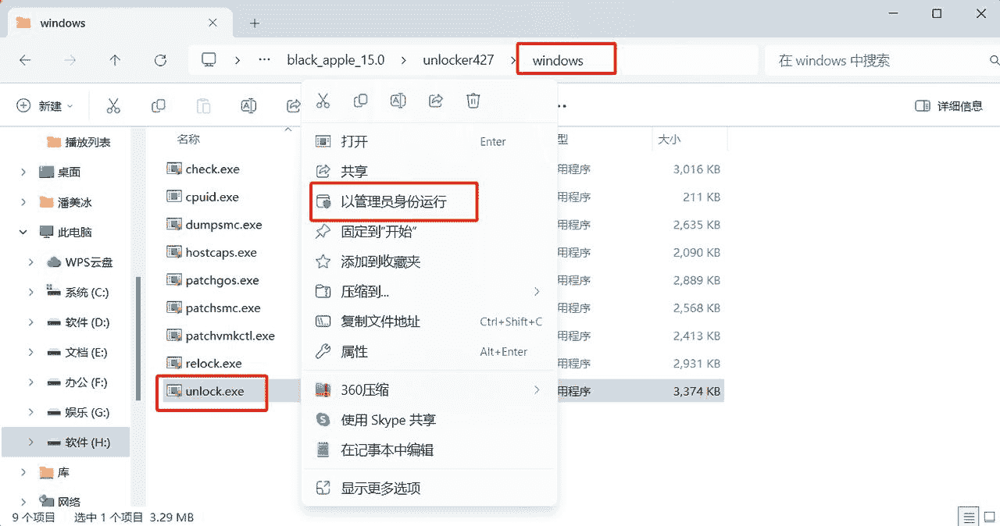

## 4.创建虚拟机

现在我们打开VMware，点击“创建新的虚拟机”按钮


选择“典型（推荐）”选项，点击“下一步”按钮

选择“稍后安装操作系统”，点击“下一步”按钮

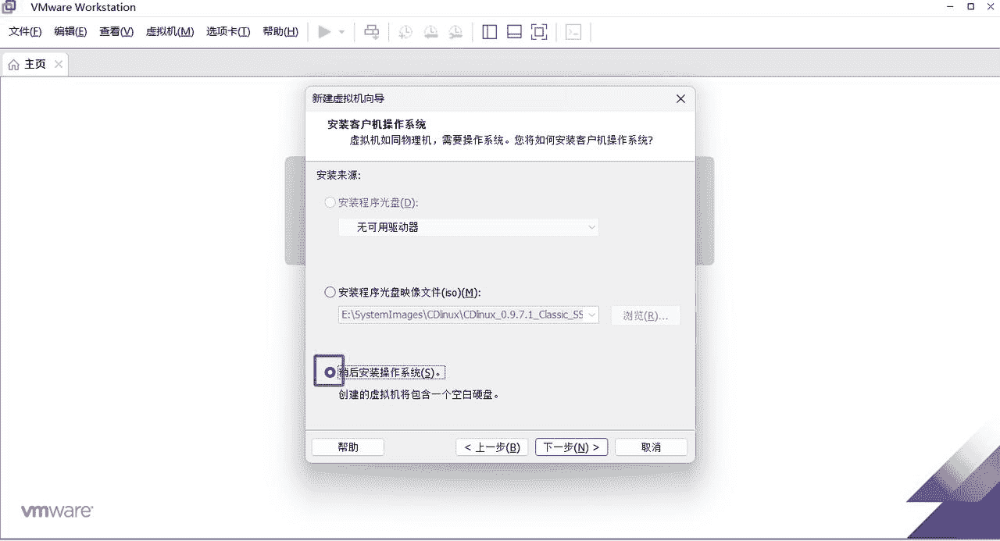

这里要选择“Apple macOS”，然后下拉选择“macOS 15”选项。如果你这里没有Apple macOS的引导项，说明你的Unlocker没有执行成功。

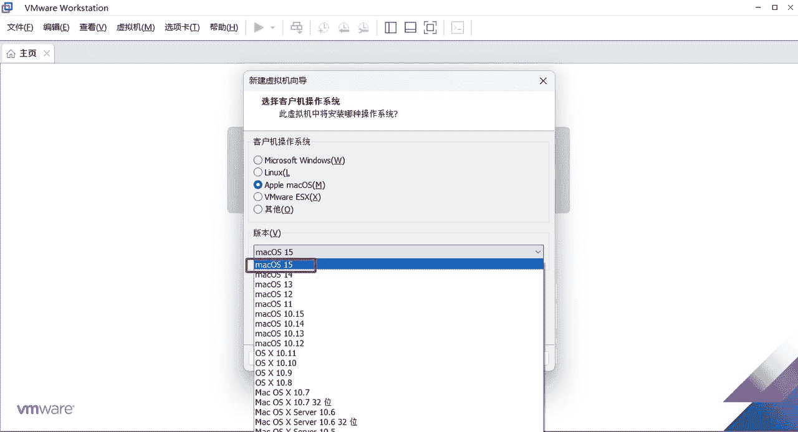

虚拟机的名称可以设置一下，然后虚拟机的位置记得要选择一个剩余空间比较大的盘，比如我这里把它放到H盘（建议路径中不要出现中文字符）

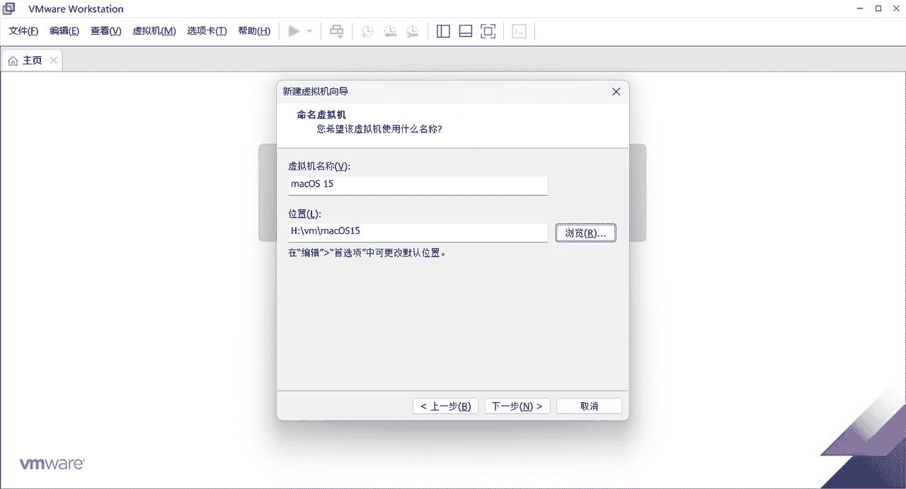

最大磁盘默认是80G，我这里把它改为了100G，建议设置大一点，它不会马上占用这些空间的，占用多少取决于你以后如何使用macOS里的硬盘。但是如果你现在设置的最大空间不够大，那以后就不好扩容了。还有就是要勾选“将虚拟磁盘存储为单个文件”，这样磁盘性能会更好。都设置好之后就点击“下一步”按钮

点击“自定义硬件”按钮。首先是设置内存，默认是设置4G，但是我的电脑运行内存比较大，所以我给它8G。这个内存设置得越大，你的macOS就越流畅，但是你的宿主机就会越卡，你可以根据自己的实际情况进行分配

现在点击“新CD/DVD（SATA）”选项，然后点击“使用ISO镜像文件”，点击“浏览”按钮，选中之前下载好的苹果镜像文件（也就是Install_macOS_Sequoia_15.0.iso），之后关闭自定义面板，再点击“完成”即可。可能我描述得不是很立体，具体操作步骤你可以参考一下我的截图

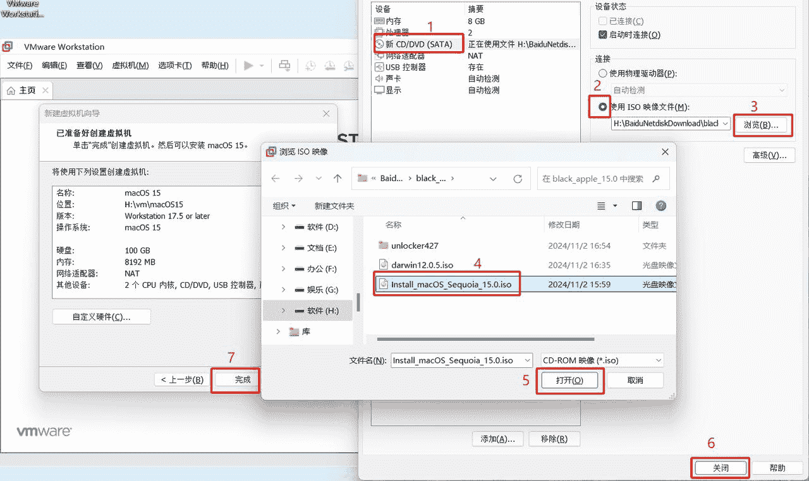

## 5.安装macOS 15

好了，硬件方面都已经设置好了，现在终于进入正题了，我们点击左边的“开启虚拟机”按钮启动虚拟机

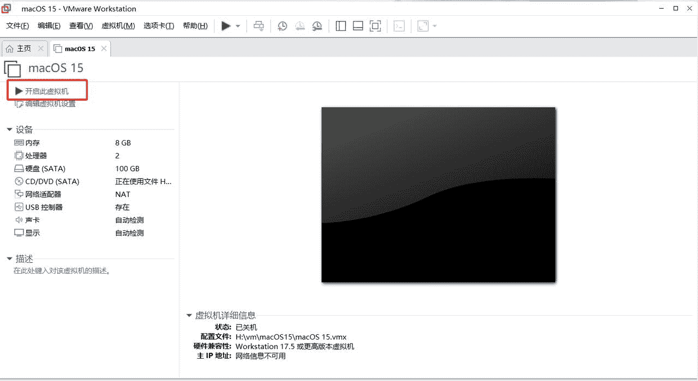

### 报错

> 插一嘴，我这里出现了意外

> vmx86驱动程序的版本不匹配

> 解决办法参考了不行，我重启就正常了

> https://blog.csdn.net/m0_52096807/article/details/128525668

不出意外的话，你现在已经看到了macOS的logo了

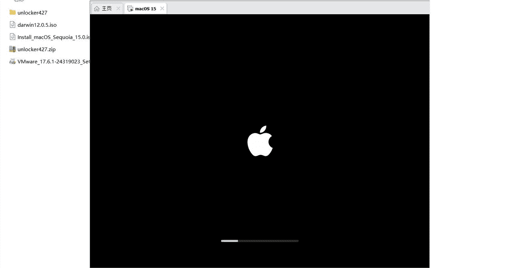

等进度条结束之后，就开始安装向导。首先是语言，选择“简体中文”，你可以根据自己的实际情况选择，选好后点击右下角的箭头按钮

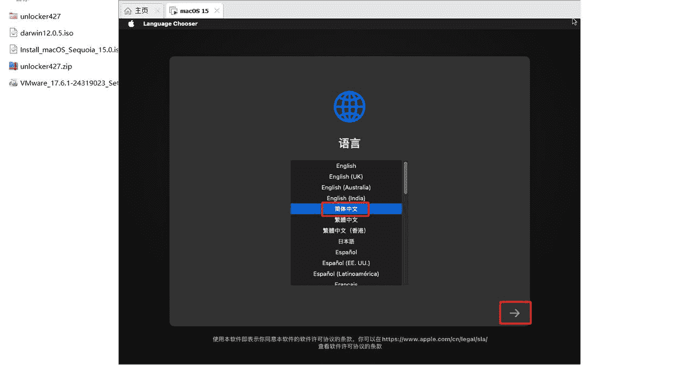

因为磁盘还没有格式化，所以现在点击“磁盘工具”，再点击“继续”按钮因为我们的磁盘还没有格式化，所以我们需要先处理一下，那现在点击“磁盘工具”，再点击“继续”按钮

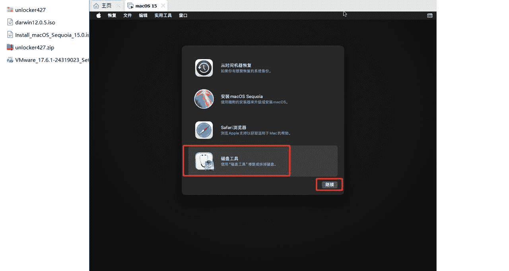

左边可能会列出多个挂载磁盘，一般最上面的那个写着“VMware Virtual”字样的就是虚拟机分配的磁盘了，你也可以根据它显示的磁盘大小进行判断。选中虚拟机的磁盘之后，直接点击“抹除”按钮

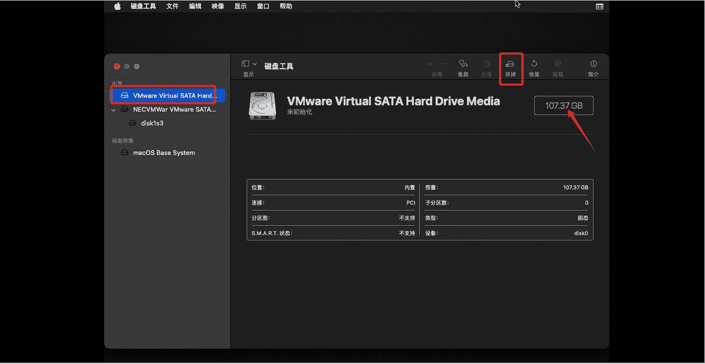

它会让你输入一个磁盘名称，随便输入一个英文名就行，格式和方案不要修改，直接点击“抹掉”按钮

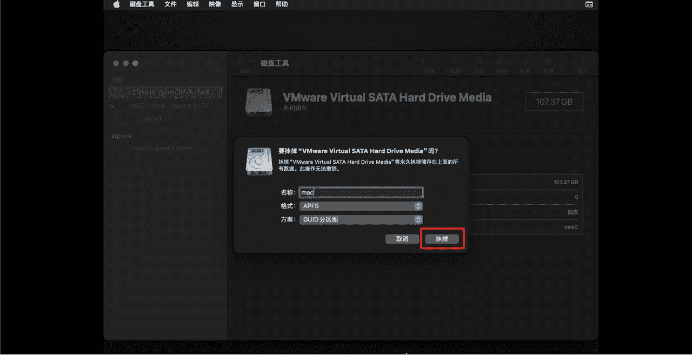

几秒之后它就操作成功了，先点击“完成”按钮

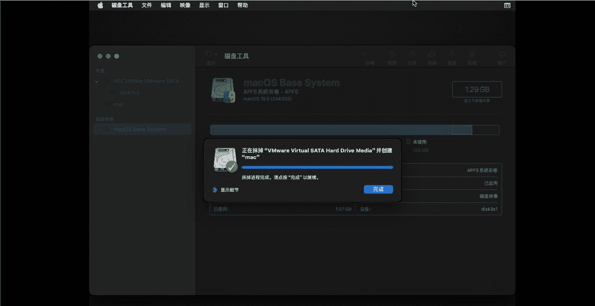

再点击左上角的红色按钮把这个界面关闭掉

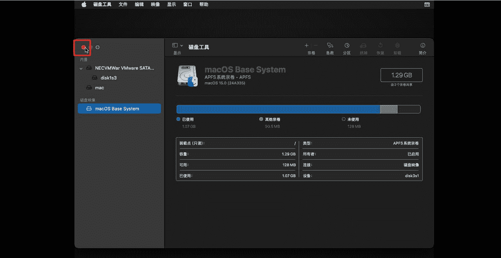

现在可以选择“安装macOS Sequoia”选项，再点击“继续”按钮

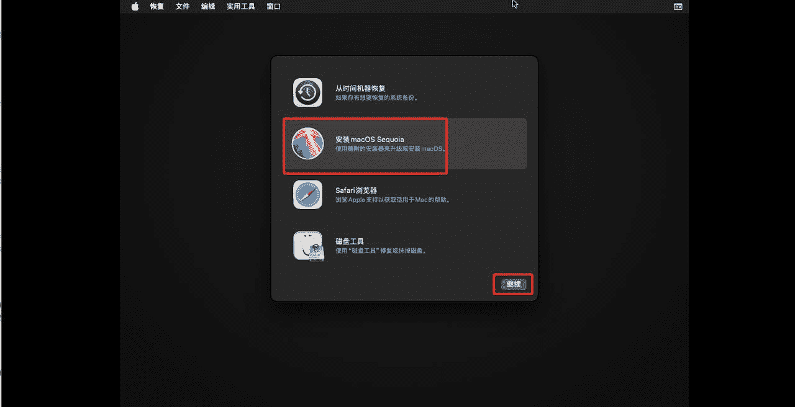

再次点击“继续”按钮


这里只能同意许可协议


这里要先选中中间的那个磁盘，才能点击“继续”按钮


到了这个界面就有得等了，虽然它显示需要二十多分钟，但我感觉好像不止，反正等了很久。因为这个过程会很消耗内存，所以建议整个过程不要动电脑，避免安装失败或者直接卡死

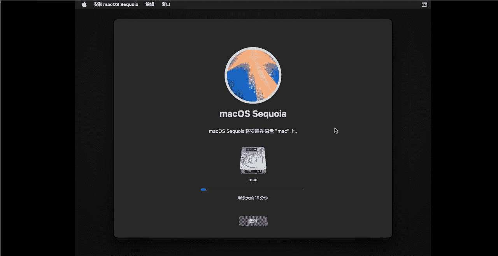

等它进度条结束之后会让你选择国家或地区，我这里选择“中国大陆”，再点击“继续”按钮


语言和输入法这里不用动，直接点击“继续”按钮


辅助功能可以先不开启（开启就更卡了），直接点击“以后”按钮


数据与隐私这里，直接点击“继续”按钮


迁移助理，点击左下角的“以后”按钮


账户登录，直接点击左下角的“稍后设置”按钮，再点击“跳过”按钮

条款与条件，只能同意啦


因为我们前面没有登录Apple账户，所以这里需要创建一个本地账户，建议用户名使用纯英文字符

服务定位，建议先不开启，避免占用资源，所以点击“继续”和“不使用”按钮


选择时区，你可以用鼠标点击那个地图，比如我这里点击了上海，时区会影响时间的显示，所以得选对了（当然后面我也会讲如何修改时区）


分析功能，建议取消勾选“与Apple共享Mac分析”选项，然后点击“继续”按钮


屏幕使用时间，为了节省性能资源，建议先不要开启，直接点击“稍后设置”按钮

外观，看你心情随便选择一个吧


现在终于进入到macOS 15的桌面了，但是你需要等一下，因为现在可能有点卡


等了一段时间之后，你可以试着动动鼠标，发现已经可以正常使用了，但是壁纸一直加载不出来，你也不用继续等了，因为显存过小，所以它默认的动态壁纸是永远也加载不出来的。为了不至于显示这么丑的白屏，我们可以打开设置选项，找一张图片壁纸给它换上

## 6.安装VMtools

虽然壁纸显示正常了，但是电脑依然是那么卡，我们看一下系统的信息，发现它才3M的图形缓存，不卡才怪

所以我们需要安装一下VMtools让它能识别更大的显存，而且安装VMtools还有其他好处，比如说可以让它自动适应桌面分辨率，还可以在宿主机之间随便拖拽传输文件

现在，我们让它关机

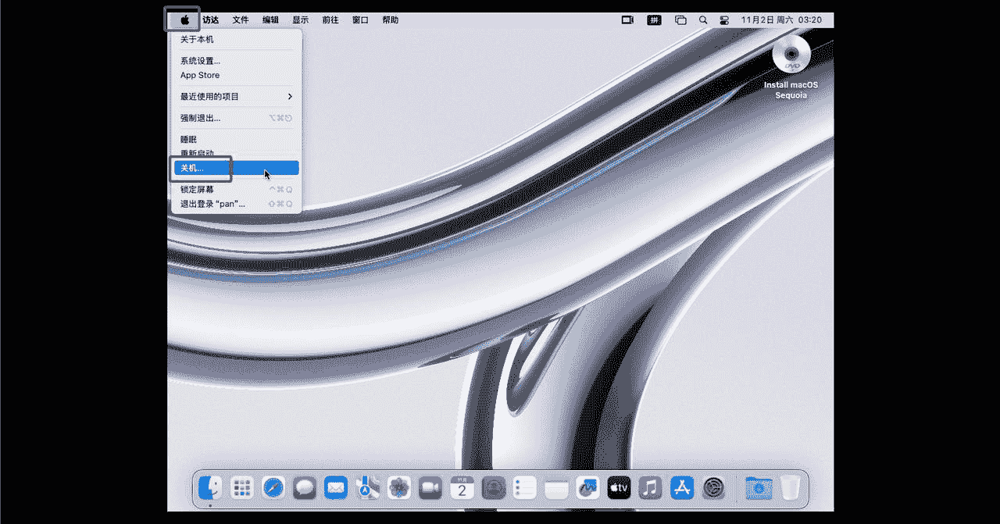

完全关机之后点击“编辑虚拟机设置”按钮，又回到自定义硬件的界面了，还是点击“CD/DVD （SATA）”选项，这次要把ISO镜像改为“darwin12.0.5.iso”这个文件了（可以参考我的截图），别忘了点击“确定”按钮

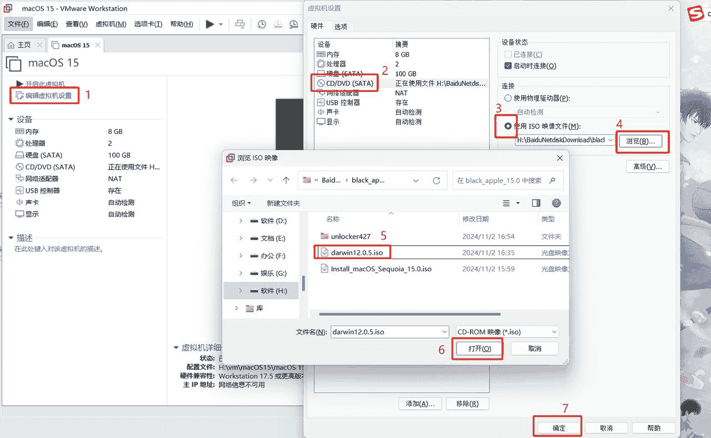

现在再次启动虚拟机，进入macOS之后，发现桌面右上角已经加载了“VMware Tools”了，双击打开它，再双击“安装VMware Tools”按钮就可以启动安装向导了，第一个界面就点击“继续”按钮

选择“为这台电脑上的所有用户安装”，再点击“继续”按钮

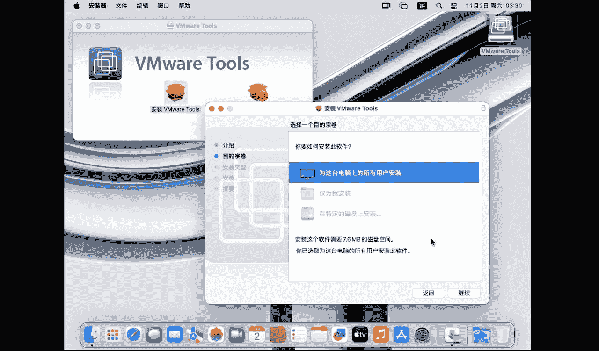

在macOS安装软件一般不需要修改安装路径，直接点击“安装”按钮

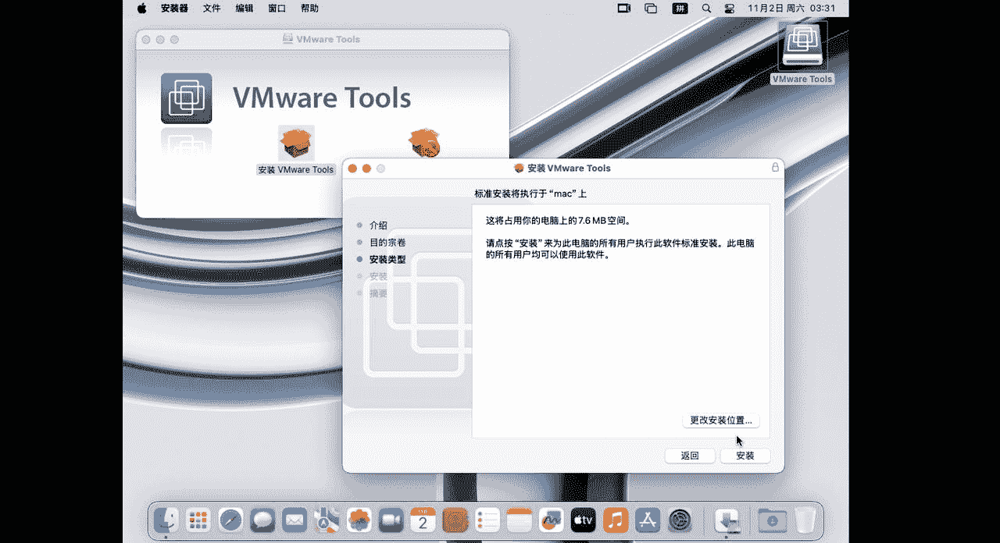

它会让你输入你的账户密码，也就是你创建账户的时候设置的那个密码，再点击“安装软件”按钮

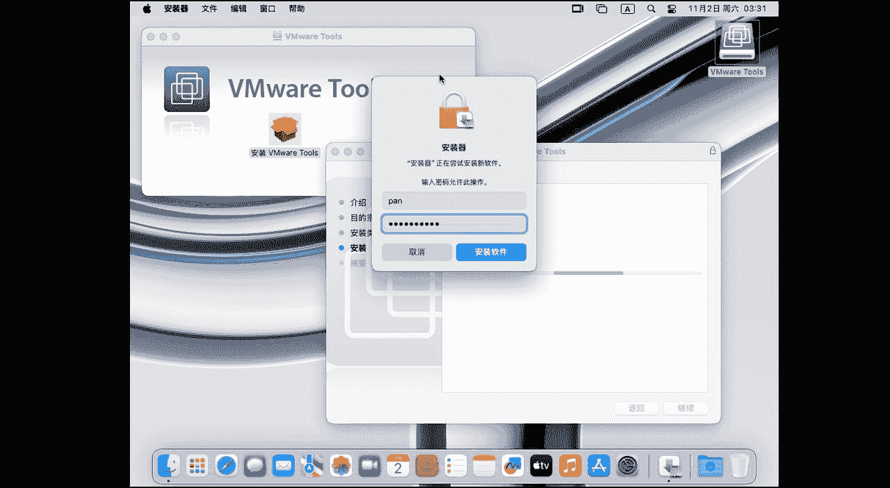

如果安装过程出现各种提示，肯定都是选择“允许”。还有就是，可能会提示“系统扩展已被阻止”，那就点击“打开系统设置”按钮

在系统的隐私与安全性这边可以看到“来自开发者XXX已被阻止载入”（可以参考一下我的截图），那我们要点击“允许”按钮

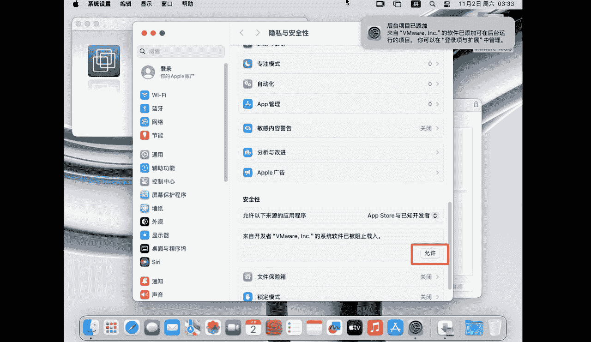

然后它会再次让你输入你的账户密码

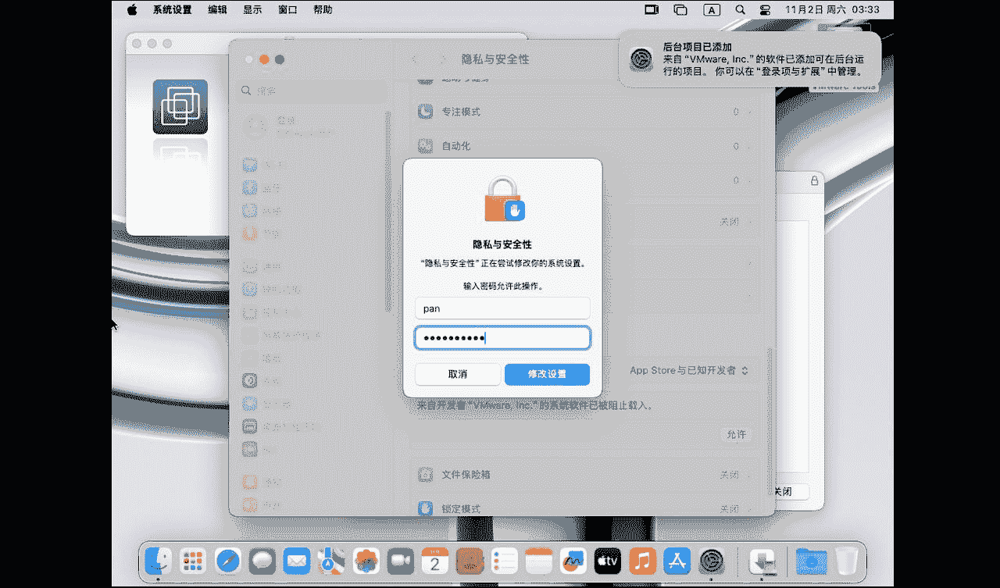

如果它提示你需要重新启动那就重新启动吧

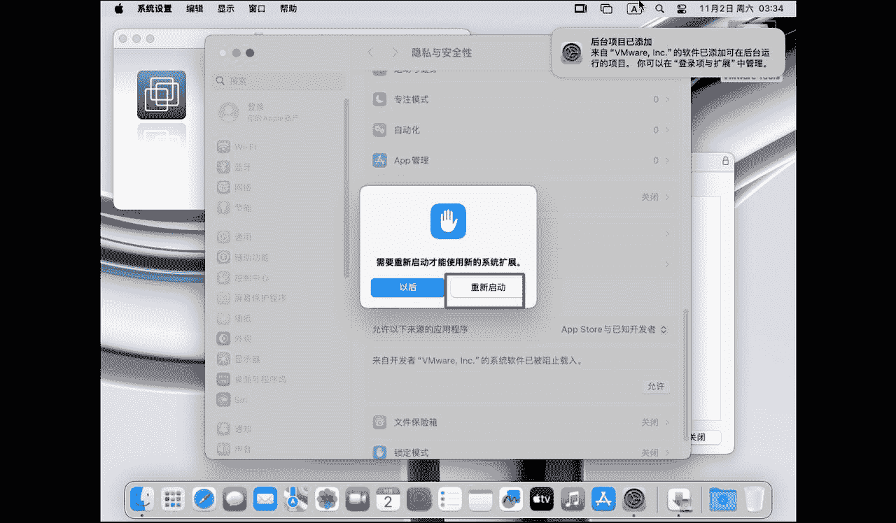

如果提示安装失败了，不要慌，重来一次就好，有了第一次授权之后第二次安装就可以轻松完成

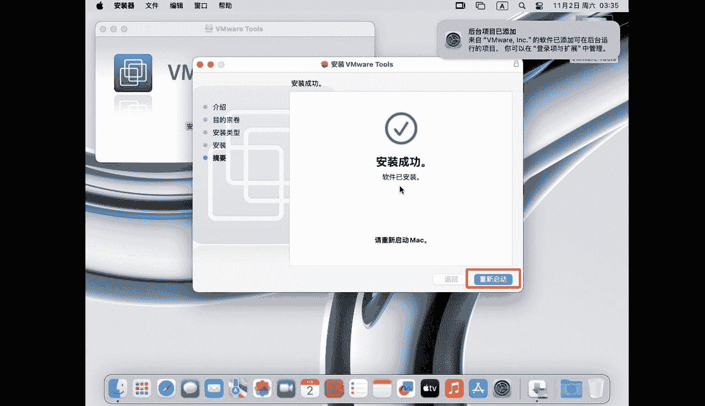

如果你不点“重新启动”按钮，你也可以自己手动关机，然后再打开虚拟机设置这里，把“CD/DVD（SATA）”这里的“启动时连接”这个选项取消勾选，不然它每次进入macOS都会加载指定的镜像

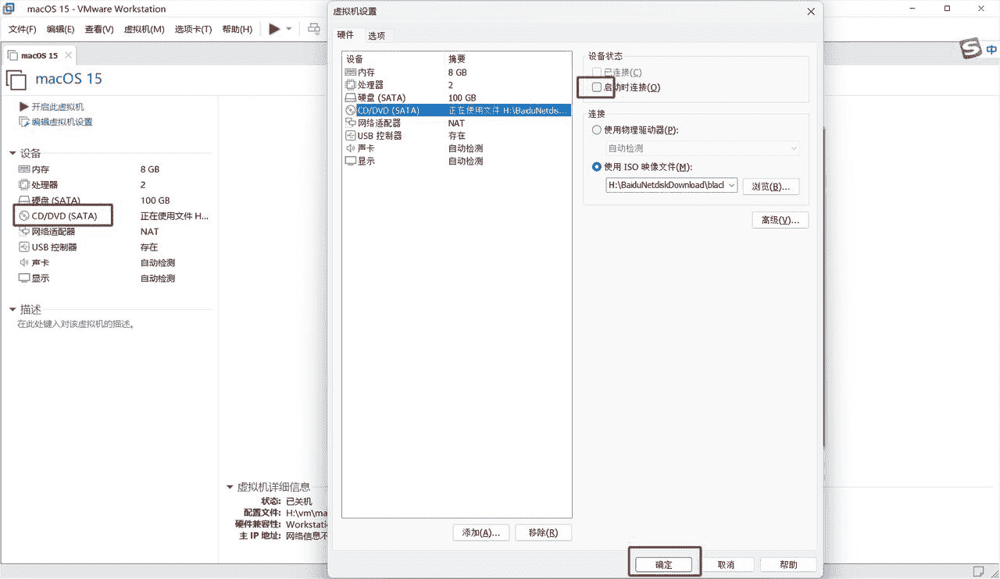

现在启动macOS之后，再次查看图形显存，发现这次已经达到128M了，虽然还是小得可怜，但是起码没有那么卡了，当然你也可以进入设置，把一些动作特效什么的都关闭，这样可能会更流畅点

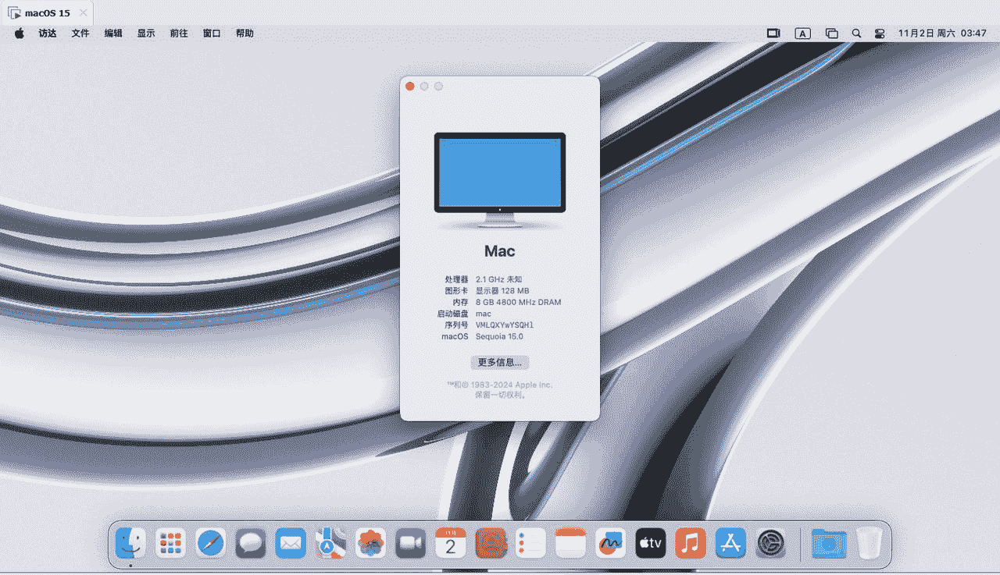

可能有些同学会发现macOS显示的时间不对，那可能是之前的时区没有选对，你可以打开系统设置，在“通用”里面找到“最接近的城市”，把它改为中国的城市就行

现在各种功能都是正常的，网络也是正常的，我们可以打开浏览器看看

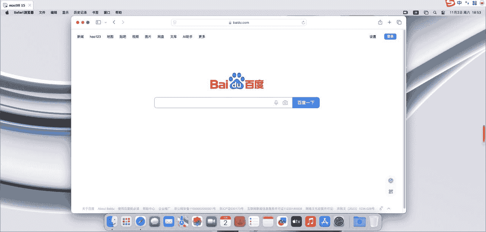

OK，整个安装过程已经结束了，你可以自己探索一下macOS 15哈哈

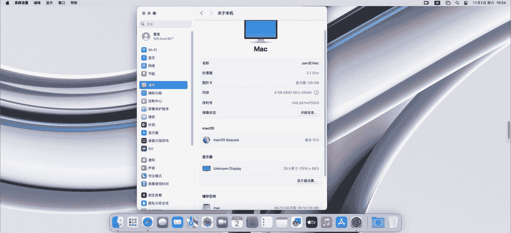

## 写在最后

尽管通过上述步骤，你已经在VMware成功安装了黑苹果，但是我使用下来，有两个问题，一个是你去App Store下载软件，登录ID后提示“发生未知错误”，还是就是你从Windows物理机拖动文件进去，需要从右下角出去再进来才行。

附：本文转自 [h](https://blog.csdn.net/qq_39147299/article/details/143466305)ttps://blog.csdn.net/qq_39147299/article/details/143466305

做了些无效文字的删减改动，如有侵权，请联系删除。