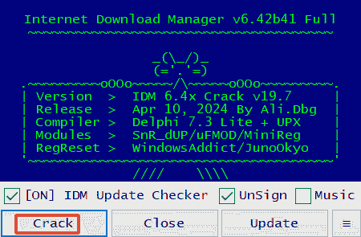
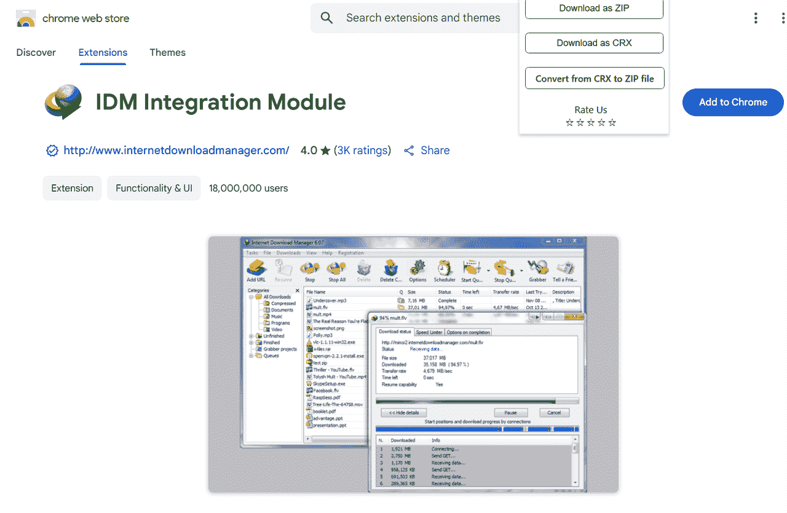
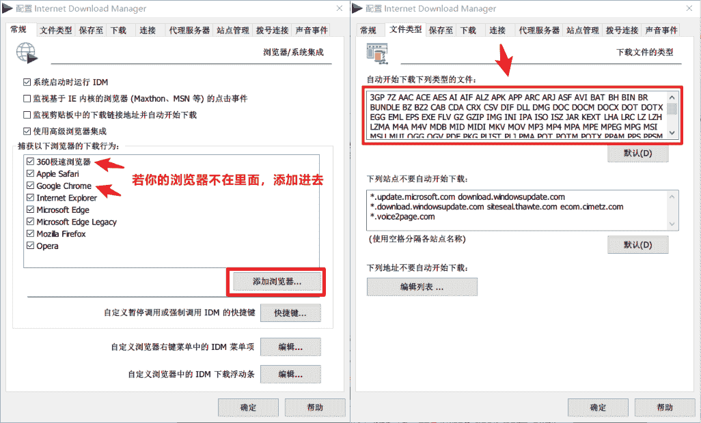
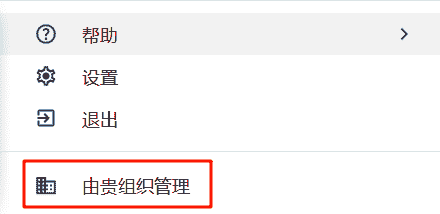
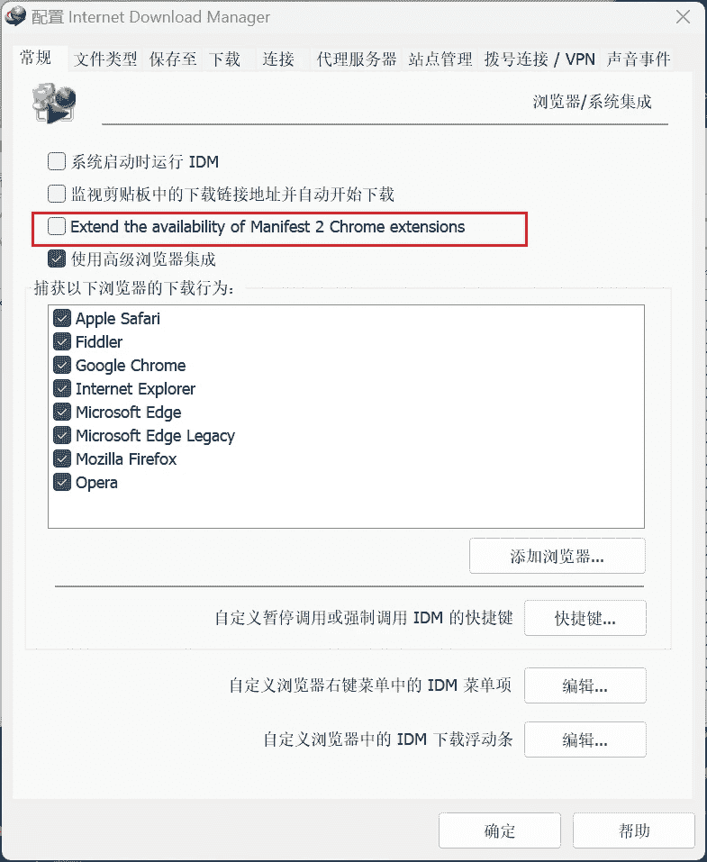
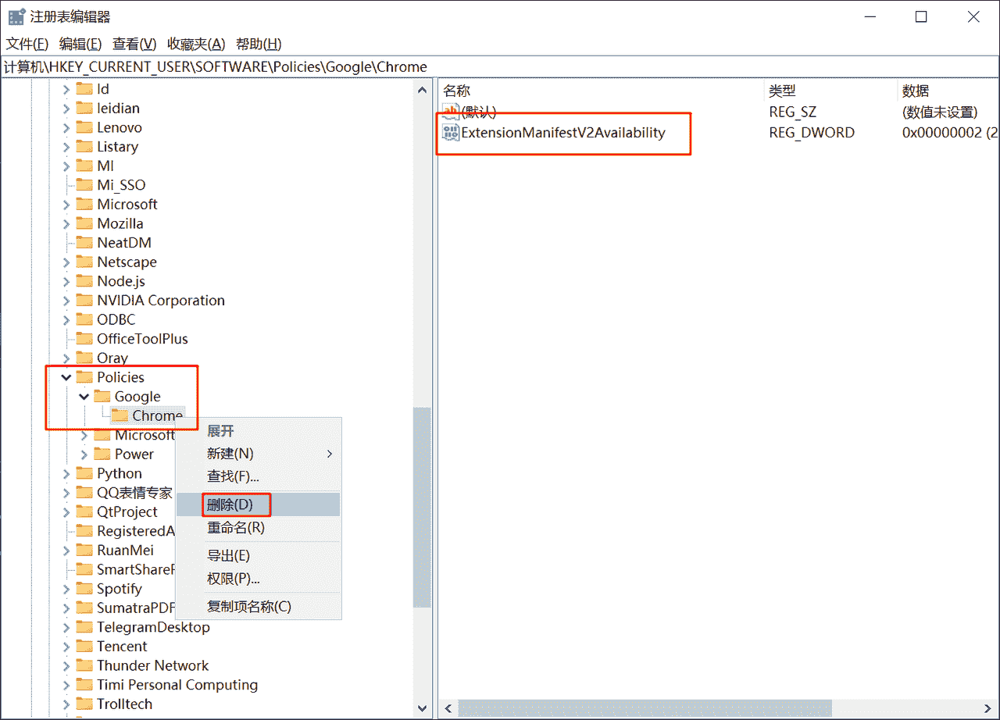
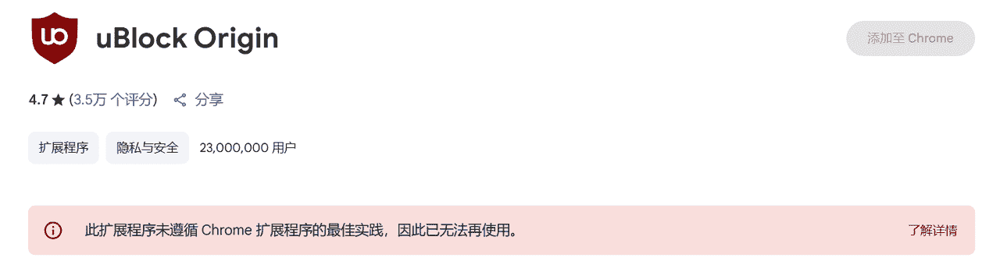

# IDM下载工具激活教程

> 来源：[https://xodnytdcaw.feishu.cn/docx/YrUAdLUa3osIGXxjOhycwHF1nZb](https://xodnytdcaw.feishu.cn/docx/YrUAdLUa3osIGXxjOhycwHF1nZb)

> [稳定梯子推荐 Co](https://www.kdocs.cn/l/:https://cokecloud.buyzur.com/#/register?code=L2FOV7Yb)keCloud ：点此注册试用1小时

> 全线路解锁流媒体，同IP下不限设备，自用2年，相当稳定

## 一.软件安装

官方正版下载地址： [点此下载](https://mirror2.internetdownloadmanager.com/idman642build36.exe)

安装完成后，打开任务管理器，把idm结束掉

## 二.软件激活

### 方式一：命令激活（需科学上网）

先输入1 ，之后输入 9

```
iex(irm is.gd/idm_reset)  
```

### 方式二：补丁激活

管理员身份打开激活补丁 [点击下载](https://pan.xunlei.com/s/VOY7D0CnkcoBobh3Az0dqEOPA1?pwd=z5be#)（点击蓝色字体下载，建议先关闭杀毒软件）

点击“Crack”



再次打开软件，点击注册可看到已经终身许可

## 三.软件设置

### 1.浏览添加拓展

> 一般插件会自动添加，如果不能自动添加手动方式如下

idm官方插件地址：[点击安装](https://chromewebstore.google.com/detail/idm-integration-module/ngpampappnmepgilojfohadhhmbhlaek)

插件打包工具：[点击安装](https://chromewebstore.google.com/detail/crx-extractordownloader/ajkhmmldknmfjnmeedkbkkojgobmljda?hl=zh-CN&utm_source=ext_sidebar)



在安装文件夹找到对应的拓展程序，拖到页面chrome://extensions/

chrome浏览器：IDMGCExt.crx

Edge浏览器：IDMEdgeExt.crx

### 2.添加文件类型

IDM 默认列表支持文件类型较少，可以点击下面的复制按钮覆盖更多常见后缀名，可以直接覆盖 IDM 的配置，修改完成后记得重启 IDM



```
3GP 7Z AAC ACE AI AIF ALZ APK APP APPX APPXBUNDLE ARC ARJ ASF AVI BH BIN BR BUNDLE BZ BZ2 CDA CSV DIF DLL DMG DOC DOCX EGG EPS EXE FLV GZ GZIP IMG IPA ISO ISZ JAR KEXT LHA LZ LZH LZMA M4A M4V MDB MID MKV MOV MP3 MP4 MPA MPE MPEG MPG MSI MSIX MSIXBUNDLE MSU MUI OGG OGV PDF PKG PPT PPTX PSD PST PUB QT R0* R1* RA RAR RM RMVB RTF SEA SIT SITX SLDM SLDX TAR TBZ TBZ2 TGZ TIF TIFF TLZ TXZ UDF VOB VSD VSDM VSDX VSS VSSM VST VSTM VSTX WAR WAV WBK WIM WKS WMA WMD WMS WMV WMZ WP5 WPD WPS XLS XLSX XPS XZ Z ZIP ZIPX ZPAQ ZSTD
```

### 3.最大链接数

## 三.常见问题

### 3.1由贵组织管理解决方法



**相关说明**

chrome://policy

[https://chromeenterprise.google/policies](https://chromeenterprise.google/policies/?policy=ExtensionManifestV2Availability)/?policy=ExtensionManifestV2Availability

**解决办法**

方法一：IDM选项里，取消这个项目打勾☑️



方法二：注册表删除

按下键盘上的 Win + R 组合键，输入regedit，定位如下图位置，选中chrome右键删除

```
计算机\HKEY_CURRENT_USER\SOFTWARE\Policies\Google\Chrome
计算机\HKEY_LOCAL_MACHINE\SOFTWARE\Policies\Google\Chrome
```



### 3.2 chrome138.0.7204.158版本问题汇总

#### IDM插件：[点此下载](https://www.kdocs.cn/l/%E7%82%B9%E6%AD%A4%E4%B8%8B%E8%BD%BD)

#### uBlock无法安装



PowerShell管理员命令运行后再去安装即可

```
Chrome v2
$path = &quot;registry::HKEY_LOCAL_MACHINE\SOFTWARE\Policies\Google\Chrome&quot;; New-Item $path -Force; Set-ItemProperty $path -Name ExtensionManifestV2Availability -Value 2
```

[Ch](https://www.bilibili.com/video/BV1g4u2z9EL5/?spm_id_from=333.337.search-card.all.click&vd_source=206031f494850e57fd6c92ace02b1bed)rome 139 禁用了对 Manifest V2 的支持 参考

启用 Enabled

chrome://flags/#temporary-unexpire-flags-m137

禁用 Disabled

chrome://flags/#extension-manifest-v2-deprecation-warning

chrome://flags/#extension-manifest-v2-deprecation-disabled

chrome://flags/#extension-manifest-v2-deprecation-unsupported

## 四.赠品：

文件查找Listary绿色版

链接：[h](https://pan.xunlei.com/s/VOQwLGfNItbnbc5mpr_iA5aGA1?pwd=6ivu#)ttps://pan.xunlei.com/s/VOQwLGfNItbnbc5mpr_iA5aGA1?pwd=6ivu#

AI照片换脸

链接：[h](https://pan.xunlei.com/s/VOQwM3jjz4poWL4tcQVyl21LA1?pwd=qm7m#)ttps://pan.xunlei.com/s/VOQwM3jjz4poWL4tcQVyl21LA1?pwd=qm7m#

我的远程业务

[https://xodnytdcaw.feishu.cn/wiki/ZOeHwecXHih](https://xodnytdcaw.feishu.cn/wiki/ZOeHwecXHihm0fkgdzcck8TCnPb?fromScene=spaceOverview)m0fkgdzcck8TCnPb?fromScene=spaceOverview

# 花瓣测速 v4.9.0.119 华为内置测速免费无广

Ookla Speedtest这款测速软件确实非常好用，准确性高是用户对它最多的评价，但是也有很多人认为它逐渐不适合国内网络环境。

一款集成移动网络和WIFI网络上传、下载以及诊断功能的专业测试工具——花瓣测速，是华为手机自带的APP。免费无广告，界面简单易用、网络测试精准，支持自动定位/手动选择测试服务器、测试速度快是这款测速软件的特点。

下载链接：https://pan.xunlei.com/s/VOVuPAHpTfWQUQKogbsOeTsEA1?pwd=wz3i#