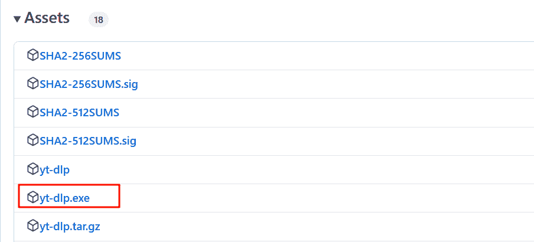
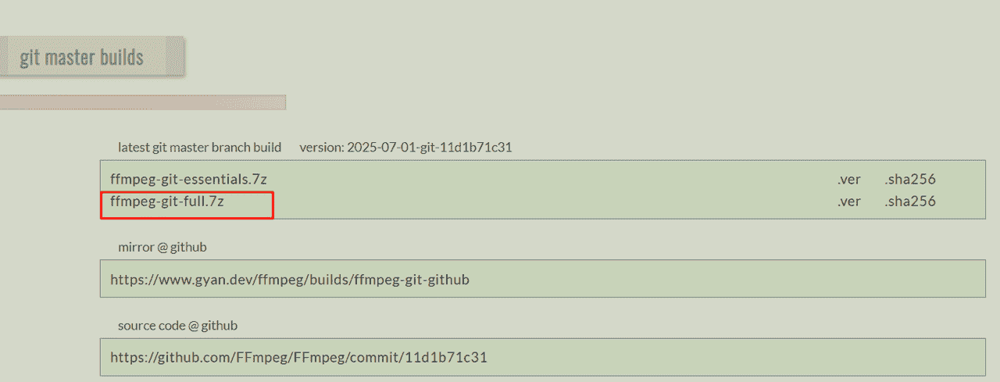
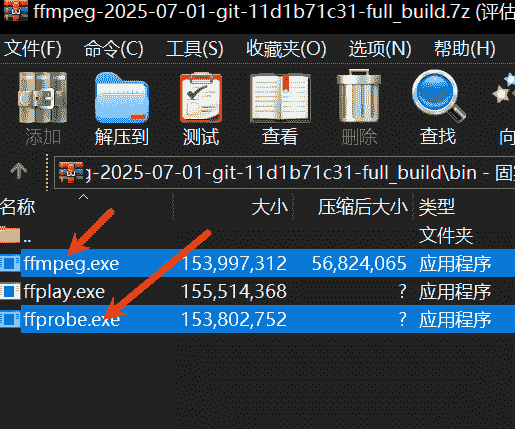
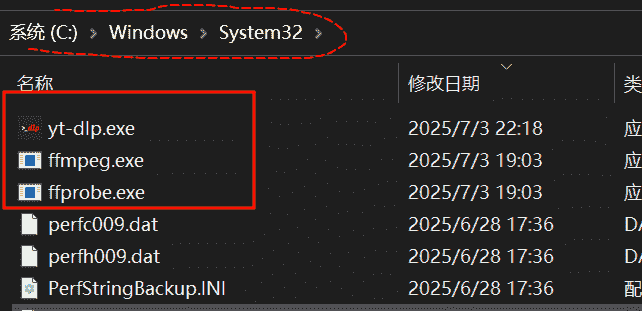
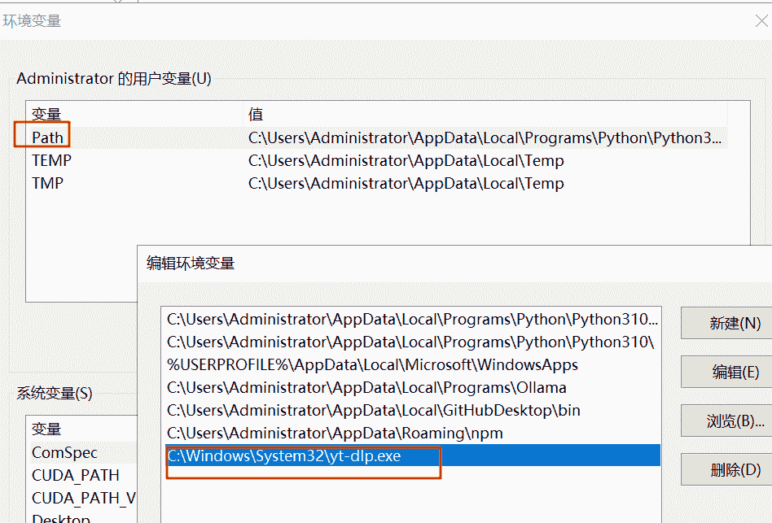

#  yt-dlp命令行下载视频

> 来源：[https://xodnytdcaw.feishu.cn/docx/SDJrdl03UohRVbxEFnEcNMW4n0b](https://xodnytdcaw.feishu.cn/docx/SDJrdl03UohRVbxEFnEcNMW4n0b)

## 1.软件配置

1.yd-dlp:[点此直达](https://github.com/yt-dlp/yt-dlp/releases/tag/2025.06.30)



2.ffmpeg： [点此直达](https://www.gyan.dev/ffmpeg/builds/)



解压BIN文件夹下面的两个文件



3，复制如下图3个文件到下面路径C:\Windows\System32，然后复制路径



添加环境变量（win+Q搜“高级系统”，进去后点击环境变量，找到Path-新建-粘贴C:\Windows\System32\yt-dlp.exe）



## 2.软件使用

+   安装插件：[Get cookies](https://chromewebstore.google.com/detail/get-cookiestxt-locally/cclelndahbckbenkjhflpdbgdldlbecc?hl=zh-CN&utm_source=ext_sidebar)

+   右键cmd集成脚本： [点击下载](https://wwzq.lanzouq.com/iKfBg307p8ze)

#### 默认分辨率下载

```
yt-dlp 视频URL
```

#### 高清下载

```
yt-dlp --cookies cookies.txt 视频下载
yt-dlp --cookies &quot;D:\web3\cookies.txt&quot; 视频URL
```

#### 直接下载最高分辨率+最佳音质（自动合并 MP4）

```
yt-dlp -f &quot;bestvideo+bestaudio&quot; --merge-output-format mp4 &quot;视频URL&quot;
```

####  只下载视频和音频，不要字幕

```
yt-dlp -f bestvideo+bestaudio --merge-output-format mp4 --no-write-subs &quot;视频链接&quot;
```

#### **自定义文件名**

```
yt-dlp -f &quot;bestvideo+bestaudio&quot; --merge-output-format mp4 -o &quot;%(title)s.%(ext)s&quot; &quot;视频URL&quot;
```

使用 Cookie 下载（跳过年龄认证）

```
yt-dlp --cookies &quot;路径/cookies.txt&quot; -f &quot;bestvideo+bestaudio&quot; --merge-output-format mp4 &quot;视频URL&quot;
```

yt-dlp --cookies "D:\web3/cookies.txt" -f "bestvideo+bestaudio" --merge-output-format mp4 "视频URL"