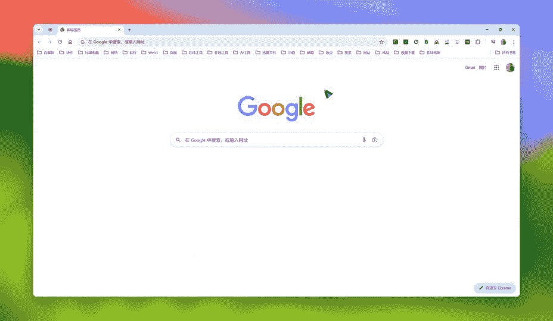
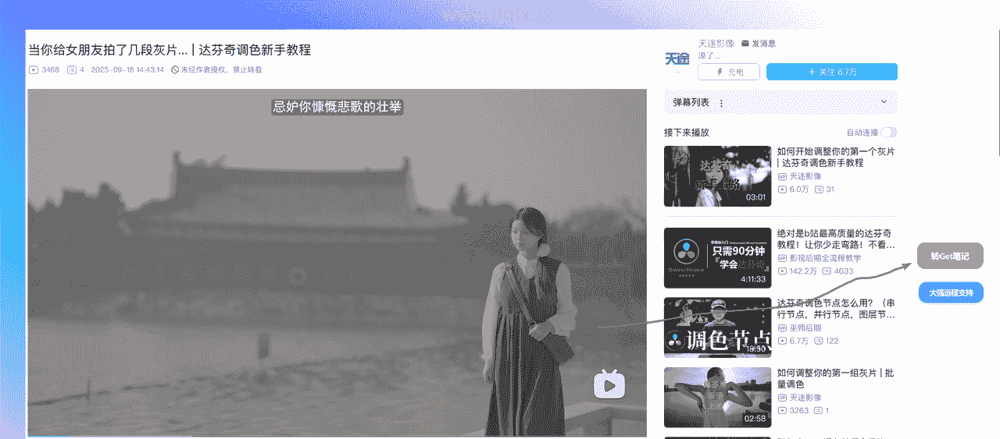
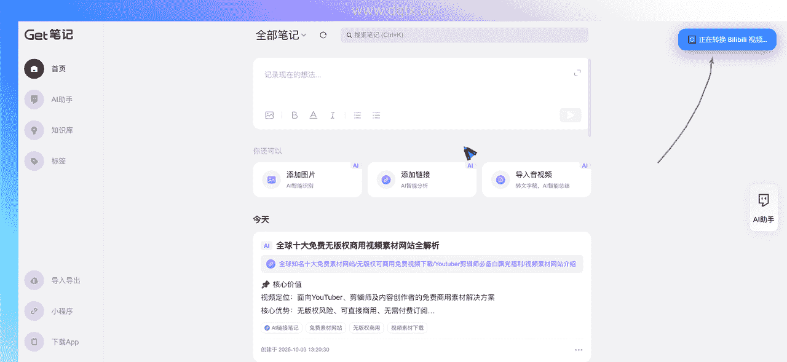
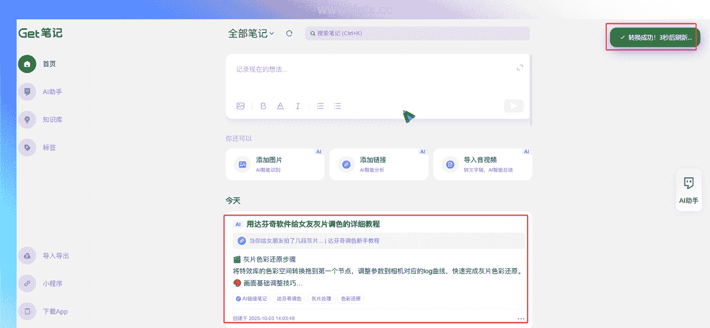

# B站/油管&视频转Get笔记脚本

> 来源：[https://xodnytdcaw.feishu.cn/docx/D01WdspSeoUgsKxr9yVcZW0Vngb](https://xodnytdcaw.feishu.cn/docx/D01WdspSeoUgsKxr9yVcZW0Vngb)

## 引言

收藏夹里存了200+学习视频，结果变成了永远不会打开的电子坟墓，这里有一款能把你刷的视频变成知识笔记的神器脚本！只需一键，即可将B站或油管上的视频内容转换get笔记，重要是连文字稿也扒了下来。

## 一. 脚本安装

### 安装脚本管理器

这个一个浏览器油猴脚本，安装前需安装脚本管理器插件，下面两个任选其一

+   Tampermonkey：[点击安装](https://chromewebstore.google.com/detail/%E7%AF%A1%E6%94%B9%E7%8C%B4/dhdgffkkebhmkfjojejmpbldmpobfkfo?hl=zh-CN&utm_source=ext_sidebar)

+   ScriptCat：[点击安装](https://chromewebstore.google.com/detail/scriptcat/ndcooeababalnlpkfedmmbbbgkljhpjf)

### 安装脚本

#### 脚本代码

```
// ==UserScript==
// @name         B站/油管&amp;视频转Get笔记
// @namespace    http://tampermonkey.net/
// @version      2.2.0
// @description  一键将 Bilibili 或 YouTube 视频转换为Get笔记，并提供大强远程支持链接。
// @author       ChatGPT &amp; Gemini
// @match        https://www.bilibili.com/video/*
// @match        https://www.youtube.com/watch*
// @match        https://www.biji.com/*
// @grant        GM_setValue
// @grant        GM_getValue
// @grant        GM_xmlhttpRequest
// @grant        GM_openInTab
// @run-at       document-end
// @license      MIT
// ==/UserScript==

(function() {
    &#x27;use strict&#x27;;

    const CONFIG = { debug: true };

    const logger = {
        log: (msg, ...args) =&gt; CONFIG.debug &amp;&amp; console.log(`[视频转Get笔记] ${msg}`, ...args),
        error: (msg, ...args) =&gt; console.error(`[视频转Get笔记] ${msg}`, ...args),
    };

    const PageType = {
        BILIBILI_VIDEO: &#x27;bilibili_video&#x27;,
        YOUTUBE_VIDEO: &#x27;youtube_video&#x27;,
        GET_NOTE: &#x27;get_note&#x27;,
        UNKNOWN: &#x27;unknown&#x27;
    };

    function getCurrentPageType() {
        const host = window.location.hostname;
        const pathname = window.location.pathname;

        if (host === &#x27;www.biji.com&#x27;) return PageType.GET_NOTE;
        if (host === &#x27;www.bilibili.com&#x27; &amp;&amp; pathname.startsWith(&#x27;/video/&#x27;)) return PageType.BILIBILI_VIDEO;
        if (host === &#x27;www.youtube.com&#x27; &amp;&amp; pathname === &#x27;/watch&#x27;) return PageType.YOUTUBE_VIDEO;
        return PageType.UNKNOWN;
    }

    function extractBilibiliVideoInfo() {
        const currentUrl = window.location.href.split(&#x27;?&#x27;)[0];
        let videoTitle = document.title.replace(/_哔哩哔哩 \(゜-゜\)つロ 干杯~-bilibili/, &#x27;&#x27;).trim();
        const titleElement = document.querySelector(&#x27;.video-title.van-ellipsis&#x27;) || document.querySelector(&#x27;.tit&#x27;);
        if (titleElement?.textContent) videoTitle = titleElement.textContent.trim();
        return { url: currentUrl, title: videoTitle, platform: &#x27;Bilibili&#x27; };
    }

    function extractYouTubeVideoInfo() {
        const currentUrl = window.location.href.split(&#x27;&amp;&#x27;)[0];
        let videoTitle = document.title.replace(/ - YouTube$/, &#x27;&#x27;).trim();
        const titleElement = document.querySelector(&#x27;#title h1.ytd-watch-metadata&#x27;);
        if (titleElement?.textContent) videoTitle = titleElement.textContent.trim();
        return { url: currentUrl, title: videoTitle, platform: &#x27;YouTube&#x27; };
    }

    function createStyles() {
        const styles = `
            .gn-to-get-btn { position: fixed; z-index: 9999; background: rgba(0, 122, 255, 0.95); backdrop-filter: blur(20px); -webkit-backdrop-filter: blur(20px); color: white; border: none; border-radius: 14px; padding: 12px 24px; font-size: 15px; font-weight: 600; font-family: -apple-system, BlinkMacSystemFont, &#x27;Segoe UI&#x27;, system-ui, sans-serif; cursor: pointer; box-shadow: 0 4px 20px rgba(0, 122, 255, 0.25), 0 1px 3px rgba(0, 0, 0, 0.1); transition: all 0.3s cubic-bezier(0.25, 0.46, 0.45, 0.94); border: 0.5px solid rgba(255, 255, 255, 0.1); letter-spacing: -0.02em; user-select: none; -webkit-user-select: none; }
            .gn-to-get-btn:hover { transform: translateY(-1px) scale(1.02); box-shadow: 0 6px 25px rgba(0, 122, 255, 0.35), 0 2px 8px rgba(0, 0, 0, 0.15); }
            .gn-to-get-btn:active { transform: translateY(0px) scale(0.98); box-shadow: 0 2px 10px rgba(0, 122, 255, 0.3); transition: all 0.1s ease; }
            .gn-to-get-btn:disabled { opacity: 0.8; cursor: not-allowed; transform: none; }
            /* B站按钮样式 */
            .gn-to-get-single-bili { top: 50%; right: 24px; transform: translateY(-50%); background: rgba(252, 98, 142, 0.95); box-shadow: 0 4px 20px rgba(252, 98, 142, 0.25); }
            .gn-to-get-single-bili:hover { background: rgba(252, 98, 142, 1); box-shadow: 0 6px 25px rgba(252, 98, 142, 0.35); }
            /* YouTube按钮样式 */
            .gn-to-get-single-youtube { top: 50%; right: 24px; transform: translateY(-50%); background: rgba(255, 0, 0, 0.95); box-shadow: 0 4px 20px rgba(255, 0, 0, 0.25); }
            .gn-to-get-single-youtube:hover { background: rgba(255, 0, 0, 1); box-shadow: 0 6px 25px rgba(255, 0, 0, 0.35); }

            /* --- 广告/支持按钮样式 (已修改为蓝色) --- */
            .gn-ad-btn {
                top: calc(50% + 65px); /* 动态计算位置，放在主按钮下方 */
                right: 24px;
                transform: translateY(-50%);
                background: rgba(0, 122, 255, 0.85); /* &lt;-- 修改为蓝色 */
                backdrop-filter: blur(15px);
                -webkit-backdrop-filter: blur(15px);
                box-shadow: 0 2px 10px rgba(0, 122, 255, 0.2); /* &lt;-- 修改为蓝色阴影 */
                font-size: 13px;
                padding: 8px 18px;
            }
            .gn-ad-btn:hover {
                background: rgba(0, 122, 255, 1); /* &lt;-- 修改为更亮的蓝色 */
                box-shadow: 0 4px 15px rgba(0, 122, 255, 0.25); /* &lt;-- 修改为更深的蓝色阴影 */
            }

            /* Get笔记状态提示 */
            #get-note-status { position: fixed; top: 24px; right: 24px; z-index: 10000; background: rgba(28, 28, 30, 0.95); backdrop-filter: blur(20px); color: white; padding: 12px 20px; border-radius: 16px; font-size: 15px; font-weight: 500; font-family: -apple-system, BlinkMacSystemFont, &#x27;Segoe UI&#x27;, system-ui, sans-serif; box-shadow: 0 8px 32px rgba(0, 0, 0, 0.3); cursor: default; transition: all 0.3s ease; border: 0.5px solid rgba(255, 255, 255, 0.1); user-select: none; animation: slideInRight 0.4s cubic-bezier(0.25, 0.46, 0.45, 0.94); }
            @keyframes slideInRight { from { transform: translateX(100%); opacity: 0; } to { transform: translateX(0); opacity: 1; } }
        `;
        const styleSheet = document.createElement(&#x27;style&#x27;);
        styleSheet.textContent = styles;
        document.head.appendChild(styleSheet);
    }

    // 视频页面的转换器 (通用)
    class VideoPageConverter {
        constructor(pageType) {
            this.pageType = pageType;
        }

        init() { this.createButtons(); }

        createButtons() {
            // --- 1. 创建主功能按钮 (转Get笔记) ---
            const mainButton = document.createElement(&#x27;button&#x27;);
            mainButton.textContent = &#x27;转Get笔记&#x27;;
            const platformClass = this.pageType === PageType.YOUTUBE_VIDEO ? &#x27;gn-to-get-single-youtube&#x27; : &#x27;gn-to-get-single-bili&#x27;;
            mainButton.className = `gn-to-get-btn ${platformClass}`;
            mainButton.addEventListener(&#x27;click&#x27;, () =&gt; {
                logger.log(`主按钮点击，平台: ${this.pageType}`);
                let videoInfo = (this.pageType === PageType.YOUTUBE_VIDEO) ? extractYouTubeVideoInfo() : extractBilibiliVideoInfo();
                if (!videoInfo.url) {
                    alert(`错误：无法获取当前 ${videoInfo.platform} 视频链接！`);
                    return;
                }
                GM_setValue(&#x27;singleUrl&#x27;, videoInfo.url);
                GM_setValue(&#x27;singleTitle&#x27;, videoInfo.title);
                GM_setValue(&#x27;platform&#x27;, videoInfo.platform);
                GM_setValue(&#x27;conversionMode&#x27;, &#x27;single_new_tab&#x27;);
                GM_setValue(&#x27;initTime&#x27;, Date.now().toString());
                GM_openInTab(&#x27;https://www.biji.com&#x27;, true);
                mainButton.textContent = &#x27;已发送 ✓&#x27;;
                mainButton.disabled = true;
                setTimeout(() =&gt; {
                    mainButton.textContent = &#x27;转Get笔记&#x27;;
                    mainButton.disabled = false;
                }, 2000);
            });
            document.body.appendChild(mainButton);

            // --- 2. 创建广告按钮 ---
            const adButton = document.createElement(&#x27;button&#x27;);
            adButton.textContent = &#x27;大强远程支持&#x27;;
            adButton.className = &#x27;gn-to-get-btn gn-ad-btn&#x27;;
            adButton.addEventListener(&#x27;click&#x27;, () =&gt; {
                logger.log(&#x27;广告按钮点击，跳转到 742112.xyz&#x27;);
                GM_openInTab(&#x27;https://742112.xyz&#x27;, true);
            });
            document.body.appendChild(adButton);
        }
    }

    // Get笔记页面的自动处理程序 (这部分代码无需修改)
    class GetNoteAutoProcessor {
        async init() {
            const mode = GM_getValue(&#x27;conversionMode&#x27;);
            const initTime = GM_getValue(&#x27;initTime&#x27;);
            const isScriptTriggered = initTime &amp;&amp; (Date.now() - parseInt(initTime)) &lt; 60000;
            if (isScriptTriggered &amp;&amp; mode === &#x27;single_new_tab&#x27;) {
                await this.handleSingleConversion();
            }
        }
        async handleSingleConversion() {
            const url = GM_getValue(&#x27;singleUrl&#x27;), title = GM_getValue(&#x27;singleTitle&#x27;), platform = GM_getValue(&#x27;platform&#x27;) || &#x27;视频&#x27;;
            this.cleanupStorage(); this.createStatusIndicator();
            if (!url) { this.updateStatus(&#x27;❌ 错误：未找到视频URL&#x27;, &#x27;#dc3545&#x27;); return; }
            try {
                this.updateStatus(&#x27;🚀 准备转换...&#x27;, &#x27;#007bff&#x27;);
                await this.waitForPageLoad();
                this.updateStatus(&#x27;🔐 正在获取认证信息...&#x27;, &#x27;#007bff&#x27;);
                const authInfo = await this.extractAuthInfo();
                if (!authInfo.token &amp;&amp; !authInfo.cookies) throw new Error(&#x27;获取认证信息失败，请确保您已登录&#x27;);
                this.updateStatus(`🔄 正在转换 ${platform} 视频...`, &#x27;#007bff&#x27;);
                const result = await this.callApiWithAuth(url, title, platform, authInfo);
                if (result?.noteId) { this.updateStatus(`✅ 转换成功！3秒后刷新...`, &#x27;#28a745&#x27;); setTimeout(() =&gt; window.location.reload(), 3000); }
                else { throw new Error(&#x27;API转换失败或未返回笔记ID&#x27;); }
            } catch (error) {
                logger.error(&#x27;单条视频转换失败:&#x27;, error);
                let userMessage = `❌ 转换失败: ${error.message}`;
                if (error.message.includes(&#x27;超时&#x27;)) userMessage += &#x27;。请检查网络或稍后再试。&#x27;;
                else if (error.message.includes(&#x27;认证失败&#x27;)) userMessage += &#x27;。请刷新页面确保您已登录。&#x27;;
                this.updateStatus(userMessage, &#x27;#dc3545&#x27;);
            }
        }
        cleanupStorage() { GM_setValue(&#x27;singleUrl&#x27;, &#x27;&#x27;); GM_setValue(&#x27;singleTitle&#x27;, &#x27;&#x27;); GM_setValue(&#x27;platform&#x27;, &#x27;&#x27;); GM_setValue(&#x27;conversionMode&#x27;, &#x27;&#x27;); GM_setValue(&#x27;initTime&#x27;, &#x27;&#x27;); }
        async callApiWithAuth(url, title, platform, authInfo) {
            const requestData = { attachments: [{ size: 100, type: &quot;link&quot;, title: title || `${platform}视频`, url: url }], content: &quot;&quot;, entry_type: &quot;ai&quot;, note_type: &quot;link&quot;, source: &quot;web&quot;, prompt_template_id: &quot;&quot; };
            const headers = { &#x27;Content-Type&#x27;: &#x27;application/json&#x27;, &#x27;Accept&#x27;: &#x27;text/event-stream&#x27;, &#x27;Origin&#x27;: &#x27;https://www.biji.com&#x27;, &#x27;Referer&#x27;: &#x27;https://www.biji.com/&#x27;, &#x27;User-Agent&#x27;: navigator.userAgent, &#x27;Cache-Control&#x27;: &#x27;no-cache&#x27;, &#x27;Connection&#x27;: &#x27;keep-alive&#x27; };
            if (authInfo.cookies) headers[&#x27;Cookie&#x27;] = authInfo.cookies; if (authInfo.token) headers[&#x27;Authorization&#x27;] = `Bearer ${authInfo.token}`;
            return new Promise((resolve, reject) =&gt; {
                GM_xmlhttpRequest({
                    method: &#x27;POST&#x27;, url: &#x27;https://get-notes.luojilab.com/voicenotes/web/notes/stream&#x27;, headers: headers, data: JSON.stringify(requestData), timeout: 60000,
                    onload: (response) =&gt; {
                        if (response.status === 200) { const lines = response.responseText.split(&#x27;\n&#x27;); let noteId = null; for (const line of lines) { if (line.startsWith(&#x27;data: &#x27;)) { try { const data = JSON.parse(line.substring(6)); if (data.data?.note_id) { noteId = data.data.note_id; break; } } catch (e) {} } } if (noteId) resolve({ noteId, url }); else reject(new Error(&#x27;未从API响应中找到笔记ID&#x27;)); }
                        else { let msg = `API请求失败: ${response.status}`; if (response.status === 403) msg += &quot; (认证失败)&quot;; reject(new Error(msg)); }
                    },
                    onerror: (err) =&gt; reject(new Error(&#x27;网络请求失败，请检查代理或网络连接&#x27;)),
                    ontimeout: () =&gt; reject(new Error(&#x27;API 请求超时 (60秒)&#x27;))
                });
            });
        }
        async extractAuthInfo() { const authInfo = { cookies: document.cookie, token: null }; try { authInfo.token = localStorage.getItem(&#x27;token&#x27;) || localStorage.getItem(&#x27;auth_token&#x27;) || localStorage.getItem(&#x27;access_token&#x27;); if (!authInfo.token) authInfo.token = sessionStorage.getItem(&#x27;token&#x27;) || sessionStorage.getItem(&#x27;auth_token&#x27;) || sessionStorage.getItem(&#x27;access_token&#x27;); if (!authInfo.token) { const match = document.cookie.match(/(?:^|;)\s*(?:token|auth_token|jwt|access_token)=([^;]*)/); if (match) authInfo.token = match[1]; } } catch (error) { logger.error(&#x27;提取认证信息失败:&#x27;, error); } return authInfo; }
        createStatusIndicator() { if (document.getElementById(&#x27;get-note-status&#x27;)) return; const indicator = document.createElement(&#x27;div&#x27;); indicator.id = &#x27;get-note-status&#x27;; indicator.textContent = &#x27;🔄 脚本已激活&#x27;; document.body.appendChild(indicator); }
        updateStatus(message, color = &#x27;#28a745&#x27;) { const indicator = document.getElementById(&#x27;get-note-status&#x27;); if (indicator) { indicator.textContent = message; indicator.style.background = color; } }
        async waitForPageLoad() { if (document.readyState === &#x27;complete&#x27;) return; return new Promise(resolve =&gt; { window.addEventListener(&#x27;load&#x27;, resolve, { once: true }); setTimeout(resolve, 10000); }); }
    }

    // 页面管理器 (这部分代码无需修改)
    class PageManager {
        constructor() { this.currentUrl = location.href; this.urlCheckTimer = null; }
        init() {
            this.runForPage();
            const pageType = getCurrentPageType();
            if (pageType === PageType.BILIBILI_VIDEO || pageType === PageType.YOUTUBE_VIDEO) { this.startUrlMonitoring(); }
        }
        runForPage() {
            const pageType = getCurrentPageType();
            logger.log(`当前页面类型: ${pageType}`);
            switch (pageType) {
                case PageType.BILIBILI_VIDEO:
                case PageType.YOUTUBE_VIDEO:
                    document.querySelectorAll(&#x27;.gn-to-get-btn&#x27;).forEach(btn =&gt; btn.remove());
                    new VideoPageConverter(pageType).init();
                    break;
                case PageType.GET_NOTE:
                    new GetNoteAutoProcessor().init();
                    break;
            }
        }
        startUrlMonitoring() {
            this.urlCheckTimer = setInterval(() =&gt; {
                if (location.href !== this.currentUrl) {
                    this.currentUrl = location.href;
                    logger.log(&#x27;URL发生变化，重新运行脚本逻辑:&#x27;, this.currentUrl);
                    setTimeout(() =&gt; this.runForPage(), 500);
                }
            }, 1000);
        }
        destroy() { if (this.urlCheckTimer) clearInterval(this.urlCheckTimer); }
    }

    // 主程序初始化
    (async function() {
        createStyles();
        if (document.readyState === &#x27;loading&#x27;) await new Promise(resolve =&gt; document.addEventListener(&#x27;DOMContentLoaded&#x27;, resolve));
        const pageManager = new PageManager();
        pageManager.init();
        window.addEventListener(&#x27;beforeunload&#x27;, () =&gt; pageManager.destroy());
    })().catch(error =&gt; { logger.error(&#x27;脚本初始化失败:&#x27;, error); });

})();
```

### 操作演示

下面我以ScriptCat来演示安装，新建脚本，把原来的脚本上删除

把上面的脚本代码复制粘贴里面，然后ctrl+c保存。



[cursorful-video-1759472229905.mp4](https://internal-api-drive-stream.feishu.cn/space/api/box/stream/download/all/LaAobMNaCobqmNxURvpckxivnHh)

### 二.使用方法

安装成功后，脚本会访问B站/YouTube任意视频播放页，屏幕的右侧中间会出现两个悬浮按钮按钮就是“转Get笔记”。它会根据网站自动变色：在B站是粉色，在YouTube是红色。

### 点击转换

这是我打开的一个B站视频，点击“转Get笔记”按钮，脚本会自动在新的浏览器标签页中打开 Get笔记 网站



### 查看自动转换

在新打开的 Get笔记 页面，您会看到一个状态提示框，显示“正在转换”



转换成功后，页面会自动刷新，您就可以在笔记列表中看到刚刚转换好的新笔记了



### 使用“大强远程支持”

在视频页面的“转Get笔记”按钮下方，您会看到一个蓝色的“大强远程支持”按钮。

点击该按钮，会直接在新标签页中打开我的网站 742112.xyz