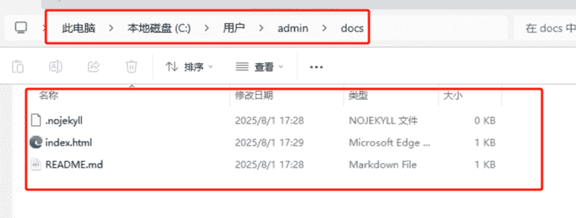

# ‬‬⁤‌‌‌⁡⁢‍⁣⁣⁡‌‬‬⁣⁣⁣‌⁣‌‬⁣⁡‌‌⁢⁢⁣‬‍‌‬⁤⁡Vercel+Docsify上线静态博客

> 来源：[https://xodnytdcaw.feishu.cn/docx/ZYPNd8rp1ouIUGxV9nJcPkrrnCb](https://xodnytdcaw.feishu.cn/docx/ZYPNd8rp1ouIUGxV9nJcPkrrnCb)

## 演示站点：

demo:[演示1](https://ceshi-beige.vercel.app/)    [演示2](https://ceshi999.vercel.app/#/README)

github:[点此直达](https://github.com/dqtx760/blog)


## 一.源码配置

### 拉取（Pull）

```
npm i docsify-cli -g
```

### 初始化docsify本地服务

```
docsify init ./docs
```



### 启用本地网页预览

```
docsify serve docs
```

### 填充项目框架

```
docs/
  │── index.html      # 我自己加的动画载入页  灵感来源https://blog-linzhe.vercel.app/
  │── main.html       # Docsify 主入口
  │── _sidebar.md     # 侧边栏导航
  │── README.md       # 主页内容（好像没什么用，但没敢删）
  └── ceshi/
        └── 1.md      # 对应大强同学附件表
```

## **二.上传GitHub**

### **1.初始化 Git 仓库**

将所有文件添加到 Git 暂存区，并提交更改：

```
git init
```

###  2.**添加文件到 Git**

所有文件添加到 Git 暂存区，并提交更改：

```
git add .
git commit -m &quot;Initial commit&quot;
```

### **3.创建 GitHub 仓库**

+   登录 [GitHub](https://github.com/) 并创建一个新的空仓库。

+   复制你的仓库地址（如 https://github.com/yourusername/your-repo.git）。

### 4.关联本地仓库并推送（Push）

回到本地项目目录，执行：

```
git remote add origin https://github.com/yourusername/your-repo.git
git branch -M main  # 确保分支名是 main
git push -u origin main
```

## 三.Vercel部署

安装 Vercel CLI ： npm i -g vercel

切换到你的 docsify 网站的文档目录，例如

```
cd docs
```

用一个指令来部署：

```
vercel
```

如果需要让正式域名生效，需要执行

```
vercel --prod
```

## 四.**常见问题 & 额外优化**

### **Q1: 如何更新网站？**

只需要在 GitHub 提交新的更改，Vercel 会自动触发重新部署：

```
git add .
git commit -m &quot;更新标题&quot;
git push origin main
```

### **Q2: 如何绑定自定义域名？**

1.  在 Vercel 项目的 "Settings" → "Domains"，输入你的域名（如 example.com）。

1.  按照提示配置 DNS 记录（通常是 CNAME 指向 Vercel）。

## 参考教程

配置方法

[官网文档](https://docsify.js.org/#/zh-cn/deploy)

[视频教程](https://www.bilibili.com/video/BV1x1t1z4EWM/?spm_id_from=333.1387.favlist.content.click&vd_source=206031f494850e57fd6c92ace02b1bed)  [文字教程教程](https://www.cpolar.com/blog/no-need-to-pack-no-need-to-build-docsify-helps-you-build-a-markdown-document-website-with-just-one-click)

https://www.bilibili.com/video/BV1LCgWzqEK9?spm_id_from=333.1387.favlist.content.click

动画ui

https://uiverse.io/challenges/button-mastery-7

从 0 开始基于 docsify + vercel + github 免费搭建属于自己的博客vercel 是一个开箱即用 - 掘金

https://juejin.cn/post/6951789326782955534

嵌入式参考

https:[//](https://ceshi999.vercel.app/#/README)tanzwei.github.io/#/   实战：点击