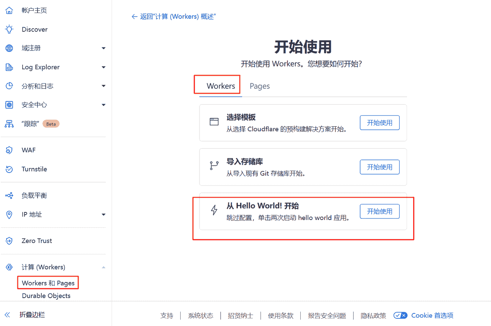
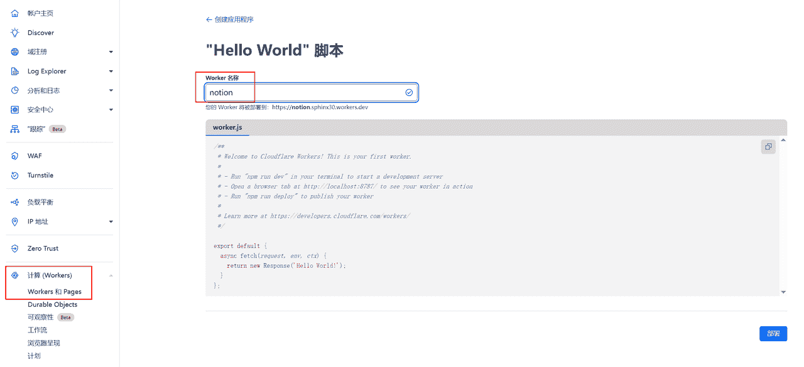
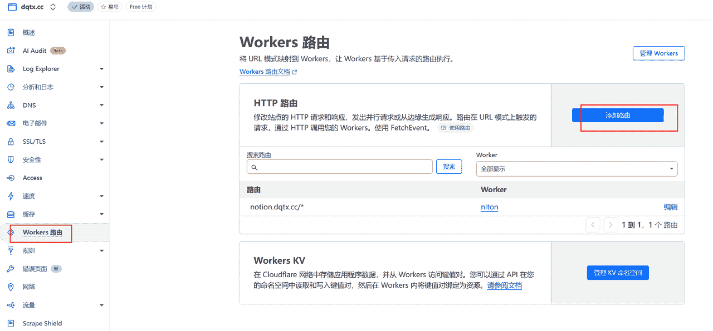
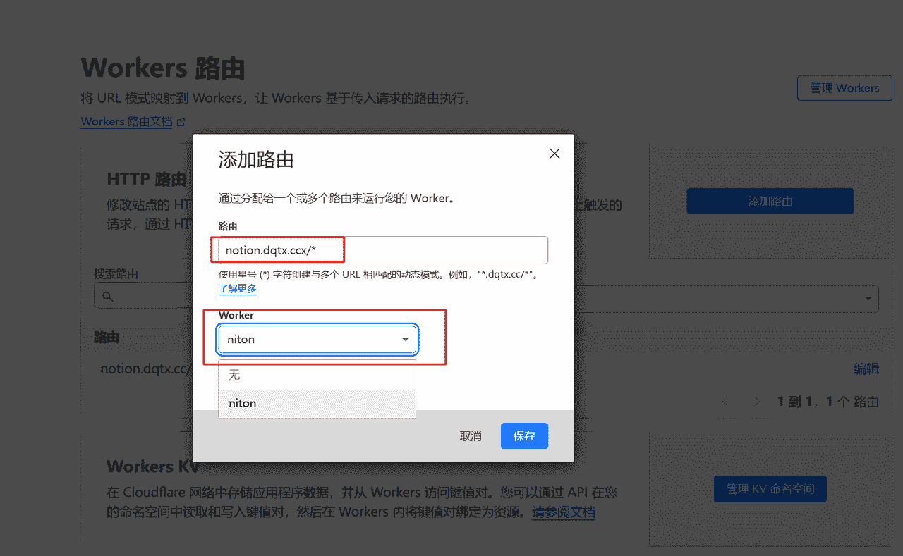
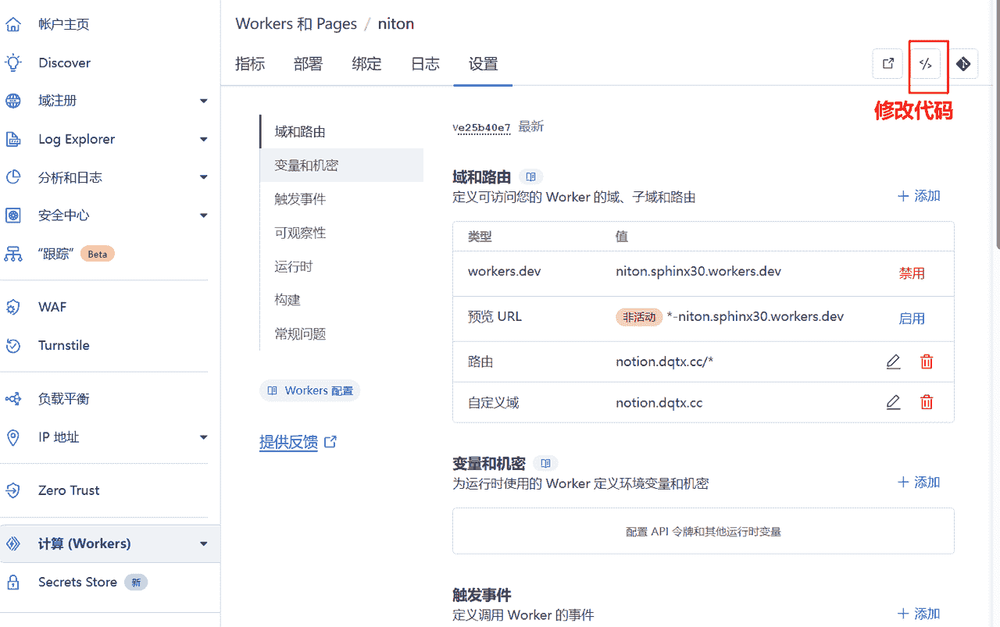
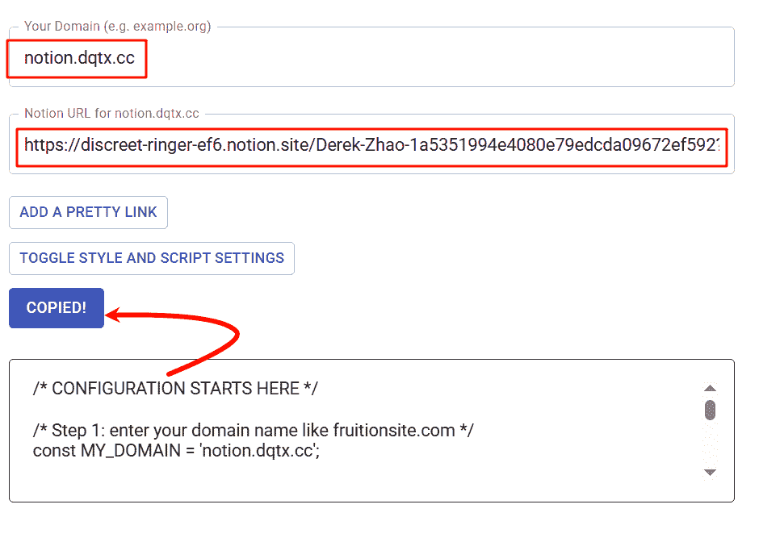
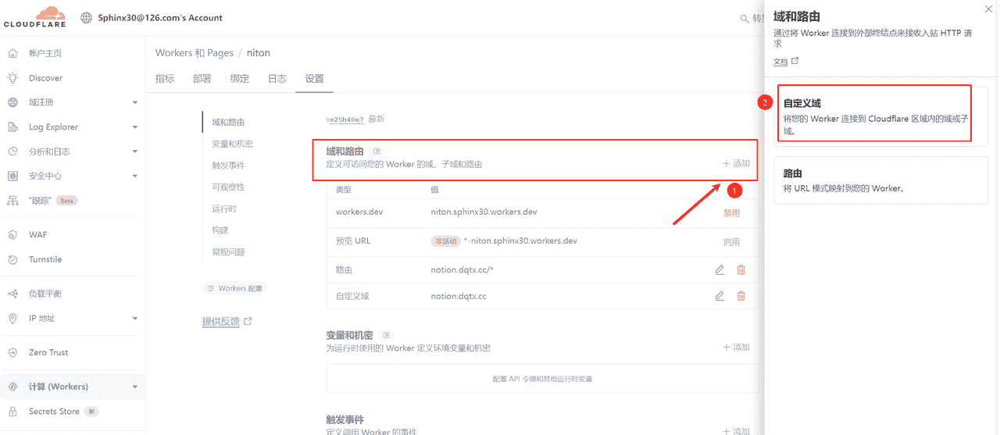

# 3分钟搞定 Notion 自定义域名

> 来源：[https://xodnytdcaw.feishu.cn/docx/IOsydYjTxoQXFpx5Jbec9LAwndf](https://xodnytdcaw.feishu.cn/docx/IOsydYjTxoQXFpx5Jbec9LAwndf)

## 一.准备工作

域名

notion分享页面

## 二.创建 Workers

来到Cloudflare，点账户主页-计算（Workers和Pages）-Workers

名称随便写，我这里就写notion(添加路由的Worker就是这个名称）

## 三.设置 Workers 路由

账户主页-点击你的域名-Workers 路由-添加路由

填入域名，注意网址后面加 /*Worker 就是那个贴代码后部署的名称

## 四.管理Workers

点击代码修改，然后全选清空里面代码

打开这个网站：[点击打开](https://fruition-git-master-stephenou.vercel.app/)  填写你的自定义域名与notion分享链接，之后复制生成的代码，粘贴的修改代码的区域

添加自定义域

至此，你就可以通过自己的域名来访问 Notion 主页

体验地址：notion.dqtx.cc