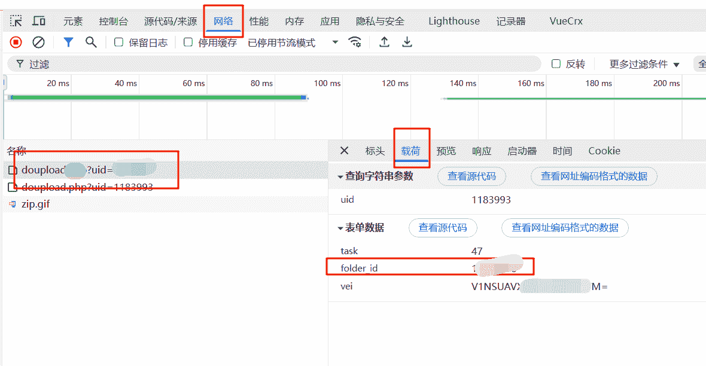
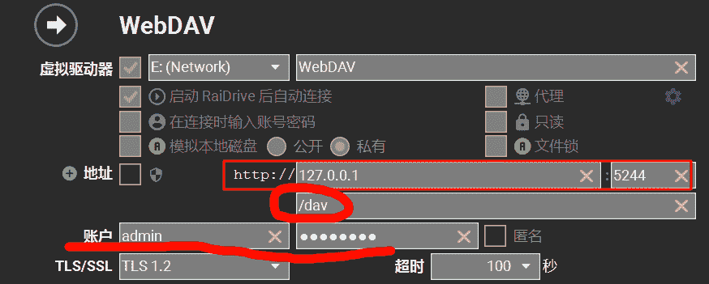
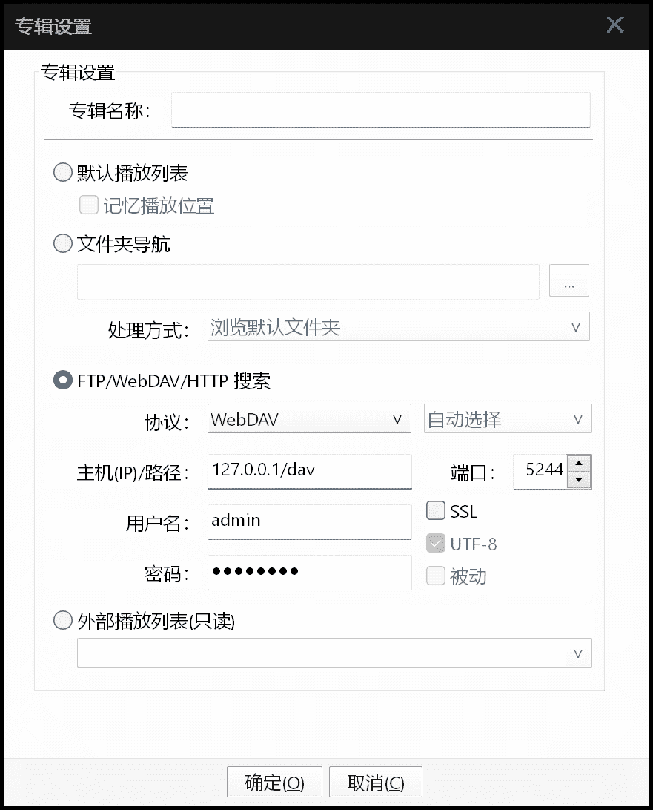
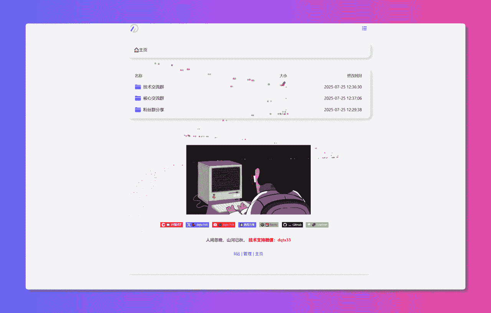
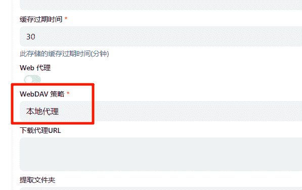

# OpenList保姆级教程

> 来源：[https://xodnytdcaw.feishu.cn/docx/OO1idlXsEon1KcxNOnXcuJmOnUK](https://xodnytdcaw.feishu.cn/docx/OO1idlXsEon1KcxNOnXcuJmOnUK)

# 一本地部署

## 1.安装OpenList

下载地址

[h](https://github.com/OpenListTeam/OpenList/releases/tag/v4.0.8)ttps://github.com/OpenListTeam/OpenList/releases/tag/v4.0.8

安装目录cmd启动服务

```
openlist server
```

浏览器访问地址：127.0.0.1：端口号

账号：admin  密码：cmd会呈现（后台改）没有的话在OpenList\daemon\start.log

在安装目录，新建VBS脚本，发送快捷方式到桌面，然后剪贴到自启动文件夹（shell:startup）

```
Dim ws
Set ws = Wscript.CreateObject(&quot;Wscript.Shell&quot;)
ws.run &quot;openlist.exe server&quot;,vbhide
Wscript.quit
```

## 2.网盘挂载

这个环节当中最重要的是添加根文件夹ID，一般都是按下F12，网络，最新chrome浏览器都是在在载荷里，比如兰奏云的对应folder_id，迅雷的对应parent_id，夸克的一般是分享链接的后面的一段数字。



[蓝奏云](https://oplist.org/zh/guide/drivers/lanzou.html)

[迅雷](https://oplist.org/zh/guide/drivers/thunder.html)（教程多看2遍，不过容易掉，不建议挂载）

https://oplist.org/zh/guide/drivers/

## 3.磁盘映射

用到的软件raidrive

https://www.raidrive.com/

先开放权限，网页-用户-admin-编辑-Webdav 读取/Webdav 管理打勾

raidrive软件的设置如下



## 4.PotPlayer播放

打开软件，新建专辑，然后选择“FTP/WebDAV/HTTP搜索”，填写主机路径与端口，账号与密码，这样，你网盘的资源就直接同步过来了。



> 注意：

> [映射的磁](https://pan.xunlei.com/s/VOVYAPfBHqH7P09owGophrIQA1?pwd=8imi)盘默认无图标，磁盘图标自定义修改工具：点此下载

> [raid](https://pan.xunlei.com/s/VOVYAAAWmY2hq78N5lqBiOaWA1?pwd=eyji#)rive这款软件的有弹窗广告，可用火绒弹窗拦截:点此下载

# 二，云端部署（公网访问）

## IPV6直接访问

[htt](https://hsk.oray.com/)p://[IPV6地址]:5244  或花生壳内网穿透   （IPV6地址查询命令ipconfig）

## 服务器部署

还有一种方法就是部署云应用或者部署服务器上，再买个域名，然后域名解析，通过域名访问

性价比域名：[Spaceship](https://www.spaceship.com/zh/domain-search/?query=&beast=false&tab=domains)

莱卡云服务器教程：[点此教程](https://blog.lcayun.com/3868.html)

雨云服务器：[点击直达](https://www.rainyun.com/NzYxMDg2_)

# 三.界面美化

参考1：https://blog.mmoe.work/oplist-beautification/、

参考2：https://github.com/wugeng20/openlist-glassmorphism-theme

Alist常用样式代码 :https://blog.itvv.cn/archives/491

自用皮肤开源仓库：https://github.com/dqtx760/oplist-Neumorphism



## 设置-全局

自定义头部

```
&lt;style type=&quot;text/css&quot;&gt;
body {
  /* 新拟态核心色调 */
  --neumorph-bg: #f0f0f3;
  --shadow-dark: rgba(163, 177, 198, 0.5);
  --shadow-light: rgba(255, 255, 255, 0.8);

  /* 仅修改背景部分（不影响 flex/布局） */
  background: var(--neumorph-bg) !important;
  background-image: none !important;  /* 确保无额外背景图干扰 */
  
  /* 纯背景新拟态（不干扰内容） */
  position: relative;  /* 确保背景覆盖完整 */
}

/* 添加一个伪元素作为背景层（避免影响内容布局） */
body::before {
  content: &quot;&quot;;
  position: fixed;
  top: 0;
  left: 0;
  width: 100%;
  height: 100%;
  z-index: -1;  /* 确保在底层 */
  
  /* 新拟态背景效果 */
  background: var(--neumorph-bg);
  box-shadow:
    inset 6px 6px 12px var(--shadow-dark),
    inset -6px -6px 12px var(--shadow-light);
}

/* 以下所有代码保持原样，不修改宽度、高度或布局 */
.markdown-body, 
.main-content {
  width: 100%;
  max-width: 800px;
  padding: 30px;
  margin: 0 auto;
  text-align: center;
}

.hope-c-PJLV-idaeksS-css,
.hope-c-hOYTCS,
.hope-c-PJLV-igScBhH-css {
  background: var(--neumorph-bg) !important;
  border-radius: 15px !important;
  box-shadow: 
    8px 8px 15px var(--shadow-dark),
    -8px -8px 15px var(--shadow-light) !important;
  border: none !important;
  transition: all 0.3s ease;
  padding: 15px 25px !important;
  margin: 10px auto !important;
  display: inline-block !important;
  cursor: pointer;
}

.markdown-body pre,
.hope-c-ctSAUo {
  background: var(--neumorph-bg) !important;
  box-shadow: 
    inset 3px 3px 5px var(--shadow-dark),
    inset -3px -3px 5px var(--shadow-light) !important;
  border-radius: 10px !important;
  padding: 15px !important;
  margin: 0 auto 20px !important;
  max-width: 90%;
}

.footer {
  text-align: center !important;
  margin-top: 30px;
  opacity: 1 !important;
}

.copyright {
  display: flex;
  flex-direction: column;
  align-items: center;
  justify-content: center;
}

@media screen and (max-width: 960px) {
  body {
    padding: 10px;
  }
  
  .markdown-body,
  .main-content {
    padding: 15px;
    max-width: 95%;
  }
}
&lt;/style&gt;
```

自定义内容

```
&lt;div id=&quot;customize&quot; style=&quot;&quot;&gt;

            &lt;/div&gt;
        &lt;/center&gt;
        &lt;br&gt;
    &lt;/center&gt;&lt;/div&gt;
&lt;!--延迟加载范围到这里结束--&gt;
&lt;/div&gt;

&lt;!--延迟加载配套使用JS--&gt;
&lt;script&gt;
    let interval = setInterval(() =&gt; {
        if (document.querySelector(&quot;.footer&quot;)) {
            document.querySelector(&quot;#customize&quot;).style.display = &quot;&quot;;
            clearInterval(interval);
        }
    }, 100);
&lt;/script&gt;

&lt;!--点击烟花--&gt;
&lt;!--&lt;script async src=&quot;https://cdn.jsdelivr.net/gh/mocchen/cssmeihua/js/yanhuabowen.js&quot;&gt;&lt;/script&gt;--&gt;

&lt;span class=&quot;js-cursor-container&quot;&gt;&lt;/span&gt;
&lt;script async src=&quot;https://cdn.jsdelivr.net/gh/mocchen/cssmeihua/js/xiaoxingxing.js&quot;&gt;&lt;/script&gt;
&lt;!--樱花飘落二选一--&gt;
&lt;script src=&quot;https://files.cnblogs.com/files/quaint/sakuraPlus.js&quot;&gt;&lt;/script&gt;
&lt;!--&lt;script async src=&quot;https://cdn.jsdelivr.net/gh/iVampireSP/special-JavaScript/yinghua.js&quot;&gt;&lt;/script&gt;--&gt;

&lt;!--音乐歌词美化--&gt;
&lt;script src=&quot;https://npm.elemecdn.com/granim@2.0.0/dist/granim.min.js&quot;&gt;&lt;/script&gt;
&lt;script&gt;
var granimInstance = new Granim({
    element: &#x27;#canvas-basic&#x27;,
    direction: &#x27;left-right&#x27;,
    isPausedWhenNotInView: true,
    states : {
        &quot;default-state&quot;: {
            gradients: [
                [&#x27;#a18cd1&#x27;, &#x27;#fbc2eb&#x27;],
                 [&#x27;#fff1eb&#x27;, &#x27;#ace0f9&#x27;],
                 [&#x27;#d4fc79&#x27;, &#x27;#96e6a1&#x27;],
                 [&#x27;#a1c4fd&#x27;, &#x27;#c2e9fb&#x27;],
                 [&#x27;#a8edea&#x27;, &#x27;#fed6e3&#x27;],
                 [&#x27;#9890e3&#x27;, &#x27;#b1f4cf&#x27;],
                 [&#x27;#a1c4fd&#x27;, &#x27;#c2e9fb&#x27;],
                 [&#x27;#fff1eb&#x27;, &#x27;#ace0f9&#x27;]
           
            ]
        }
    }
});
&lt;/script&gt;

&lt;!-- 音乐增强 --&gt;
&lt;script&gt;
  window.initMuscPlus = false;
  window.$q = window.$q || function(val) { return document.querySelector(val) }
  window.$qa = window.$qa || function(val) { return Array.from(document.querySelectorAll(val)) }

  // 生成随机渐变色
  function generateRandomGradient() {
    const randomColor = () =&gt; `rgba(${Math.floor(Math.random() * 255)}, ${Math.floor(Math.random() * 255)}, ${Math.floor(Math.random() * 255)}, ${Math.random().toFixed(2)})`;
    const color1 = randomColor();
    const color2 = randomColor();
    darkUIChange();
    return `linear-gradient(to right, ${color1}, ${color2})`;
  }

  ;(function(){
    let style = document.createElement(&#x27;style&#x27;)
    style.innerHTML = `
      .music-plus .aplayer .aplayer-lrc { 
        position: fixed; 
        top: 180px; 
        left: 0; 
        right: 0; 
        width: 88%; 
        height: 100px; 
        max-width: 1000px; 
        margin: 0 auto; 
        padding: 50px 0; 
        transform: scale(1.3);
        z-index: 999; 
        background: ${generateRandomGradient()}; /* 随机渐变背景 */
        backdrop-filter: blur(10px); /* 添加高斯模糊效果 */
        box-shadow: 0 4px 8px rgba(0,0,0,0.5); /* 添加阴影，增加立体感 */
        transition: background 0.5s ease; /* 平滑过渡渐变背景 */
      }
      .music-plus .aplayer .aplayer-lrc-current { 
        font-weight: bold; 
        transform: scale(0.95) !important; 
      }
      .music-plus .aplayer .aplayer-lrc p { 
        color: #fff; /* 设置歌词文字颜色为白色 */
        opacity: 1; /* 设置透明度 */
        transform: scale(0.9); 
      }
      .music-control { 
        position: absolute; 
        right: 4px; 
        top: 4px; 
        display: flex; 
        align-items: center; 
      }
      .music-control i { 
        cursor: pointer; 
        width: 22px; 
        height: 22px; 
        display: flex; 
        align-items: center; 
        justify-content: center; 
        font-size: 14px; 
        border-radius: 50%; 
        background: rgba(255, 255, 255, 0.2); /* 控制按钮背景颜色 */
        margin-left: 4px; 
        font-style: normal; 
      }
      /*电脑模式音乐歌词容器设置*/
      @media screen and (min-width: 1200px) {
        .music-plus .aplayer .aplayer-lrc { 
          left: 0; 
          right: 0;
          width: 410px; 
          height: 100px; 
          padding: 100px 0; 
          top: 212px;
        }

      }
    `
    document.body.appendChild(style)

  })();

  setTimeout(() =&gt; {
    let stack = document.querySelector(&#x27;#musicPlus2&#x27;)
    let span = document.createElement(&#x27;span&#x27;)
    span.innerHTML = &#x27;|&#x27;
    stack.appendChild(span)
    let a = document.createElement(&#x27;a&#x27;)
    a.style = `padding: var(--hope-space-1_5); cursor: pointer; `
    a.innerHTML = &#x27;音乐加强&#x27;
    a.onclick = changeMusic
    stack.appendChild(a)

    document.addEventListener(&#x27;keydown&#x27;, function(e) {
      if (e.ctrlKey) {
        const type = [&#x27;4&#x27;, &#x27;[&#x27;].includes(e.key) ? 1 : [&#x27;6&#x27;, &#x27;]&#x27;].includes(e.key) ? 3 : [&#x27;5&#x27;, &#x27;\\&#x27;].includes(e.key) ? 2 : null
        if (type) {
          e.preventDefault()
          e.stopPropagation()
          musicMove(type)
        }
      }
    })
  }, 1000)

  function darkUIChange() {
    // 获取当前页面宽度,设置样式
    var documentWidth = $(document).width();
    let widthIsMin = 0;
    if (documentWidth&lt;600){
    widthIsMin = 1;
    }
    // 黑夜模式调整样式
    let isDarkUI= document.querySelector(&#x27;.hope-ui-dark&#x27;)
    if (isDarkUI){
     $(&quot;.music-plus .aplayer .aplayer-lrc&quot;).css(&quot;top&quot;, &quot;315px&quot;);
     // 小屏幕 手机 调整样式
     if(widthIsMin){
        $(&quot;.music-plus .aplayer .aplayer-lrc&quot;).css(&quot;top&quot;, &quot;332px&quot;);
      }
    }
  
  }

  function changeMusic() {
    let lrcWarp = document.querySelector(&#x27;.aplayer .aplayer-lrc&#x27;)
    if (!lrcWarp) return alert(&#x27;没有找到歌词容器&#x27;)

    if (!window.initMuscPlus || !$q(&#x27;.music-control&#x27;)) {
      let control = document.createElement(&#x27;div&#x27;)
      control.className = &#x27;music-control&#x27;
      control.innerHTML = `&lt;i onclick=&quot;musicMove(1)&quot; title=&quot;CTRL+[ 上一曲&quot;&gt;◄&lt;/i&gt;
      &lt;i onclick=&quot;musicMove(2)&quot; title=&quot;CTRL+] 上一曲&quot;&gt;◼&lt;/i&gt;
      &lt;i onclick=&quot;musicMove(3)&quot; title=&quot;CTRL+\\ 暂停&quot;&gt;►&lt;/i&gt;`
      document.querySelector(&#x27;.aplayer-body&#x27;).append(control)
    }
    window.initMuscPlus = true
    let cls = document.body.className
    if (cls.includes(&#x27;music-plus&#x27;)) {
      document.body.className = document.body.className.replace(&#x27; music-plus&#x27;, &#x27;&#x27;)
    } else {
      document.body.className += &#x27; music-plus&#x27;
    }

    // 每次切换歌曲时重新生成渐变背景
    lrcWarp.style.background = generateRandomGradient();
    darkUIChange();

  }

  function musicMove(type) {
    if (type == 2) {
      return $q(&#x27;.aplayer-pic&#x27;).click()
    }
    let list = $qa(`.aplayer-list li`)
    let ind = list.findIndex(item =&gt; item.classList.contains(&#x27;aplayer-list-light&#x27;))
    let index = type == 1 ? ind - 1 : type == 3 ? ind + 1 : ind
    index = index &lt; 0 ? list.length - 1 : index &gt; list.length - 1 ? 0 : index
    list[index].click()

   
  }

&lt;/script&gt;
&lt;!---去掉底部文字---&gt;

&lt;!--延迟加载范围到这里结束--&gt;
&lt;/div&gt;

&lt;!--延迟加载配套使用JS--&gt;
&lt;script&gt;
    let interval = setInterval(() =&gt; {
        if (document.querySelector(&quot;.footer&quot;)) {
            document.querySelector(&quot;#customize&quot;).style.display = &quot;&quot;;
            clearInterval(interval);
        }
    }, 100);
&lt;/script&gt;

&lt;!--点击烟花--&gt;
&lt;!--&lt;script async src=&quot;https://cdn.jsdelivr.net/gh/mocchen/cssmeihua/js/yanhuabowen.js&quot;&gt;&lt;/script&gt;--&gt;

&lt;span class=&quot;js-cursor-container&quot;&gt;&lt;/span&gt;
&lt;script async src=&quot;https://cdn.jsdelivr.net/gh/mocchen/cssmeihua/js/xiaoxingxing.js&quot;&gt;&lt;/script&gt;
&lt;!--樱花飘落二选一--&gt;
&lt;script src=&quot;https://files.cnblogs.com/files/quaint/sakuraPlus.js&quot;&gt;&lt;/script&gt;
&lt;!--&lt;script async src=&quot;https://cdn.jsdelivr.net/gh/iVampireSP/special-JavaScript/yinghua.js&quot;&gt;&lt;/script&gt;--&gt;

&lt;!--音乐歌词美化--&gt;
&lt;script src=&quot;https://npm.elemecdn.com/granim@2.0.0/dist/granim.min.js&quot;&gt;&lt;/script&gt;
&lt;script&gt;
var granimInstance = new Granim({
    element: &#x27;#canvas-basic&#x27;,
    direction: &#x27;left-right&#x27;,
    isPausedWhenNotInView: true,
    states : {
        &quot;default-state&quot;: {
            gradients: [
                [&#x27;#a18cd1&#x27;, &#x27;#fbc2eb&#x27;],
                 [&#x27;#fff1eb&#x27;, &#x27;#ace0f9&#x27;],
                 [&#x27;#d4fc79&#x27;, &#x27;#96e6a1&#x27;],
                 [&#x27;#a1c4fd&#x27;, &#x27;#c2e9fb&#x27;],
                 [&#x27;#a8edea&#x27;, &#x27;#fed6e3&#x27;],
                 [&#x27;#9890e3&#x27;, &#x27;#b1f4cf&#x27;],
                 [&#x27;#a1c4fd&#x27;, &#x27;#c2e9fb&#x27;],
                 [&#x27;#fff1eb&#x27;, &#x27;#ace0f9&#x27;]
           
            ]
        }
    }
});
&lt;/script&gt;

&lt;!-- 音乐增强 --&gt;
&lt;script&gt;
  window.initMuscPlus = false;
  window.$q = window.$q || function(val) { return document.querySelector(val) }
  window.$qa = window.$qa || function(val) { return Array.from(document.querySelectorAll(val)) }

  // 生成随机渐变色
  function generateRandomGradient() {
    const randomColor = () =&gt; `rgba(${Math.floor(Math.random() * 255)}, ${Math.floor(Math.random() * 255)}, ${Math.floor(Math.random() * 255)}, ${Math.random().toFixed(2)})`;
    const color1 = randomColor();
    const color2 = randomColor();
    darkUIChange();
    return `linear-gradient(to right, ${color1}, ${color2})`;
  }

  ;(function(){
    let style = document.createElement(&#x27;style&#x27;)
    style.innerHTML = `
      .music-plus .aplayer .aplayer-lrc { 
        position: fixed; 
        top: 180px; 
        left: 0; 
        right: 0; 
        width: 88%; 
        height: 100px; 
        max-width: 1000px; 
        margin: 0 auto; 
        padding: 50px 0; 
        transform: scale(1.3);
        z-index: 999; 
        background: ${generateRandomGradient()}; /* 随机渐变背景 */
        backdrop-filter: blur(10px); /* 添加高斯模糊效果 */
        box-shadow: 0 4px 8px rgba(0,0,0,0.5); /* 添加阴影，增加立体感 */
        transition: background 0.5s ease; /* 平滑过渡渐变背景 */
      }
      .music-plus .aplayer .aplayer-lrc-current { 
        font-weight: bold; 
        transform: scale(0.95) !important; 
      }
      .music-plus .aplayer .aplayer-lrc p { 
        color: #fff; /* 设置歌词文字颜色为白色 */
        opacity: 1; /* 设置透明度 */
        transform: scale(0.9); 
      }
      .music-control { 
        position: absolute; 
        right: 4px; 
        top: 4px; 
        display: flex; 
        align-items: center; 
      }
      .music-control i { 
        cursor: pointer; 
        width: 22px; 
        height: 22px; 
        display: flex; 
        align-items: center; 
        justify-content: center; 
        font-size: 14px; 
        border-radius: 50%; 
        background: rgba(255, 255, 255, 0.2); /* 控制按钮背景颜色 */
        margin-left: 4px; 
        font-style: normal; 
      }
      /*电脑模式音乐歌词容器设置*/
      @media screen and (min-width: 1200px) {
        .music-plus .aplayer .aplayer-lrc { 
          left: 0; 
          right: 0;
          width: 410px; 
          height: 100px; 
          padding: 100px 0; 
          top: 212px;
        }

      }
    `
    document.body.appendChild(style)

  })();

  setTimeout(() =&gt; {
    let stack = document.querySelector(&#x27;#musicPlus2&#x27;)
    let span = document.createElement(&#x27;span&#x27;)
    span.innerHTML = &#x27;|&#x27;
    stack.appendChild(span)
    let a = document.createElement(&#x27;a&#x27;)
    a.style = `padding: var(--hope-space-1_5); cursor: pointer; `
    a.innerHTML = &#x27;音乐加强&#x27;
    a.onclick = changeMusic
    stack.appendChild(a)

    document.addEventListener(&#x27;keydown&#x27;, function(e) {
      if (e.ctrlKey) {
        const type = [&#x27;4&#x27;, &#x27;[&#x27;].includes(e.key) ? 1 : [&#x27;6&#x27;, &#x27;]&#x27;].includes(e.key) ? 3 : [&#x27;5&#x27;, &#x27;\\&#x27;].includes(e.key) ? 2 : null
        if (type) {
          e.preventDefault()
          e.stopPropagation()
          musicMove(type)
        }
      }
    })
  }, 1000)

  function darkUIChange() {
    // 获取当前页面宽度,设置样式
    var documentWidth = $(document).width();
    let widthIsMin = 0;
    if (documentWidth&lt;600){
    widthIsMin = 1;
    }
    // 黑夜模式调整样式
    let isDarkUI= document.querySelector(&#x27;.hope-ui-dark&#x27;)
    if (isDarkUI){
     $(&quot;.music-plus .aplayer .aplayer-lrc&quot;).css(&quot;top&quot;, &quot;315px&quot;);
     // 小屏幕 手机 调整样式
     if(widthIsMin){
        $(&quot;.music-plus .aplayer .aplayer-lrc&quot;).css(&quot;top&quot;, &quot;332px&quot;);
      }
    }
  
  }

  function changeMusic() {
    let lrcWarp = document.querySelector(&#x27;.aplayer .aplayer-lrc&#x27;)
    if (!lrcWarp) return alert(&#x27;没有找到歌词容器&#x27;)

    if (!window.initMuscPlus || !$q(&#x27;.music-control&#x27;)) {
      let control = document.createElement(&#x27;div&#x27;)
      control.className = &#x27;music-control&#x27;
      control.innerHTML = `&lt;i onclick=&quot;musicMove(1)&quot; title=&quot;CTRL+[ 上一曲&quot;&gt;◄&lt;/i&gt;
      &lt;i onclick=&quot;musicMove(2)&quot; title=&quot;CTRL+] 上一曲&quot;&gt;◼&lt;/i&gt;
      &lt;i onclick=&quot;musicMove(3)&quot; title=&quot;CTRL+\\ 暂停&quot;&gt;►&lt;/i&gt;`
      document.querySelector(&#x27;.aplayer-body&#x27;).append(control)
    }
    window.initMuscPlus = true
    let cls = document.body.className
    if (cls.includes(&#x27;music-plus&#x27;)) {
      document.body.className = document.body.className.replace(&#x27; music-plus&#x27;, &#x27;&#x27;)
    } else {
      document.body.className += &#x27; music-plus&#x27;
    }

    // 每次切换歌曲时重新生成渐变背景
    lrcWarp.style.background = generateRandomGradient();
    darkUIChange();

  }

  function musicMove(type) {
    if (type == 2) {
      return $q(&#x27;.aplayer-pic&#x27;).click()
    }
    let list = $qa(`.aplayer-list li`)
    let ind = list.findIndex(item =&gt; item.classList.contains(&#x27;aplayer-list-light&#x27;))
    let index = type == 1 ? ind - 1 : type == 3 ? ind + 1 : ind
    index = index &lt; 0 ? list.length - 1 : index &gt; list.length - 1 ? 0 : index
    list[index].click()

   
  }

&lt;/script&gt;
&lt;!---去掉底部文字---&gt;
&lt;style type=&quot;text/css&quot;&gt; .footer { display: none !important; } &lt;/style&gt;

```

## 元数据

```
&lt;div style=&quot;text-align: center; margin: 0 auto; max-width: 800px; padding: 20px;&quot;&gt;
  &lt;!-- 图片：强制居中 --&gt;
  &lt;img 
    src=&quot;https://mmbiz.qpic.cn/mmbiz_gif/gz2sdHyQbaZc0dIlEbMqjanFnBSmeLcww0YAecX8fuicqdUW4goZhMlKxhdaNzMDA9XgZD5CfffmqsEqkUibrySA/640?wx_fmt=gif&amp;from=appmsg&quot; 
    alt=&quot;小猫编程动图&quot; 
    style=&quot;display: block; margin: 10px auto; max-width: 80%; border-radius: 8px; box-shadow: 0 4px 12px rgba(0,0,0,0.1);&quot;
  &gt;

  &lt;!-- 社交图标：增强型居中方案 --&gt;
  &lt;div style=&quot;
    display: flex;
    flex-wrap: wrap;
    justify-content: center;
    align-items: center;
    gap: 12px;
    margin: 30px auto;
    padding: 0 10px;
    width: 100%;
  &quot;&gt;
    &lt;a href=&quot;https://blog.csdn.net/2402_82616859?type=blog&quot; target=&quot;_blank&quot; rel=&quot;noopener noreferrer&quot; style=&quot;flex-shrink: 0;&quot;&gt;
      &lt;img src=&quot;https://img.shields.io/badge/📖_大强同学-FF4D4D?style=flat-square&amp;logo=c&amp;logoColor=white&quot; alt=&quot;CSDN&quot; style=&quot;max-height: 28px;&quot;&gt;
    &lt;/a&gt;
    &lt;a href=&quot;https://twitter.com/dqtx760&quot; target=&quot;_blank&quot; rel=&quot;noopener noreferrer&quot; style=&quot;flex-shrink: 0;&quot;&gt;
      &lt;img src=&quot;https://img.shields.io/badge/🐦_dqtx760-1DA1F2?style=flat-square&amp;logo=x&amp;logoColor=white&quot; alt=&quot;Twitter&quot; style=&quot;max-height: 28px;&quot;&gt;
    &lt;/a&gt;
    &lt;a href=&quot;https://www.youtube.com/@dqtx760/videos&quot; target=&quot;_blank&quot; rel=&quot;noopener noreferrer&quot; style=&quot;flex-shrink: 0;&quot;&gt;
      &lt;img src=&quot;https://img.shields.io/badge/🎬_dqtx760-FF0000?style=flat-square&amp;logo=youtube&amp;logoColor=white&quot; alt=&quot;YouTube&quot; style=&quot;max-height: 28px;&quot;&gt;
    &lt;/a&gt;
    &lt;a href=&quot;https://xodnytdcaw.feishu.cn/wiki/BtjSwIjMuiISo7kNFiQcMMXcnKc?fromScene=spaceOverview&quot; target=&quot;_blank&quot; rel=&quot;noopener noreferrer&quot; style=&quot;flex-shrink: 0;&quot;&gt;
      &lt;img src=&quot;https://img.shields.io/badge/📚_教程合集-00A1E9?style=flat-square&amp;logo=feishu&amp;logoColor=white&quot; alt=&quot;飞书文档&quot; style=&quot;max-height: 28px;&quot;&gt;
    &lt;/a&gt;
    &lt;a href=&quot;https://bento.me/dqtx&quot; target=&quot;_blank&quot; rel=&quot;noopener noreferrer&quot; style=&quot;flex-shrink: 0;&quot;&gt;
      &lt;img src=&quot;https://img.shields.io/badge/🍱_Bento-FFDD54?style=flat-square&amp;logo=bento&amp;logoColor=black&quot; alt=&quot;Bento&quot; style=&quot;max-height: 28px;&quot;&gt;
    &lt;/a&gt;
    &lt;a href=&quot;https://github.com/dqtx760&quot; target=&quot;_blank&quot; rel=&quot;noopener noreferrer&quot; style=&quot;flex-shrink: 0;&quot;&gt;
      &lt;img src=&quot;https://img.shields.io/badge/💻_GitHub-181717?style=flat-square&amp;logo=github&amp;logoColor=white&quot; alt=&quot;GitHub&quot; style=&quot;max-height: 28px;&quot;&gt;
    &lt;/a&gt;
    &lt;!-- 新增Linktree链接 --&gt;
    &lt;a href=&quot;https://link3.cc/dqtx760&quot; target=&quot;_blank&quot; rel=&quot;noopener noreferrer&quot; style=&quot;flex-shrink: 0;&quot;&gt;
      &lt;img src=&quot;https://img.shields.io/badge/🔗_Linktree-39E09B?style=flat-square&amp;logo=linktree&amp;logoColor=white&quot; alt=&quot;Linktree&quot; style=&quot;max-height: 28px;&quot;&gt;
    &lt;/a&gt;
  &lt;/div&gt;

  &lt;!-- 文艺文字：居中优雅显示 --&gt;
  &lt;p style=&quot;
    font-family: &#x27;Ma Shan Zheng&#x27;, &#x27;Noto Sans SC&#x27;, sans-serif;
    font-size: 1.4rem;
    color: #5c5c5c;
    margin: 30px 0;
    line-height: 1.8;
    letter-spacing: 1px;
    text-shadow: 1px 1px 2px rgba(0,0,0,0.1);
  &quot;&gt;
&lt;strong&gt;人间忽晚，山河已秋。 &lt;span style=&quot;color: red;&quot;&gt;技术支持微信：dqtx33&lt;/span&gt;&lt;/strong&gt;
&lt;/p&gt;
&lt;div id=&quot;customize&quot; style=&quot;&quot;&gt;
                        &lt;/a &gt;
                    &lt;/span&gt;
                &lt;/span&gt;
        &lt;center class=&quot;dibu&quot;&gt;
            &lt;div style=&quot;font-size: 13px; font-weight: bold;&quot;&gt;
                             &lt;span class=&quot;nav-item&quot;&gt;
                    &lt;a class=&quot;nav-link&quot; href=&quot;https://space.bilibili.com/491358682/upload/video0&quot; target=&quot;_blank&quot;&gt;
                        &lt;i class=&quot;fa-duotone fa-envelope-open&quot; style=&quot;color:#409EFF&quot; aria-hidden=&quot;true&quot;&gt;
                        &lt;/i&gt;
                        B站 |
                    &lt;/a &gt;
                &lt;/span&gt;
                &lt;!--后台入口--&gt;
                &lt;span class=&quot;nav-item&quot;&gt;
                    &lt;a class=&quot;nav-link&quot; href=&quot;/@manage&quot;&gt;
                        &lt;i class=&quot;fa-solid fa-folder-gear&quot; style=&quot;color:#409EFF;&quot; aria-hidden=&quot;true&quot;&gt;
                        &lt;/i&gt;
                        管理 |
                    &lt;/a &gt;
                &lt;/span&gt;
                &lt;span class=&quot;nav-item&quot;&gt;
                    &lt;a class=&quot;nav-link&quot; href=&quot;/&quot; target=&quot;_blank&quot;&gt;
                        &lt;i class=&quot;fas fa-edit&quot; style=&quot;color:#409EFF&quot; aria-hidden=&quot;true&quot;&gt;
                        &lt;/i&gt;
                        主页 
                    &lt;/a &gt;
                &lt;/span&gt;
                
```

## 用户

用户-guest-编辑，把默认“停用”打勾取消  加密码也是在这个地方

# 四.常见问题

通过RaiDrive同时挂载蓝奏云与夸克，复制文件到本地, 但夸克云盘复制提示"目标文件夹访问被拒绝"

https://github.com/AlistGo/alist/issues/5446

改本地代理即可，但是进夸克真的卡，不知为什么



# 五. 远程服务

🛰️：dqtx33

部署，挂载，映射，美化，