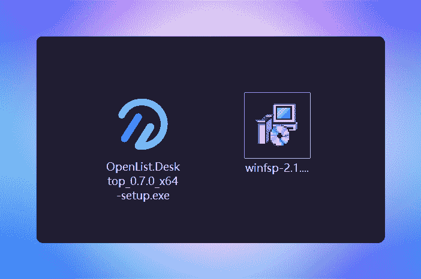
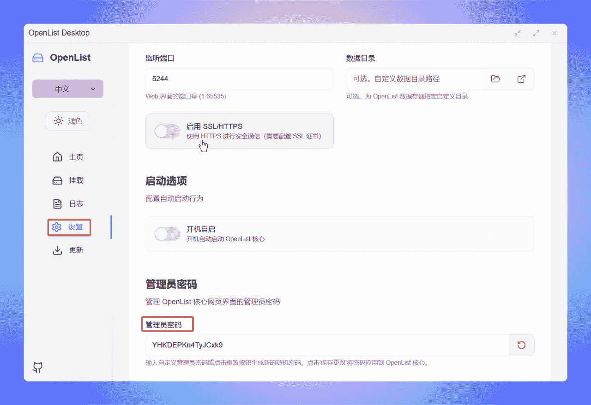
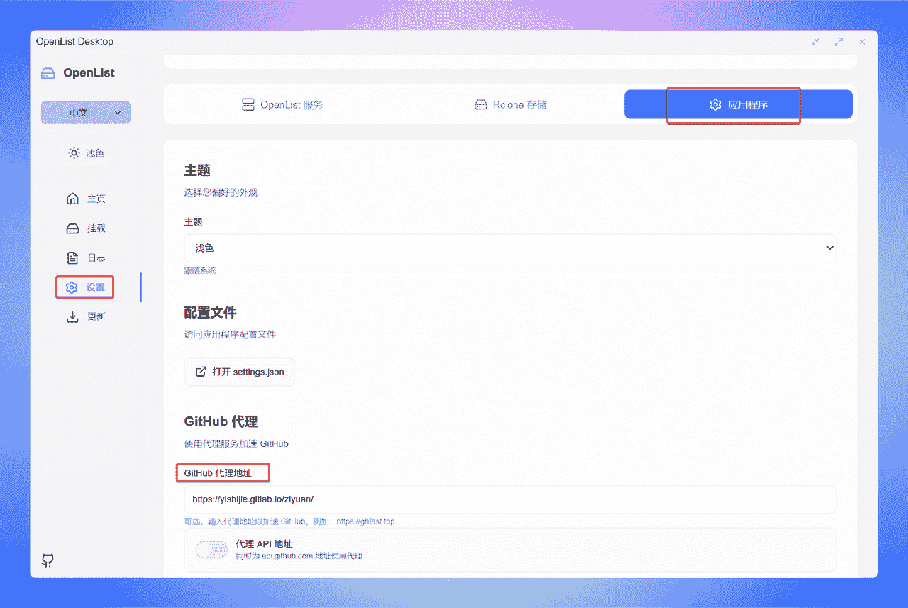
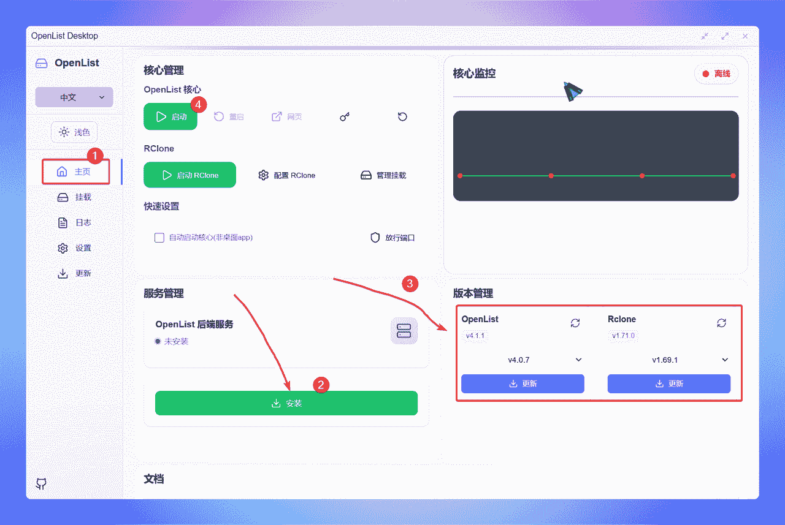
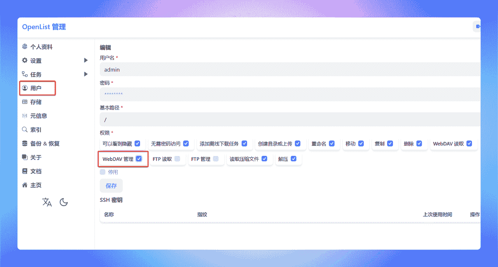
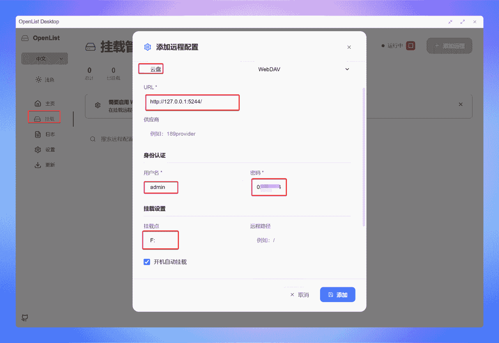
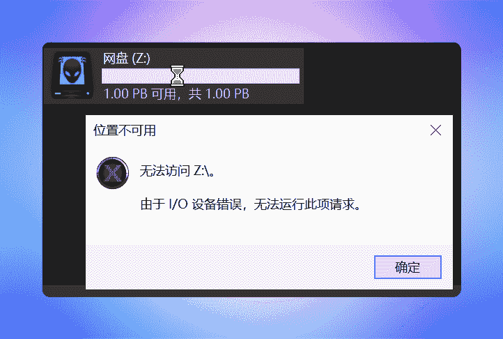

# OpenList-Desktop

> 来源：[https://xodnytdcaw.feishu.cn/docx/Mv4td6oOeo7qKtx7aNVcXq0cnNb](https://xodnytdcaw.feishu.cn/docx/Mv4td6oOeo7qKtx7aNVcXq0cnNb)

## 软件安装

OpenList-Desktop

https://github.com/OpenListTeam/OpenList-Desktop

winfsp

https://github.com/winfsp/winfsp/releases

## 软件配置

更改管理员密码

配置代理

核心管理

## 网盘挂载

### 添加储存

浏览器输入127.0.0.：5244

账号admin

密码：管理员密码

### 挂载本地

在挂载远程存储之前，请确保在OpenList核心中为用户启用了WebDAV管理功能

然后添加远程配置

### 报错

## 思考

另外一个本地网盘挂载项目

https://www.netmount.cn/

安装本地

安装路由器

安装在服务器