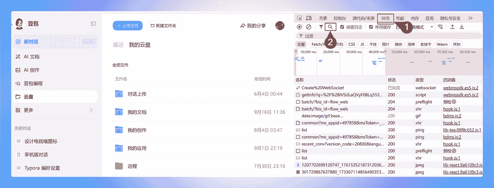
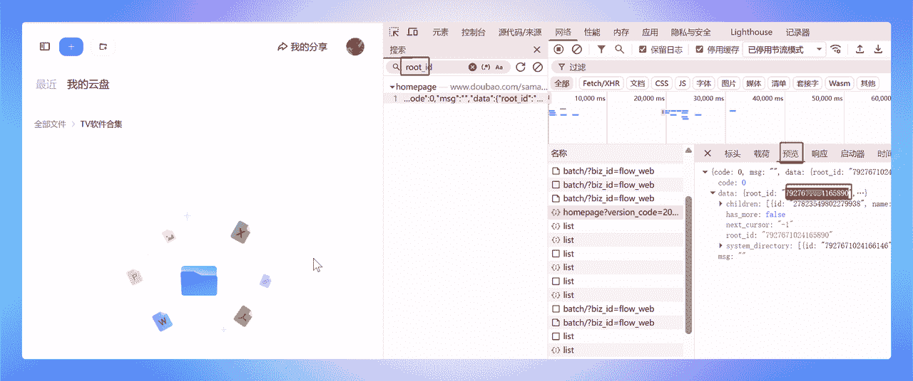
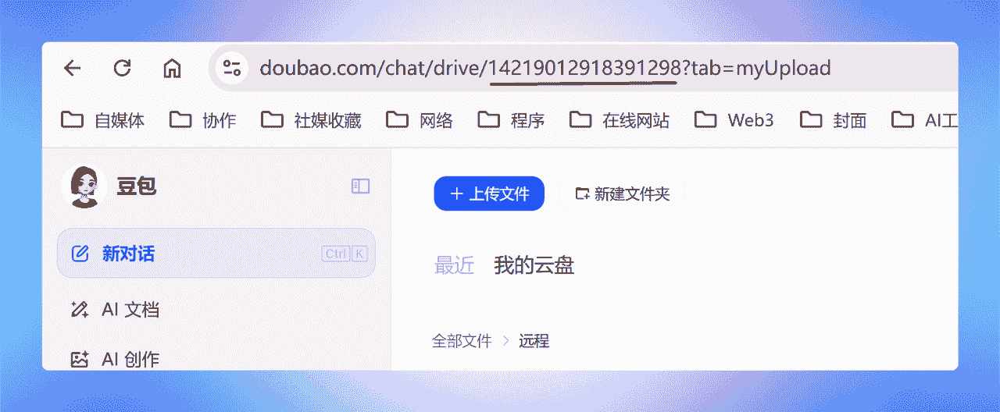

# Openlist挂载豆包网盘教程

> 来源：[https://xodnytdcaw.feishu.cn/docx/KV8pdglDEoREaUxmeRVc0GDynLg](https://xodnytdcaw.feishu.cn/docx/KV8pdglDEoREaUxmeRVc0GDynLg)

WebDAV 策略:本地代理

## Cookie

检查-网络-查找



搜索下方命令，随便点进去一个文件再退出来，刷新下，

搜索关键词

```
sid_guard
```

点搜索结果进去，会自动定位到，标头-cookie，复制以sid_guard开头的内容即可

## 根文件夹ID

### 所有根目录

进入文件夹，再出来，再进去，搜索

```
root_id
```

会自动定位响应，点击预览就可以看到root_id，直接复制值



### 单文件夹

直接打开你的文件，地址栏里的数字就是了

