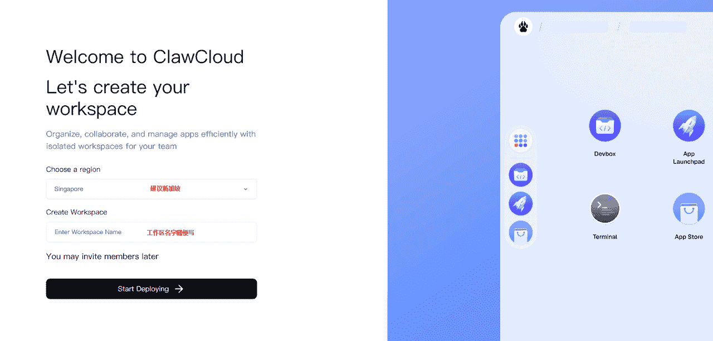
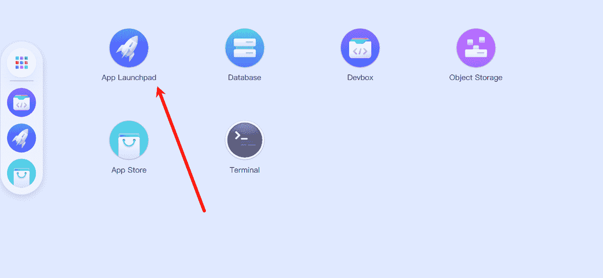
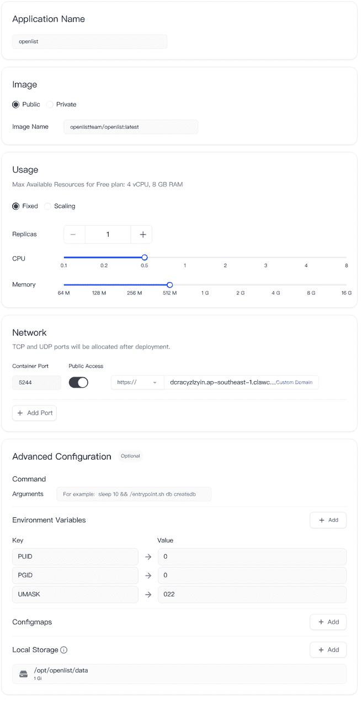

# 免费docker容器部署openlsit

> 来源：[https://xodnytdcaw.feishu.cn/docx/M8Kld9G6DoFpNzxd0vAc7DPtncb](https://xodnytdcaw.feishu.cn/docx/M8Kld9G6DoFpNzxd0vAc7DPtncb)

一个免费的docker容器部署平台，可以部署AI客户端，工作流，alist等项目，下面演示下自定义部署openlsit的方法

参考视频：https://www.bilibili.com/video/BV1zKVtzFEQH/?spm_id_from=333.1391.0.0&vd_source=206031f494850e57fd6c92ace02b1bed

## 注册地址

https://ap-northeast-1.run.claw.cloud/signin

注册超过180天的GITHUB用户,每个月可以获得五美元的赠送额度



## 自定义部署



点击“App Launchpad”-Create App

> Docker方式安装openlist命令

> 命令来源：https://doc.oplist.org/guide/installation/docker

```
docker run -d --restart=unless-stopped -v /etc/openlist:/opt/openlist/data -p 5244:5244 -e PUID=0 -e PGID=0 -e UMASK=022 --name=&quot;openlist&quot; openlistteam/openlist:latest
```

配置参数

