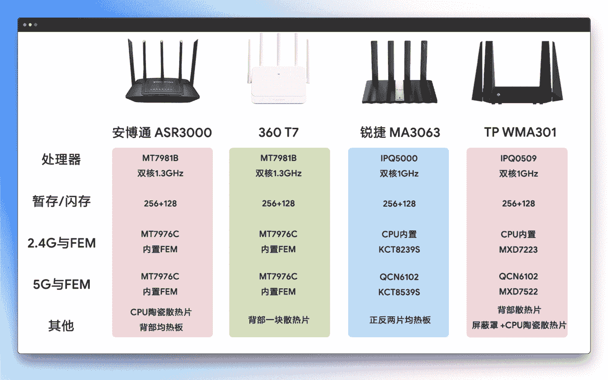
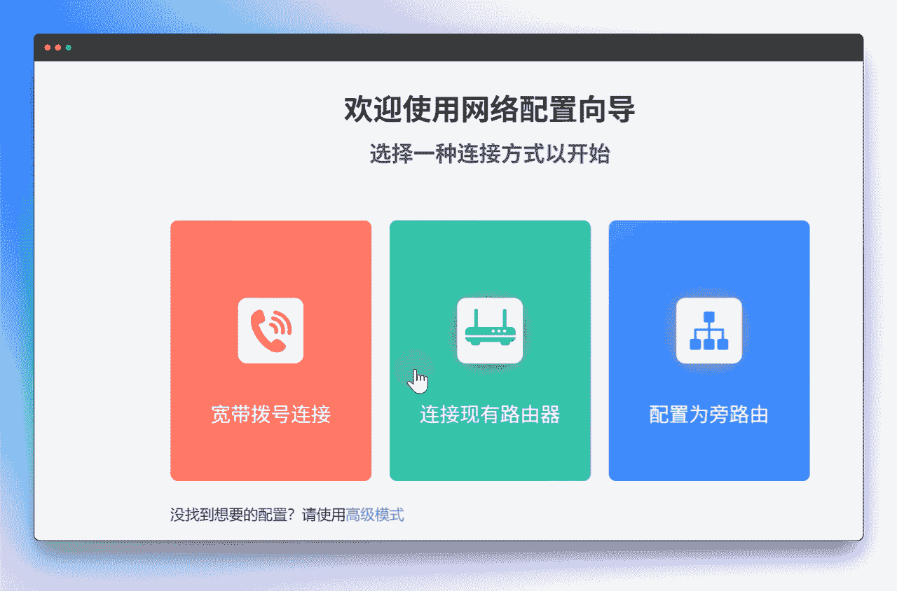
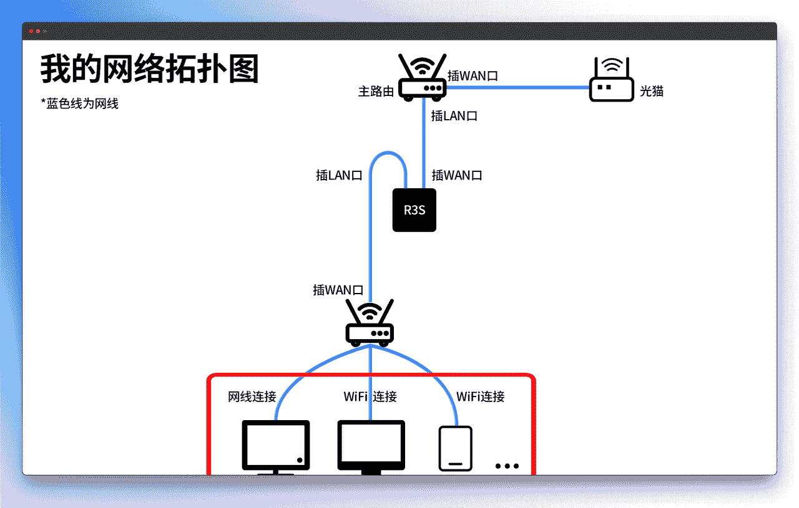
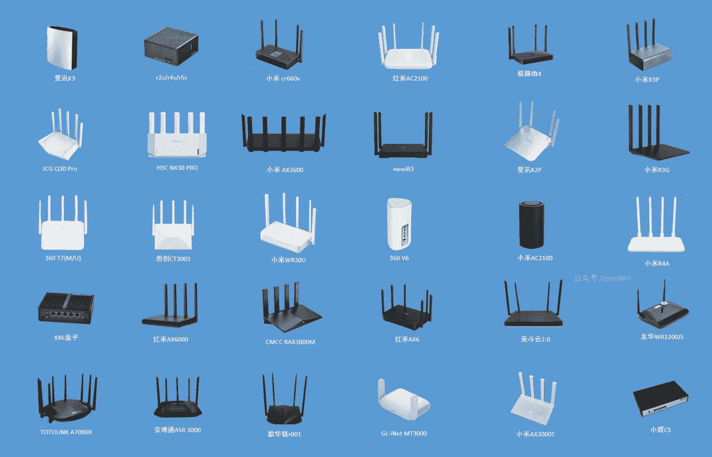
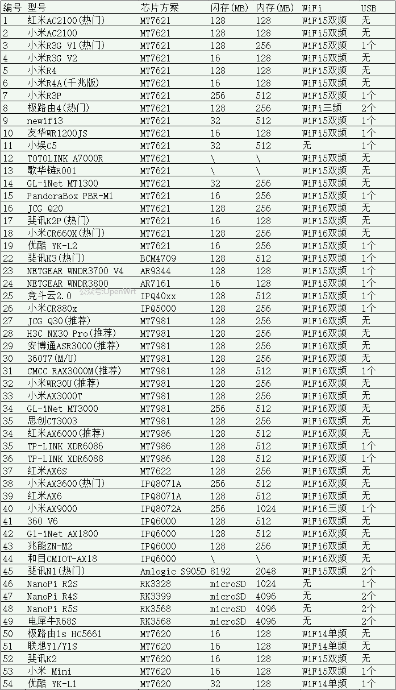

# 路由器选购/刷机

> 来源：[https://xodnytdcaw.feishu.cn/docx/TTI2dy0EnoSD4hxo1EAc4ewqnfh](https://xodnytdcaw.feishu.cn/docx/TTI2dy0EnoSD4hxo1EAc4ewqnfh)

## 百元路由器推荐

单间&公寓

哪个便宜买哪个

**商品房 36**0T7>**wma301** （注意 移动买wma301，电信买wmt301 否则有锁网风险）

## R3S软路由

准备工作：

MicroSD卡/TF卡: Class10或以上的 8GB SDHC卡

TF卡读卡器

一个TYPE-C接口的外接电源，建议输出为5V/3A

[R3S固件推荐

https://fw.](https://fw.koolcenter.com/iStoreOS/r3s/)koolcenter.com/iStoreOS/r3s/

后台地址：192.168.100.1

写盘[工具

https](https://gh-proxy.com/https://github.com/balena-io/etcher/releases/download/v2.1.4/balenaEtcher-2.1.4.Setup.exe)://etcher.[bal](https://gh-proxy.com/https://github.com/balena-io/etcher/releases/download/v2.1.4/balenaEtcher-2.1.4-arm64.dmg)ena[.io/ （W](https://gh-proxy.com/https://github.com/balena-io/etcher/releases/download/v2.1.4/balenaEtcher-2.1.4-x64.dmg)indows版 | macOS: M芯片 | Intel芯片）

https://rufus.ie/zh/

[科学插件下载](https://github.com/bcseputetto/Are-u-ok/releases)

点击查看>> [开启代理打开速度更快]

支持刷机的路由器

+   Cudy TR3000   可以直接刷

+   斐讯K2P  梅林固件

