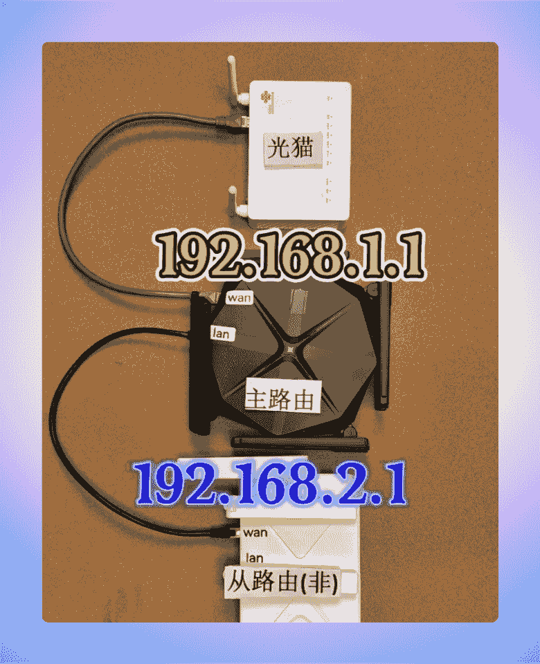
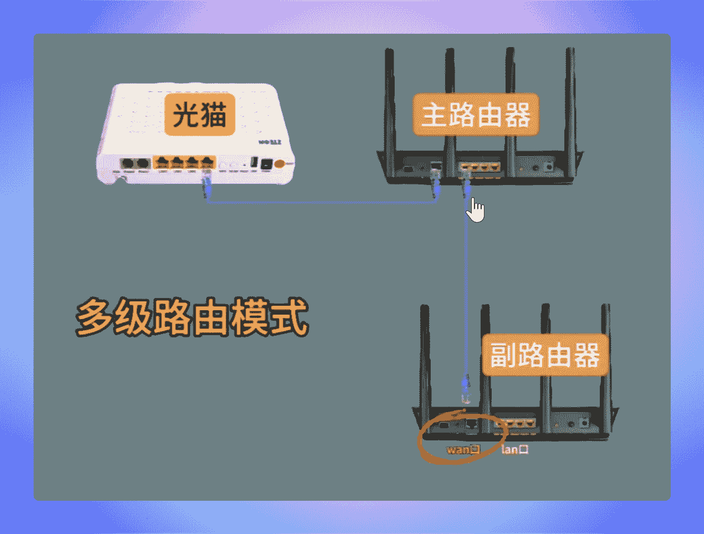
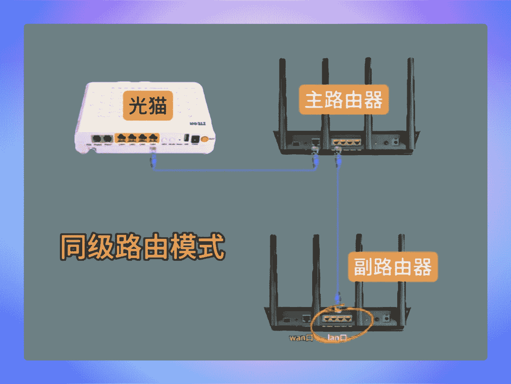
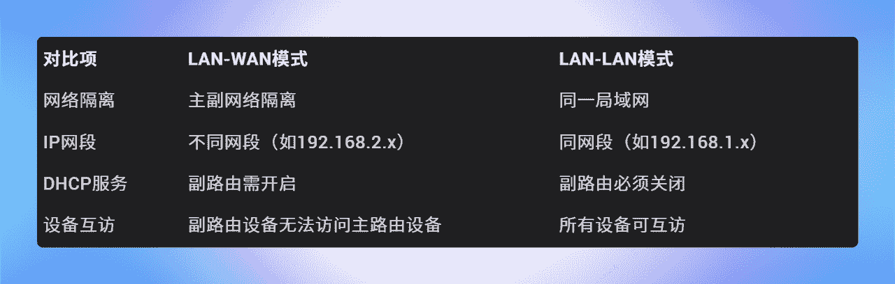

# 两路由器有线桥接

> 来源：[https://xodnytdcaw.feishu.cn/docx/MDw5dbeado8kCDx2uQMc7JVinrc](https://xodnytdcaw.feishu.cn/docx/MDw5dbeado8kCDx2uQMc7JVinrc)

## 方式一：LAN-WAN 桥接（子网络模式）

将副路由器的 WAN口 连接主路由器的 LAN口，形成独立子网。

+   适用场景：需要隔离网络（如出租房、公司分部）

+   IP设置：主路由192.168.1.1 → 副路由192.168.2.1（不同网段）

+   DHCP：副路由器需开启DHCP（分配192.168.2.x地址）

+   连接方式：主路由LAN口 → 网线 → 副路由WAN口

## 方式二：LAN-LAN 桥接（交换机模式）

将副路由器作为无线交换机使用，所有设备处于同一局域网。

+   适用场景：家庭无缝漫游，所有设备互访

+   IP设置：副路由IP改为192.168.1.2（同网段未占用地址）

+   DHCP：必须关闭副路由DHCP，由主路由统一分配IP

+   连接方式：主路由LAN口 → 网线 → 副路由LAN口

## 关键设置对比

## 通用设置步骤

1.  准备阶段：确认主路由可正常上网，记录其IP（如192.168.1.1）

1.  副路由初始化：单独连接副路由，登录管理界面（默认IP多为192.168.1.1）

1.  修改IP地址：

+   LAN-WAN模式：改为192.168.2.1（不同网段）

+   LAN-LAN模式：改为192.168.1.2（同网段未占用地址）

1.  关闭DHCP（仅LAN-LAN模式需要）

1.  网线连接：根据模式选择WAN口或LAN口连接

1.  无线设置：建议将副路由WiFi名称密码与主路由一致，实现无缝漫游