# 旁路由配置指南，附分流方案

> 来源：[https://xodnytdcaw.feishu.cn/docx/Old7dkRTioE1g0xWUwEc9zAUnhg](https://xodnytdcaw.feishu.cn/docx/Old7dkRTioE1g0xWUwEc9zAUnhg)

## 一.引言：

今天来讲无需改变家庭原有网络结构，主路由保留基础功能，软路由专注🪜等扩展任务，避免主路由配置冲突或断网风险，实现家里所有设备🪜，另外通过openwrt分流规则为不同的设备分配不同的网关。

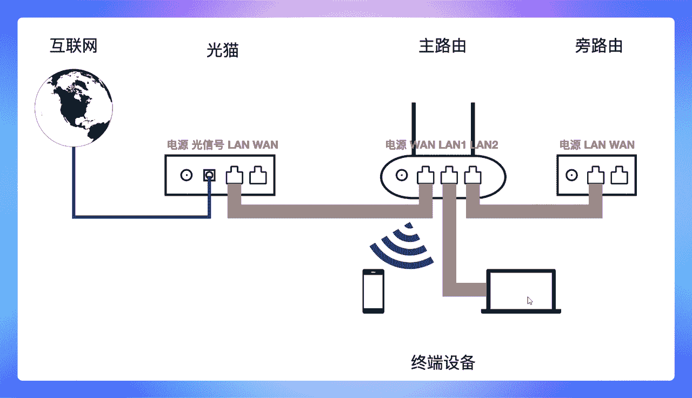

## **二.旁路由配置**

LAN-LAN 桥接（交换机模式（同级路由模式）将副路由器作为无线交换机使用，所有设备处于同一局域网。

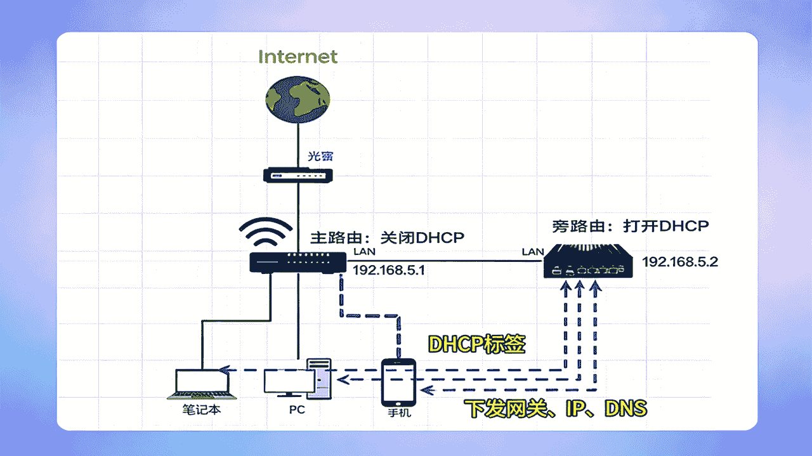

+   适用场景：家庭无缝漫游，所有设备互访

+   主路由保持默认设置，软路由刷OpenWrt系统，LAN口连接主路由LAN口（禁用软路由WAN口）

+   IP设置：副路由IP改为192.168.1.2（同网段未占用地址）

+   DHCP：必须关闭主路由DHCP由旁路由统一分配IP，避免地址冲突

+   连接方式：主路由LAN口 → 网线 → 副路由LAN口

+   无线设置：建议将副路由WiFi名称密码与主路由一致，实现无缝漫游

### 1.接口配置

> 网络-接口-LAN

#### 常规设置

谁提供DHCP服务 DNS和网关就是谁 所以电脑的网关应该是IP地址为（旁路由192.168.5.1）

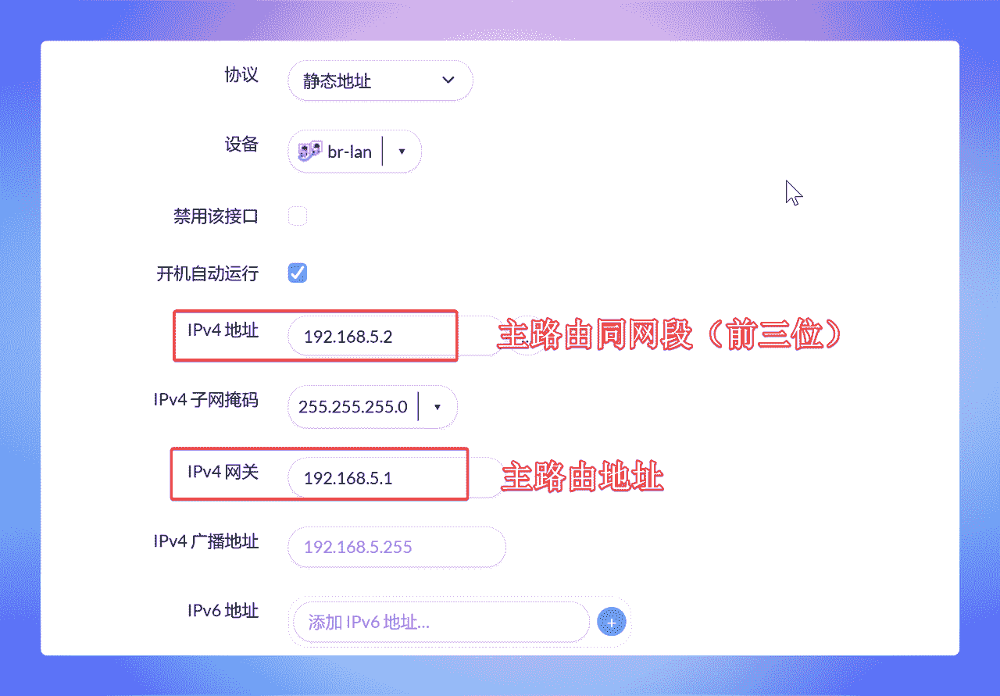

> **IPV4地址：**

> 改成和主路由同网段的某一个空闲IP，我主路由的IP是192.168.5.1 为了方便记忆 我这里改成192.168.5.2

>

> **IPV4网关：**

> 改成主路由的IP 192.168.5.1 因为这台旁路由要上网的话同样也得找网关，也就是主路由

#### **高级设置**

将**DNS服务器**同样设置为**主路由 **

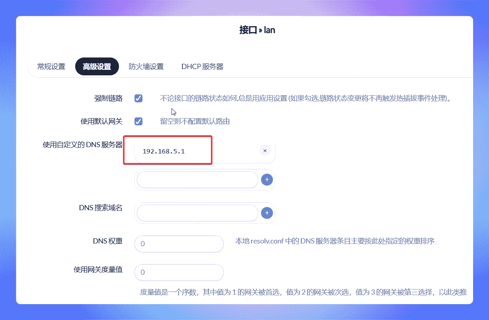

#### DHCP服务器

我们需要让旁路由提供DHCP服务 默认没有勾选就说明已经开启了

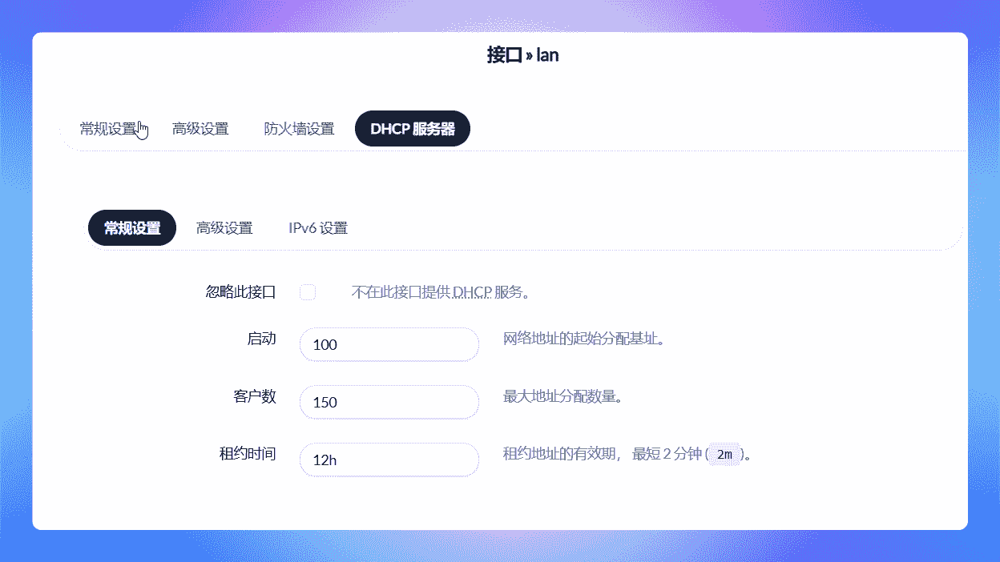

### 2.防火墙配置

> 网络-防火墙

#### **开启NAT**

具体操作：lan→wan区域，☑️IP动态伪装

如果不开会造成什么问题？

连接主路由wifi的设备，只能访问国外网站，国内部分网站打不开，直播看不了，所有网站流量IP会叛国外ip

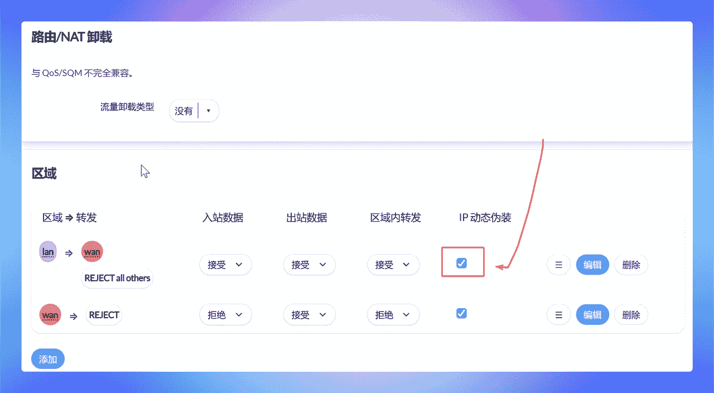

#### NAT原理剖析

> 谁提供DHCP服务 DNS和网关就是谁

>

> 在**旁路由模**式下，设备的默认网关仍然是主路由，但部分流量会被主路由转发到旁路由进行分流处理。为了保证这些经过旁路由的连接能够完整往返，旁路由会自动创建一个 NAT 连接表（NAT Table） 来记录每一个经过它的会话。

>

> 当设备向外网发起请求时，旁路由会对源地址进行一次伪装（Masquerading），使外网看到的源地址是主路由的公网 IP 而不是设备的私网 IP。与此同时，旁路由会在 NAT 连接表中记录：

+   原始设备的内部地址（如 192.168.5.193）

+   对应被伪装后的外部地址（主路由的公网 IP）

+   端口号及对应会话信息

>

> 当外网返回数据包时，主路由会将此数据包交给旁路由。旁路由通过查询 NAT 连接表，就能准确判断该数据包属于哪个内部设备，并将其成功转发回去。

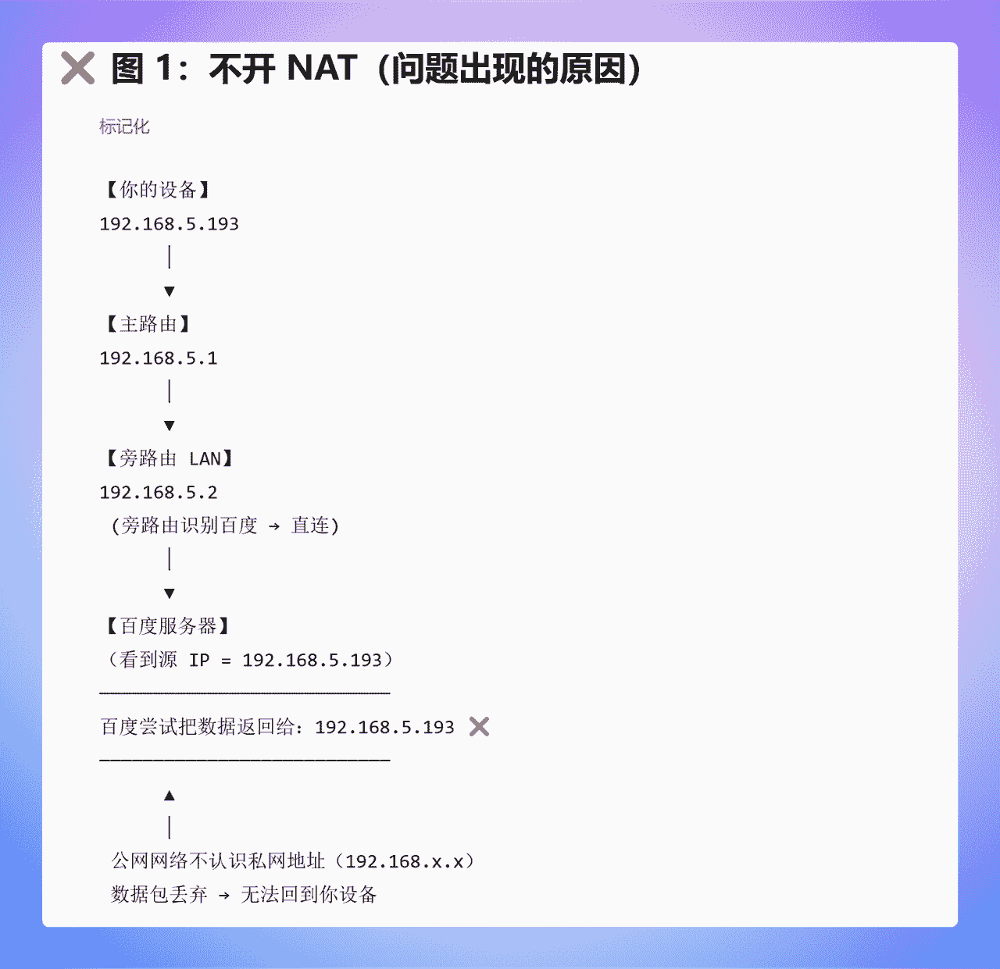

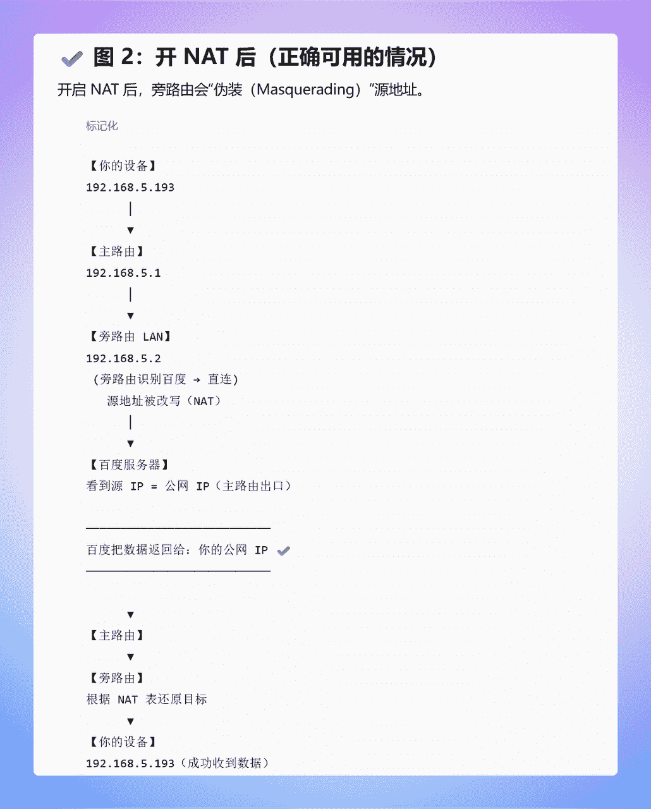

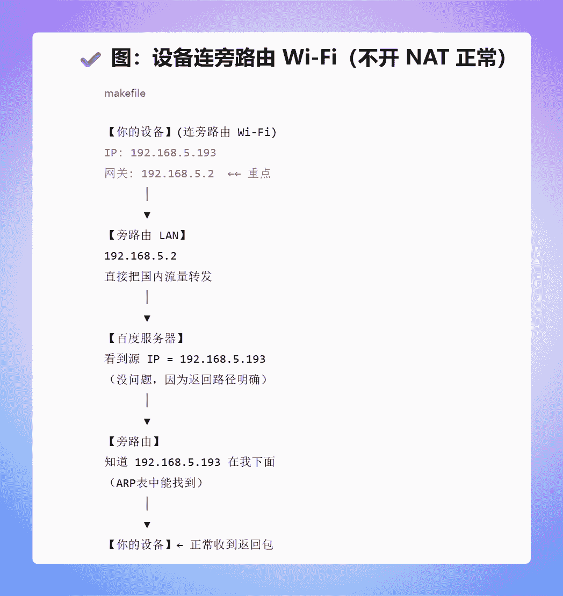

### **3.分流规则**

openwrt默认使用DNSMASQ提供DHCP和DNS服务，让DHCP服务器为不同的设备分配不同的网关，

> 网络-DHCP/DNS

#### 大部分设备走代理，小部分设备走直链

> 假设我现在想让苹果和安卓不能🪜 其他所有设备都能🪜 那么只需要让他们两个的网关和DNS指向主路由 其他设备全部指向旁路由即可

> 先将安卓和苹果的mac地址进行静态绑定

> 静态绑定就是将mac地址和某个IP添加映射关系 以后这个mac地址再找这台DHCP服务器要IP 都会分配之前绑定的这个固定的IP地址 （无线局域网地址=mac地址）

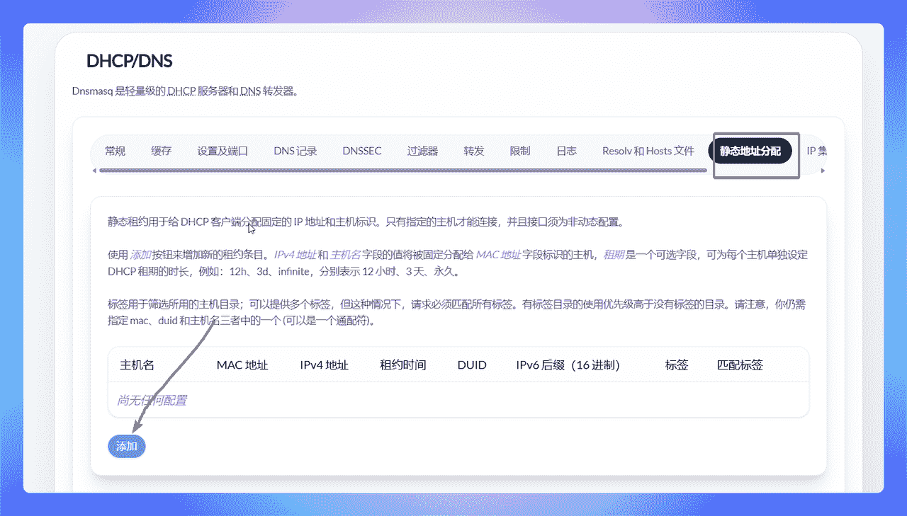

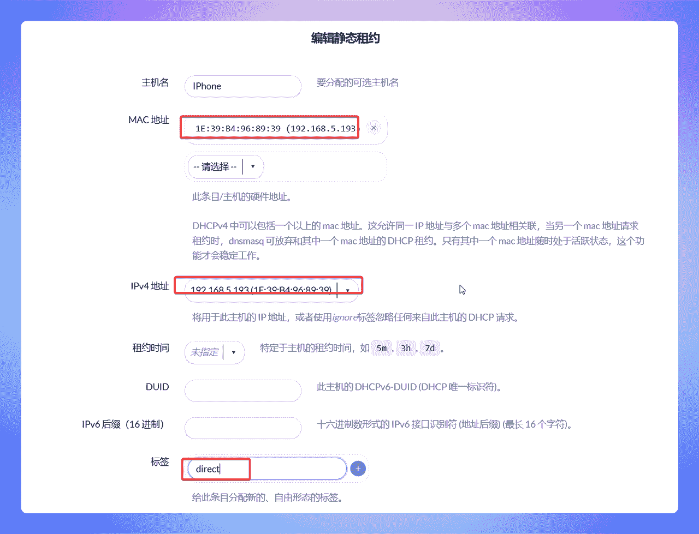

进入LAN口的DHCP高级配置 在DHCP

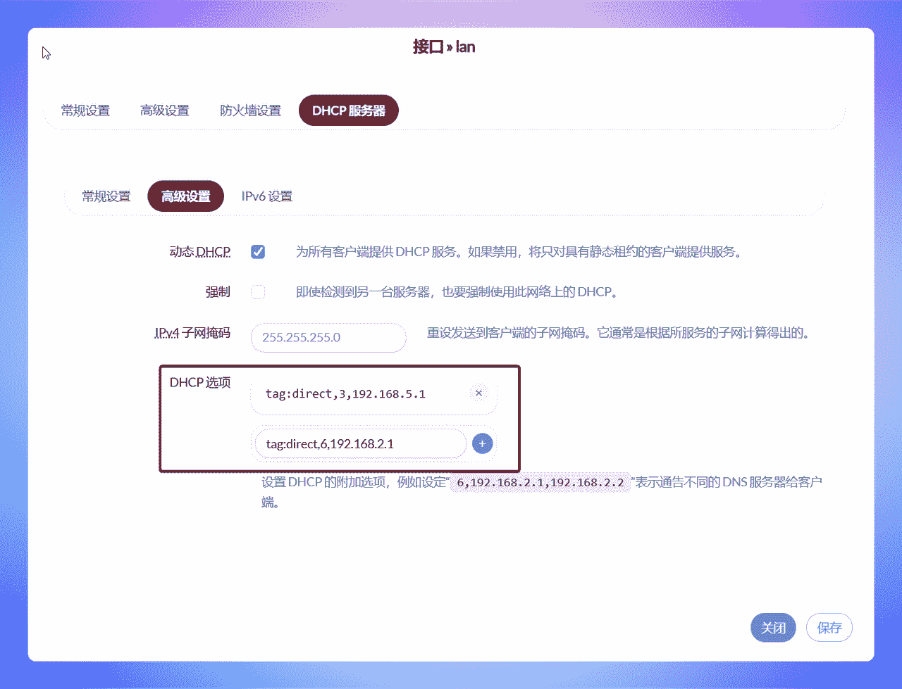

> tag:direct,3,192.168.5.1

> 意思是所有标签为direct的设备，只走网关为192.168.5.1 也就是主路由的IP

> tag:direct,6,192.168.5.1

> 所有标签为direct的设备 DNS只能是192.168.5.1 其他不是direct的设备标签还是按默认的,谁提供DHCP服务网关和DNS就是谁.

#### 大部分设备走直链，小部分设备走代理

> tag:!proxy,3,192.168.5.1

> tag:!proxy,6,192.168.5.1

> 意思是如果标签不是proxy的设备，就给它分配网关为192.168.5.1（主路由直连），也就是除了proxy的设备，其他设备的网关都会分配主路由的IP 192.168.5.1

## 三.主路由配置

⚠️关闭主路由DHCP由旁路由统一分配IP

主路由IP地址更改/DHCP服务位置

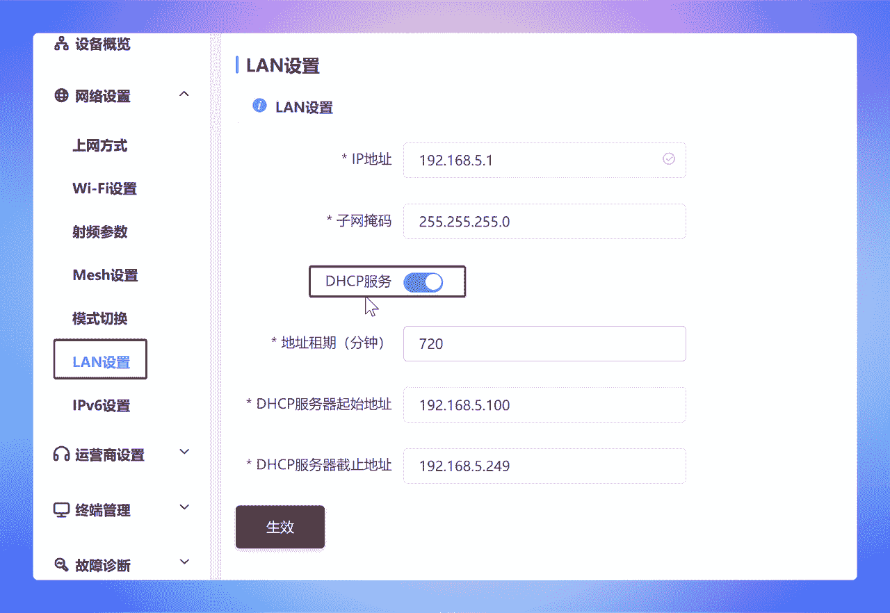