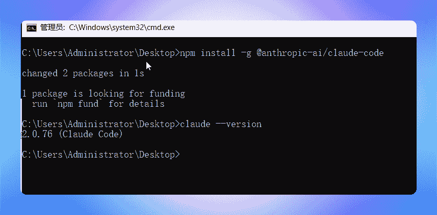
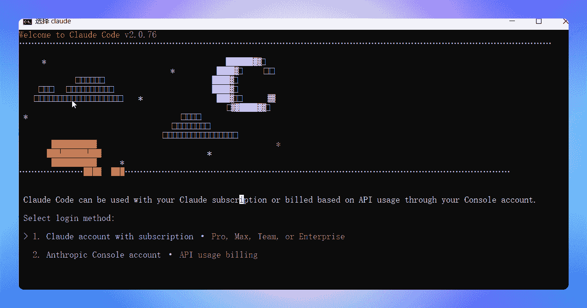
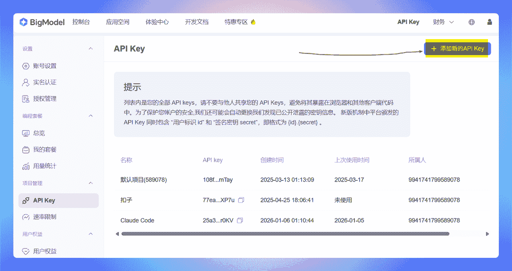
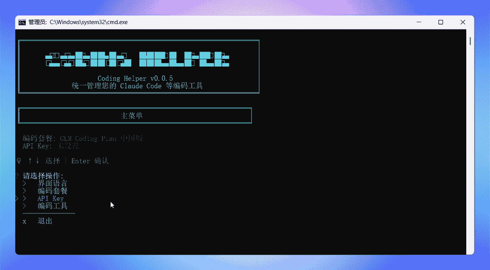
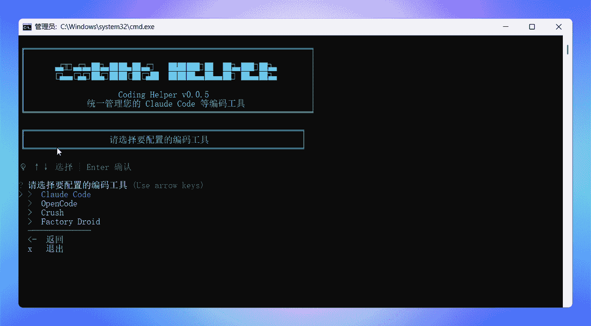
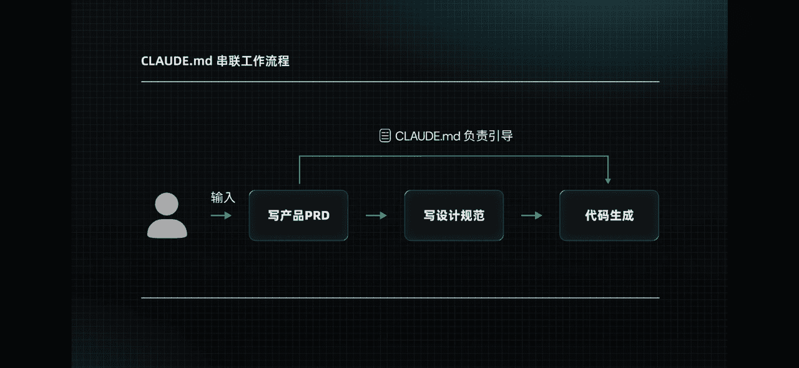
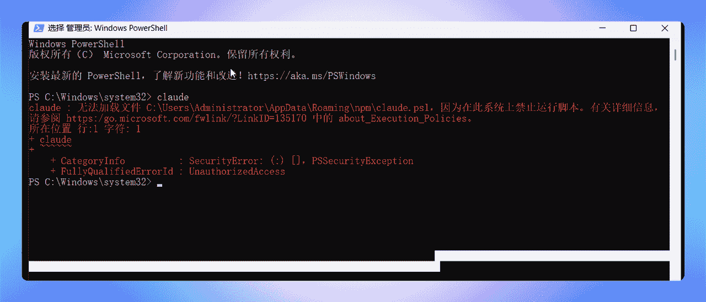
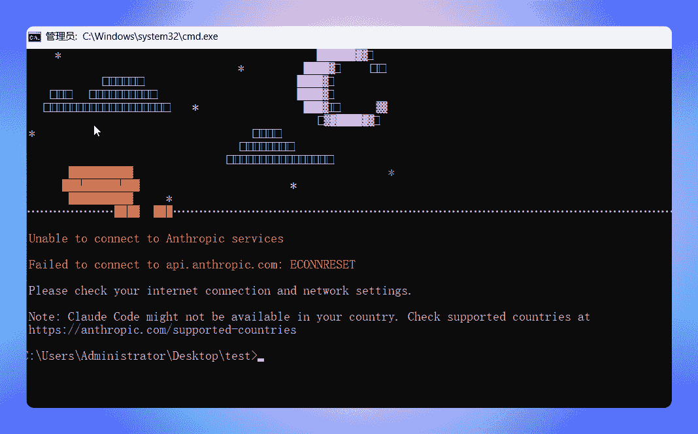
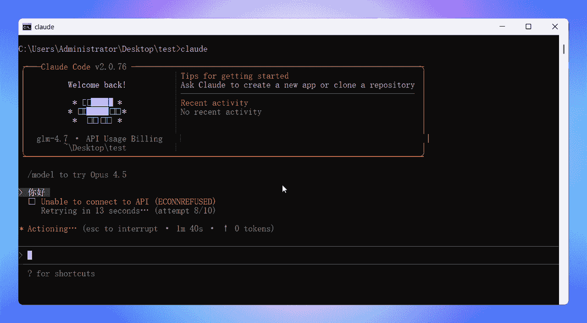

# Claude Code安装使用指南

> 来源：[https://xodnytdcaw.feishu.cn/docx/B7rKdZAlvoFJs8xWJKkcQUThnUg](https://xodnytdcaw.feishu.cn/docx/B7rKdZAlvoFJs8xWJKkcQUThnUg)

你是否厌倦了在IDE和ChatGPT之间来回切换？渴望一个真正懂你代码的AI助手？

这几天，Claude Code彻底火了，网上都在夸赞这个由Anthropic出品的命令行AI编码工具。不同于那些花哨的AI插件，Claude Code直接住进你的终端，像个老司机一样帮你写代码、修bug、重构项目。

我也测试了一圈下来，确实牛批！免费、不限量、速度快，关键是它真的能理解你的整个项目结构。

今天，我就给大家整理一份保姆级教程，让你5分钟上手Claude Code。

## 一.准备工作

1.  Node.js 18 或更高版本

> 请前往 Node.js 官方网站安装最新 LTS 版本，确保 Claude Code 能正常运行。

> https://nodejs.org/en/download/

>

1.  Git（Windows 用户必需）

> **如果你使用 Windows，请**提前安装 Git for Windows，否则后续依赖安装可能失败。

> https://git-scm.com/install/windows

## 二.安装[**Cl**](https://www.i7dc.com/docs/getting-started/claude-code-uninstall)**a**ude Code（卸载方法：点此）

```
npm install -g @anthropic-ai/claude-code
```

安装完成后，输入下面的命令查看是否安装成功。只要能看到版本号，就表示已经就绪：

```
claude --version
```



**启动Claude Code**

重新打开一个新的终端窗口，进入你的项目目录，运行claude。

```
cd test
claude
```



> 启**动后会要求你授权，为了节约成本，这里推荐接入API的方法使用，你可以订阅智谱GLM Coding** Lite，然后将API通过CC-switch进行管理启动，供Claude Code使用，当然你有gemini pro会员，也可以借助Antigravity Tools反代API，通过CC-switch进行管理启动供Claude Code使用。

## 三.配置**Claude Code的API**

### 1.购买API  KEY

[点此领优惠卷购买](https://www.bigmodel.cn/glm-coding?ic=PUCQNADSPM)  3个月只要48.6


### 2.创建API key



### 3.配置API三种方法：

#### **方法1：CC-switch**[**点此直达**](https://github.com/farion1231/cc-switch)**  （推荐）**

> 一款基于 Rust + Tauri 开发的跨平台 AI 工具配置管理工具，核心功能是一键切换 Claude Code、Codex、Gemini CLI 等 AI 编程工具的多套 API / 供应商配置，还具备可视化管理、技能扩展与云端同步能力，能替代手动编辑 JSON 配置的繁琐操作，大幅提升 AI 开发效率。

#### **方法2：**Coding Tool Helper

win+r输入cmd，粘贴以下命令可以直接讲GLM的API服务器配置到Claude Code

```
npx @z_ai/coding-helper
```

进入这个界面，选择第三个回车，然后粘贴API





#### 方法3：Claude-code-router

可以把任意的大模型接入到**Claude Code**

安装命令   视频教程：[点此直达](https://www.bilibili.com/video/BV1jGtEzNEAv/?spm_id_from=333.1387.upload.video_card.click&vd_source=206031f494850e57fd6c92ace02b1bed)

```
npm install -g @musistudio/claude-code-router
```

创建配置文件

> ~/.claude-code-router/config.json

配置文件config.json样列

```
{
  &quot;Providers&quot;: [
    {
      &quot;name&quot;: &quot;modelscope&quot;,
      &quot;api_base_url&quot;: &quot;http://127.0.0.1:8045/v1beta/models&quot;,
      &quot;api_key&quot;: &quot;sk-&quot;,
      &quot;models&quot;: [&quot;gemini-3-flash&quot;, &quot;gemini-3-pro-high&quot;],
      &quot;transformer&quot;: {
        &quot;use&quot;: [
          [
            &quot;maxtoken&quot;,
            {
              &quot;max_tokens&quot;: 65536
            }
          ],
          &quot;enhancetool&quot;
        ],
        &quot;gemini-3-pro-high&quot;: {
          &quot;use&quot;: [&quot;reasoning&quot;]
        }
      }
    }
  ],
  &quot;Router&quot;: {
    &quot;default&quot;: &quot;modelscope,gemini-3-pro-high&quot; // &lt;--- 修改这里
  }
}
```

在桌面新建test文件，打开cmd，输入一下命令启动

```
ccr code
```

## 四.上手claude Skills

Skills 是给 Claude 装的"专业技能包"。就像RPG游戏里给角色学技能，一个 Skill 让 Claude 在特定领域变成专家。Skills 是打包好的指令、脚本和资源，Claude 会自动发现并按需加载，让它在特定任务上表现更好。

**目**前skills支持在Claude.ai、Claude Code以及API中使用，Skills 有两个位置

```
~/.c**laude/s**kills/              # 全局 Skills  (所有项目可用)
project/.claude/skills/        # 项目 skills (仅当前项目，可 git 共享)
```

> 案例

> [使用Claude Code的Slash Command 编排写作工作流](https://xodnytdcaw.feishu.cn/wiki/TN6OwOsijiyDL9kjWQ1cw6a9nxe)

> GitHub上1400星的Skills清单,老金给你扒个明白 - 知乎

### 理解CLAUDE.md

存储位置：项目根目录 ./CLAUDE.md



### 理解Claude Code 的 Slash Commands(自定义斜杠命令）

```
mkdir -p ~/.claude/commands
```

```
touch ~/.claude/commands/search-web.md
```

search-web.md内容

```
---
allowed-tools: Bash(*)
description: 使用 Gemini CLI 搜索特定站点并进行 UltraThink 总结
argument-hint: [搜索关键词]
---

# 任务目标
在互联网上搜索关于 &quot;$ARGUMENTS&quot; 的内容，并挖掘最靠谱、最能解答疑问的信息。

# 搜索要求
1. **限定范围**：重点关注以下站点的资料和动态：
   - anthropic.com
   - x.com
   - reddit.com
   - linux.do
2. **时效性**：搜索当前月份（!`date &quot;+%Y年%m月&quot;`）的最新消息 [1]。
3. **执行工具**：必须调用本地的 `gemini cli` 工具，并利用其 `GoogleSearch` 功能执行查询。
4. **并行处理**：请启动多个并行的子任务（同时调用多次 Bash 工具）分别检索上述不同站点，以加快执行速度。
5. **总结逻辑**：在给出最终回复前，请开启 **UltraThink (Extended Thinking)** 模式。深度分析各方资料的冲突、真实性和深度，最后提供一份结构严密的总结。

# 搜索指令示例（供你参考执行）
- `gemini search &quot;site:linux.do $ARGUMENTS&quot;`
- `gemini search &quot;site:anthropic.com $ARGUMENTS&quot;`

```

使用示例

```
/search-web  Claude Code上手教程
```

## 六.常见问题

#### 1.PowerShell运行不了命令Claude

以管理员身份运行 PowerShell，执行：Set-ExecutionPolicy RemoteSigned（该策略允许运行本地签名脚本、远程可信签名脚本），按提示输入Y确认。



#### 2.网络问题

windows下的cmd默认不支持梯子，需要在环境变量下设置下，并让梯子走全局代理‘’






+   检查这个文件API正确C:\Users\Administrator\.claude\settings.json

+   检查C:\Users\Administrator\.claude.json

最后的结局方案：

我自己用的OpenWrt系统路由器，给电脑direct标签（可选），电脑使用客户端解决

配置环境变量 创建文件夹D:\Tools  里面cl.bat  端口改你自己

```
@echo off
set HTTP_PROXY=http://127.0.0.1:3067
set HTTPS_PROXY=http://127.0.0.1:3067
echo [Claude CLI] 代理隧道已建立 (Port:3067)...
for /f &quot;delims=&quot; %%i in (&#x27;where claude&#x27;) do (
    &quot;%%i&quot; %*
    goto :finish
)

echo.
echo [Error] 未在系统路径中找到 &#x27;claude&#x27; 程序。
echo 请确保你已经正确安装了 claude-cli 并且它在你的系统环境变量 PATH 中。
goto :finish

:finish
:: 脚本结束，临时设置的环境变量会自动销毁，不影响系统其他程序
echo.
```

然后命令命令sysdm.cpl进入配置环境变量，两种方法都可以

方法1：用户变量---Path---编辑---新建粘贴 D:\Tools

方法2：系统变量---新建

> 变量名：http_proxy   变量值：http://127.0.0.1:1080

> 变量名：https_proxy变量值：http://127.0.0.1:1080

## 七.写在最后

Claude Code确实是目前最好用的AI编程工具之一，它不像其他工具那样花哨，而是专注于真正提升你的编程效率。当然，一些简单的任务基本用不到AI，反而会拖累你的效率，日常可以根据自己的实际情况，是否使用AI辅助。以上，既然看到这里了，如果觉得不错，随手点个赞、在看、转发三连吧，如果想第一时间收到推送，也可以给我个星标⭐～

谢谢你看我的文章，我们，下次再见。

PS.如有网络不便下载，回复暗号「ClaudeCode」获取安装包网盘下载地址。

### 补充：参考资料

[Claude Code从入门到狂飙](https://ai.feishu.cn/wiki/JAjhwcIlHixsf1kDlI8cHAfanyd)

```
36233@r2
```

Claude Code 超级小白入门指南

https://mp.weixin.qq.com/s/pEPweAhpzZb1ef5oMvaDDA