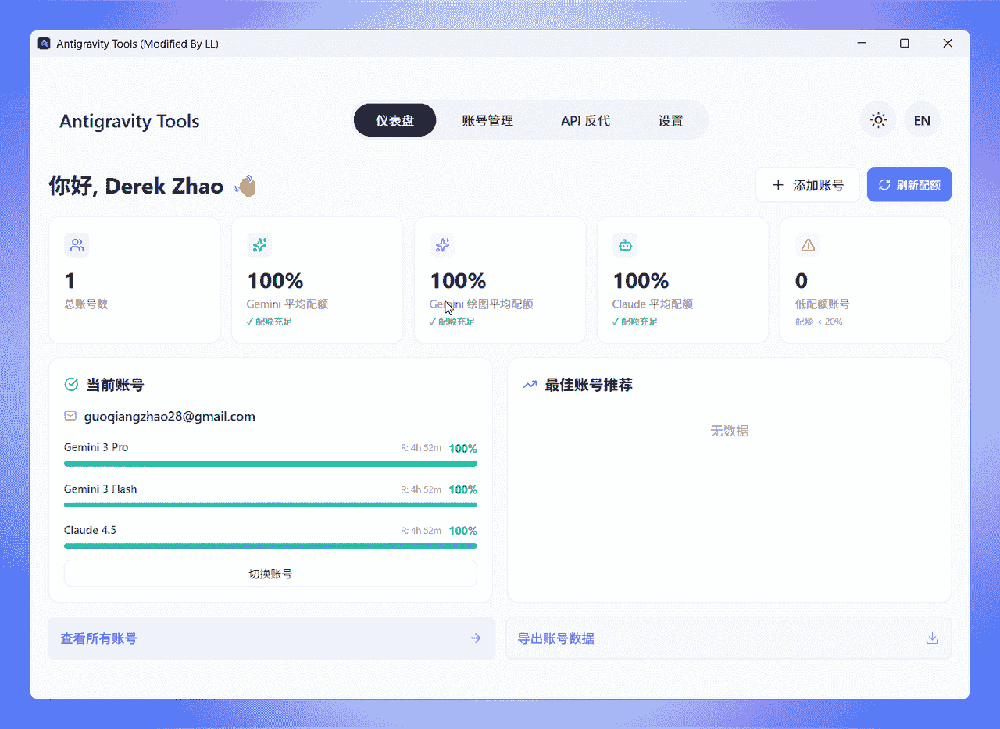
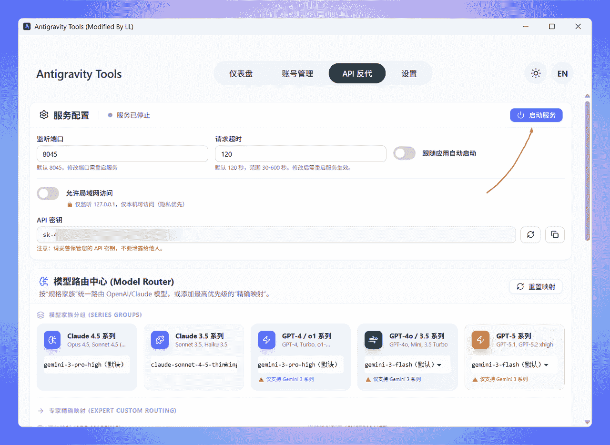
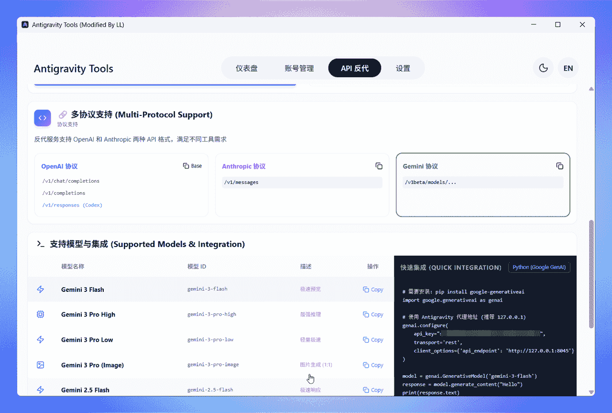
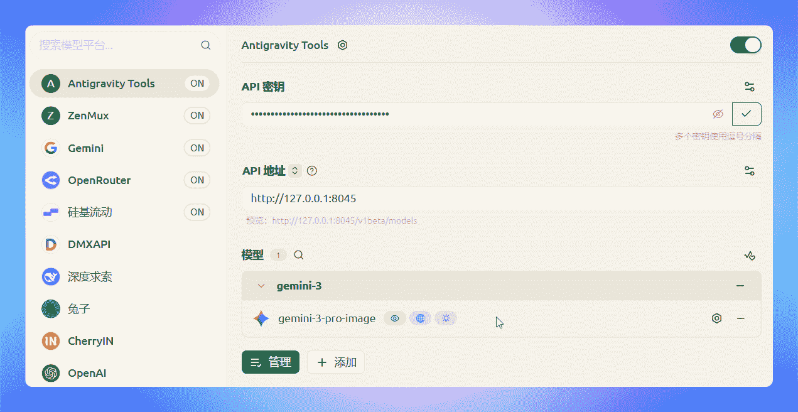
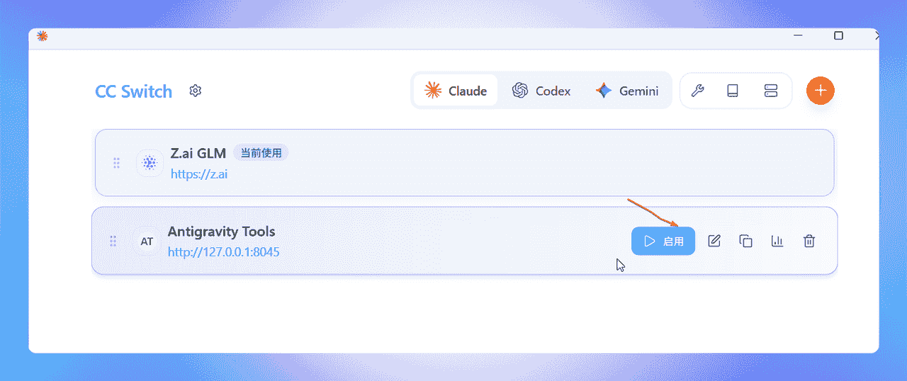

# Antigravity Tools教程

> 来源：[https://xodnytdcaw.feishu.cn/docx/QoKzdeK9OoNCOQxXgXrcGDeKneh](https://xodnytdcaw.feishu.cn/docx/QoKzdeK9OoNCOQxXgXrcGDeKneh)

Antigravity Tool是一个把 Antigravity 里面的模型转成标准 API，给 Claude Code 等 Coding Agent 接入的智能代理项目。提供多账号管理、协议转换和智能请求调度等功能，让你能稳定、低成本地在 Claude Code、Codex 中使用 gemini / claude 系列模型。

## 安装客户端

https://github.com/lbjlaq/Antigrav[ity-Ma](https://github.com/nguyenphutrong/quotio)nager   类似的项目：quotio

在 Antigravity Tools 桌面软件添加账号，打开浏览器通过谷歌账号登录 Antigravity

> 1. 打开“Accounts / 账号” → “添加账号” → “OAuth”。

> 2. 弹窗会在点击按钮前预生成授权链接；点击链接即可复制到系统剪贴板，然后用你希望的浏览器打开并完成授权。

> 3. 授权完成后浏览器会打开本地回调页并显示“✅ 授权成功!”。

> ⚠️：授权登录不了的话，可以使用开启了“TUN模式"或“虚拟网卡模式”，或者切换魔法新加坡



## 配置环境变量

启动 Antigravity，并在“API 反代”页面开启服务。



## 接入使用

> OpcnAI 协议  可以接入Codex

> Anthropic 协议  可以接入Claude Code

> Gcmini 协议  可以接入Cherry Studio



### Cherry Studio



### Claude Code

#### 启动CC-switch托管Antigravity Tools反代API



#### 终端启动

```
Claude code
```

### Codex