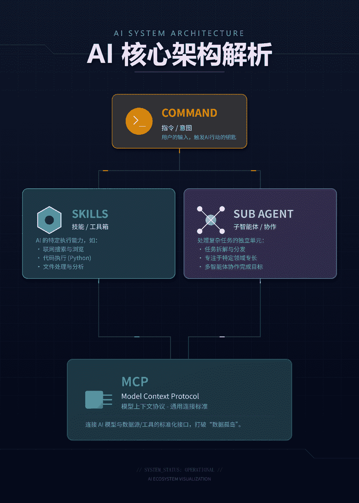
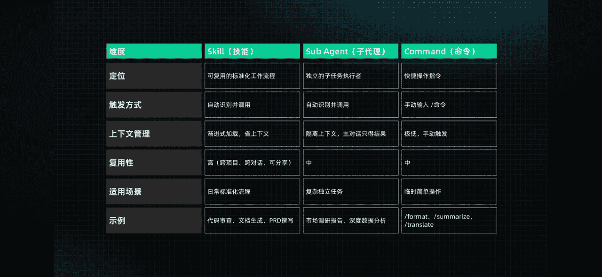
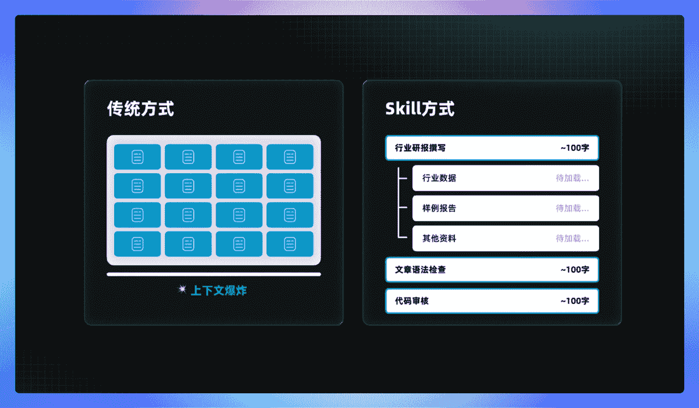
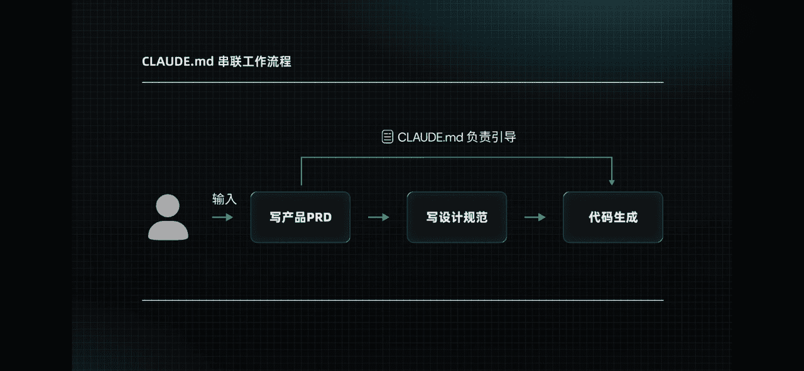
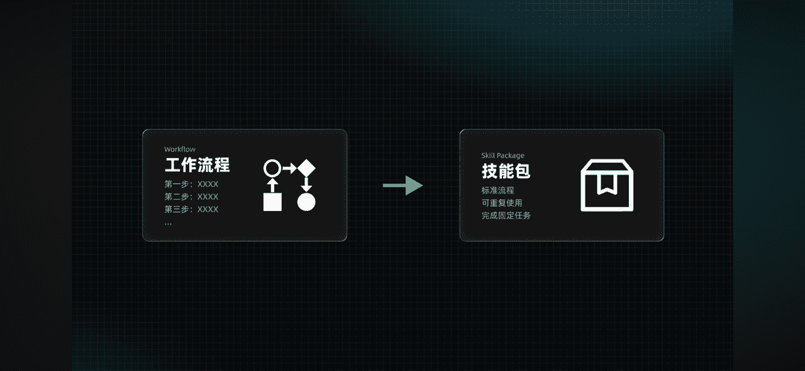

# Skills/Command/Sub Agent/MCP

> 来源：[https://xodnytdcaw.feishu.cn/docx/VJH1dsxTQom2PNxYUmJcLVp7nXe](https://xodnytdcaw.feishu.cn/docx/VJH1dsxTQom2PNxYUmJcLVp7nXe)

Skills (技能)、Command (指令)、Sub Agent (子智能体) 和 MCP (模型上下文协议) 四个核心概念

