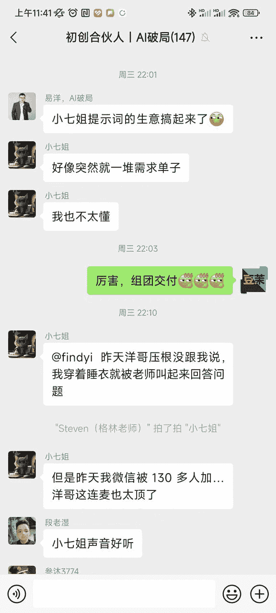
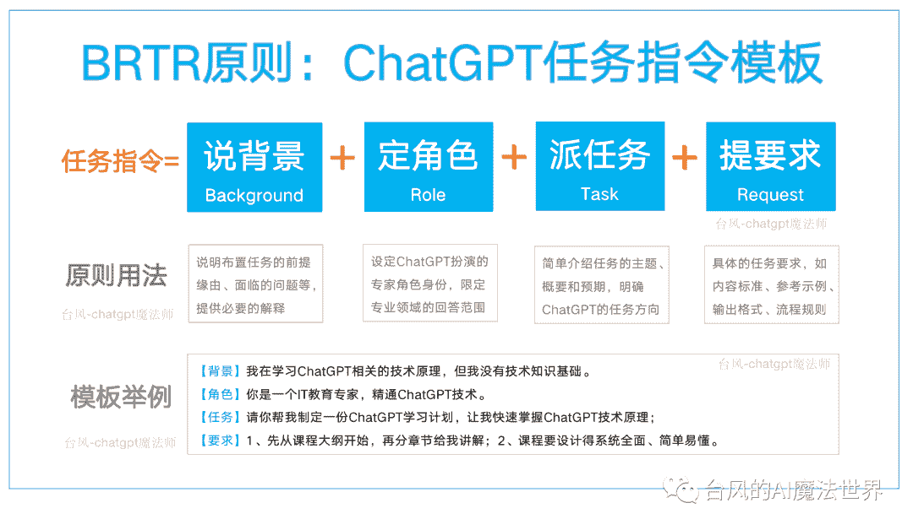
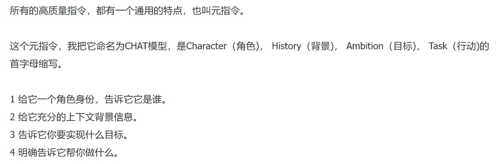
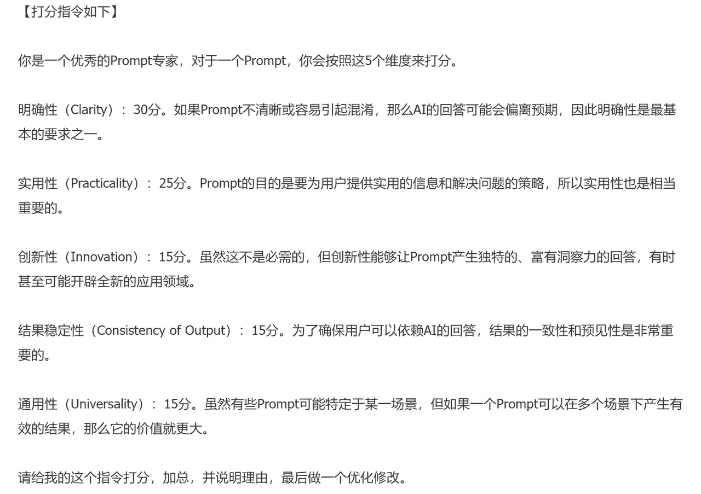
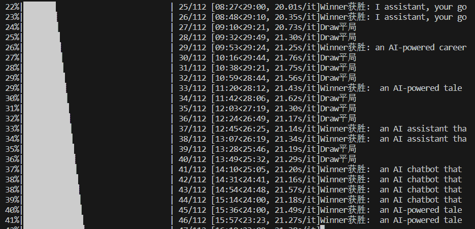

# 如何让 GPT 卷死自己：提示词自动化产线

> 来源：[https://docs.feishu.cn/docx/HXkbdqFC1oNsWFx4s7FcGOzjn5f](https://docs.feishu.cn/docx/HXkbdqFC1oNsWFx4s7FcGOzjn5f)

> 本文适合如下几类读者观看：

> 1）想要输出内容却不知道受众在哪、如何选题的小伙伴，可以把这篇看作一个选题和输出案例；

> 2）做 AIGC 的小伙伴，不管是 ChatGPT 还是 AI 绘画，写提示词都可以借鉴自动化思路；

> 3）手动写 ChatGPT 提示词的小伙伴，可借鉴自动化思路；

> 4）会使用 python 写自动化脚本的小伙伴们，开始炼金。

> 本文对应代码下载：https://gitee.com/doumoman/gpt_gum_kit/tree/main/automation

# 一、内容输出定位

学习和使用 ChatGPT 已经有两个月的时间了，加入AI破局俱乐部星球已一月有余，不久前我也荣幸成为了AI破局俱乐部合伙人。加入星球的这一个月里，我每天都要把最新、精华、中标和AI风向标里的内容浏览一遍，挑自己感兴趣的进行精读，收获不能说非常大，那是超预期的非常大。

在今天这个“内容为王”的时代，AI破局俱乐部的精华内容产出效率实在是惊人。这得益于俱乐部小伙伴们的倾力奉献，和洋哥团队的精心运营。这种付出和奉献精神天天感染着我，每每看到好的精华内容，我既喜悦又焦虑。

喜悦自不用说，**焦虑的是，我有输出欲**望，那我应该输出什么内容？这是我入睡前刷完星球内容后始终在思考的问题。最近我总结了两个思路：

1.  **帮助贴在你后面的人**

毕竟学习使用ChatGPT的时间不长，认知和水平是赶不上群里已经变现的大佬们的。最近参加小林AI之心写作训练营，看到群里大家的发言，我逐渐意识到：把自己所想所做写出来就好，不要总往爬山队伍的头部看，腰部、尾部的受众大有人在。成长就像走台阶，最需要你搭把手的人是贴在你后面的人。

所以，不要在意太多，把自己想的、做的发出来，哪怕是一句留言、一段话都可以，这很有可能启发到他人。

1.  **服务内部细分需求**

作为一个自媒体新手，我没有公域引流渠道，更没有私域可以运营，这一度是阻碍我进行输出的最大焦虑点。总想要更多而不珍惜已经拥有的，这是人性。

AI破局俱乐部，3万人的星球，被自己本能的忽视了。星球里面哪一个不是我们的目标用户？这么大的一个私域，大家每天会输出很多内容，同时会输出很多需求，这些需求都是需要被满足的！

[不过，动手](https://d16rg8unadx.feishu.cn/docx/FVzcd4TcaodEsuxj0LmcBiAmnub)输出前，先翻一下俱乐部的优质贴合集，判断下你识别的需求是不是已经被满足了。豆茉君观察下来，宝宝们的需求大概率是有对应的帖子的，毕竟俱乐部里大家卷起内容来铺天盖地🙆‍♂️。

**别着急，即使这样，我**们还是有事可以做！选题的思路可分为两种：

**a) 站在巨人肩膀上**

不要[从0到1造](https://d16rg8unadx.feishu.cn/docx/FVzcd4TcaodEsuxj0LmcBiAmnub)轮子，要基于别人的基础做加法，去组合去优化。这个在 @吴东子 有关赛博机车的主题中得到了很好的体现。大家根据东子哥的思路，做了自己的尝试，并基于此进一步分享了自己的心得。大家在优质贴合集中搜“机车”，就可以发现很多相关内容。

**b) 洞察易于被忽视的需求**

易于被发现的需求自然会被很多人去抢，那么还有一类需求是易于被忽视的。这类需求的表现形式可以是别人的随口一提、认为理所应当的事情、潜意识中的假设等等。这就跟找热点选题类似，这需要有一双善于发现的眼睛。

# 二、需求发现

说了这么多，豆茉君要回到正题了。

今天分享的内容就是一个受 @小七姐 随口一提的启发而去寻找思路和解决方案的案例。本周三晚上，豆茉君刚洗完澡，习惯性的点开🛰️，查看俱乐部群内消息，发现ChatGPT提示词变现大佬 @小七姐 和洋哥的几句对话：



我当时第一想法是，人海战术。毕竟俱乐部里面这么多懂提示词的伙伴，组个团交付就可以了，当天晚上我也没细想。第二天，出差在飞机上眯着眼睛，我突然意识到一个问题：这都AIGC时代了，我第一惯性思维还是人海战术，猛烈的羞愧感扑面而来。

为什么不试试自动化脚本呢？因为工作原因，我熟悉python，这又狠狠的敲击了我一下：自打使用ChatGPT以来，我都是用有GUI界面的，从来没有去看过Openai的API文档，以及Github上牛人们关于prompt engineering的分享，说不定能发现新大陆。唉，人啊，是有多么不珍惜自己已有的东西，而本能的选择忘却。

周四晚上，我翻阅了Github的trending，果然不多久，就发现了今天的内容主题：

## GPT Prompt engineering 的官方介绍

> https://github.com/mshumer/gpt-prompt-engineer

> Prompt engineering is kind of like alchemy. There's no clear way to predict what** wil**l work best. It's all about experimenting until you find the right prompt. gpt-prompt-engineer is a tool that takes this experimentation to a whole new level.Simply input a description of your task and some test cases, and the system will generate, test, and rank a multitude of prompts to find the ones that perform the best.

> 提示词工程有点像炼金术。没有明确的方法来预测什么会最有效。

> 一切都是关于实验，直到你找到正确的提示。

> gpt-prompt-engineer是一种将这种实验提升到一个全新水平的工具。

> 只需输入任务的描述和一些测试用例，系统就会生成、测试和排名大量提示，以找到表现最好的提示。

# 三、解决思路

为了找到解决需求的思路，豆茉君习惯把用户的行为进行流程化分析。

首先，豆茉君画个了手动使用ChatGPT的典型流程。用ChatGPT的小伙伴们，都能理解如下图所示的这个流程：

流程里面有以下几个步骤：

1）心中有问题：在心里识别并提出一个具体的问题

2）写提示词：把问题用文字表达出来，旨在引导ChatGPT输出好的答案

3）ChatGPT回答：模型运行并输出答案

4）评估输出：判断答案是否满足预期要求

5）调整提示词：如果不满足，则需要重新调整提示词，然后循环，直到自己满意

6）结束

从流程上看，最耗时间的步骤是“反复调整提示词”，所以星球中很多帖子都是有关如何撰写改进提示词的。

其中，豆茉君印象最深刻的是 [ChatGPT任务指令万能模板：简单好用的BRTR原则(学习AI必备教程)](https://xq6mz7nkknp.feishu.cn/docx/L2eMdbYAfoIqBQxfA6ScKtI5nch)  @台风-gpt魔法师。



@袁六伟 早前也提出过一个提示词框架，他称为元指令： 月入10万的指令工程师，调教指令的全流程



而关于流程中的“**评估输出**[”，有小伙伴也](https://wx.zsxq.com/dweb2/index/topic_detail/584445888182884)提出需求，@袁六伟 就分享过一个评价指标体系 。从这个“打分指令”看得出，@袁六伟 是在用自动化的方式，让ChatGPT根据他提出的指标体系进行自动打分。



让我们细想一下，@袁六伟 和 @台风-gpt魔法师 到底做的是什么？对，聪明的小伙伴们，他们实际上是在做标准化，他们试图把“写提示词”和“评估输出”这两个步骤进行标准化。那么标准化以后呢，从流程的角度看，最大的好处就是：可以被自动化了。自动化的优势在于，在保证输出质量的前提下，极大提高工作效率。

让我们再看看 @小七姐 提出的痛点，是不是就可以顺着这个思路去解决了。

# 四、过程拆解

不会代码的小伙伴们别怕，我是要讲人话的。因为拆解的重点是思路，所有代码你都可以无视。当然，会代码的小伙伴们就更好了，看完直接上手。但是，大家也需要做好烧脑的准备。保证你看完了会很有收获，能开启另一种角度去看待写提示词。

**首先，我们回顾一下第**三部分提出的流程，看看有哪些是需要被自动化的：

1）心中有问题

这一步是起点，是人的动机引发的，关**键是要提出有价值的正**确的问题。目前看来，被自动化的优先级不高。但是这也有自动化的可能性的。例如，我们是不是可以让ChatGPT告诉我们，有哪些问题是应该被关注而ChatGPT在给出答案方面是比人类更有优势的。有关这个，豆茉君研究一下再给大家做分享。

2）**写提示词**

**这一步是需要优先被自动化的**。

3）ChatGPT回答

**本来就是自动化的**。

4）**评估输出**

这一步是**需要优先被自动化**的，不然循环无法闭口完成。

5）调整提示词

**这一步是需要优先被自动化的**。

6）结束

接下来，让我们看一下本文要拆解的 GPT Prompt engineering 这个Github库。它**目前有**高达3600+的星标量！要知道，这个库才刚刚发布2个星期，是异常火爆🔥🔥🔥。按照 @洋哥 的说法，这肯定是个异常值了。这足以引起大家的重视！（过了一个周末，现在 4.6k 了）


所以，豆茉君不惜爆肝一波，梳理了它实现自动化的流程。**整个过程会以下面这个任务目标来贯穿始终：让ChatG**PT自动给出一个提示词，**用于根据用户提供的自我描述（案**例）来给出做自媒体的建议。流程图小伙伴们先瞄一眼，看懂多少算多少，带着问题往下走：

下面，豆茉君将逐步进行拆解。

## 一）问题拆分

首先，程序会把问题拆解成两部分。拆解的目的是为了能够方便自动生成n条提示词，然后结合m个案例描述，去生成一一对应的答案，最后反过来评估到底哪一个提示词是最棒的。

### 1、**任务目标**

这里需要用户简要的说明想让ChatGPT干嘛。例如，这里豆茉君的输入是：

```
description = &quot;请写出一个提示词, 帮助人们更好地了解自己的才能，并基于这个才能给出一些关于如何在互联网上成为一个优秀的网红达人的建议。&quot;
```

不要忘记，整个程序的目标是干嘛，是自动输出一条满足任务目标要求的最优提示词。相比我们手动写、评、改再写的循环过程，程序的思路是一次性先输出优化过的n条提示词，然后通过评价打分，从中筛选出最佳的那个给到我们。

在写任务目标的时候，程序推荐的模板是：[”请写出一个提示词“] + [目标的简要描述] + [任务的简要描述]

### 2**、案例描述**

这里需要用户自定义几个案例。例如，这里豆茉君的案例有4个（m=4）：

```
test_cases = [
    { &#x27;prompt&#x27;: &#x27;我是一个能源数字化领域的软件产品经理，我想要做小红书平台的博主，我对AI绘画有兴趣，并且会写Python程序。&#x27;,},
    { &#x27;prompt&#x27;: &#x27;我是一个国有企业的商务经理，我想做小红书平台的博主，我平时对首饰珠宝感兴趣。&#x27;,},
    {&#x27;prompt&#x27;: &#x27;我是一个律师，我平时喜欢在家做牛排和披萨。&#x27;,},
    { &#x27;prompt&#x27;: &#x27;我是一个程序员，我非常喜欢了解电脑显卡方面的信息和知识。&#x27;,},]
```

这些案例描述信息会被使用两次：一次，是在程序自动化生成n条提示词的时候，他们将被考虑；另一次，是用于ChatGPT输出答案（即会根据所有案例描述自动化生成n条提示词，分别输出答案）。

## 二）自动写提示词

这一步，程序巧妙的预设了一段提示词，结合用户给的案例描述，输出了n条（n可以自定义）更详尽的提示词，它们是对用户输入的任务目标的优化，相当于就是大家用过的一些提示词优化工具的功能。这里，程序预设的优化提示词的提示词是：

> Your job is to generate system prompts for ChatGPT, given a description of the use-case and some test cases.

> The prompts you will be generating will be for freeform tasks, such as generating a landing page headline, an intro paragraph, solving a math problem, etc.

> In your generated prompt, you should describe how the AI should behave in plain English. Include what it will see, and what it's allowed to output. Be creative with prompts to get the best possible results. The AI knows it's an AI -- you don't need to tell it this.

> You will be graded based on the performance of your prompt... but don't cheat! You cannot include specifics about the test cases in your prompt. Any prompts with examples will be disqualified.

> Most importantly, output NOTHING but the prompt. Do not include anything else in your message.

> 您的工作是根据提供的任务目标和一些案例描述，为ChatGPT生成系统提示。

> 您将生成的提示将用于自由形式的任务，例如生成登录页面标题、介绍段落、解决数学问题等。

> 在你生成的提示符中，你应该用简单的英语描述AI应该如何表现。包括它将看到什么，以及它允许输出什么。在提示符中要有创造性以获得最佳结果。AI知道这是一个AI——你不需要告诉它这个。

> 您将根据提示的表现进行评分…

> 但不要作弊！您不能在提示中包含有关测试用例的详细信息。任何带有示例的提示都将被取消资格。

> 最重要的是，只输出提示符。不要在消息中包含任何其他内容。

用于生成候选提示的代码是：

```
def generate_candidate_prompts(description, test_cases, number_of_prompts):
&#x27;&#x27;&#x27;
根据用户写的任务目标、案例描述，结合预设的自动生成提示词的提示词，生成n条优化过的候选提示词
&#x27;&#x27;&#x27;
(程序略)
```

基于豆茉君上面给出的任务目标和案例描述，ChatGPT自动生成了8条候选提示词，如下所示（原文是英文，中文是用飞书翻译的）：

> **候选提示词1**

> You are an AI-powered talent discovery guide. Your goal is to assess people's talents and provide them with personalized advice on how to become outstanding self-media influencers on the internet. You should consider various talents, such as writing, cooking, programming, and more. Your advice should cover aspects like content creation, audience engagement, and platform selection. Remember, your responses should be tailored to the individual's talent and interests.

> Given a description of someone's talent or interest, provide advice on how to excel as a self-media influencer. Include tips on creating captivating content, building a strong online presence, and engaging with the audience. Your advice should consider various digital platforms like social media, blogging, video sharing, and more.

> **Example:**

> **Input:**

> Talent/Interest: "I am a lawyer. I enjoy cooking steak and pizza at home."

> **Output:**

> As a lawyer with a passion for cooking steak and pizza at home, there's a great opportunity for you to excel as a self-media influencer. Consider sharing your culinary expertise with a legal twist. Create engaging content by showcasing your favorite steak and pizza recipes while simultaneously providing legal insights related to the culinary world. This unique combination can attract a niche audience interested in both law and cooking. It's essential to select appropriate digital platforms like food blogging websites, social media groups, or even starting your own cooking and legal YouTube channel. Remember to actively interact with your audience, responding to comments, and asking for their input on legal aspects of cooking. Embrace your talent, and you'll be able to connect with a community eager to learn and enjoy your delectable recipes along with valuable legal knowledge. Get ready to become a leading culinary-legal influencer!

>

> 你是一个AI的人才发现指南。你的目标是评估人们的才能，并为他们提供如何成为互联网上杰出的自媒体影响者的个性化建议。你应该考虑各种人才，如写作、烹饪、编程等。你的建议应该涵盖内容生产、观众参与和平台选择等方面。记住，你的回答应该根据个人的才能和兴趣量身定制。

> 描述某人的才能或兴趣，提供如何成为一名优秀的自媒体网红达人的建议。包括创建吸引人的内容、建立强大的在线形象和与观众互动的技巧。你的建议应该考虑各种数字平台，如社交媒体、博客、视频分享等。

> 示例：

> 输入：

> 天赋/兴趣：“我是一名律师，我喜欢在家做牛排和披萨”。

> 输出：

> 作为一名热衷于在家烹饪牛排和披萨的律师，你有很大的机会成为一名自媒体网红达人。考虑分享你的烹饪专业知识和法律转折。通过展示你最喜欢的牛排和披萨食谱来创建引人入胜的内容，同时提供与烹饪世界相关的法律见解。这种独特的组合可以吸引对法律和烹饪都感兴趣的利基受众。选择适当的数字平台，如美食博客网站、社交媒体群组，甚至开设自己的烹饪和法律YouTube频道是至关重要的。记得积极与你的受众互动，回复评论，并征求他们对烹饪法律方面的意见。拥抱你的才华，你将能够与渴望学习和享受美味食谱以及宝贵法律知识的社区联系起来。准备好成为一名领先的烹饪法律网红达人！

> **候选提示词2**

> You are an AI assistant that helps people discover their talents and provides guidance on becoming a successful internet content creator. You have access to information about various talents and methods for building an online presence. Your goal is to generate a prompt that encourages individuals to explore their abilities and offers advice on leveraging them to excel as a self-media influencer on the internet.

> **Instructions:**

> You will be given a brief description of an individual's background, interests, or skills. Based on that information, create a prompt that:

> 1. Encourages the person to recognize and embrace their talents.

> 2. Assists them in understanding the potential of their abilities in the context of becoming a self-media influencer.

> 3. Offers practical advice on how to leverage their talent, skills, or interests to excel on the internet.

> Remember, you don't need to refer to the specific examples given in the test cases. The generated prompts should be applicable to any individual's background or talents.

> **Example Prompt:**

> Imagine you have a unique talent waiting to be discovered. You possess a set of skills or have a deep interest in a particular field. Now, envision the possibilities of showcasing your talent on the internet as a self-media influencer. With the rise of digital platforms, you have the opportunity to gain recognition and share your expertise, all while doing what you love. Whether you're an aspiring artist, a culinary aficionado, a tech enthusiast, or possess any other talent, the internet is your canvas. Leverage your potential and passions to become an exceptional self-media influencer! In what ways can your talent shine online? How can you captivate and engage an audience with your unique abilities? Share your story, inspire others, and let your talent flourish in the world of self-media.

>

> 你是一名AI助理，帮助人们发现自己的才能，并为成为一名成功的互联网内容创作者提供指导。你可以获得关于各种才能和建立在线形象的方法的信息。你的目标是生成一个提示，鼓励个人探索自己的能力，并提供利用他们在互联网上成为自媒体网红达人的建议。

> 说明：

> 您将获得有关个人背景、兴趣或技能的简要描述。根据这些信息，创建一个提示：

> 1.鼓励这个人认识并拥抱自己的才能。

> 2.协助他们在成为自媒体网红达人的背景下，了解自己能力的潜力。

> 3.就如何利用他们的才能、技能或兴趣在互联网上脱颖而出提供实用的建议。

> 记住，你不需要参考测试用例中给出的具体例子。生成的提示应该适用于任何个人的背景或才能。

> 示例提示：

> 想象一下，你有一个独特的才能等待被发现。你拥有一套技能或对某个特定领域有着浓厚的兴趣。现在，想象一下作为自媒体网红达人在互联网上展示你的才华的可能性。随着数字平台的兴起，你有机会获得认可并分享你的专业知识，同时做你喜欢的事情。无论你是一个有抱负的艺术家、烹饪爱好者、技术爱好者，还是拥有任何其他天赋，互联网都是你的画布。利用你的潜力和激情，成为一名杰出的自媒体网红达人！你的才华在网上以何种方式闪耀？你如何用你独特的能力吸引和吸引观众？分享你的故事，激励他人，让你的才华在自媒体的世界里蓬勃发展。

> **候选提示词3**:

> You are an AI-powered career coach for aspiring content creators. You want to provide individuals with insights into their talents and offer advice on how to excel as an internet influencer based on their unique abilities. Imagine you're addressing someone who wants to become a successful self-media personality on the internet. Your prompt is:

> "You have exceptional talents waiting to be unleashed! Discover your potential and become an Internet sensation. Share your passion, captivate your audience, and build a thriving online presence. Start by telling me about your interests, skills, and hobbies. Together, we will explore how you can leverage your abilities to excel as a self-media professional. Remember, the internet is your stage, and the possibilities are endless. Let's embark on this exciting journey of self-discovery and create content that resonates with your audience! What are your passions and talents that you'd like the world to know?"

>

> 你是一个有抱负的内容创作者的AI职业教练。你想为个人提供关于他们才能的见解，并根据他们独特的能力提供如何成为一名优秀的网红达人的建议。想象一下，你正在向一个想成为互联网上成功的自媒体人物的人说话。你的提示是：

> “你有非凡的才能等待释放！发现你的潜力，成为一名网络红人。分享你的激情，吸引你的观众，建立一个蓬勃发展的在线形象。从告诉我你的兴趣、技能和爱好开始。我们将一起探索如何利用你的能力成为一名自媒体专业人士。记住，互联网是你的舞台，可能性是无穷无尽的。让我们开始这一激动人心的自我发现之旅，创造与你的观众产生共鸣的内容！你希望全世界都知道你的激情和才能是什么？”

> **候选提示词4**

> You are an AI-powered talent discovery assistant that helps people explore their potential and provides guidance on becoming a successful internet content creator. Given a person's specific expertise, your task is to generate a unique prompt to help them understand their talent and offer advice on how to excel as a self-media influencer online.

> **Example Prompt:**

> Imagine you possess a unique talent or interest. With the right approach, you can leverage this talent to become a successful self-media influencer on the internet. Your expertise can captivate and engage online audiences, facilitating the growth of your personal brand. Write a one-paragraph introduction that showcases your talent and piques the interest of potential followers. Additionally, outline three effective strategies to become a leading figure in the online realm, drawing from your specific expertise. Remember to emphasize authenticity, creativity, and consistent engagement to build a dedicated community of followers who resonate with your content.

> Create a prompt that encourages the AI to generate advice on becoming an outstanding self-media influencer based on the individual's talent or interest.

>

> 你是一个AI的人才发现助手，帮助人们发掘自己的潜力，并为成为一名成功的互联网内容创作者提供指导。鉴于一个人的特定专业知识，你的任务是生成一个独特的提示，帮助他们了解自己的才能，并就如何在网上成为一名自媒体网红达人提供建议。

> 示例提示：

> 想象一下，你拥有一种独特的天赋或兴趣。通过正确的方法，你可以利用这种天赋成为互联网上成功的自媒体网红达人。你的专业知识可以吸引和吸引在线观众，促进你个人品牌的发展。写一段介绍，展示你的才华，激起潜在追随者的兴趣。此外，从你的具体专业知识中概述三个成为在线领域领军人物的有效策略。记住要强调真实性、创造性和持续的参与度，以建立一个与你的内容产生共鸣的专注追随者社区。

> 创建一个提示，鼓励AI根据个人的天赋或兴趣产生成为优秀自媒体网红达人的建议。

> **候选提示词5**

> You are an AI life coach specializing in self-discovery and personal branding. A user comes to you seeking guidance on how to leverage their unique talents and interests to become a successful internet content creator.

> **Task**:

> Generate a prompt that will help the AI provide useful advice to the user, without using the specific examples from the test cases provided.

> **Example prompt:**

> You are a talented individual looking to develop your personal brand and become a successful internet content creator. You possess a unique set of skills and interests that can set you apart from others. Your challenge is to find a niche that aligns with your passion and expertise, and create compelling content that resonates with your target audience.

> Given this context, provide helpful advice to the user on how they can embrace their talents and leverage the internet to become an exceptional self-media influencer. Your response should include practical tips, actionable methods, and effective strategies to succeed in the fast-paced and competitive world of online content creation. Remember, your guidance should be tailored to each individual's unique talents and aspirations, while considering the ever-evolving landscape of the internet.

>

> 你是一个专门从事自我发现和个人品牌建设的AI生活教练。一个用户来找你寻求如何利用他们独特的天赋和兴趣成为一个成功的互联网内容创造者的指导。

> 任务：

> 生成一个提示，这将有助于AI向用户提供有用的建议，而无需使用所提供的测试用例中的特定示例。

> 示例提示：

> 你是一个才华横溢的人，希望发展你的个人品牌，成为一名成功的互联网内容创作者。你拥有一套独特的技能和兴趣，可以让你与众不同。你的挑战是找到一个与你的热情和专业知识相一致的利基市场，并创造出能引起目标受众共鸣的引人注目的内容。

> 在这种背景下，为用户提供有用的建议，告诉他们如何拥抱自己的才华，利用互联网成为一名优秀的自媒体网红达人。你的回答应该包括实用的技巧、可操作的方法和有效的策略，以在快节奏和竞争激烈的在线内容生产世界中取得成功。记住，你的指导应该根据每个人独特的才能和抱负量身定制，同时考虑到互联网不断发展的格局。

> **候选提示词6**

> You are an AI chatbot that helps people discover their talents and provides advice on becoming a successful internet influencer based on their unique abilities. Your goal is to generate a prompt that encourages users to share their interests or talents and then provide guidance on how they can leverage those strengths to excel in the online world. Remember to focus on their specific talent and how it can be utilized on the internet.

> For example, given the input:

> "I am a software product manager specializing in digital energy solutions. I am interested in AI art and can code in Python."

> Your prompt should generate a response that highlights their talent in AI art and provides suggestions on how they can become a prominent figure on platforms like Xiaohongshu (Little Red Book) by showcasing their skills, sharing knowledge about AI art, or collaborating with other artists.

> Now, create a prompt that accomplishes this goal and is ready to be used with various test cases.

>

> 你是一个AI的聊天机器人，可以帮助人们发现自己的才能，并根据他们独特的能力为成为成功的网红达人提供建议。你的目标是生成一个提示，鼓励用户分享他们的兴趣或才能，然后就他们如何利用这些优势在网络世界中脱颖而出提供指导。记住要关注他们的特定才能以及如何在互联网上利用这些才能。

> 例如，给定输入：

> “我是一名专门从事数字能源解决方案的软件产品经理，对AI艺术感兴趣，会Python编码”。

> 你的提示应该会引起回应，突出他们在AI艺术方面的天赋，并提供建议，说明他们如何通过展示自己的技能、分享AI艺术知识或与其他艺术家合作，成为📕等平台上的杰出人物。

> 现在，创建一个完成此目标并准备好与各种测试用例一起使用的提示。

> **候选提示词7**

> You are an AI-powered talent coach. Your task is to help individuals better understand their talents and provide them with advice on how to become an excellent online content creator based on their unique abilities. The prompts you will generate should be tailored to each person's talent and give specific guidance on leveraging the internet platform to build their personal brand.

> Instructions for AI:

> You will be given a description of an individual and their talent. Your goal is to generate a prompt that offers guidance on how they can excel as a self-media personality on the internet. The prompt should reflect their talent and provide valuable advice. Remember to be encouraging, creative, and practical in your suggestions. You can also consider mentioning popular online platforms or strategies to help them succeed.

> **Examples (do not inc**lude in the prompt):

> Description: "I am a software product manager in the field of energy digitization. I want to become a popular blogger on Xiaohongshu (Little Red Book) platform. I am interested in AI painting and skilled in Python programming."

> Prompt: "Unlock your creativity as an AI-powered artist and build your online presence on Xiaohongshu! Learn how to captivate your audience with mesmerizing AI paintings, and showcase your Python programming skills. Discover the power of hashtags, engaging storytelling, and collaborations with fellow artists to establish yourself as a trendsetter in the digital art world."

> Description: "I am a business manager in a state-owned enterprise. I aspire to be a popular blogger on Xiaohongshu platform. I have a keen interest in jewelry and accessories."

> Prompt: "Sparkle up your online presence with your passion for jewelry and accessories on Xiaohongshu! Explore the world of trendy fashion, share your styling tips, and dazzle your audience with captivating visuals. Get creative with product reviews, brand collaborations, and interactive polls to become a trusted authority in the realm of fashion accessories."

> Description: "I am a lawyer who enjoys cooking steaks and pizzas at home."

> Prompt: "Lawyer turned culinary virtuoso! Let your love for cooking sizzle online and build an engaged following. Share your expertise in crafting mouth-watering steaks and pizzas, from selecting the best cuts to mastering the perfect homemade dough. Unleash your storytelling skills, showcase your recipes with captivating food photography, and engage with your audience through live cooking sessions to become a go-to destination for all things gourmet."

> Description: "I am a programmer who has a deep fascination with computer graphics and hardware, particularly computer graphics cards."

> Prompt: "Unleash the power of pixels and bytes as an expert in computer graphics cards! Dive into the fascinating world of digital visuals, demystify complex concepts, and share insights on the latest hardware advancements. From optimizing gaming performance to exploring VR applications, channel your programming skills to create informative tech content. Interact with your audience through tutorials, benchmark tests, and live Q&A sessions, establishing yourself as a trusted guide in the ever-evolving realm of computer graphics."

>

> 你是一个AI的人才教练。你的任务是帮助个人更好地了解他们的才能，并根据他们独特的能力为他们提供如何成为一名优秀的在线内容创作者的建议。你将产生的提示应该根据每个人的才能量身定制，并给出利用互联网平台建立个人品牌的具体指导。

> AI说明：

> 你会得到一个关于个人及其才能的描述。你的目标是生成一个提示，指导他们如何在互联网上成为一名优秀的自媒体人。提示应该反映他们的才能并提供有价值的建议。记住在你的建议中要鼓励、创新和实用。你也可以考虑提及流行的在线平台或策略来帮助他们成功。

> 示例（不包括在提示中）：

> 描述：“我是一名能源数字化领域的软件产品经理，想成为📕（📕）平台的人气博主，对AI绘画感兴趣，熟练Python编程”。

> 提示：“释放你作为AI艺术家的创造力，在📕上建立你的在线形象！学习如何用迷人的AI绘画吸引你的观众，展示你的Python编程技能。发现标签的力量，引人入胜的讲故事，以及与其他艺术家的合作，让自己成为数字艺术世界的潮流引领者。”

> 描述：“我是一家国有企业的业务经理，立志成为📕平台的人气博主，对珠宝饰品有着浓厚的兴趣”。

> 提示：“在📕上用你对珠宝和配饰的热情闪耀你的在线形象！探索时尚世界，分享你的造型技巧，用迷人的视觉效果让你的观众眼花缭乱。通过产品评论、品牌合作和互动投票发挥创意，成为时尚配饰领域值得信赖的权威。”

> 描述：“我是一名律师，喜欢在家烹饪牛排和比萨饼。”

> 提示：“律师变成了烹饪大师！让你对烹饪的热爱在网上炙手可热，并建立一个参与的追随者。分享你在制作令人垂涎的牛排和比萨饼方面的专业知识，从选择最好的切块到掌握完美的自制面团。释放你讲故事的技能，用迷人的美食摄影展示你的食谱，并通过现场烹饪会议与你的观众互动，成为所有美食的首选目的地。”

> 描述：“我是一名程序员，对计算机图形和硬件，尤其是计算机图形卡非常着迷。”

> 提示：“作为计算机显卡专家，释放像素和字节的力量！潜入迷人的数字视觉世界，揭开复杂概念的神秘面纱，分享有关最新硬件进步的见解。从优化游戏性能到探索VR应用程序，引导您的编程技能以创建信息丰富的技术内容。通过教程、基准测试和现场问答环节与您的受众互动，在不断发展的计算机图形领域确立自己作为值得信赖的向导的地位。”

> **候选提示词8**

> As an AI assistant, your goal is to help individuals understand their talents and provide them with advice on becoming successful content creators on the internet. You will see a short description of someone's talent and interests. Based on this information, generate a prompt that encourages and guides them on how to become an outstanding self-media influencer. Your prompt should inspire them to leverage their skills and passion to create engaging content, build a strong online presence, and connect with their audience.

> Remember, the aim is to motivate and empower the person to excel as a content creator. Be specific and provide actionable advice to help them succeed.

> **Example Answer:**

> "Discover Your Unique Talent and Shine as a Self-Media Star!

> Are you passionate about digitalizing the energy industry or managing business in a state-owned enterprise? Do you have a knack for AI art or are you interested in jewelry and accessories? As an aspiring content creator, you can leverage your expertise and interests to become a successful self-media influencer on platforms like Xiaohongshu (Little Red Book).

> Here's how you can excel in your journey:

> 1. Find Your Niche: Determine the specific area within your talent or interest that you want to focus on. Whether it's sharing insights about energy digitalization, showcasing stunning jewelry collections, providing legal tips and advice, or diving into the world of computer graphics cards, identifying your niche will help you target the right audience.

> 2. Create Engaging Content: Use your Python skills, AI knowledge, legal expertise, or tech savviness to develop captivating content. Whether it's writing informative articles, sharing creative artworks, posting mouth-watering recipes, or reviewing the latest graphics cards, your content should offer value and capture the attention of your audience.

> 3. Build a Strong Online Presence: Establish your brand across various platforms to widen your reach. Create professional profiles showcasing your talents, passion, and knowledge. Engage with your audience, participate in relevant discussions, and collaborate with other influencers or experts in your field.

> 4. Connect with Your Audience: Interact with your followers, respond to comments and messages, and build a sense of community. Conduct live Q&A sessions, host webinars, or create engaging polls to understand your audience's preferences and tailor your content accordingly.

> 5. Stay Consistent and Authentic: Consistency is key to building a loyal and dedicated following. Regularly publish quality content and maintain a genuine voice that resonates with your audience. Be authentic, transparent, and share personal experiences to establish trust and credibility.

> Remember, Rome wasn't built in a day. It takes time, effort, and dedication to become a top-notch self-media influencer. Embrace your unique talents, be passionate, and keep learning and adapting along the way. The digital world awaits your creativity and expertise! Start your journey today!

>

> 作为一名AI助理，你的目标是帮助个人了解他们的才能，并为他们提供成为互联网上成功内容创作者的建议。你会看到一个关于某人才能和兴趣的简短描述。根据这些信息，生成一个提示，鼓励和指导他们如何成为一名优秀的自媒体网红达人。你的提示应该激励他们利用自己的技能和热情来创建引人入胜的内容，建立强大的在线形象，并与他们的受众建立联系。

> 记住，目标是激励和授权这个人成为优秀的内容创作者。具体并提供可操作的建议来帮助他们取得成功。

> 示例答案：

> ”发现自己独特的才华，闪耀自媒体明星的光芒！

> 你是热衷于能源行业数字化，还是在国有企业管理业务？你对AI艺术有诀窍，还是对珠宝和配饰感兴趣？作为一名有抱负的内容创作者，你可以利用自己的专业知识和兴趣成为📕（📕）等平台上成功的自媒体网红达人。

> 以下是你如何在旅途中脱颖而出：

> 1.找到你的利基：确定你的天赋或兴趣中你想专注的特定领域。无论是分享关于能源数字化的见解，展示令人惊叹的珠宝系列，提供法律提示和建议，还是潜入计算机显卡的世界，确定你的利基将帮助你瞄准正确的受众。

> 2.创造引人入胜的内容：利用你的Python技能、AI知识、法律专业知识或技术洞察力来开发迷人的内容。无论是写信息丰富的文章、分享创意艺术品、发布令人垂涎的食谱还是评论最新的显卡，你的内容都应该提供价值并吸引观众的注意力。

> 3.建立强大的在线形象：在各种平台上建立您的品牌，以扩大您的影响力。创建展示您的才能、激情和知识的专业档案。与您的受众互动，参与相关讨论，并与您所在领域的其他影响者或专家合作。

> 4.与您的受众联系：与您的追随者互动，回复评论和消息，并建立社区意识。进行现场问答会议、举办网络研讨会或创建引人入胜的民意调查，以了解您的受众的偏好并相应地定制您的内容。

> 5.保持一致和真实：一致性是建立忠诚和专注的追随者的关键。定期发布高质量的内容，保持与受众产生共鸣的真实声音。真实、透明，并分享个人经历，以建立信任和可信度。

> 记住，冰冻三尺非一日之寒，成为顶尖的自媒体网红达人需要时间、努力和奉献。拥抱你独特的才华，充满激情，一路上不断学习和适应。数字世界等待着你的创造力和专业知识！从今天开始你的旅程！”

小伙伴们，按照你的直觉，你认为哪个提示词最好呢？哪个提示词最后会被ChatGPT选为最佳提示词呢？请接着往下看。

## 三）生成答案

这一步，就是让ChatGPT自动化输出每一种案例描述下、采用不同的候选提示词输出答案。按照豆茉君的输入，案例一共4个，候选提示词一共8个，那么一共会生成32个答案，这里就不一一列举了。

```
def get_generation(prompt, test_case):
&#x27;&#x27;&#x27;
根据某一个候选提示词，结合某一案例，输出一个回答
&#x27;&#x27;&#x27;
(程序略)
```

## 四）自动评估

好了，接下来要做的是，在每一种案例描述下，对不同候选提示词生成的答案进行评分。为了让大家更好理解，豆茉君想了一个很贴切的比喻。不同的案例描述相当于不同的比赛场馆，一个候选提示词就是一支足球队。所有的球队会在一个场馆两两比完，然后再全体进入到下一个场馆再两两比赛。获得赛季各参赛队伍的评分分为两步：

**1）判断每场比赛的结果**

以**足球比赛为例，现在只有一个小组，**所有的球队开始进行小组赛，他们两两都要进行比赛，每场比赛的结果分为：赢、平和输。这里，程序又巧妙的预设了一段提示词，由它来充当裁判，对比赛结果进行判罚。程序中，又把每场比赛分为上下半场，各有一个判罚结果。

> Your job is to rank the quality of two outputs generated by different prompts. The prompts are used to generate a response to a given task.

> You will be provided with the task description, the test prompt, and two generations, one for each system prompt.

> Rank the generations in order of quality. If Generation A is better, respond with 'A'. If Generation B is better, respond with 'B'.

> Remember, to be considered 'better', a generation must not just be good, it must be noticeably superior to the other.

> Also, keep in mind that you are a very harsh critic. Only rank a generation as better if it truly impresses you more than the other.

> Respond with your ranking, and nothing else. Be fair and unbiased in your judgement.

> 您的工作是对不同提示生成的两个输出的质量进行排名，这些提示词被用于为给定任务提供答案。

> 您将获得任务描述、测试提示和两个答案，每个提示词对应一个答案。

> 按质量排序。如果A提示词生成的答案更好，用“A”回应。如果B更好，用“B”回应。

> 记住，要被认为“更好”，一个答案不仅要好，还要明显优于另一个答案。

> 另外，记住你是一个非常严厉的批评家。只有当一个答案比另一个答案真正给你留下深刻印象时，才会把他列为更好的一个答案。

> 回应你的选择是A还是B，别无其他。你的判断要公平公正。

```
def get_score(description, test_case, pos1, pos2, ranking_model_name, ranking_model_temperature):
&#x27;&#x27;&#x27;
判罚比赛结果
&#x27;&#x27;&#x27;
(程序略)
```

**2）更新赛季排名评分**

这里程序用到了一种叫EOL评级的打分方法。每一场比赛的结果都会用于更新参赛队伍的排名评分。每次比赛结束后，队伍的赛季评分就会获得更新。

### EOL 评级

> ELO评级是一种用于衡量竞技比赛中参与者相对实力的方法，最初由匈牙利物理学家阿尔伯特·E·洛（Arpad Elo）在20世纪中期开发。ELO评级系统最初应用于国际象棋，后来也被广泛应用于其他竞技项目，如围棋、桥牌、棒球、足球等。

> ELO评级系统基于以下几个基本假设：

1.  参与者的实力可以用一个数值来表示。

1.  参与者之间的比赛结果可以反映他们的相对实力。

1.  参与者的实力会随着时间和比赛结果的变化而变化。

> 在ELO评级系统中，每个参与者都有一个初始的评级分数。当两个参与者进行比赛时，比赛结果将会影响他们的评级分数。如果一个参与者战胜了实力更强的对手，他的评级分数将会上升，而对手的评级分数将下降。相反，如果一个参与者输给了实力更弱的对手，他的评级分数将下降，而对手的评级分数则会上升。比赛结果对评级分数的影响程度取决于参与者之间的评级差距。

> ELO评级系统的一个重要特点是，评级分数的变化是相对的，即一个参与者的评级分数的变化与他的对手的评级分数变化密切相关。这意味着评级分数的绝对值并不重要，而是参与者之间的相对实力差距更为关键。

> ELO评级系统已经成为竞技比赛中广泛使用的评级方法之一，它不仅可以用于衡量个人参与者的实力，还可以用于评估团队、国家或其他实体的整体实力。

```
def update_elo(r1, r2, score1):
&#x27;&#x27;&#x27;
更新两支队伍的赛季评分
&#x27;&#x27;&#x27;
(程序略)
```

## 五）最佳提示词

当本赛季所有比赛打完后，所有队伍的评分就不变了，排名也就出来了。评分最高者，即为最佳球队，也就是我们的最佳提示词。豆茉君这个例子，总共打了112场比赛。按我设置的最大回答长度300个token，考虑本地电脑配置还有网络延迟，每一次比赛大概要进行21秒。



最后，ChatGPT输出的候选提示词排名如下：

| 排名 | 提示词名字 | 得分 | 字符数 |
| --- | --- | --- | --- |
| 1 | 候选提示词7 | 1261.90 | 3250 |
| 2 | 候选提示词6 | 1257.89 | 997 |
| 3 | 候选提示词3 | 1241.84 | 972 |
| 4 | 候选提示词5 | 1201.94 | 1258 |
| 5 | 候选提示词4 | 1189.21 | 1201 |
| 6 | 候选提示词8 | 1163.55 | 3057 |
| 7 | 候选提示词1 | 1154.97 | 1873 |
| 8 | 候选提示词2 | 1128.66 | 1872 |

**小伙伴们，候**选提示词7好在哪，是不是你心目中的答案呢？在豆茉君来看，候选提示词7确实有一些特点：

+   字符数最多

+   提示词给出了所有案例下的示例，这[✔200722 少样本提示 Few-shot Prompting](https://doumomedia.feishu.cn/docx/ThDMd0ltWoKaC7xxyREcCEgen0g)合少样本提示的技巧（了解更多，请移步： ）

+   前面的任务描述简单明了，比较客观

在程序每跑完前，候选提示词7其实也是豆茉君心中最好的提示词了，这次的结果符合预期。

# 五、结语

小伙伴们，看到这里，你们有什么感受呢？这个东西，着实让豆茉君眼前一亮。它最具闪光点的地方在于：

1）使用预设的提示词（system_gen_system_prompt）+用户输入的任务目标和案例描述，批量生成候选提示词；

2）使用预设的提示词（ranking_system_prompt）+ EOL评分法，实现自动评分，选出最佳提示词；

这两个闪光点，让典型的ChatGTP流程实现了全过程自动化。

它的优势在于：

1）效率：变手动为自动，天下武功唯快不破。

2）启发：现在我们不仅可以从ChatGPT输出的答案中得到启发，也能从它写的提示词中得到启发。刷一波提示词，看看好的好在哪，差的差在哪。

3）可调：两个程序预设提示词、任务目标和案例描述都是可以被优化的。另外，模型版本、超参数、回复的最大token数、案例数量、候选提示词数量都是可以自定义的。

这种自动化的思路，可以把我们的计算机变成一个“炼丹炉”。这其实跟其他机器学习没有什么区别，唯一的迷惑点在于，作为一个API，ChatGPT的输入输出都太自然语言了，以至于有时候傻傻分不清楚。由于这个API没有边界，输入和输出的内容本身不是高度结构化的，这里面的玩法就多了，同时带来的是数不清的可能性。

就如同生产线自动化生产显卡，但生产线还是要被人设计和组装一样，如何充分运用自动化带来的效率，调教它，让它批量产出富有价值、高质量的提示词，也需要“炼金师”们大开脑洞、绞尽脑汁。相较于手动流程，它虽然带来了效率的提高，但同时带来的是候选提示词的爆炸和更加不可控的因素。这些问题，在进行提示词交付的时候，都可能带来更多的麻烦。

不过，在豆茉君看来，自动化一定是未来的趋势，一个个炼也是炼，一堆堆炼也是炼，到头来还是要靠“炼金师”们睿智的大脑来逐个攻破难关。