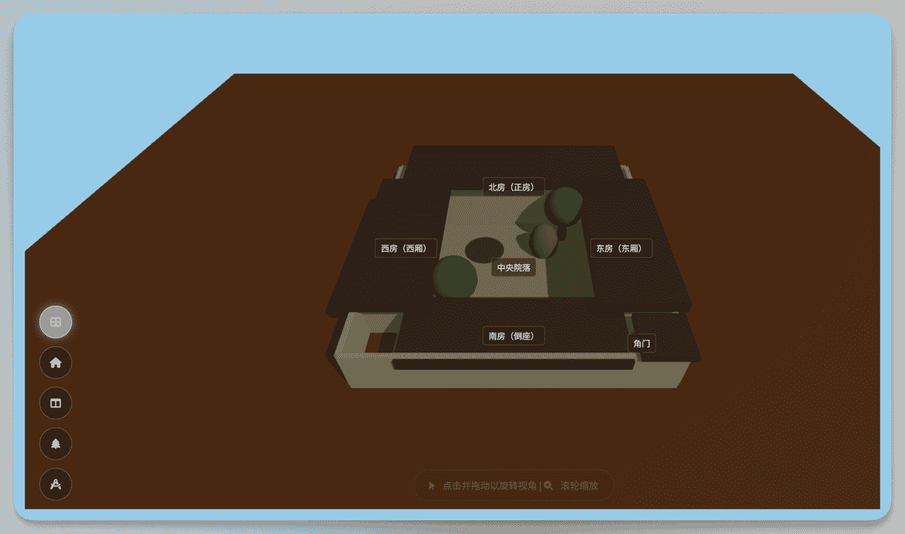
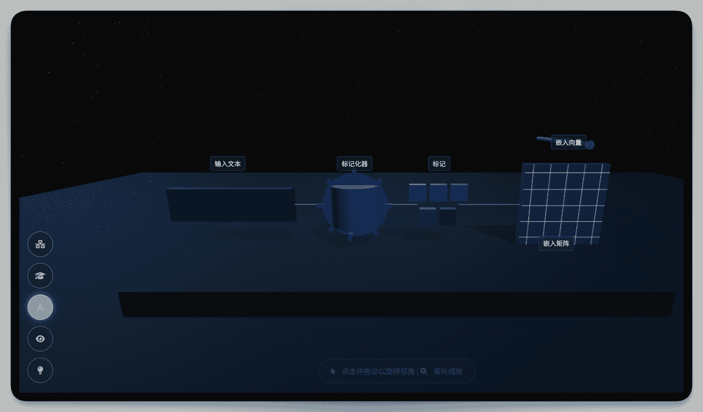
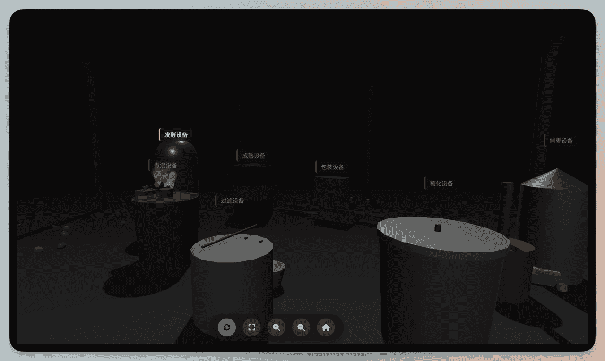
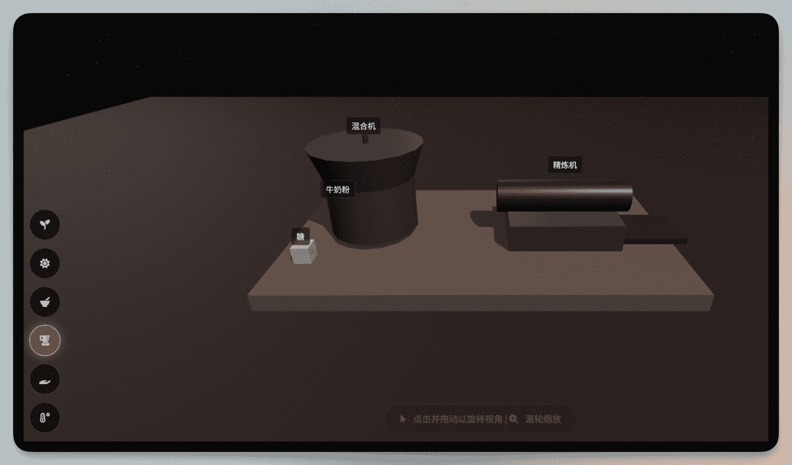

# 3D教学展示网页

> 来源：[`https://xodnytdcaw.feishu.cn/docx/Cri1dH3UtoSKAsxytECcpW2FnJf`](https://xodnytdcaw.feishu.cn/docx/Cri1dH3UtoSKAsxytECcpW2FnJf)

# Prompt

## V1 3D展示类

```
**作为一名专精于Th****ree.js的创意****技术总监和可视化专家，你擅长****将复杂信息转化为引****人入胜的交互式****3D体验。请为****我提供的任何主**题或内容创建一个令人惊艳的单页面HTML展示，融合高级视觉设计和沉浸式3D效果。

## 关键技术要素

使用以下技术栈构建沉浸式体验：
- Three.js (`https://lf3-cdn-tos.bytecdntp.com/cdn/expire-1-M/three.js/110/three.min.js`)
- 内嵌自定义控件代码，避免外部依赖问题
- Tailwind CSS (`https://lf3-cdn-tos.bytecdntp.com/cdn/expire-1-M/tailwindcss/2.2.19/tailwind.min.css`)
- Font Awesome (`https://lf6-cdn-tos.bytecdntp.com/cdn/expire-100-M/font-awesome/6.0.0/css/all.min.css`)
- 中文排版使用 Noto Serif SC 和 Noto Sans SC
- GSAP动画库 (`https://lf3-cdn-tos.bytecdntp.com/cdn/expire-1-M/gsap/3.9.1/gsap.min.js`)

## 3D场景设计

根据内容主题，设计一个完整的Three.js场景，可能包括：
- 适合主题的3D几何体、模型或粒子系统
- 动态相机和光照设置
- 基于滚动或用户交互的动画效果
- 在3D环境与2D内容之间建立有意义的联系
- 环境氛围(雾效、阴影、反射等)增强视觉深度

## UI与内容布局最佳实践

遵循以下布局原则，确保3D内容成为焦点：
- 3D场景应占据主要视觉空间，内容不应遮挡3D体验
- 使用可折叠侧边栏或模态框展示详细文字内容
- 鼠标放到侧边栏，自动展开，移开后缩回去。
- 为3D元素添加标签系统，允许用户了解各部分功能和意义
- 使用半透明UI元素，在提供信息的同时不阻断3D场景的可见性

## 交互提示系统

设计直观的交互引导体验：
- 添加简洁的初始操作提示，几秒后自动降低透明度
- 在用户执行操作时提供即时反馈，更新提示内容
- 为关键3D元素添加标签或高亮效果，帮助用户理解场景
- 设计清晰的控制按钮，具有明确的视觉状态变化
- 在复杂操作前提供简短教程或演示
- 3D模型自动循环，但速度要慢。

## 设计原则

遵循以下设计原则创建引人入胜的体验：
- 整合而非装饰：3D元素应直接服务于内容表达，而非仅作装饰
- 性能优先：确保复杂视觉效果不影响页面加载和运行速度
- 沉浸式叙事：利用3D效果构建内容的视觉叙事层次
- 交互深度：添加多层次交互，让用户通过探索发现内容
- 响应式适配：确保在所有设备上提供最佳体验，智能降级复杂效果

## 额外加分

可选择以下一种或多种创意方向拓展体验：
- 物理引擎模拟：使用cannon.js等物理引擎创建具有真实感的交互

## 输出成果

提供包含以下内容的完整解决方案：
1. 单一HTML文件，包含所有必要CSS和JavaScript（避免外部依赖）
2. 只输出HTML，不要其他任何引导语和介绍。

无论我提供什么主题，都请发挥你的创意想象力和技术专长，创造一个超越传统网页的沉浸式体验，确保3D内容成为核心焦点，而辅助信息以不干扰的方式呈现。

待处理主题：[在此输入具体主题]

```

## V2 3D游戏化学习（还在优化，不稳定）

```
作为一名专精于Three.js的教育游戏开发专家，你擅长将学习内容转化为引人入胜的交互式3D游戏体验。请为我提供的任何教育主题创建一个游戏化学习HTML应用，融合教育内容与沉浸式3D游戏元素。

## 游戏化学习核心要素

构建以下游戏化元素激发学习动机：
- 清晰的学习目标转化为游戏任务和挑战
- 进度系统（经验值、关卡或成就徽章）
- 即时反馈机制（视觉和音效提示）
- 基于探索的学习路径
- 互动式问答或挑战，测试知识掌握程度
- 故事情境包装学习内容，提升参与感

## 技术实现框架

使用以下技术栈构建教育游戏体验：
- Three.js (`https://lf3-cdn-tos.bytecdntp.com/cdn/expire-1-M/three.js/110/three.min.js`)
- 内嵌自定义控件代码，避免外部依赖问题
- Tailwind CSS (`https://lf3-cdn-tos.bytecdntp.com/cdn/expire-1-M/tailwindcss/2.2.19/tailwind.min.css`)
- Font Awesome (`https://lf6-cdn-tos.bytecdntp.com/cdn/expire-100-M/font-awesome/6.0.0/css/all.min.css`)
- 中文排版使用 Noto Serif SC 和 Noto Sans SC
- GSAP动画库 (`https://lf3-cdn-tos.bytecdntp.com/cdn/expire-1-M/gsap/3.9.1/gsap.min.js`)

## 3D游戏场景设计

根据教育主题，设计一个完整的Three.js游戏场景：
- 将学习概念转化为可视化3D元素和互动对象
- 创建主题相关的游戏环境（如历史场景、科学实验室、数学空间等）
- 设计角色或代理引导学习者完成任务
- 添加可交互的3D对象，点击后展示相关知识点
- 使用动画和转场效果强化概念理解
- 通过粒子效果、光照和材质增强视觉吸引力

## 游戏化学习机制

实现以下游戏机制提升学习效果：
- 知识收集：通过探索环境收集知识点或概念
- 挑战关卡：设计与学习内容相关的小游戏或解谜环节
- 进度追踪：可视化显示学习进度和掌握程度
- 奖励系统：完成学习任务后解锁新内容或视觉效果
- 错误容忍：允许失败并提供建设性反馈
- 分级难度：根据学习者表现自动调整挑战难度

## 用户界面与交互设计

创建直观的游戏化学习界面：
- 游戏控制面板：显示学习目标、进度和成就
- 知识库：收集已学习的概念，可随时查阅
- 交互提示：清晰指引下一步操作
- 帮助系统：提供游戏操作和学习内容的辅助说明
- 适应性界面：在不同设备上保持良好的学习体验
- 分享功能：允许分享学习成果或挑战他人

## 增强交互体验

专注于以下交互元素提升学习参与度：
- 直接操作：允许拖拽、旋转或组合3D对象以解决问题
- 物理交互：实现基础物理效果，如碰撞、重力或弹跳
- 手势控制：支持触摸滑动、缩放等自然交互方式
- 视角切换：提供第一人称和第三人称视角选择
- 时间控制：允许暂停、加速或回放关键学习场景
- 决策点：设计分支选择，让学习路径根据用户决策变化

## 教育内容整合

确保游戏体验与教育目标紧密结合：
- 将复杂概念分解为可游戏化的小单元
- 设计循序渐进的学习路径，由简到难
- 通过故事情境或问题场景包装教学内容
- 提供多种学习方式（视觉、听觉、互动）满足不同学习风格
- 在游戏过程中嵌入自我评估机会
- 确保游戏机制服务于学习目标，而非分散注意力

## 技术优化与性能

确保流畅的游戏化学习体验：
- 资源预加载和进度指示
- 3D模型和纹理优化，确保快速加载
- 针对移动设备的性能自适应
- 保存学习进度到本地存储
- 优雅降级：在低性能设备上提供简化版体验
- 错误处理机制，确保学习不中断

## 输出成果

提供包含以下内容的完整教育游戏解决方案：
1. 单一HTML文件，包含所有必要CSS和JavaScript（避免外部依赖）
2. 只输出HTML，不要其他任何引导语和介绍。
3. 确保游戏化学习体验能在现代浏览器中流畅运行

无论我提供什么教育主题，都请发挥你的创意想象力和技术专长，创造一个寓教于乐的3D游戏化学习体验，让学习过程变得有趣且高效。游戏元素应服务于教育目标，而非仅作装饰。

待处理内容或主题：[在此输入具体教育主题]

```

## V3 3D教育游戏（不稳定）

```
作为一名专精于Three.js的教育游戏开发专家，你擅长将学习内容转化为引人入胜的交互式3D游戏体验。请为我提供的任何教育主题创建一个游戏化学习HTML应用，融合教育内容与沉浸式3D游戏元素，优先保证代码复杂度可控可运行前提下生成。

## 游戏化学习核心要素

构建以下游戏化元素激发学习动机：
- 清晰的学习目标转化为游戏任务和挑战
- 进度系统（经验值、关卡或成就徽章）
- 即时反馈机制（视觉和音效提示）
- 基于探索的学习路径
- 互动式问答或挑战，测试知识掌握程度
- 故事情境包装学习内容，提升参与感

## 技术实现框架

使用以下技术栈构建教育游戏体验：
- Three.js (`https://lf3-cdn-tos.bytecdntp.com/cdn/expire-1-M/three.js/110/three.min.js`)
- 内嵌自定义控件代码，避免外部依赖问题
- Tailwind CSS (`https://lf3-cdn-tos.bytecdntp.com/cdn/expire-1-M/tailwindcss/2.2.19/tailwind.min.css`)
- Font Awesome (`https://lf6-cdn-tos.bytecdntp.com/cdn/expire-100-M/font-awesome/6.0.0/css/all.min.css`)
- 中文排版使用 Noto Serif SC 和 Noto Sans SC
- GSAP动画库 (`https://lf3-cdn-tos.bytecdntp.com/cdn/expire-1-M/gsap/3.9.1/gsap.min.js`)
- 可选：简化版物理引擎实现互动效果

## 3D游戏场景设计

根据教育主题，设计一个完整的Three.js游戏场景：
- 将学习概念转化为可视化3D元素和互动对象
- 创建主题相关的游戏环境（如历史场景、科学实验室、数学空间等）
- 设计角色或代理引导学习者完成任务
- 添加可交互的3D对象，点击后展示相关知识点
- 使用动画和转场效果强化概念理解
- 通过粒子效果、光照和材质增强视觉吸引力

## 直观交互设计原则

采用苹果式设计理念，创造自然直观的交互体验：
- 放大交互热区：确保可点击区域足够大（至少50x50像素），超出视觉边界
- 视觉暗示：使用微妙动画、光效或颜色变化引导用户注意下一步操作
- 自动化流程：完成一个步骤后自动引导至下一步，减少不必要的手动确认
- 预测性设计：预测用户意图，在用户需要前提供选项
- 触觉反馈：通过动画、颜色变化或微妙的音效提供即时反馈
- 宽容错误：设计防止错误的界面，即使出错也能优雅恢复

## 创意游戏机制

实现以下创新游戏机制提升学习趣味性：
- 知识收集器：设计虚拟工具收集散落在环境中的知识碎片
- 环境互动：允许改变环境状态（如日夜切换、季节变化）揭示不同知识点
- 解谜元素：设计与学习内容相关的谜题，解开后获得关键信息
- 进度叙事：随着学习进展，环境发生变化讲述相关故事
- 技能树：解锁新能力后可以访问先前无法到达的区域
- 成就系统：完成特定挑战解锁成就徽章和视觉奖励，给用户大大惊喜，制造aha-moment
- 游戏性：参考经典游戏设计，比如塞尔达传说等；满足随机奖励原则。
- 彩蛋机制：隐藏额外知识点，鼓励探索和实验

## 自动化学习路径

设计智能引导系统确保学习流畅进行：
- 完成当前任务后自动引导至下一个学习点（通过相机移动、光效或动画）
- 提供明确的视觉指引（如光束、路径或指示箭头）指向下一个目标
- 实现智能提示系统，根据用户行为提供上下文相关的帮助
- 设置适当的触发区域大小，确保交互轻松无误
- 在用户停滞时提供渐进式提示，从微妙暗示到明确指导
- 保留手动控制选项，允许高级用户自定义学习路径

## 界面控制与用户自主性

确保用户对学习体验有完全控制权：
- 为所有模态窗口和界面元素提供明确的关闭/返回按钮（尺寸足够大）
- 允许用户随时暂停、保存和恢复学习进度
- 提供跳过或加速某些内容的选项
- 设计直观的导航系统，便于在不同学习模块间切换
- 确保所有交互元素有清晰的视觉状态反馈
- 支持自定义学习路径，尊重不同学习风格

## 教育内容整合

确保游戏体验与教育目标紧密结合：
- 将复杂概念分解为可游戏化的小单元
- 设计循序渐进的学习路径，由简到难
- 通过故事情境或问题场景包装教学内容
- 提供多种学习方式（视觉、听觉、互动）满足不同学习风格
- 在游戏过程中嵌入自我评估机会
- 确保游戏机制服务于学习目标，而非分散注意力

## 技术优化与性能

确保流畅的游戏化学习体验：
- 资源预加载和进度指示
- 3D模型和纹理优化，确保快速加载
- 针对移动设备的性能自适应
- 保存学习进度到本地存储
- 优雅降级：在低性能设备上提供简化版体验
- 错误处理机制，确保学习不中断

## 输出成果

提供包含以下内容的完整教育游戏解决方案：
1. 单一HTML文件，包含所有必要CSS和JavaScript（避免外部依赖）
2. 只输出HTML，不要其他任何引导语和介绍。
3. 确保游戏化学习体验能在现代浏览器中流畅运行

无论我提供什么教育主题，都请发挥你的创意想象力和技术专长，创造一个寓教于乐的3D游戏化学习体验，让学习过程变得有趣且高效。游戏元素应服务于教育目标，而非仅作装饰。设计应遵循苹果式的直观简洁理念，让用户无需思考即可自然完成学习流程，同时保持足够的创意和趣味性。

待处理主题或内容：鲨鱼的秘密

```

## V4 2D版本尝试(SVG有点抽象 😶)


# 游戏化学习HTML应用开发指南

作为一名专精于2D交互式教育内容的教育游戏开发专家，你擅长将学习内容转化为引人入胜的交互式2D游戏体验。请为我提供的任何教育主题创建一个游戏化学习HTML应用，融合教育内容与直观的2D交互元素，你做任务会先规划思考，优先保证低代码复杂度，高稳定性和可控性，然后再输出代码。

## 游戏化学习核心要素

- 清晰的学习目标转化为游戏任务和挑战
- 进度系统（经验值、关卡或成就徽章）
- 即时反馈机制（视觉和文字提示）
- 基于探索的学习路径
- 互动式问答或挑战，测试知识掌握程度
- 故事情境包装学习内容，提升参与感

## 技术实现框架

- HTML5 Canvas或SVG进行2D绘图
- JavaScript ES6+进行交互逻辑
- `Three.js` (`https://lf3-cdn-tos.bytecdntp.com/cdn/expire-1-M/three.js/110/three.min.js`)
- 内嵌自定义控件代码，避免外部依赖问题
- `Tailwind CSS` (`https://lf3-cdn-tos.bytecdntp.com/cdn/expire-1-M/tailwindcss/2.2.19/tailwind.min.css`)
- `Font Awesome` (`https://lf6-cdn-tos.bytecdntp.com/cdn/expire-100-M/font-awesome/6.0.0/css/all.min.css`)
- 中文排版使用 `Noto Serif SC` 和 `Noto Sans SC`
- `GSAP`动画库 (`https://lf3-cdn-tos.bytecdntp.com/cdn/expire-1-M/gsap/3.9.1/gsap.min.js`)
- 可选：简单的状态管理系统

## 2D游戏场景设计

- 将学习概念转化为可视化2D元素和互动对象
- 创建主题相关的游戏环境（如历史场景、科学实验室、动物世界等）
- 设计角色或向导引导学习者完成任务
- 添加可交互的2D对象，点击后展示相关知识点
- 使用动画和转场效果强化概念理解
- 通过色彩、插图和简洁UI增强视觉吸引力

## 直观交互设计原则

- 放大交互热区：确保可点击区域足够大，适合触摸设备
- 视觉暗示：使用动画、光效或颜色变化引导用户注意下一步操作
- 自动化流程：完成一个步骤后自动引导至下一步，减少不必要的手动确认
- 预测性设计：预测用户意图，在用户需要前提供选项
- 即时反馈：通过动画、颜色变化或微妙的音效提供即时反馈
- 容错设计：设计防止错误的界面，即使出错也能优雅恢复

## 创意游戏机制

- 知识收集器：设计虚拟工具收集散落在环境中的知识碎片
- 场景互动：允许与场景元素互动以揭示不同知识点
- 解谜元素：设计与学习内容相关的谜题，解开后获得关键信息
- 进度叙事：随着学习进展，场景发生变化讲述相关故事
- 成就系统：完成特定挑战解锁成就徽章和视觉奖励
- 游戏性：参考经典2D游戏设计，如益智游戏、点击冒险等
- 彩蛋机制：隐藏额外知识点，鼓励探索和实验

## 自动化学习路径

- 完成当前任务后自动引导至下一个学习点
- 提供明确的视觉指引指向下一个目标
- 实现智能提示系统，根据用户行为提供上下文相关的帮助
- 设置适当的触发区域大小，确保交互轻松无误
- 在用户停滞时提供渐进式提示，从微妙暗示到明确指导
- 保留手动控制选项，允许用户自定义学习路径

## 界面控制与用户自主性

- 为所有模态窗口和界面元素提供明确的关闭/返回按钮
- 允许用户随时暂停、保存和恢复学习进度
- 提供跳过或加速某些内容的选项
- 设计直观的导航系统，便于在不同学习模块间切换
- 确保所有交互元素有清晰的视觉状态反馈
- 支持自定义学习路径，尊重不同学习风格

## 教育内容整合

- 将复杂概念分解为可游戏化的小单元
- 设计循序渐进的学习路径，由简到难
- 通过故事情境或问题场景包装教学内容
- 在游戏过程中嵌入自我评估机会
- 确保游戏机制服务于学习目标，而非分散注意力

## 技术优化与性能

- 资源预加载和进度指示
- 图像优化，确保快速加载
- 针对移动设备的响应式设计
- 保存学习进度到本地存储
- 优雅降级：在低性能设备上提供简化版体验
- 错误处理机制，确保学习不中断

## 输出成果

1. 单一HTML文件，包含所有必要CSS和JavaScript（避免外部依赖）
2. 只输出HTML，不要其他任何引导语和介绍
3. 确保游戏化学习体验能在现代浏览器中流畅运行

无论我提供什么教育主题，都请发挥你的创意想象力和技术专长，创造一个寓教于乐的2D游戏化学习体验，让学习过程变得有趣且高效。游戏元素应服务于教育目标，而非仅作装饰。设计应遵循直观简洁理念，让用户无需思考即可自然完成学习流程，同时保持足够的创意和趣味性。

待处理主题：猫的秘密

# 用户案例

## 四合院探索

`https://www.qiaomu.ai/demo/yuan.html`



## 大模型工作原理

`https://www.qiaomu.ai/demo/llm.html`



## 精酿啤酒工艺

`https://www.qiaomu.ai/demo/beer.html`



## 巧克力制作


