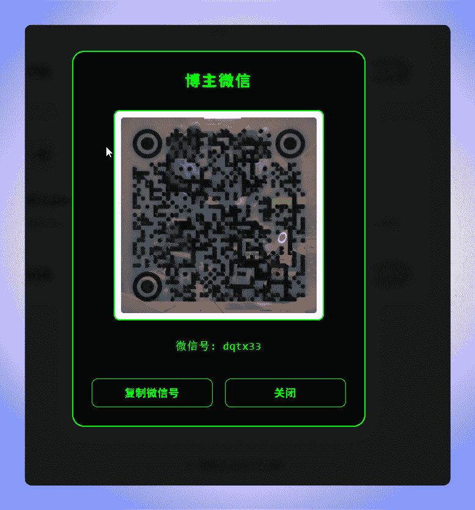
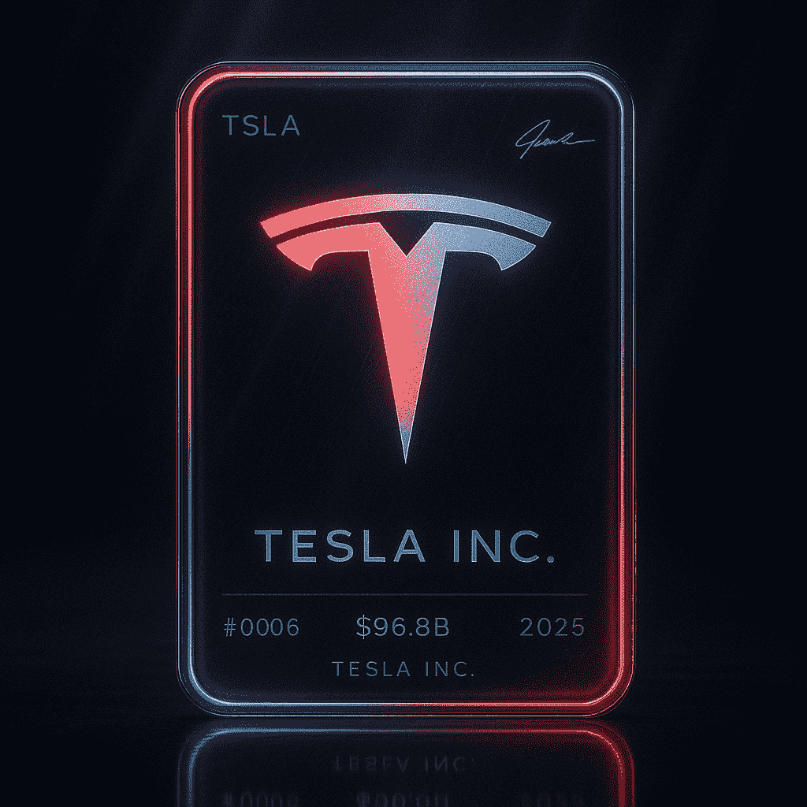

# GPT生图案例库

> 来源：[https://xodnytdcaw.feishu.cn/docx/Wj6jd3YQeowWWqxBQ9ccZRbxnih](https://xodnytdcaw.feishu.cn/docx/Wj6jd3YQeowWWqxBQ9ccZRbxnih)

## 毛玻璃样机图[原文](https://x.com/ZHO_ZHO_ZHO/status/1917467387512905808)


```
生成一张极具现代感的玻璃拟态风格视觉设计样机图

竖幅4:3比例

画面中央，一只自然姿态的人手从画面底部托举起一张半透明的玻璃质感圆角矩形卡片，卡片比例为竖向4:3，指尖轻触卡片边缘。卡片材质细腻，边缘柔和，具有背景模糊与轻微渐变光影效果，呈现出真实玻璃的弧面反射质感。卡片上排版文字如下：
• 左上角：大强同学
• 左中下小字：数字生产力玩家
效率工具/AI前沿玩法/出海攻略
提供可落地定制化远程技术服务
• 左下小小字：个人主页
→dqtx.cc

背景采用纯色渐变，色调为柔和的暖白到浅米色渐变，突出卡片和手的质感。背景简洁无杂质，光源从画面上方轻微倾斜打下，柔光高光在卡片边缘与手指关节上形成自然过渡。

整体风格高级、干净、现代而温暖，既有未来感，又保留细腻的人文气息。细节处理真实且精致，强调玻璃质感、手部皮肤纹理与柔和光影之间的微妙互动
```

## 未来社交界面


gpt生成（文字有问题）

豆包重新生成文字，其他不变




```
一张3:4竖版逼真的赛博美学未来社交软件界面照片：一只手拿着一张竖直半透明的亚克力卡片，占据了大部分画面。上面显示着一个社交媒体个人资料界面，但没有任何横幅或背景图片。卡片有平滑的圆润边缘，闪烁着柔和的霓虹灯光，呈现出粉色、紫色和蓝色的渐变。背景黑暗而模糊，以突出发光的边缘。卡片表面如水晶般清澈，个人资料的细节仿佛雕刻，只显示参考图中的信息，按照顺序依次显示：
- 头像（居中）  
- 用户名：电视喵、顶部的认证徽章   
- 网站： tv.dqtx.cc 
- 介绍：一个收集全网Android TV电视盒子应用的导航站！  
- 关注按钮 
手指上的灯光反射看起来富有电影感和氛围感，营造出一种高科技的全息氛围。
```

附件：

> 原文：[点此查看](http://x.com/dotey/status/1983941654680641984)    使用Sora 或者 ChatGPT

一张3:4竖版逼真的赛博美学未来社交软件界面照片：一只手拿着一张竖直半透明的亚克力卡片，占据了大部分画面。上面显示二维码，但没有任何横幅或背景图片。卡片有平滑的圆润边缘，闪烁着柔和的霓虹灯光，呈现出粉色、紫色和蓝色的渐变。背景黑暗而模糊，以突出发光的边缘。卡片表面如水晶般清澈

## 个人名片


```
一张插画特写，展示一只手拿着一张名片。这张名片被设计成在Notepad++ 窗口，显示一个名为 “BusinessCard.json” 的 JSON 文件样式。名片上的内容为采用【JSON】语法高亮格式的代码，包含清晰可见的键值对，比如：
- 【&quot;name&quot;: &quot;大强同学&quot;】
- 【&quot;github&quot;: &quot;dqtx760&quot;】
- 【&quot;link&quot;: &quot;www.dqtx.cc&quot;】
- 【&quot;email&quot;: &quot;sphinx30@126.com&quot;】
窗口界面带有标准的工具栏图标和标题栏,背景模糊且为中性色调。照片级真实感，细节丰富，光线柔和，高分辨率。
```

## 未来主义风格的 Logo 交易卡



```
{
&quot;prompt&quot;: &quot;A futuristic trading card with a dark, moody neon aesthetic and soft sci-fi lighting. The card features a semi-transparent, rounded rectangle with slightly muted glowing edges, appearing as if made of holographic glass. At the center is a large glowing logo of {{logo}}, with no additional text or label, illuminated with a smooth gradient of {{colors}}, but not overly bright. The reflections on the card surface should be subtle, with a slight glossy finish catching ambient light. The background is a dark carbon fiber texture or deep gradient with soft ambient glows bleeding into the edges. Add subtle light rays streaming down diagonally from the top, giving the scene a soft cinematic glow. Apply light motion blur to the edges and reflections to give the scene a sense of depth and energy, as if it&#x27;s part of a high-end tech animation still. Below the card, include realistic floor reflections that mirror the neon edges and logo—slightly diffused for a grounded, futuristic look. Text elements are minimal and softly lit: top-left shows &#x27;{{ticker}}&#x27;, top-right has a stylized signature, and the bottom displays &#x27;{{company_name}}&#x27; with a serial number &#x27;{{card_number}}&#x27;, a revenue badge reading &#x27;{{revenue}}&#x27;, and the year &#x27;{{year}}&#x27;. Typography should have a faint glow with slight blurring, and all elements should feel premium, elegant, and softly illuminated—like a high-end cyberpunk collectible card.&quot;,
&quot;style&quot;: {
&quot;lighting&quot;: &quot;Neon glow, soft reflections&quot;,
&quot;font&quot;: &quot;Modern sans-serif, clean and minimal&quot;,
&quot;layout&quot;: &quot;Centered, structured like a digital collectible card&quot;,
&quot;materials&quot;: &quot;Glass, holographic plastic, glowing metal edges&quot;
},
&quot;parameters&quot;: {
&quot;logo&quot;: &quot;Tesla logo&quot;,
&quot;ticker&quot;: &quot;TSLA&quot;,
&quot;company_name&quot;: &quot;Tesla Inc.&quot;,
&quot;card_number&quot;: &quot;#0006&quot;,
&quot;revenue&quot;: &quot;$96.8B&quot;,
&quot;year&quot;: &quot;2025&quot;,
&quot;colors&quot;: [&quot;red&quot;, &quot;white&quot;, &quot;dark gray&quot;]
},
&quot;medium&quot;: &quot;3D render, high-resolution digital art&quot;,
&quot;size&quot;: &quot;1080px by 1080px&quot;
}
```

注意：提示信息使用类似 JSON 的结构来描述卡片元素。您可以修改 parameters 对象中的值（例如 logo、ticker、company_name、colors 等）来自定义卡片。对于自定义 logo，请在 parameters.logo 中指定（例如，“Framer logo（附图）”），然后上传图片。

参考图片（可选）： 上传自定义徽标图片。

可灵动画提示词

```
A cinematic static shot of a futuristic trading card rotating slowly in place. The background is dark with ambient neon glows and soft light rays streaming from above. The card is thick and premium, with beveled edges and subtle glossy reflections that react to the rotating motion. As the card turns, light dances across its surface, highlighting the glow of text and graphical elements. The floor beneath the card shows a soft, diffused reflection. The rotation is smooth and continuous, completing a full 360-degree spin on the vertical axis, then seamlessly looping back to the start. No camera movement—only the card rotates, creating an elegant, endless loop.
```

[来源](http://x.com/hewarsaber/status/1912933875166171515)