# Gpt改图/生图

> 来源：[https://xodnytdcaw.feishu.cn/docx/H0MOdMz5aoyT4jx6EvMcBPJHnsV](https://xodnytdcaw.feishu.cn/docx/H0MOdMz5aoyT4jx6EvMcBPJHnsV)

## 一、使用渠道

+   [GPT官方（20美金/月）](https://chatgpt.com/#pricing)

+   DeepSider插件（免10次/天） （只能上传1张照片）

邀请码：67ec342e59a3d37fcd1893ea

+   https://aiautomedia.com/zh/image

## 二、参考案例

+   [案例合集1](https://www.figma.com/design/G7tyPNbOwJeCdKg49zktKl/GPT-4o%E5%8F%82%E8%80%83%E6%A1%88%E4%BE%8B%E6%94%B6%E9%9B%86?node-id=0-1)-figma

+   [案例合集2](https://github.com/jamez-bondos/awesome-gpt4o-images)-GitHub

+   [全网改图/生图案例参考](https://ew6rccvpnmz.feishu.cn/wiki/Z829w2PWZioptBktB1gcajdgnrZ)--飞书

## 三，改图场景

| 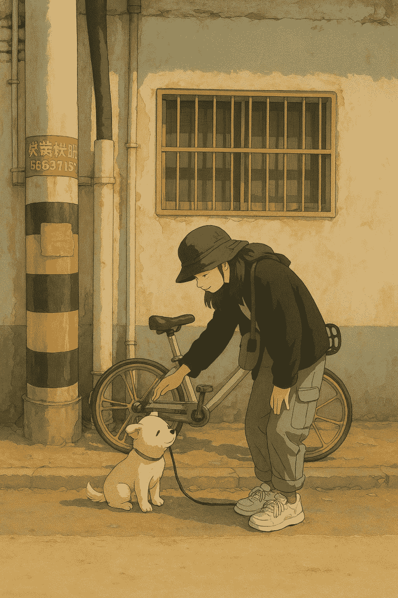 | ``` {   “艺术_风格_配置文件”：{     “style_name”：“手绘动画”，     “visual_elements”：{       “shape_language”：“柔软、有机的形状，具有微妙的不对称性;表情丰富的面部特征，大眼睛和最小的线条”，       “colors”：{         “primary_palette”：[“柔和的色调，泥土般的绿色，温暖的棕色，柔和的蓝色”]，         “accent_colors”：[“Deep reds，soft pinks，mute yellow for emphasization”]，         “shading”：“带有柔和手绘渐变的平面颜色;单元格着色很少使用”       },       “lighting”：{         “type”：“自然，环境照明与暖色调”，         “source_direction”：“通常来自太阳光或漫射天空光，营造平衡的氛围”，         “shadow_style”：“柔和的、带有光不透明度和暖边的着色阴影”       },       “materials”：{         “surface_texture”：“在背景中具有可见的笔触或纹理的绘画风格;字符平滑且干净”，         “reflectivity”：“低到中等，在头发、眼睛和反射表面上有细微的高光”       },       “composition”：{         “object_presentation”：“人物和环境放置在强大的叙事背景和视觉故事”，         “perspective”：“经典的 2D 动画透视，具有轻微的视差和深度分层”，         “background”：“高度细致的水彩风格背景，具有丰富的环境背景”       },       “typography”：{         “font_style”：“使用时为手写或衬线样式，边框中最小”，         “text_placement”：“Used sparingly，often in credits or narrative only”，         “color”：“静音，匹配整体调色板”       },       “rendering_style”：{         “technique”：“2D hand-drawn animation with painted backgrounds”，         “detail_level”：“环境中的高细节;角色保持简单但富有表现力”       }     },     “目的”：“通过手工制作的视觉魅力和丰富的环境唤起温暖，怀旧和情感故事。&amp;quot;   } } ``` |
| --- | --- |
| 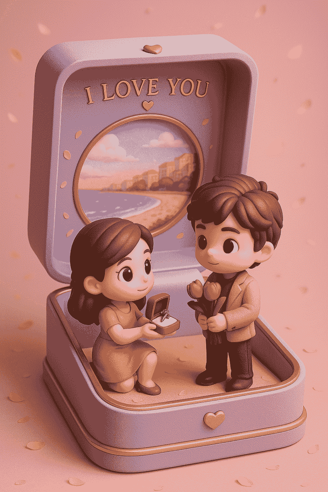 | ``` 根据人物五官特征，制作一个细节丰富、可爱的 3D 渲染收藏品小雕像，放在一个温馨的粉彩色展示盒中。盒子呈淡紫色，形状像一个紧凑的珠宝盒，打开后会露出两个处于浪漫场景中的 Q 版人物。盒子顶部印有“I LOVE YOU”字样，并配有小心心装饰。背景中的圆形窗口展示了风景优美的城市景观，背景中有海滩和云彩。女子手拿戒指向男子求婚。男子站着手拿一束郁金香，图像的背景是浪漫的粉红色，上面有落花。展示盒的颜色应与背景相协调，物体和人物的颜色应与整体主题和氛围相得益彰，盒子的设计和配色方案应体现出真正奢华的外观。 ``` |
| 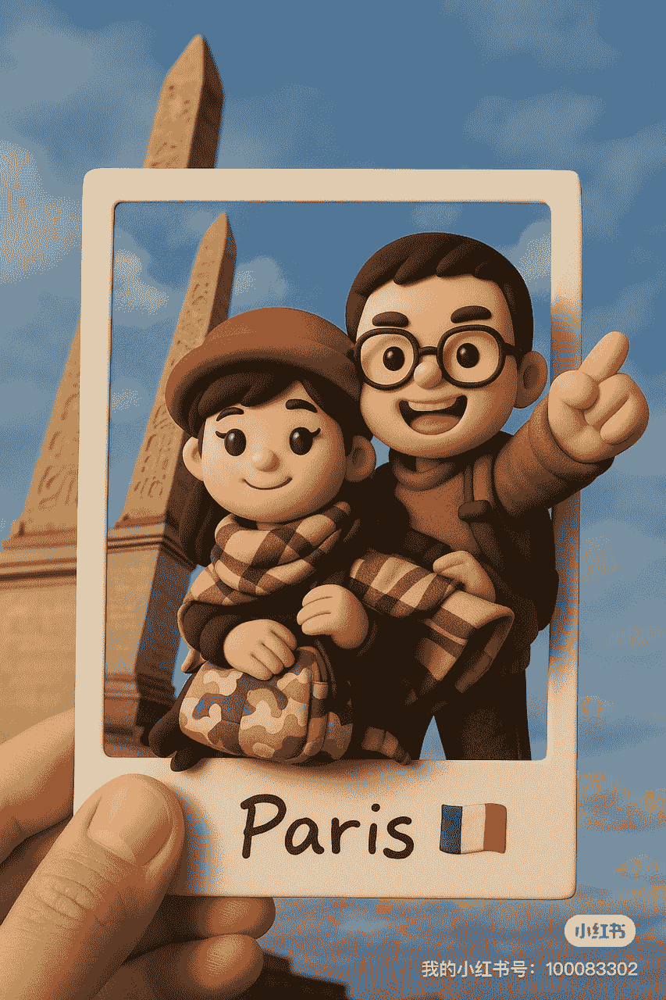 | ``` 请根据附件的照片，将画面中的角色转化为3D Q版黏土风格角色公仔，整体放置于一张 拍立得照片中，并由一只手持握著拍立得相纸。画面呈现出一种视觉效果：角色从拍立得照片中突破边框、延伸进入现实世界的二维空间。 构图比例：9:16 垂直构图 人物设定：将照片中的人物转化为 Q版 3D 公仔，整体约为 1/4 身高比例，呈现全身，保持原照片中的服装与造型，风格为柔软可爱的黏土材质 背景：延续拍立得中的背景，以 Q 版风格绘制，不需再有人物出现，仅作为角色背景的延伸，与照片原始场景一致，拍立得底部文字：手写字体：Paris ``` |
| 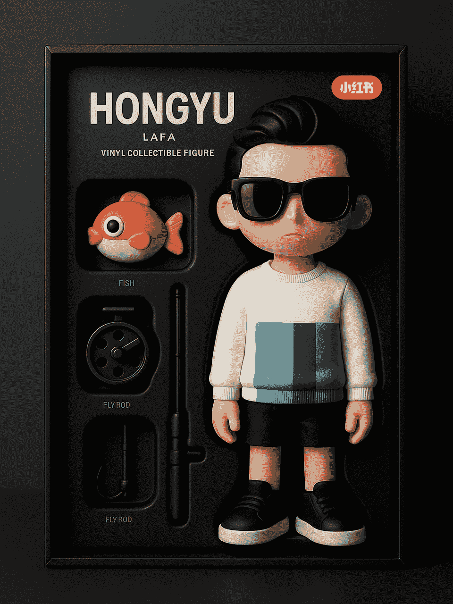 | 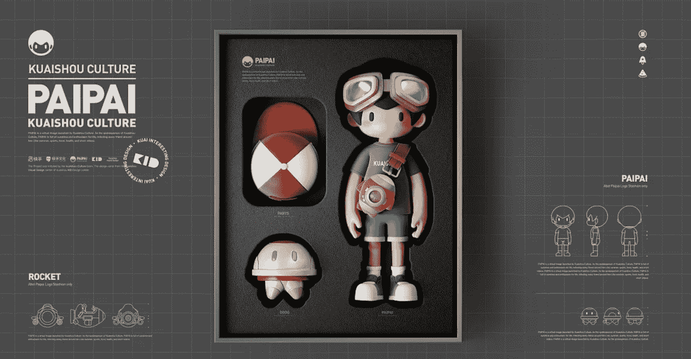 |
| 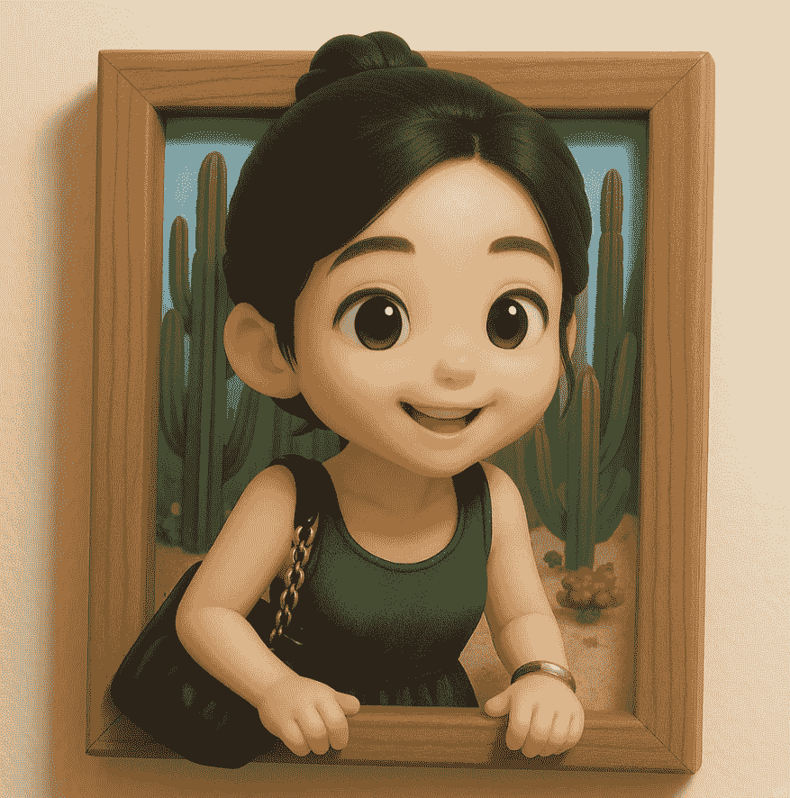 | ``` 请生成3D Q版探头相框： ▫️*人物设定 ：参考上传图片 ▫️相框细节 ：北欧风原木质感相框，挂在米色墙面 ▫️任务动作：人物从一个木制相框中探出身子，保留人物特征，采用柔和且鲜明的灯光风格，使其呈现出精致的高品质效果，角色一直手撑着边框的下边边框充满好奇的向外探出身子，一只手伸直向外挥手（这里也可以描述你自己想要的动作）， ▫️效果描述：风格应给人一种萌趣可爱的感觉，类似迷你手办。 ``` |
| 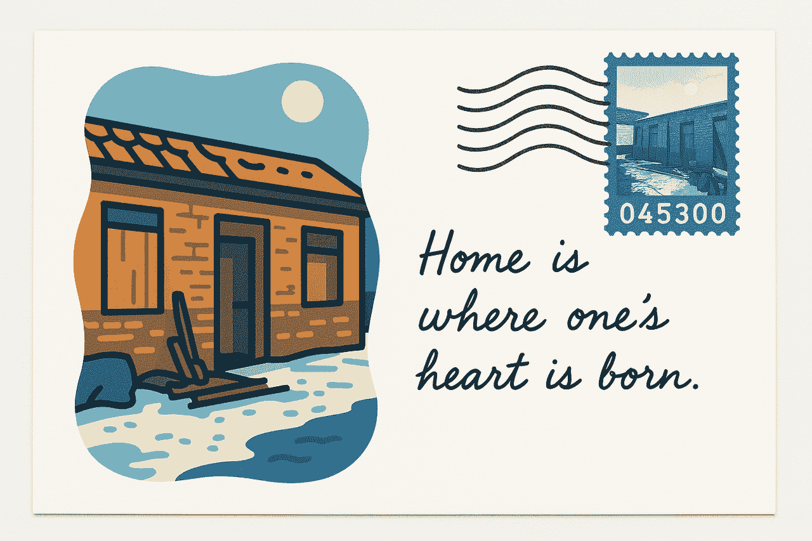 | ``` 帮我把这张照片做成一张 3:2 的明信片， 左边是一幅 扁平多色插画风格（参考某某图）的画面， 插画内容参考这张照片，比如：建筑/风景/人物等细节， 插画的边缘请做成 不规则异形边框， 右边用手写风格英文写一句和「XX」相关的名言， 并贴上一枚用原图生成的单色风格邮票， 邮票右上角，邮编写 XXXX，盖上邮戳。 ``` |
| 换脸 | ``` 将第一张图的脸换到第二张图上 ``` |
| 换背景 |  |
| 老照片修复 | ``` 老照片上色，并帮我修复 ``` |
| 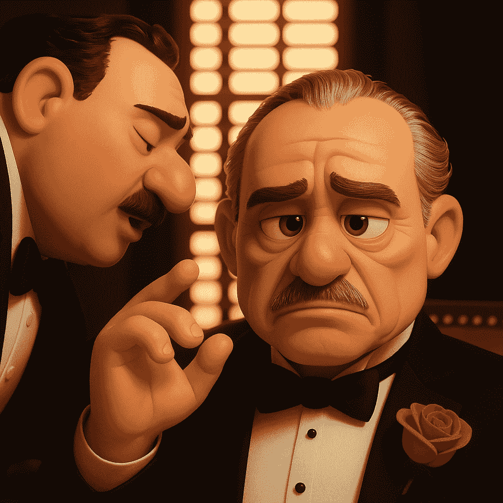 | ``` 以皮克斯 3D 风格重绘这张照片 ``` |
| 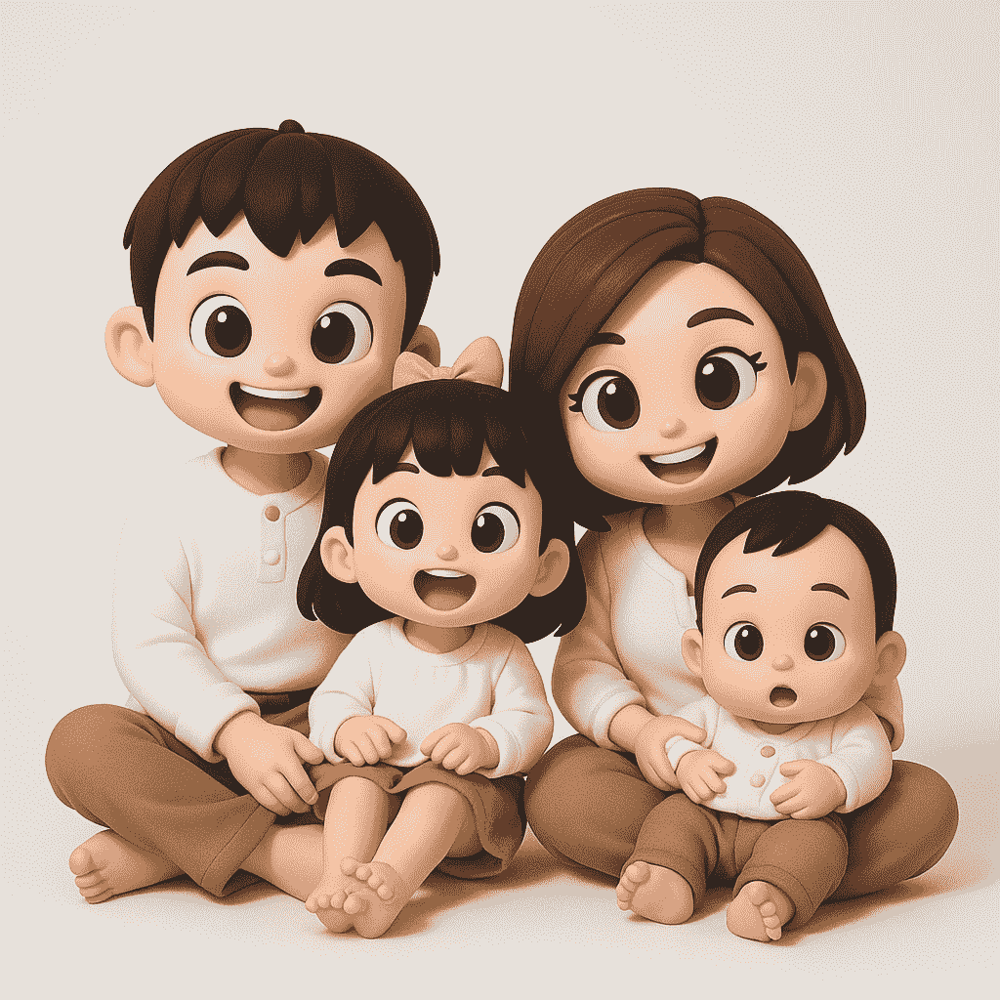 | ``` 将场景中的角色转化为3D Q版风格，同时保持原本的场景布置和服装造型不变。 ``` |

## 四，生图场景

| 微缩场景 | 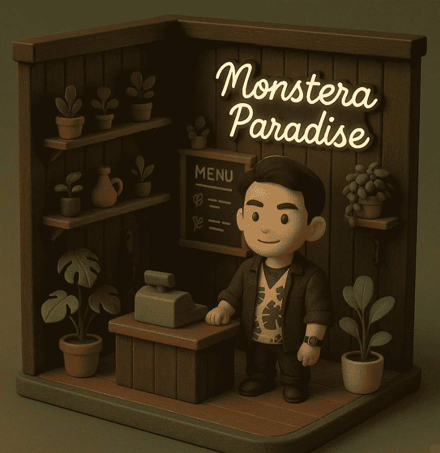 | ``` 这是一个可爱的微型3D立体模型场景，描绘了一家{类型}店铺。店铺采用{颜色}木墙，木架上摆满{你想要摆放的东西}。店内后方放置着一块小黑板菜单，旁边站着身穿{着装特点}服的卡通风格友善女店主。场景包含一个带收银机的柜台，墙上悬挂着发光的黑色霓虹灯招牌，上面写着{文案内容}。整体氛围温馨治愈，兼具现代简约美学风格，并点缀着精致可爱的细节元素。」          ✨具体填入喜欢的内容，例如： ☕️ 咖啡店、原木色、咖啡豆和杯子、咖啡师制服、“Grid Coffee” 🌳 绿植店、深棕色、各种盆栽植物、休闲夹克、“Monstera Paradise” ``` |
| --- | --- | --- |
|  | 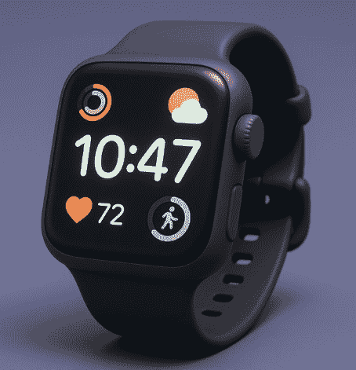 |  |
|  | 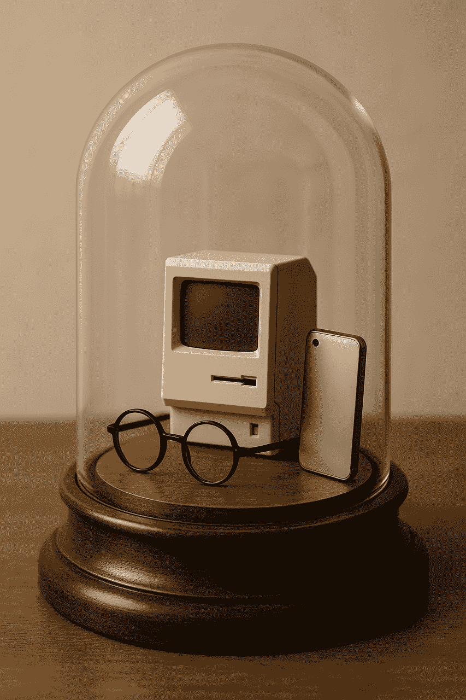 | ``` A photorealistic image of a miniature dioramadisplayed inside a glass dome with apolished dark wooden base. inside the domea tribute scene to Steve Jobs is arrangedwith minimalist precision: a small vintageMacintosh computer, a pair of round black-rimmed glasses, and a sleek metallic Applelogo, all placed thoughtfully on a clean whiteplatform inside the dome. The dome rests ona circular wooden base, and on the front is abrushed silver plaque engraved with thephrase &amp;quot;Stay Hungry. Stay Foolish.&amp;quot; in arefined serif font. The glass surface capturessoft reflections from warm ambient studiolighting, and the background is subtly blurredto draw full attention to the diorama.l wantSteve Jobs in a very miniature form leaningon to the Apple logo. it could even be astylized version. lt doesn&amp;#x27;t have to be sodetailed, but it should be noticeably him.Keep the Apple logo slightly in theforeground.l want Steve Jobs in between theMac and the Apple logo. ``` |
|  | 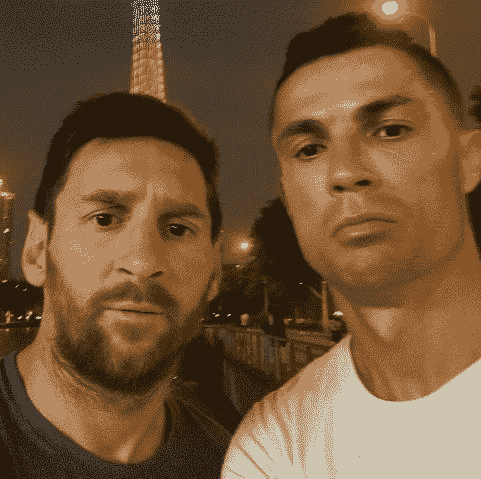 | ``` 请你画一张及其平凡无奇的iPhone自拍照，没有明确的主体或构图感–就像是随手一拍的快照。照片略带运动模糊，灯光不均导致轻微曝光过度。角度尴尬、构图混乱，整体呈现出一种刻意的平庸感-就像是从口袋里拿手机时不小心拍到的一张自拍。主角是xxx 背景是xxxx ``` |
|  | 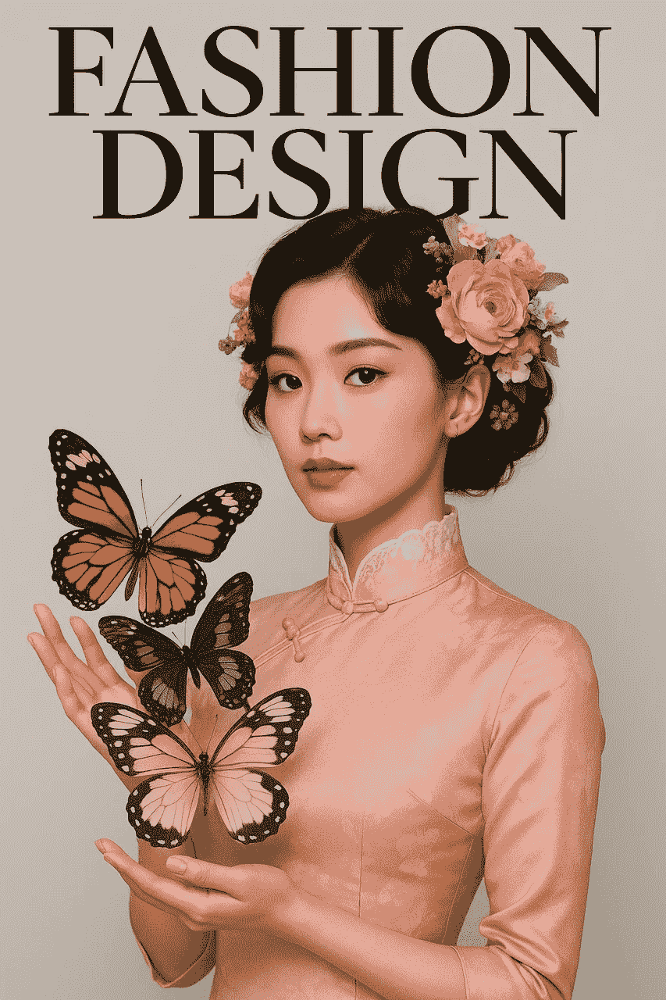 | ``` 一位美丽的女子身穿粉色旗袍，头戴精致的花饰，秀发中点缀着色彩缤纷的花朵，颈间装饰着优雅的白色蕾丝领子。她的一只手轻托着几只大型蝴蝶。整体拍摄风格呈现高清细节质感，类似时尚杂志封面设计，照片上方中央位置标有文字「FASHION DESIGN」。画面背景采用简约的纯浅灰色，以突出人物主体。 ``` |
|  |  | ``` 创作一张手绘风格的信息图卡片，比例为9:16竖版。卡片主题鲜明，背景为带有纸质肌理的米色或米白色，整体设计体现质朴、亲切的手绘美感。  卡片上方以红黑相间、对比鲜明的大号毛笔草书字体突出标题，吸引视觉焦点。文字内容均采用中文草书，整体布局分为2至4个清晰的小节，每节以简短、精炼的中文短语表达核心要点。字体保持草书流畅的韵律感，既清晰可读又富有艺术气息。周边适当留白。  卡片中点缀简单、有趣的手绘插画或图标，例如人物或象征符号，以增强视觉吸引力，引发读者思考与共鸣。整体布局注意视觉平衡，预留足够的空白空间，确保画面简洁明了，易于阅读和理解。 “做 IP 是长期复利 坚持每日更新，肯定会有结果，因为 99% 都坚持不了的！”  ``` |
|  |  | ``` 生成3:2 比例的图片，一个胶囊形状的创意微缩场景，胶囊横放着。胶囊一半为活力的樱花粉色或现代的银灰色，印有白色的字“東京”和英文“TOKYO”。另一半透明，展示东京真实的特色建筑缩影——一座现代的东京塔或晴空塔微缩模型，完全包含在胶囊里面，不超出边界。背景为繁华的涩谷十字路口或浅草寺的微缩景象，整体风格3D渲染，具有梦幻感，使用 C4D制作，材质有光泽感。 ``` |
|  |  | ``` 帮我生成左手捏着一张未来主义的卡片，卡片具有黑暗、喜怒无常的霓虹灯美学和柔和的科幻灯光。该卡具有一个半透明的圆角矩形，带有略微柔和的发光边缘，看起来就像由全息玻璃制成一样，卡片内容为“大强同学，一个科技博主，在写公众号文章，小红书开了个小店，平时喜欢逛油管，爱听海来阿木的歌，科幻迷。公众号：大强同学”，整体背景感觉优质、优雅和柔和的照明——就像高端赛博朋克收藏卡一样 ``` |