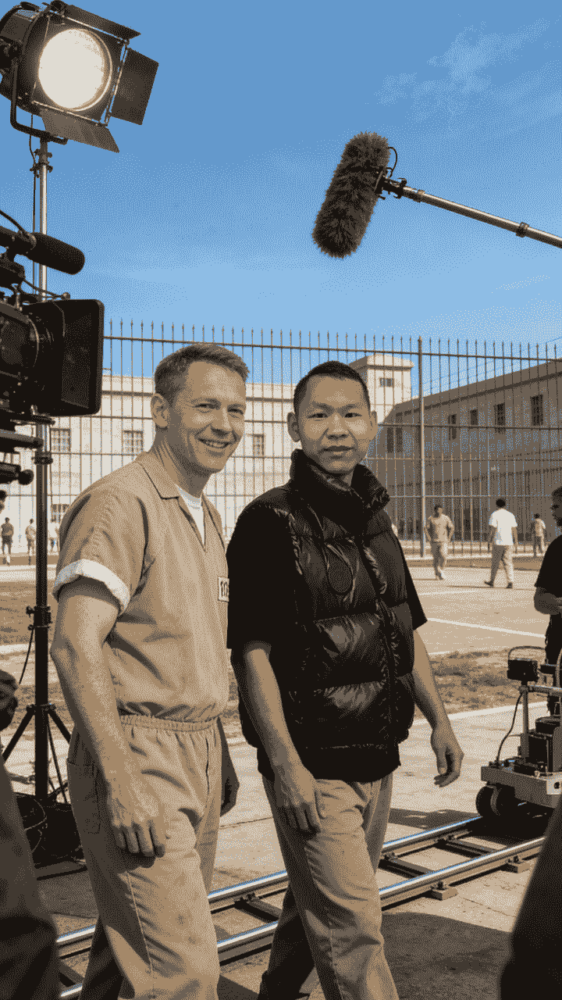
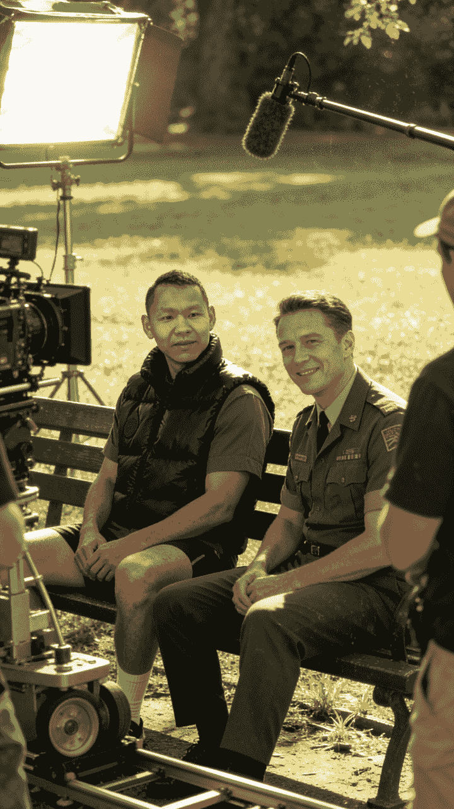
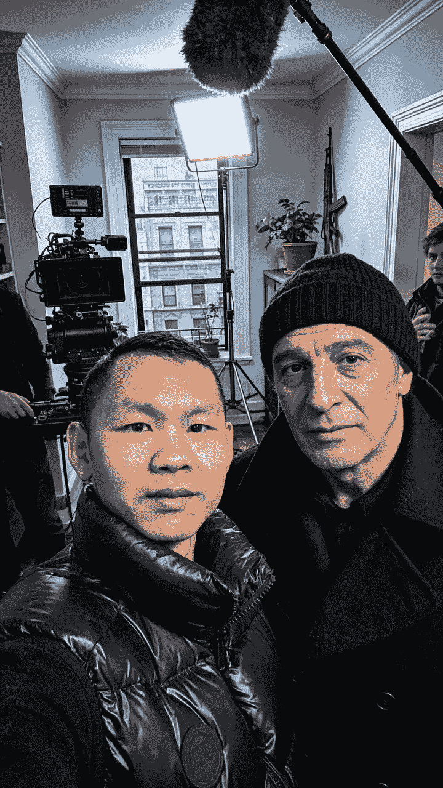
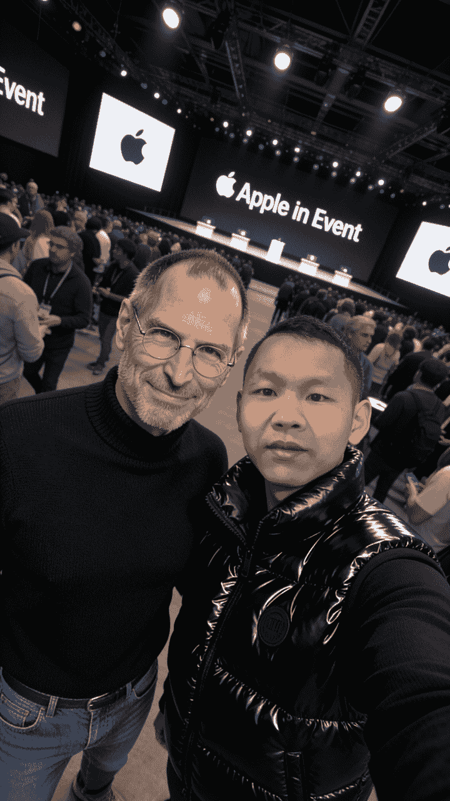
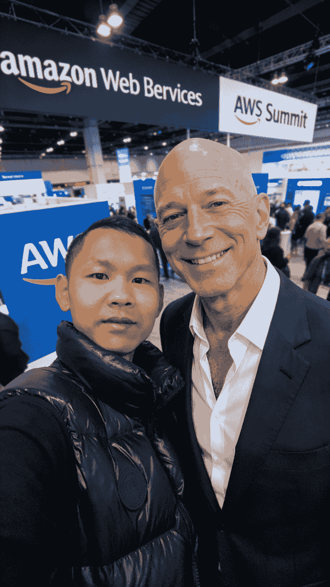
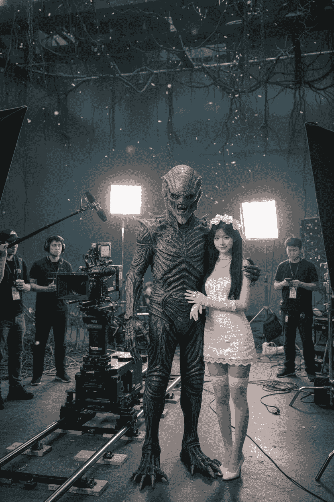
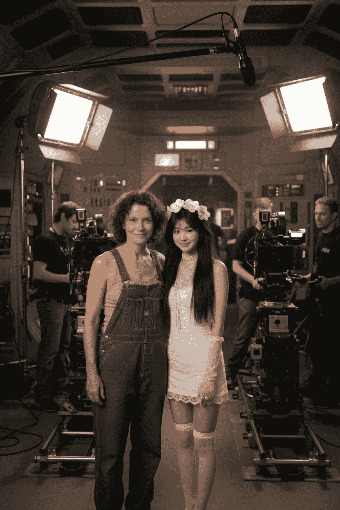
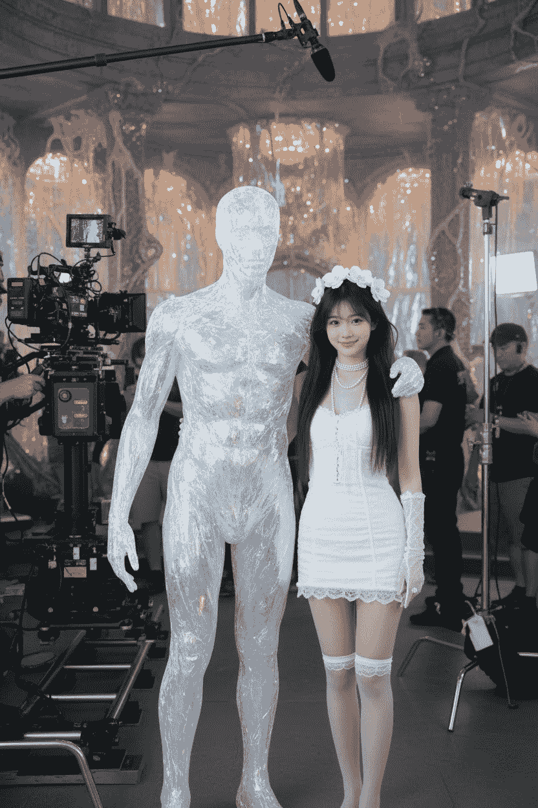

# AI片场探班的视频

> 来源：[https://xodnytdcaw.feishu.cn/docx/FCYndXz0qoUYS1xZdMdcqBctnob](https://xodnytdcaw.feishu.cn/docx/FCYndXz0qoUYS1xZdMdcqBctnob)

## 生成片场图

### 片场提示词[点此生成](https://www.doubao.com/code/launch/detail/131129289474)

[豆瓣电影 Top 250](https://movie.douban.com/top250)

### 生图

支持Nano Pro的AI工具：Lovart ,海螺AI

```
{
&quot;metadata&quot;: {
&quot;type&quot;: &quot;AI Generated Video/Image Sequence&quot;,
&quot;aspect_ratio&quot;: &quot;9:16&quot;,
&quot;resolution&quot;: &quot;1080x1920&quot;,
&quot;orientation&quot;: &quot;Vertical (Portrait)&quot;,
&quot;style&quot;: &quot;Hyper-realistic, Vlog Selfie, 8k, High Detail&quot;
},
&quot;content_description&quot;: {
&quot;main_character&quot;: &quot;Young Asian woman, influencer aesthetic, long dark straight hair, fair skin, wearing a white strapless draped dress with a large gold sunburst/star accessory on the chest.&quot;,
&quot;theme&quot;: &quot;Time-traveling or impossible celebrity selfies at tech events.&quot;
},
&quot;scenes&quot;: [
{
&quot;timestamp&quot;: &quot;00:00&quot;,
&quot;subject&quot;: &quot;Selfie with Steve Jobs&quot;,
&quot;prompt_text&quot;: &quot;A photorealistic selfie of a young Asian woman with Steve Jobs at an Apple Special Event. Steve Jobs is wearing his iconic black turtleneck, blue jeans, and rimless glasses, smiling slightly. The woman is wearing a white dress with a gold sun emblem. Background shows a large hall with &#x27;Apple Special Event&#x27; screens, crowd of tech attendees, bright professional lighting, sharp focus, 8k resolution.&quot;,
&quot;details&quot;: {
&quot;character_1&quot;: &quot;Steve Jobs (Iconic look)&quot;,
&quot;character_2&quot;: &quot;Asian woman (White dress, gold accessory)&quot;,
&quot;background&quot;: &quot;Apple Launch Event, logo visible&quot;
}
},
{
&quot;timestamp&quot;: &quot;00:04&quot;,
&quot;subject&quot;: &quot;Selfie with Jeff Bezos&quot;,
&quot;prompt_text&quot;: &quot;A photorealistic selfie of a young Asian woman with Jeff Bezos at an AWS Summit. Jeff Bezos is bald, wearing a navy blue suit with a white shirt (open collar), smiling. The woman is the same character in a white dress. Background shows &#x27;Amazon Web Services&#x27; and &#x27;AWS Summit&#x27; signage, blue exhibition booths, busy convention center atmosphere, depth of field.&quot;,
&quot;details&quot;: {
&quot;character_1&quot;: &quot;Jeff Bezos (Business casual suit)&quot;,
&quot;character_2&quot;: &quot;Asian woman (Same attire)&quot;,
&quot;background&quot;: &quot;AWS Summit, Blue branding&quot;
}
}
],
&quot;technical_settings&quot;: {
&quot;camera_angle&quot;: &quot;Selfie angle, slightly high angle&quot;,
&quot;lighting&quot;: &quot;Indoor event lighting, soft volumetric light&quot;,
&quot;rendering&quot;: &quot;Unreal Engine 5 style, Octane Render, Ray Tracing&quot;
}
}

```











### Nano Banana Pro---初始图

上传照片，提示词里头填上，

> 影片：怪奇物语，角色：demogorgon，场景：upsidedown。

> 影片：Alien，角色：艾伦・雷普利，场景：诺斯特罗莫号飞船 - 穿梭机（最终驱逐异形）

> 影片：Annihilation，角色：闪光生物（复制体），场景：“闪光” 区域 - 灯塔内部（莉娜与复制体对峙）

```
场景与地点：还原经典影视作品的拍摄现场。这是一个正在拍摄的片场环境，拍摄现场包含大型电影电影摄影机、灯光设备、轨道车、吊杆录音设备、部分入镜的工作人员，以及场景中的重要道具。

人物与角色: 
参考图中的人物，保持面部特征、五官、发型和衣着100%一致。站在旁边的是影片中的角色，呈现角色在影片拍摄期间的装扮、发型和衣着。两人站在一起，看向镜头，在影片拍摄的休息时间里，随机抓拍一张自然放松的幕后合影。

光线与氛围: 
专业级影棚照明，捕捉到角色和设备的所有细节。展现幕后制作的真实感，氛围捕捉到温馨但不被人看到的幕后时刻，两个人物的互动欢乐自然。影片：，角色：，场景：。
```

|  |  |  |
| --- | --- | --- |
| 1 | 2 | 3 |

即梦---面孔替换（可选）

```
用图二中人物的脸部替换图一中左侧男人的脸部，场景中的光线、色调和大气透视效果必须真实地应用到人物身上。场景中的光源 （例如：太阳、灯光）必须在环境中投射出人物可信的光影。人物的纹理细节和分辨率必须与背景完美匹配，以创造一个连贯、统一的图像，使人物看起来完全自然并扎根于这个环境中。
```

## 生成视频

> 可灵 2.5、Vidu Q2、Veo3.1、即梦视频 3.0

```
全景，推镜头。跟随黑色马甲男生背影冲向图二的人物。BGM: 动感、欢快的快节奏流行乐。
```

### 豆包--生成收尾帧运镜提示词

上传两个图片

```
以第一张图为首帧图，第二张为尾帧图，写一个用在即梦AI里的关键词，链接首尾帧丝滑转场的AI运镜提示词，要求具有视觉冲击
```

#### 1-2文生首尾帧视频提示词

```
昏暗电影片场，枯枝悬垂 + 悬浮暖光斑，巨型鳞甲怪兽与白裙蕾丝少女并肩，贴地环绕运镜扫过怪兽利爪 / 少女长袜细节→镜头穿透怪兽肩甲，光斑爆发为星尘粒子流，裹挟镜头极速穿梭，片场布景被粒子冲刷成科幻舱室金属纹理（运镜由环绕转俯冲推进）→粒子爆炸后镜头急停，聚焦白裙少女与工装女性面部特写，舱室设备灯光逐一点亮，运镜轻微拉远露出全景，画面从冷调暗场过渡为暖调工业质感，全程运镜丝滑无卡顿，视觉冲击强烈
```

#### 2-3文生首尾帧视频提示词

```
首帧（科幻舱室）：镜头从舱室顶部轨道缓缓下摇，聚焦白裙少女与工装女性的肩并肩特写，背景设备灯光闪烁→运镜突然推近少女发间的花朵装饰，花朵花瓣边缘泛起虹光，光线迅速扩散包裹镜头，舱室金属墙面被虹光溶解为琉璃质感的拱形结构→镜头随虹光流穿梭，工装女性的身影渐隐，透明镭射质感的人形轮廓从光流中浮现，运镜由推近转为环绕，扫过人形的全息纹理→尾帧（琉璃宫殿）：镜头定焦在少女与镭射人形的并肩画面，背景琉璃穹顶的彩光漫射，运镜轻微拉远露出宫殿全景，画面从工业冷调过渡为梦幻虹光质感，全程转场无断层，视觉冲击强烈。
```

### 即梦生成视频

```
镜头跟随白衣男子从图1自然走向图2的场景和人物，嘴部不动，不需要说话，白衣男子和图2的人物站在一起拍照，不要出现手机或者掏手机动作，速度自然，其他人物动作自然，不要出现多余的手或者骼膊，身体的转动自然，视频帧连贯 回使用提示词
```

#### 1-2图片文生首尾帧视频提示词

## 最后

导到剪映里加工一下，再加点拍照的特效和音效。