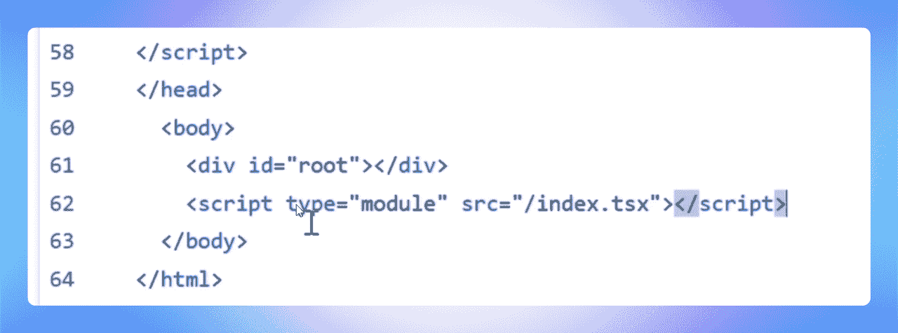
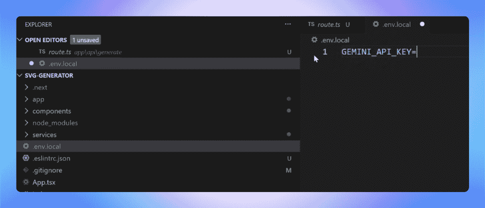
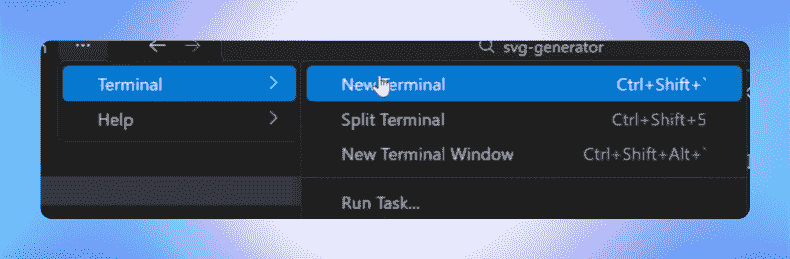
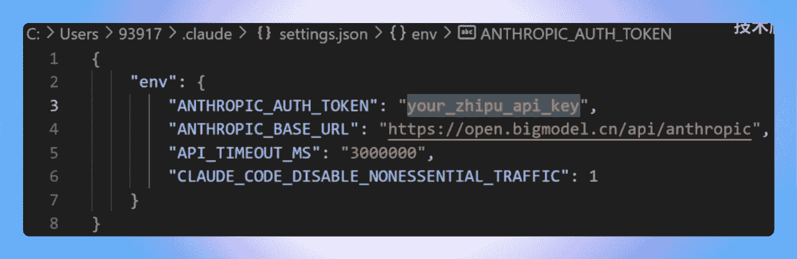
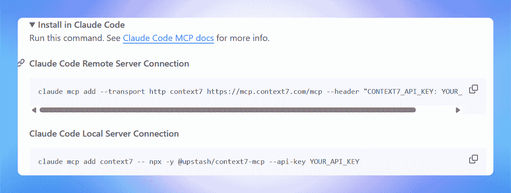

# gemini3部署网站教程

> 来源：[https://xodnytdcaw.feishu.cn/docx/RMSvdPMZCoWWF3xTe41coeTYnhc](https://xodnytdcaw.feishu.cn/docx/RMSvdPMZCoWWF3xTe41coeTYnhc)

入口：https://aistudio.google.com/prompts/new_chat

按钮：Build

一键托管GitHub

### 纯前端

index.html文件添加代码

```
&lt;script type=&quot;module&quot; src=&quot;/index.tsx&quot;&gt;&lt;/script&gt;
```



### 把API KEY写到代码里

本地下载仓库代码

> GitHubDesktop官网：https://desktop.github.com

> 汉化工具：https://github.com/robotze/GithubDesktopZhTool/releases/tag/3.5.4

添加缺失代码

```
&lt;script type=&quot;module&quot; src=&quot;/index.tsx&quot;&gt;&lt;/script&gt;
```

通过AI加入后端数据库提示词如下

```
把这个项目改造成一个NextJs的前后端应用， 注意GEMINI_API_KEY要安全的存放在后端，在后端调用AI功能，确保我的APIKey不会泄露
```

### 本地测试

新建.env.loca文件填写GEMINI_API_KEY=

API创建必须是第一层级



新建重终端



启动命令

```
npm run dev
```

Vercel部署环境Key如下，  Value：无API随便写  有API填写API

```
GEMINI_API_KEY
```

### 支付鉴权系统

用户先注册账号，进来购买积分，凭借积分来使用网站

+   Supabase McP

+   stripe MCP

完整用户的鉴权与下单支付。

### 模型：GL M Coding Pro（智谱4.6）有图像识别与联网搜索功能

https://bigmodel.cn/glm-coding

### 工具：Claude- Code

https://claude.com/product/claude-code

安装命令，psh管理员运行

```
irm https://claude.ai/install.ps1 | iex
```

配置API路径如下。

```
C:\用户\你的用庐名.claude 
```

找到settings.json



Claude Code安装视觉MCP

https://docs.bigmodel.cn/cn/coding-plan/mcp/vision-mcp-server

```
claude mcp add -s user zai-mcp-server --env Z_AI_API_KEY=your_api_key -- npx -y &quot;@z_ai/mcp-server&quot;
```

Claude Code安装视觉MCP

```
claude mcp add -s user -t http web-search-prime https://open.bigmodel.cn/api/mcp/web_search_prime/mcp --header &quot;Authorization: Bearer your_api_key&quot;
```

其他MCP

+   Figma---将网页/产品设计稿可视化并支持导出前端代码片段

+   Stripe---为网站/应用集成全球化的支付与计费功能

+   Supabase---快速搭建基于PostgreSQL的后端服务（数据库/认证/存储）

+   Replicate---快速生产商品图片，给商品配图

+   web-search-prime---提供高性能、结构化的网页搜索API服务

+   zai-mcp-server---搭建多模态AI协作平台的服务端（调度/编排/资源管理）

### 注册登录

```
用户注册与登录的具体实现请使用supabase Sdk， 有关 supabase的文档与 supabasesdk如何配置， 请使用 supabase mcp查找。

```

```
你搜索下stripe如何对接到项目里面 ，并且写一篇文档放到项目根目录
```

```
创建一个在线你画我猜游戏，玩家可以在画布上作画，AI系统负责猜测画的是什么内容。技术栈nextjs， AI使用Gemini的 API，从后台调用API，不要任何SDK， 直接调用 Gemini API地址
```

### [context7](https://github.com/upstash/context7) MCP服务专门为A提供最新的技术文档

AI的知识库都是有截止日期的，项目的依赖有可能不是最新的版本

```
你的知识截止日期？
```

context7在Claude Code配置命令

```
claude mcp add --transport http context7 https://mcp.context7.com/mcp --header &quot;CONTEXT7_API_KEY: YOUR_API_KEY&quot;
```

API获取（免费的）https://context7.com



```
把这个项目的依赖更新一下， use context7
```