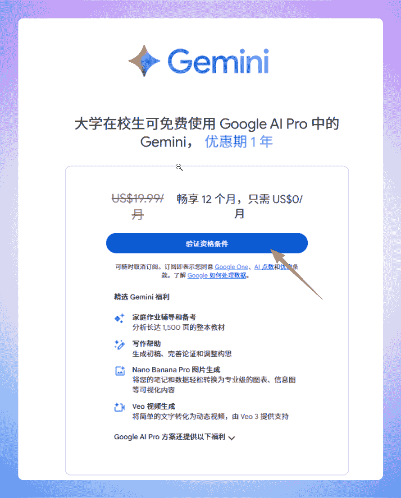
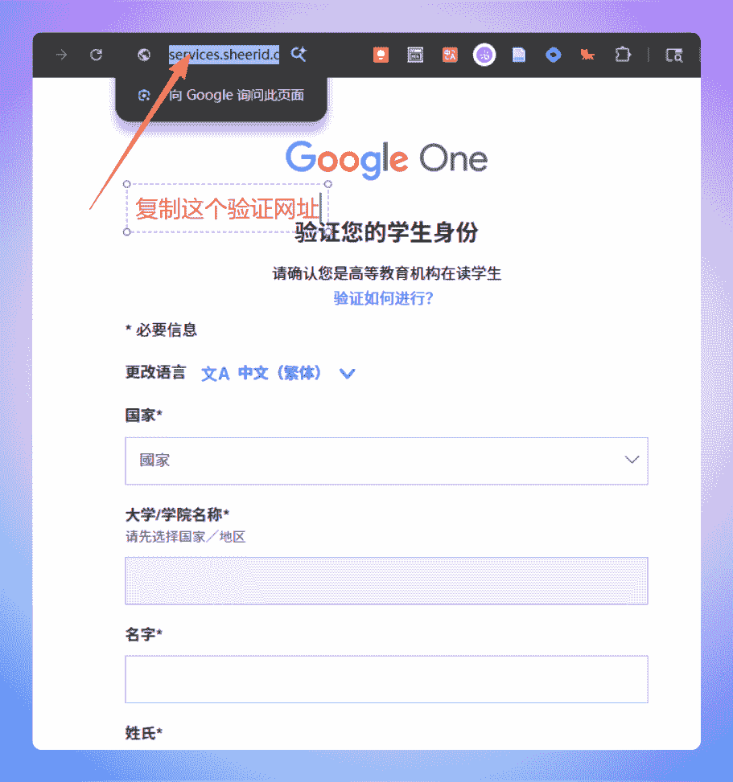
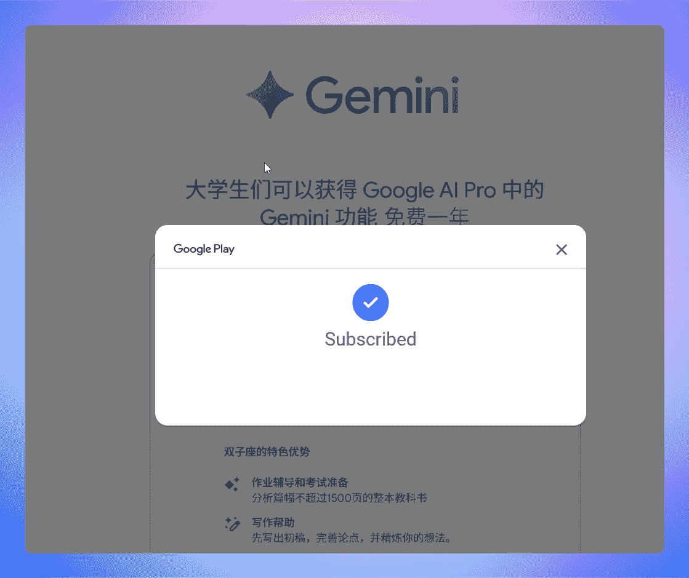
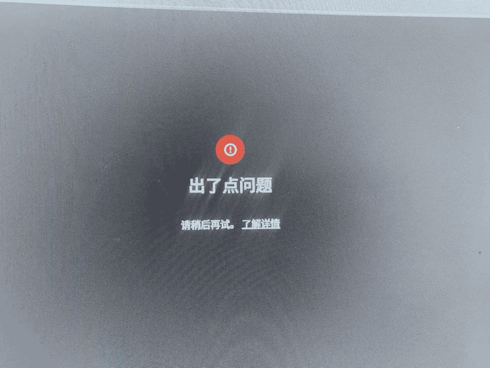
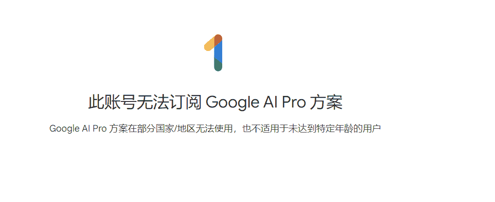
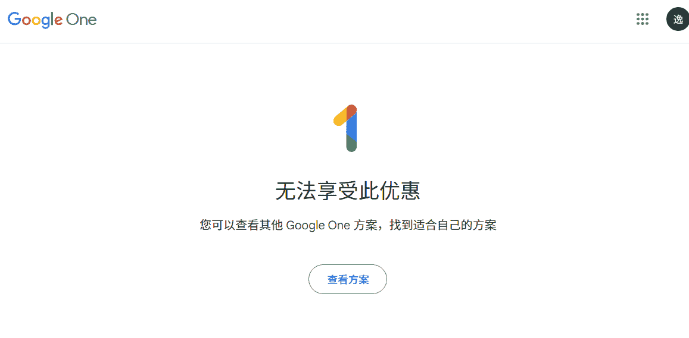

# Gemini Pro保姆级教程

> 来源：[https://xodnytdcaw.feishu.cn/docx/U29sdoMSOoEw8jx36T5czLndnKe](https://xodnytdcaw.feishu.cn/docx/U29sdoMSOoEw8jx36T5czLndnKe)

## 1.验证资格

活动地址：[点此直达](https://goo.gle/freepro)

> 如果正常：接着2步骤

> 如果异常：参考5.2/5.3解决办法

## 2.获取URL

点击后跳转到“验证学生身份页面”，复制这个页面的网址。

## 3.验证

[把刚才复制的验证页面网址，](https://batch.1key.me/)粘贴到这个网址（batch.1key.me）里面，然后点击“start Verification”，如果提示“success”，则验证成功；如果失败，多重来几次。

| https://batch.1key.me/ | https://www.sheerid.help/ |
| --- | --- |
| 免费方法 | 付费卡密**加微信dqtx33** |

## 4.绑卡

回到最开始的验证资格页面，这时会提醒你绑卡（如果没绑卡）

辅助加**微信dqtx33**

## 5.常见问题

### 5.1打开gemini提示“**出了点问题”**

> 解决办法：

> 打开网址（[点此打开](https://gemini.google.com/gems/create)）随便输入一个名字保存，就可以正常访问。

### 5.2.打开学生验证页面提示提示“此账号无法订阅Google Al Pro方案”

> 解决办法：

> 1，[点此](https://policies.google.com/terms)查看谷歌注册地是不是米国，不是[点此](https://policies.google.com/country-association-form)修改

> 2，[付款地址](https://payments.google.com/gp/w/home/settings?ec=AJ9oCCxrUsE3hiMVrpGas2PxrJln0%2FNCkEeqwBpBmUqzXbhn2SktZ8ccf5q97JoxFH%2FoOA1b6z%2FM)修改米国

> 3，打开 Google Play 商店应用。右上角，点击个人资料。

> 点击“设置”“常规”“帐户”和"设备偏好设置”“国家/地区和配置文件"

> 点击您要添加帐户的国家或地区。

### 5.3.打开学生验证页面提示“无法享受此优惠”

> 解决办法：

> 1.无痕模式

> 2.IP问题  全局/改规则

> Domain-keyword     gcp和doubleclick      Proxy

> 3,关闭付款地址[点此](https://payments.google.com/gp/w/home/settings?ec=AJ9oCCxrUsE3hiMVrpGas2PxrJln0%2FNCkEeqwBpBmUqzXbhn2SktZ8ccf5q97JoxFH%2FoOA1b6z%2FM)

> 4，再不行搞个新号即可

### 5.4.Google 家人群组邀请方法

|  |  |
| --- | --- |
| [点此邀请你朋友](https://myaccount.google.com/family/details) | 点此开启与家人共 Google One |