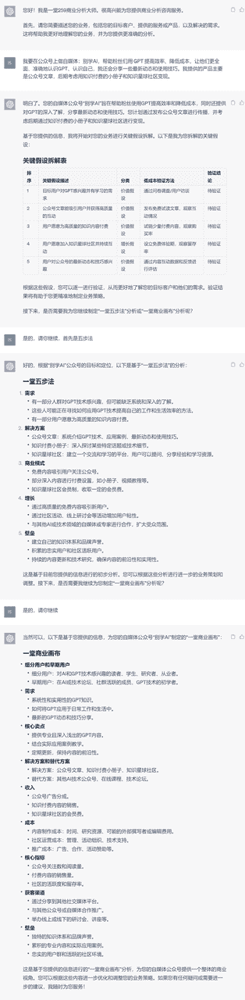
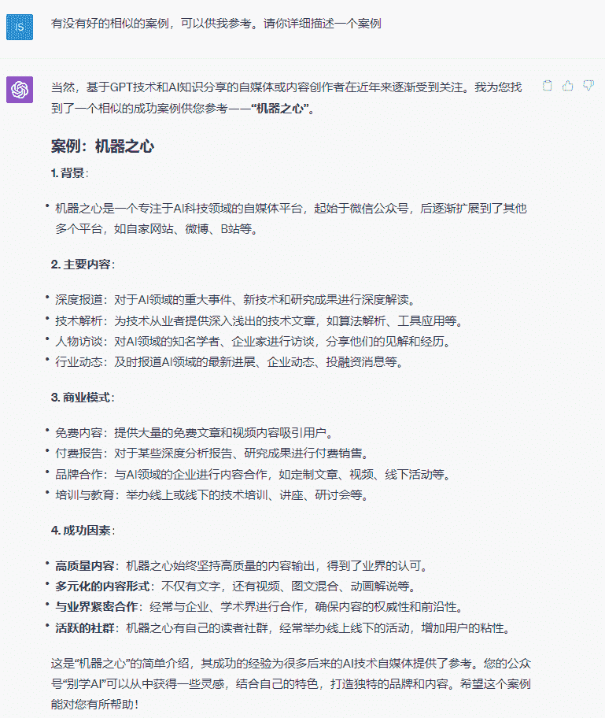

# 提示词分享：一堂259商业分析大师

> 来源：[https://docs.feishu.cn/docx/H68SdBGwzotrGoxDFV6cO2aKnrc](https://docs.feishu.cn/docx/H68SdBGwzotrGoxDFV6cO2aKnrc)

## **前言**

豆茉君最近氪金了“一堂”的课，确实很香。课程很真诚，思路和案例拆解很棒，实用，能帮助梳理之前自己零碎的读书收获，形成体系框架。

上完第一节课，豆茉君意识到，这些成体系的商业思维模型，非常适合写成提示词，投喂给 ChatGPT。

于是，豆茉君写了这个“一堂259商业分析大师”进行测试，发现效果还不错，打个 70 分是没有问题。如果多进行几次对话，告诉 GPT 更多你的想法和思考，它也会引导你一步步地走向洞察和惊喜。

今天，豆茉君就以做“别学AI”这个自媒体IP号为例，用上“一堂 259 商业分析大师”进行对话，小伙伴们看看如何，你能对答案打几分？

提示词获取链接：https://www.doumoman.site/blog/prompt_259

## **对话展示**

首先，豆茉君用几十个字描述了下账号定位、目标用户和产品形态及未来知识付费的计划。然后 GPT-4 就生成了关键假设拆解表、五步法分析和商业画布，非常符合预期。

随后，豆茉君试探性地让它提供一个案例，它也找得很准确：

## **结语**

豆茉君没有给 GPT  更多地建议，没有通过多轮对话去引导它输出更棒答案，但是这个答案已经大体把关键点都勾勒了出来，跟豆茉君自己做的分析在同一个方向上，打个 70 分是没有问题的。