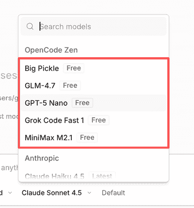

# OpenCode

> 来源：[https://xodnytdcaw.feishu.cn/docx/GSlwdtF7JoOMv8x5aE2ca8LanUc](https://xodnytdcaw.feishu.cn/docx/GSlwdtF7JoOMv8x5aE2ca8LanUc)

### 下载地址

官网下载：https://opencode.ai/download

夸克网盘：https://pan.quark.cn/s/2e6757964f1e

### 模式说明

Plan 模式：只分析不修改，适合代码审查、性能分析

Build 模式：实际修改代码，适合重构、添加功能

### 免费模型

## Nvidia

在nvidia注册账号生成key

https://build.nvidia.com/explore/discover

请求地址使用

https://integrate.api.nvidia.com/v1/chat/completions

> 找不到模型可以直接填，网页还没更新不用管：

> GLM-4.7：z-ai/glm4.7

> Minimax-m2.1：minimaxai/minimax-m2.1