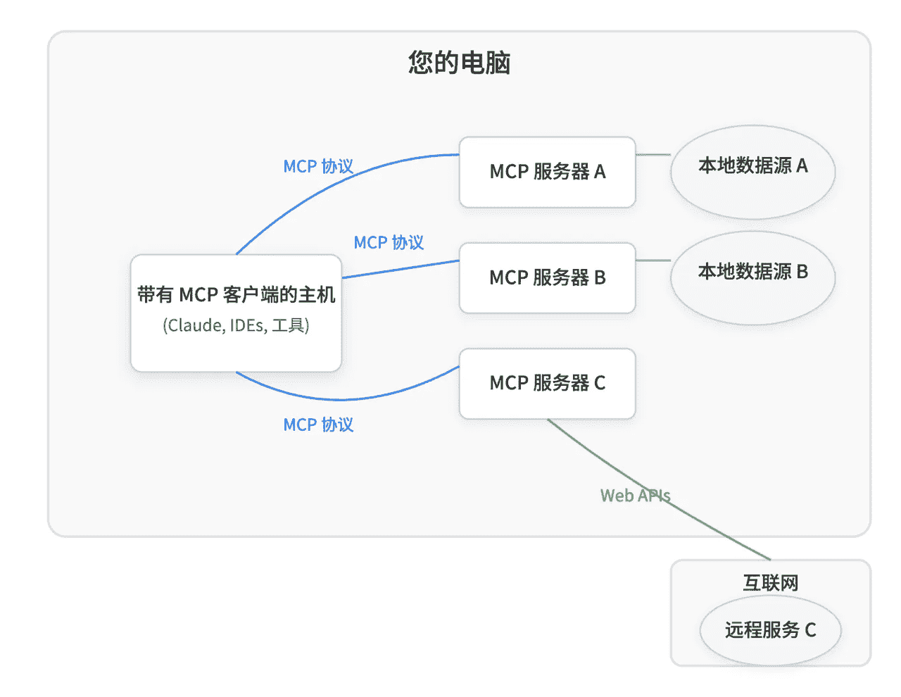
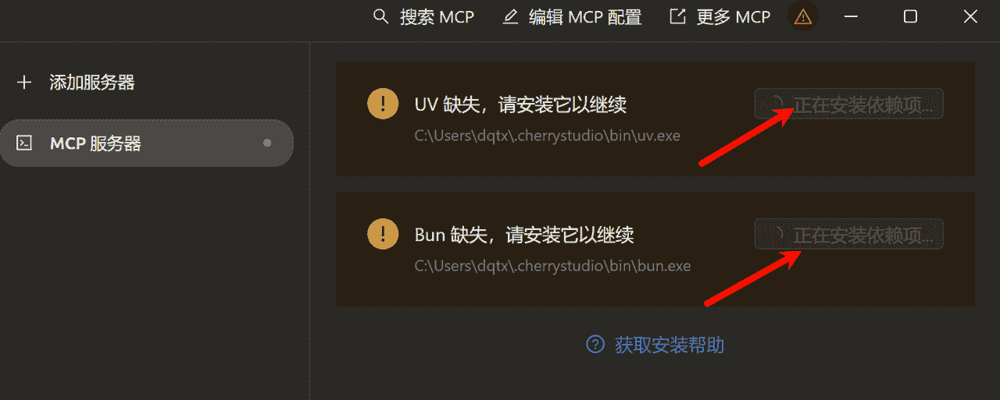
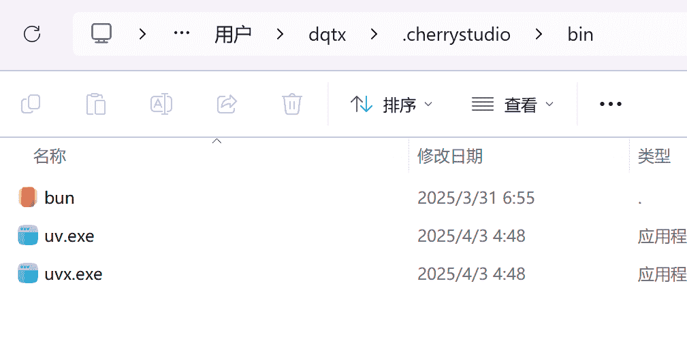
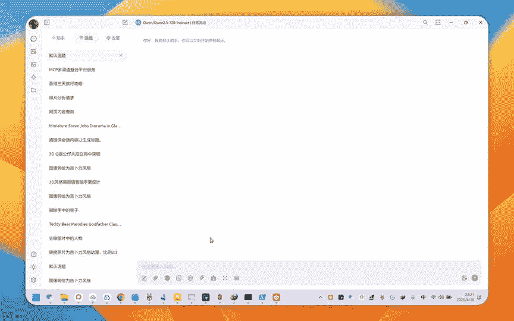
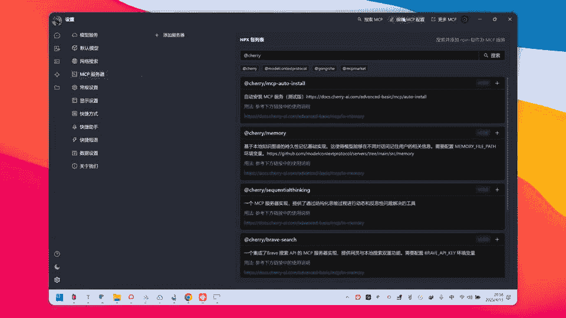

# CherryStudio中配置MCP

> 来源：[https://xodnytdcaw.feishu.cn/docx/MkDXdSmSDoH9ApxAWUkctVtJnpd](https://xodnytdcaw.feishu.cn/docx/MkDXdSmSDoH9ApxAWUkctVtJnpd)

# 一、什么是MCP

+   **MCP （Model Conte**xt Protocol）模型上下文协议。

+   **MCP Host**：支持调用MCP工具的各类大模型对话客户端，例如cursor

+   **MCP Server**：开发者基于 MCP 协议开发的各种“工具”，本质上是一个具备某种功能的程序，比如可以文件操作、网页浏览等。



# 二、CherryStudioMCP配置

客户端使用mcp协议对接AI大模型有两种方式，一种是利用系统提示词另外一种是使用模型functioncall功能，CherryStudio就是使用function call功能，而cline则是使用系统提示词，因此，给CherryStudio配置模型的时候需要模型支持function call功能

> 推荐模型：

> [https://cloud.silic](https://cloud.siliconflow.cn/i/Ce0mZAc1)onflow.cn/i/Ce0mZAc1-----使用Qwen/Qwen2.5-72B-lnstruct

> https://platform.deepseek.com/------------使用DeepSeek Chat

> https://openrouter.ai/------使用anthropic/claude-3.7-sonnet

### 1，安装运行环境

+   手动下载

https://docs.cherry-ai.com/advanced-basic/mcp

+   我安装的D盘，需要手动创建文件夹“C:\Users\用户名\.cherrystudio\bin”

我的路径：C:\Users\dqtx\.cherrystudio\bin





### **2，MCP Server推荐**

+   [fetch](https://mcp.so/server/fetch/modelcontextprotocol?tab=content)-----网页内容获取

https://bento.me/dqtx获取这个网页的详细内容

+    [filesystem](https://mcp.so/server/filesystem/modelcontextprotocol?tab=content)-----本地文件读取

D:\下载\Bandicam\chorme 包含哪些内容，包含子目录和文件？

+   [百度地图](https://lbsyun.baidu.com/faq/api?title=mcpserver/base)  [百度地图API申请](https://lbsyun.baidu.com/)

我想周末花一天时间去赏花，我家住在西二旗附近，我想早晨8点出门，中文去吃烤鸭。下午继续赏花，请帮我规划行程。

+   flomo  MCP服务-------把AI生成的内容自动保存在你

帮我规划下从甘肃出发香港旅行路线，保存结果。

```
    &quot;mcp-server-flomo&quot;: {
      &quot;command&quot;: &quot;npx&quot;,
      &quot;args&quot;: [&quot;-y&quot;, &quot;@chatmcp/mcp-server-flomo&quot;],
      &quot;env&quot;: {
        &quot;FLOMO_API_URL&quot;: &quot;https://flomoapp.com/iwh/xxx/xxx/&quot;
      }
    }
```



[FocuSee Project 2025-04-16 23-21-01.mp4](https://internal-api-drive-stream.feishu.cn/space/api/box/stream/download/all/XaY8bzqsBo4AuMxMGPecBq3qnbh)

> MCP 配置注意事项

> 第一个MCP Server，保留2个大括号，复制粘贴中间，保存

> 第二个MCP Server，倒数第三个符号英文下打个“,”，然后粘贴第二个MCP Server，以此类推



[111111111111.mp4](https://internal-api-drive-stream.feishu.cn/space/api/box/stream/download/all/AtFsbJdQaoimlUxnregctApVnEf)

```
{
  &quot;mcpServers&quot;: {
    &quot;fetch&quot;: {
      &quot;isActive&quot;: true,
      &quot;command&quot;: &quot;uvx&quot;,
      &quot;args&quot;: [
        &quot;mcp-server-fetch&quot;
      ],
      &quot;name&quot;: &quot;fetch&quot;
    },
    &quot;filesystem&quot;: {
      &quot;isActive&quot;: true,
      &quot;command&quot;: &quot;npx&quot;,
      &quot;args&quot;: [
        &quot;-y&quot;,
        &quot;@modelcontextprotocol/server-filesystem&quot;,
        &quot;D:\\下载\\Bandicam\\chorme&quot;
      ],
      &quot;name&quot;: &quot;filesystem&quot;
    },
    &quot;mcp-server-flomo&quot;: {
      &quot;isActive&quot;: true,
      &quot;command&quot;: &quot;npx&quot;,
      &quot;args&quot;: [
        &quot;-y&quot;,
        &quot;@chatmcp/mcp-server-flomo&quot;
      ],
      &quot;env&quot;: {
        &quot;FLOMO_API_URL&quot;: &quot;https://flomoapp.com/iwh/MTAzMjE0Mw/b150865af870dd1a565be782f7019e13/&quot;
      },
      &quot;name&quot;: &quot;mcp-server-flomo&quot;
    }
  }
}
```

# 三、MCP 服务聚合平台

多维表格（UzMXb2RF8awg89sDpavcfWPAnhb_tbl5A7psUuE5S5c2）

# 四、支持 MCP 的客户端

多维表格（UzMXb2RF8awg89sDpavcfWPAnhb_tblfyGarWgckyr51）

# 五，参考教程

秋芝2046

https://www.bilibili.com/video/BV1HFd6YhErb/?spm_id_from=333.1387.upload.video_card.click

技术爬爬虾

https://www.bilibili.com/video/BV1MjZ5YrESn/?spm_id_from=333.1387.upload.video_card.click&vd_source=206031f494850e57fd6c92ace02b1bed