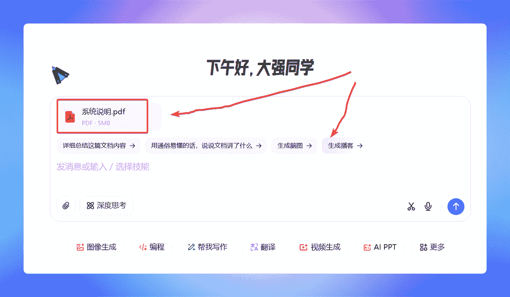
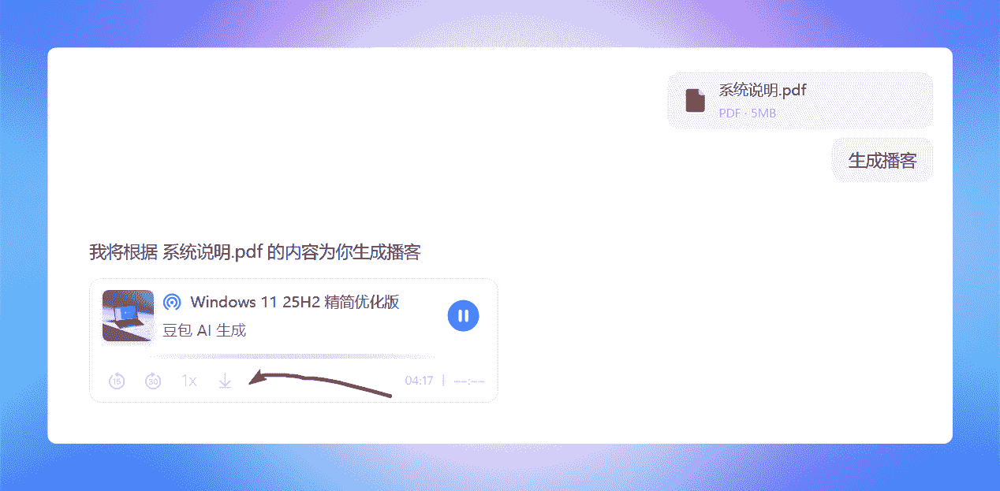
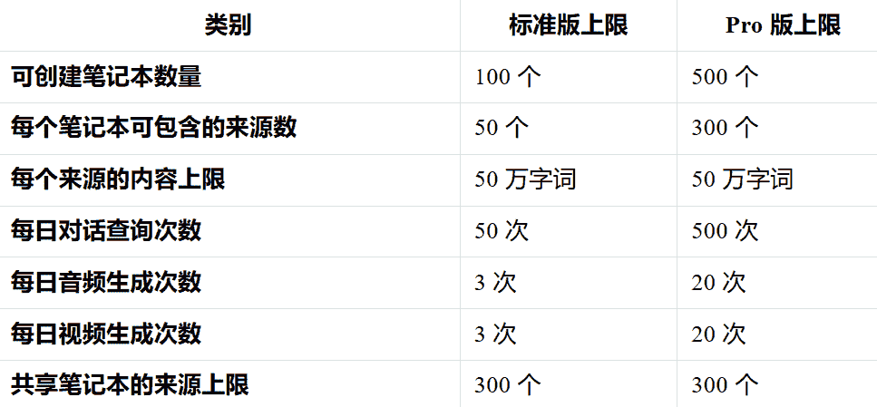
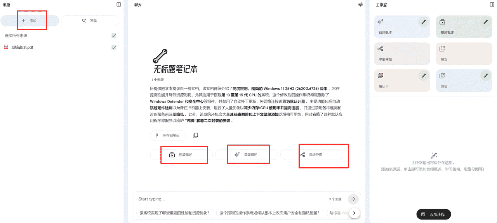

# ‌⁢‍⁣⁣⁤​‍‌⁢​‌​‌⁢​‍⁣‬⁤​​⁡⁤‌‬‬⁡​⁣​⁡⁡⁣⁢⁤‬​⁣⁣⁤豆包AI博客功能教程

> 来源：[https://xodnytdcaw.feishu.cn/docx/Qf64dMsJQoC82ax9RfFcxzcsnPf](https://xodnytdcaw.feishu.cn/docx/Qf64dMsJQoC82ax9RfFcxzcsnPf)

## 使用地址

打开豆包https://www.doubao.com/chat/

上传PDF文件（文章转PDF)，点击“生成博客”

## 使用步骤

生成需要一段时间，但是你可以马上听，生成的是格式是.wav，生成完好后就可以下载了。

## 音频效果

[Windows+11+25H2+精简优化版.wav](https://internal-api-drive-stream.feishu.cn/space/api/box/stream/download/all/UWZabH3MwoLNe6xqUxQcy3kgnNc)

思考：

1.类似短视频里的2个人采访节目

2，[NotebookLM](https://notebooklm.google.com/)也可以实现，上传文件，点击“音频概述”，还可以生成思维导图，视频，默认语言是中文，可以在设置里选择中文输出。

**左侧显示文章信息与概要，中**间是交互区，右侧的 Studio 区域提供 笔记、音频、视频、思维导图等六个功能卡片

[3，类似N](https://www.biji.com/note)otebookLM这种还是get笔记，来帮助更好的吸收知识