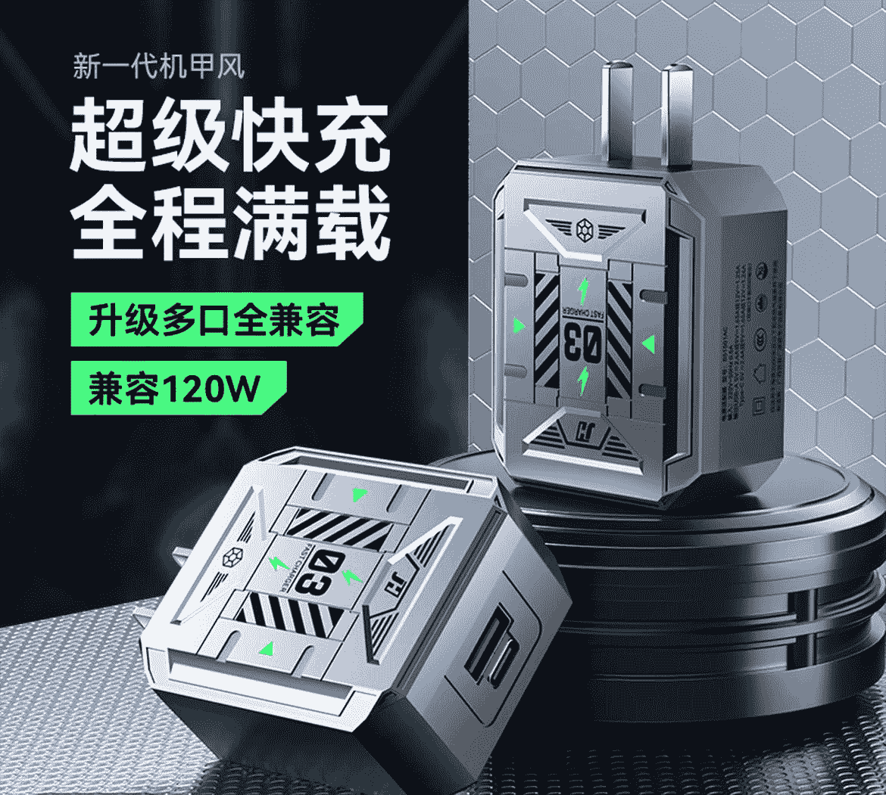
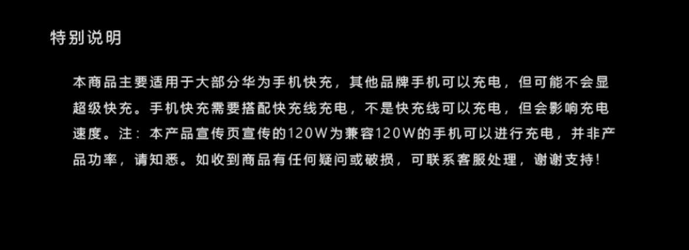
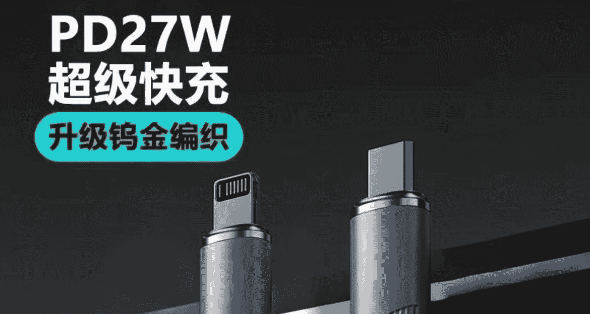

# 全协议充电线避坑：PPS头是关键

> 来源：[https://xodnytdcaw.feishu.cn/docx/NM6Edv5VioSkkjxwP4ScEkBYnOd](https://xodnytdcaw.feishu.cn/docx/NM6Edv5VioSkkjxwP4ScEkBYnOd)

你是不是也踩过这样的坑：花大价钱买了号称 “一根线充所有” 的全协议破解线，满心期待华为、小米、OPPO 都能触发满血快充，结果手机只显示 “快速充电”；想给笔记本应急充电，插上后却毫无反应 —— 难道这根 “万能线” 是智商税？

**其**实问题根本不在线上，而是你没搞懂快充的核心逻辑：快充是设备、充电头、充电线三方的 “精密对话”，全协议线只是 “翻译官”，真正决定供电能力的，是充电头这个 “发电机” 。今天就用大白话拆解清楚，让你再也不被 “虚标参数”“万能营销” 割韭菜。

## 一、先搞懂：快充的 “三方对话” 到底在说什么？

快充不是简单的 “通电”，而是一场需要 “语言互通” 的协作，三者各司其职，少一个环节都不行：

+   **设备（手机 / 笔记本）**

“甲方”，只认自己熟悉的 “语言”（充电协议），比如华为认 SCP、苹果认 PD、小米认 HyperCharge。

+   **充电线**

“翻译官”，全协议线就是 “万能翻译”，能模仿各家 “暗号” 骗设备开门；普通线只是 “哑巴电线”，只能传电不会沟通。

+   **充电头**

“发电机”，负责提供实际电力，只有能听懂 “翻译官” 的需求，输出对应电压电流，才能激活真正的快充。

举个通俗的例子：给华为手机充超级快充，就像甲方（手机）只收 “10V/4A” 规格的货，翻译官（全协议线）能说华为的 “暗号” 让甲方接收，但如果发电机（充电头）只能生产 “9V/2A” 的货，最终也只能给甲方慢递 ——翻译官再厉害，没有匹配的货源也是白搭 。

## 二、关键协议：搞懂 3 种 “充电语言”，避坑一半

不同设备的 “语言” 不同，充电头必须会对应的 “语种” 才能配合，这 3 种核心协议一定要分清：

1.  通用语：PD/QC 协议（适合苹果、笔记本）

比喻：就像英语，全球通用，兼容性最强。

适用设备：iPhone、iPad、MacBook、华为 MateBook、联想小新等所有主流笔记本，以及大部分安卓旗舰。

核心特点：笔记本充电的 “必备语言”，必须支持 20V 电压档位（比如 20V=3.25A=65W），否则根本无法握手。

1.  加密方言：私有协议（适合安卓超级快充）

比喻：各家 “祖传暗号”，外人听不懂，只为追求极致速度。

适用设备：华为（SCP）、OPPO（VOOC）、vivo（FlashCharge）、小米（HyperCharge）等安卓旗舰。

核心特点：充电速度极快（最高 120W），但 “排他性强”，必须充电头能输出特定非标电压电流（比如华为要 10V/4A、OPPO 要 11V/7.3A），否则只能触发普通快充。

1.  万能桥接：PPS 协议（全协议线的最佳搭档）

比喻：“翻译官的万能词典”，是 PD 协议的升级版，支持电压动态微调（3.3V-21V）。

核心作用：解决 “通用语” 和 “方言” 的沟通障碍，比如小米的私有协议就是基于 PPS 魔改的，支持 PPS 的充电头，搭配全协议线能激活大部分安卓的满血快充。

避坑提醒：不是所有 PD 头都支持 PPS，买的时候一定要看铭牌标注 “PPS” 或 “3.3V-21V” 电压范围。

## 三、充电头：“发电机” 的硬指标，比功率数字更重要

**很多人买充电**头**只看 “**XXW”，却忽略了真正决定兼容性的 2 个关键：电压电流档位和协议支持 ，这才是区别 “真快充头” 和 “虚标头” 的核心。

### 给手机充超级快充：看私有协议档位（最低要求）

| 品牌 | 私有快充协议 | 激活超级快充最低要求 | 屏幕显示特征 |
| --- | --- | --- | --- |
| 华为 | SCP | 10V/4A 或 11V/6A | 显示「超级快充」+ 双大闪电 |
| OPPO/一加 | VOOC / SuperVOOC | 10V/6.5A 或 11V/7.3A | 显示「SuperVOOC」或「闪充」 |
| vivo/iQOO | FlashCharge | 10V/2.25A 或 11V/3A | 显示「FlashCharge」或「超快闪充」 |
| 小米 | Mi Turbo Charge | 10V/3A 或 11V/3A | 显示「Mi Turbo Charge」或「疾速」 |
| 苹果 | PD (USB‑C) | 9V/2.2A（约20W） | 显示「正在快速充电」 |

⚠️ 避坑：外壳标 “66W” 不代表支持华为 SCP！比如之前用户买的充电头，外壳印 66W，但铭牌只有 12V/1.17A≈14W，根本没有 10V 档位，只能触发 “假快充”。

### 给笔记本充电：必须满足 2 个硬条件

| 设备类型 | 最低功率 | 关键指标 | 判断方法 |
| --- | --- | --- | --- |
| 轻薄本（MacBook、MateBook 等） | 45W | 必须支持 20V 档位 | 查看充电头铭牌，需有「20V=2.25A」或同类标注 |
| 游戏本 | 100W | 必须支持 20V / 5A | 查看充电头铭牌，需有「20V=5A」标注 |
| 其他 | 原功率 | 原充电器铭牌 | 查看充电头铭牌数据，购买第三方 |

⚠️ 关键提醒：USB-A 口充电头绝对不能给笔记本充电！必须是 USB-C 口 + PD 协议 + 20V 档位，否则插了也白插（比如用户的 90W 充电头，实际标注 20V=3.25A=65W，才能给轻薄本充电，但达不到 90W 峰值）。

### 虚标充电头的 3 个识别技巧

+   看铭牌不看外壳：真正的功率 = 电压 × 电流（比如 11V×6A=66W），外壳大字 “120W” 可能是文字游戏，铭牌才是真实身份证。

+   查协议标注：支持华为 SCP 会写 “10V/4A”，支持 PPS 会写 “3.3V-21V”，只写 QC/PD 不标档位的，大概率不支持超级快充。

+   看接口颜色：部分品牌用蓝色 Type-C 口标识 PD/PPS 协议，但仅供参考，最终以铭牌为准。

当你看完这个图，你会想到什么，输出 120❓但是你注意看详情页小字

我当时就是被这种文字游戏误导，以为这个可以给笔记本充电，实际上这个充电头你仔细看：

> 它仅支持常见的 **QC 2.0/3.0**** 快充（9****V/1****2V档位），但不支**持 PD 协议（无PD典型的9V/2A、15V/3A等高功率档位）。单口最高输出约 15W，双口无法同时工作。从此推出这是一个基础的 15W QC快充头

>

> 但是从商品图望去，99% 的人会误解这是支持 120w 快充头**，配合全协议线**，确实可以点亮超级快充，但实际**速度会打折。**比**如给**华为充，现在华为私有协议最高能到100W。而这个现在最大输出才 15w， 如果搭配一个支持 PPS 协议 140w ～240w 的充电头，才能跑出原装的速度。但是比如苹果手机，即使你充电头输出很大，但是它的协议最大限制在 40W 以内，苹果手机的充电芯片和电池设计决定了它只能承受 9V/3A 或 12V/3A 左右的电流，强行输入 100W 的电流，手机内部也会自动“限流”保护，实际功率还是只有 20W-30W

## 四、充电线：“翻译官” 的段位，决定能不能 “跨品牌沟通”

全协议线和普通线的区别，就是 “智能翻译” 和 “哑巴电线” 的差距，核心看 2 点：

### 全协议线：能 “骗” 设备开门，但不能造电

+   工作原理：内置协议识别芯片，比如给华为充电时，会模仿原装线的 “暗号”，让手机以为是原装配件，从而准备接收超级快充。

+   核心局限：只能 “传话” 不能 “发电”，如果充电头没有对应的电压电流档位，手机还是只能普通充电。

+   选购要点：必须标注 “5A/6A”（大电流）和 “支持全协议（SCP/VOOC/FlashCharge）”，线身越粗、带 E-Marker 芯片的越靠谱。

### 普通线：只能 “被动传电”，无法跨品牌快充

+   常见规格：3A 电流（支持 27W 以下 PD 快充），没有协议芯片。

+   适用场景：给 iPhone 充 20W、给安卓充 18W 普通快充，无法激活华为 66W、OPPO 120W 等超级快充。

> **段位判断：**Pd27w，但是电流有**上限， **27W** 通常对应 3A 电**流。也就是说，它是一条 3A 线，无法承载 5A 或 6A 的大电流。无法激活华为/荣耀的 66W 或 100W 超级快充（这些协议需要 5A/6A 大电流线）。它更适合给 iPhone、小米、OPPO 等支持 PD 协议的设备用。头的话肯定不能普通 5V/2A 头：这种头没有 PD 协议，插上这根线也只能跑 10W，浪费了线的性能。那么，这款线最大支持 27W，你配一个 20W 或 30W 的 PD 头，刚好能跑满它的性能，性价比最高。

## 五、终极公式：实现 “一充通” 的最优解

想让一根线搞定手机 + 笔记本，且激活所有超级快充，记住这个公式：

**支持 PPS 协议的大功率充电头 +** 5A/6A 全协议线 = 万能快充组合

### 具体选购建议：

充电头：优先选 65W 或 100W PPS 快充头（兼顾手机和笔记本），必须标注 “PPS”“20V 档位”“对应私有协议档位”（比如支持华为 SCP）。

充电线：选 5A/6A 全协议线，线身标注 “5A”“E-Marker”，避免买低价细铜线（容易发烫、限流）。

### 避坑组合：

❌ 全协议线 + 普通 PD 头：只能触发 18W 快充，无法激活超级快充。

❌ 全协议线 + 5V 老款头：只能慢充，浪费线的功能。

✅ 全协议线 + 100W PPS 头：能激活华为 66W、小米 120W、苹果 27W，还能给轻薄本快充。

### 最后总结：别再迷信 “万能线”，抓准核心不踩坑

快充的核心永远是 “充电头的协议和档位”，全协议线只是辅助工具。记住 3 个关键结论：

看铭牌不看广告：功率、电压档位、协议标注，比外壳大字靠谱 10 倍。

笔记本充电三要素：USB-C 口 + PD 协议 + 20V 档位，缺一不可。

超级快充三要素：设备私有协议 + 充电头对应档位 + 全协议 / 原装线。

从此再也不用为 “充不快” 发愁，选充电头时对着铭牌一一核对，就能精准匹配需求，让每一分钱都花在刀刃上～