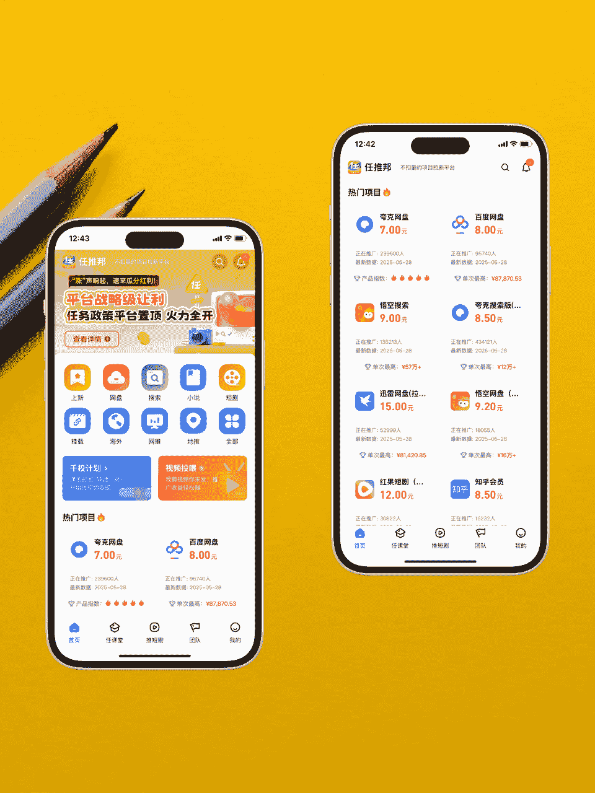
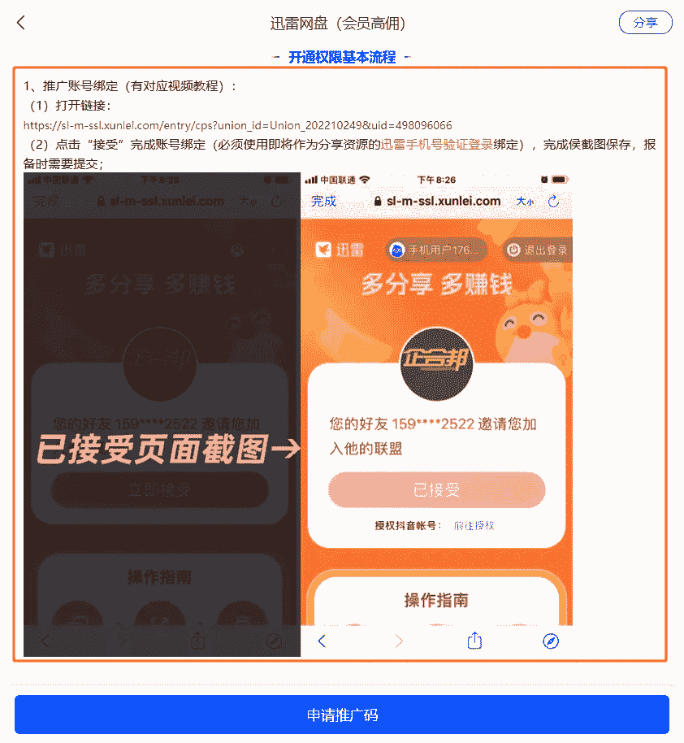
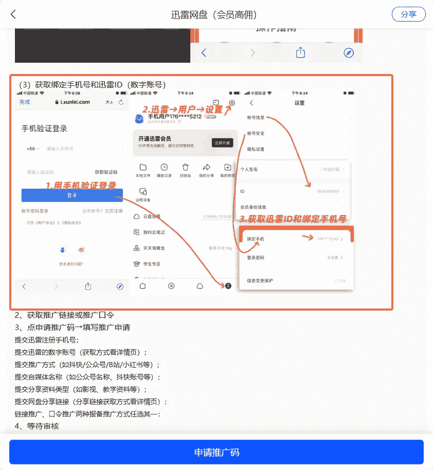
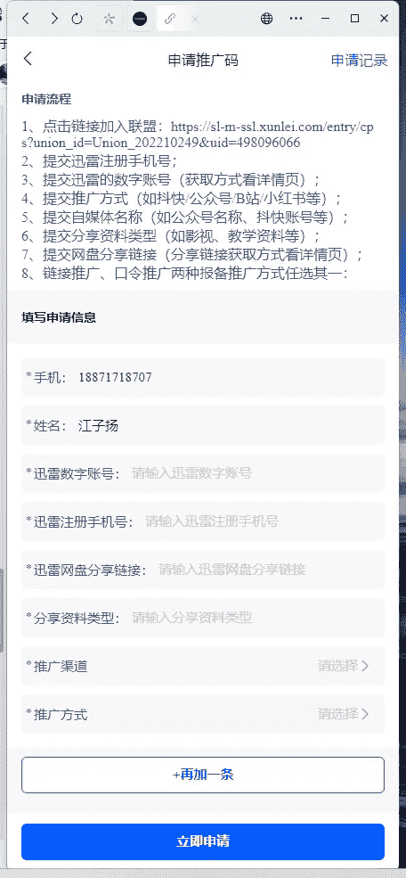

# 迅雷网盘拉新教程

> 来源：[https://xodnytdcaw.feishu.cn/docx/FmFNdj0a6o0JPMxr8RfcVMohntb](https://xodnytdcaw.feishu.cn/docx/FmFNdj0a6o0JPMxr8RfcVMohntb)

如果你经常玩知乎、看公众号（软件、工具、互联网这几类的）你就会发现，好多资源连接都变成了夸克网盘、迅雷网盘的资源链接。有资源的前提下，迅雷网盘拉新基本上是躺赚！例如：天涯神贴，基本上全是夸克、UC、迅雷网盘的资源链接。

#### **如何参与迅雷网盘拉新活动**

## 第一步：注册第三方拉新平台任推邦

各大厂商的App都有拉新活动，常见的如抖音、快手、京东、夸克网盘、UC网盘、迅雷网盘。想要加入这些app的拉新活动，普通人是无法对接这些App厂商，一般都是从专业的第三方推广平台接单。

任推帮就是专业App拉新、信用卡拉新的第三方平台，如图所示：

目前任推邦app没有在应用商店上发布，只能在官网进行下载app。

**注册地址**：[点此注册](https://dt.bd.cn/#/pages/login/register?invite_code=577546)

完成注册后，我们即可申请推广迅雷网盘拉新。

## **第二步：开通推广权限**

1、推广账号绑定

## 第三步：在任推邦上申请【推广码】，填写推广信息

## **第四步：分享资源链接，赚取收益**

迅雷网盘做单是用【迅雷网盘内文件的分享链接】做为做专属推广链接开始做单，需要在迅雷网盘内保存资料、视频、电影等做为分享用（如果没有资料，可以用下面的资料）

把需要的资源保存在自己的迅雷网盘内，也可以用自己的资源上传去转发。

> 大强迅雷资源合集

> https://pan.xunlei.com/s/VORZfRhPC80T-hG2945e7jTCA1?pwd=4vwt#

和其他网盘分享资源是一样的。

1）打开迅雷APP，点击“网盘”—“我的转存”——找到保存好的电影

2）找到保存的分享文件，长按，选择”分享”，任何一种分享方式都可以（推荐是“分享链接”），生成的链接就是推广链接