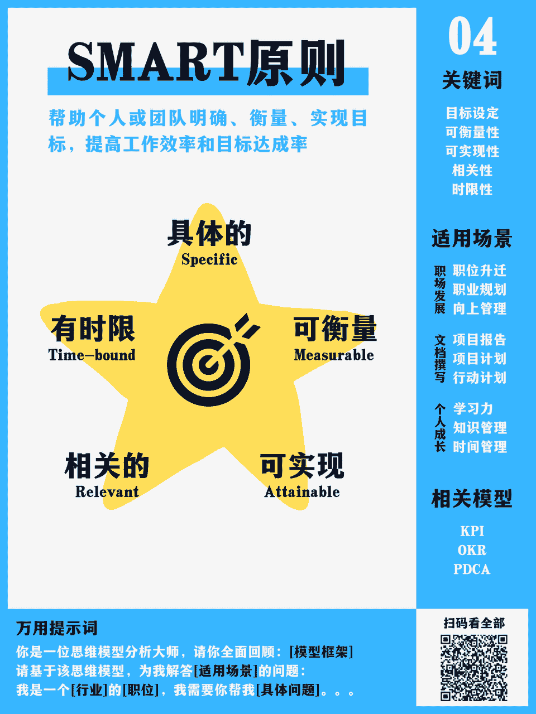
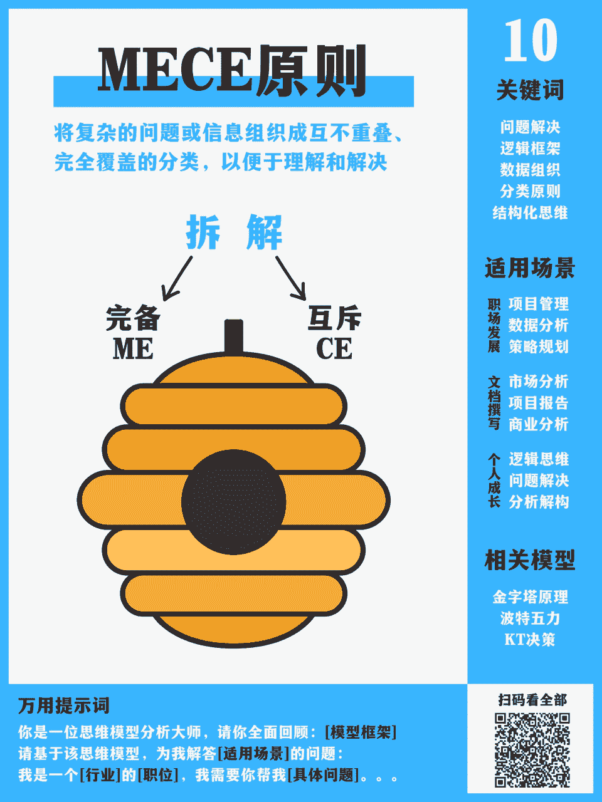

# 逻辑拆解基本功

> 来源：[https://docs.feishu.cn/docx/GMudd9hKhoOuF8xFiHuc1p6nnzc](https://docs.feishu.cn/docx/GMudd9hKhoOuF8xFiHuc1p6nnzc)

> 摘要：在面对复杂或抽象的问题时，逻辑拆解是一种高效的解决方法。本文通过明确目标、选择合适的切入维度和运用 MECE 原则，展示了如何将大问题分解为小问题，逐个击破。通过借鉴专业理论、最佳实践和逻辑分析，我们可以更系统、更精准地解决问题，实现目标。

## 前言

在面对复杂和抽象问题时，我们往往会感到困惑和无助，尤其是在缺乏明确指导和经验的情况下。

比如，钟表匠面对一个复杂精密的机械钟表时，他的目标是诊断并修复钟表秒针不走的问题。怎么办？是不是得拆啊。怎么拆？他首先是移除外壳，然后是逐层拆解内部的齿轮、弹簧等机械结构。每一步拆解都是为了更好地理解钟表的工作机理和发现可能的问题。

同理，解决复杂问题的关键在于逻辑拆解，将大问题分解为一系列小问题，然后逐一解决。通过切入特定维度和应用明确的策略，我们能够更有效地解决问题。

## 正文

**面**对一个复杂的问题，特别是那些没有确切答案、也没有经验可借鉴的时候，最大的挑战是在信息特别有限的情况下，解决这个问题。

拆解是一个广泛有效的方法，把复杂问题分解成一个个基本问题：

一来，可以识别出确定性高、经验丰富的部分，迎刃而解；

二来，把它们当已知，再结合关键假设和逻辑推理，来增加解决剩下部分的概率。

回到切，想一想切菜，切黄瓜吧。在切之前，你是不是已经想到做什么菜了？凉拌那就切丝，爆炒那就切片，煨汤那就滚刀，不同的目标决定了你的切法。

面对抽象、复杂的问题，其实道理是一样的：

### 1、**首先，你要尽量明确目标**

谈到确定目标，常见的是 S.M.A.R.T.E.R。 方法。

S.M.A.R.T. E.R. 是一个由英文字母所组成的缩写，每个字母都代表了一个重要的词语，分别是：

+   S （Specific， 具体）: 你的目标要清晰明了。

+   M （Measurable， 可衡量）: 你能够衡量目标的进度和结果。

+   A （Achievable， 可实现）: 你的目标是可以实现的，而非遥不可及。

+   R （Relevant， 相关）: 你的目标要与你的生活或工作目标紧密相关。

+   T （Time-bound， 时限）: 你为实现目标设定了明确的截止日期。

+   E （Evaluate， 评估）: 你需要定期评估你的进度，看看你是否在正确的道路上前进。

+   **R （Revise， 修订）:** 如果必要的话，你应该愿意调整你的目标，以保持其相关性和实现性。

比如，你是一个写👸号的，想要在未来的一年里扩大你的粉丝基础。

根据 S.M.A.R.T.E.R。方法，你设定了一个目标，要在一年内增加 100 个新粉丝，你每个季度都要评估一下你的进度。在第一个季度末，你发现只增加了 15 个新粉丝，于是你决定修订你的增粉策略。

通过定期评估和修订，你能够及时发现问题，调整策略，保持目标的实现性。最难的可能是如何客观、准确地评估进度，并勇于做出必要的修订。

### **2、选择维度切入**

在进行 MECE（互斥且完备） 切分前，得选好维度，也就是切入的角度。

比如，你可以把人分为男人、女人，也可以分成老人、小孩，都对，都是 MECE 的。

但是因为有目标，选择一些维度能够更直观、明显地说明问题。

不知道大家有没有过这样的经历，当维度（角度、指标）找对了，问题就很快能找到答案；

反过头来看之前的分析，都是在绕弯子，就像是找到了对的钥匙。

**那么，怎么找合适的维度呢？**

首先，要决定用几维？

一般来说，2 维、3 维就够了，突出重点，还方便作图辅助分析。

上升到更高维度没有必要（除非你研究的问题很数学，完全可以用计算机来建模计算，例如特征工程），甚至有相反效果。因为复杂问题往往没有确定的答案，需要人脑理解、思考后把问题进行降维，太高的维度人脑无法应付。

接下来，需要确定每一个维度上的内容是什么。

**借鉴专业体系**：如果你的问题聚焦在一个成熟的专业方向，可以参考该专业体系，也就是找一些成熟的理论和指标去一一比对，选出最优。比如，杜邦分析法，如果你的问题涉及到上市公司财务指标分析，那么借鉴经典的理论和指标一定没问题。

**借鉴最佳实践**：如果你的问题被他人实践过，那就找到前人的最佳实践。比如，敏捷 Scrum，如果你的问题涉及到敏捷开发实践，那么借鉴业内最佳实践一定是不错的选择。

**借助逻辑分析**：从第一性原理出发，按时间切入、按空间切入、因果关系、相关性、流程关系、条件关系、主谓宾等等。比如，你是一家大型零售公司的运营经理，最近公司的销售额有所下降。为了解决这个问题，你需要找到销售下降的根本原因。如果你按照商品类别（逻辑维度）进行分析，你可能会发现某些商品类别的销售额下降了，而其他类别的销售额却保持稳定或增加；如果你选择按照时间（时间维度）进行分析，可能会发现销售下降主要出现在特定的时间段，例如假期或周末。

### **3、按 MECE 原则切分**

带着目标，确定了切入维度，接下来就可以开始按照 MECE 原则进行拆解了。还记得 MECE 原则吗？

## 模型框架

MECE 原则是一个基础的问题结构框架，其名称由两部分构成：相互排斥（Mutually Exclusive） 和完全穷尽（Completely Exhaustive）：

1.  相互排斥 （Mutually Exclusive）: 意指将问题的不同方面分解成互不重叠的子集。例如，在分析食品的类别时，可以将食品分为“甜点”和“非甜点”两类，其中每类都不会与另一类有重叠。

1.  完全穷尽 （Completely Exhaustive）: 意指确保所有相关的方面都被考虑到，没有遗漏。继续上面的例子，所有食品都可以分为“甜点”或“非甜点”两类，没有遗漏。

通过将问题分解成相互排斥且完全穷尽的子集，可以更清晰、系统地理解问题，为解决问题提供结构化的框架。

维度确定好以后，就可以在平面上一横一竖画两根线（2 维），一个代表 X 轴，一个代表 Y 轴，把平面分成 4 个象限，这种适合于维度的二分法（二分法肯定是 MECE 的）。

如果你对于各个维度的拆解不止于二分法，那么就会出现九宫格、十二宫格、十六宫格等等分区，一一对应地把问题平面分成各种情况。

### **4、举例**

## 结语

通过以上的探讨，我们了解到逻辑拆解是解决复杂问题的有力工具。通过明确目标、选择合适的切入维度和应用 MECE 原则，我们能够将大问题分解为小问题，逐个击破。

更重要的是，逻辑拆解提供了一种系统性的思考方式，帮助我们在面对未知和复杂的情境时，保持清晰的思维，找到问题的解决路径。实际应用中，我们还能借助于专业理论、最佳实践和逻辑分析，不断优化我们的思考和解决策略，以更高效、更精准地解决问题，实现我们的目标。