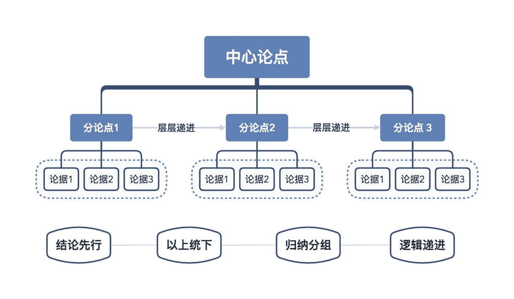
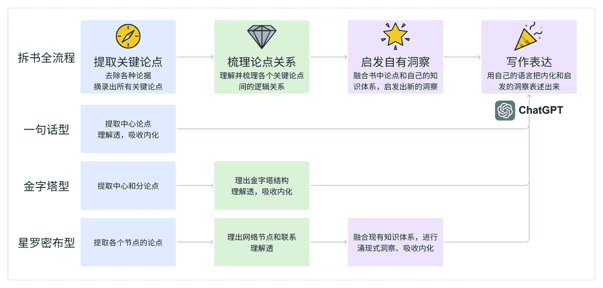

# 初探：书与拆书

> 来源：[https://docs.feishu.cn/docx/D7GvdKUgEokttfxcVjucIS10nuf](https://docs.feishu.cn/docx/D7GvdKUgEokttfxcVjucIS10nuf)

前几天，跟朋友聊天，聊到 GPT 拆书。

意思是，给定一本书，让 GPT 帮助提炼书中最重要的观点和洞察，向豆瓣、樊登拆书笔记看齐的那种品质。

朋友对此兴致勃勃，并进行了非常仔细地对标拆解和思考，他正在努力朝着这个方向努力。

首先，明确一下，我脑中设定的要拆的书，是指非小说类，是那种个人成长、思维科学、经济理财之类的书。

这种书，普遍会**围绕一个明确的大主题，然后分切成小论点，辅以各种论据进**行阐述，从而提出一些核心的、有洞见的观点。

理想情况下，内容组织就是麦肯锡**金字塔模型**的结构。

所以，**书**中内容存在一定的压缩空间，即把那些作者举例的论据都去掉，只保留最后的中心论点和分论点，从而大大缩小内容篇幅，进而缩短阅读时间。

是不是听起来，非常完美。

但就我个人经验来说，书还能细分成三种：

**1、一句话型**

这些书，整本其实一段话、甚至一句话也就说完了，但是作者偏偏东回忆、西观察，硬生生搞出一本书的篇幅。你如果一字一句陪它玩，读完就直呼亏大了。

所以，有没有可能，在开始阅读之前，就绕过这样的书呢？

**2、金字塔型**

这些书，读起来结构非常严密，目录中的大标题和小标题就是金字塔的骨架，添加的论据，非常容易识别，内容组织很规律。就是，读起来很满，没有太多空间感。

这种，重在梳理中心论点和分论点之间的逻辑链条。

**3、星罗密布型**

这些书，全篇的金句洞察很多，且读者第一遍线性读下来，无法马上建立起一个明显的逻辑结构。书本身的论点交叉相错、复杂多样，金句洞察是由网状信息涌现、交织生成的。读下来，会感觉很受启发，作者的洞察很好，但通过消化、吸收和再加工，预感能有更多自己的洞察。

这多半是本好书，重在进行梳理融合，尽可能对各个金句洞察进行交叉验证，在理解作者本意的基础上，结合自己的知识体系，探求新的发现。

所以，针对上面三类，**有三种拆书需求**：

1、识别一句话型，不用通读，理解中心论点即可；

这种，看看别人的书评，用不着用 GPT 啥的了。

2、把中心论点和分论点摘出来，梳理清楚逻辑链条；

这一种，用 GPT 做感觉应该是刚刚好，逻辑清晰，辅助进行快速梳理。

**3、发现网状节点和它们之间的联系，复现作者洞察，同时**链接自己的知识体系，受到启发进行再发现。

最后这种，是最有梳理价值的。但是，以豆哥目前的实战经历，结合对 GPT 的能力认识，我抱有怀疑态度。

我归纳了一张图，方便大家理解和比较：

> 我可能前后花了有 7、8 个小时的时间，基于 ZK 卡片法的方法论，尝试让 GPT 帮我拆解“星罗密布型”的书，效果并不好。之前，我不确定，是不是提示词没写好的问题。

> 今天，我偶然发现，《构建第二大脑》的作者 Tiago Forte 在油管上分享了自己用 GPT 拆书的经验。

> Tiago Forte 是一位专注于提高个人和组织生产力和知识管理的专家。他创立了 Forte Labs，该公司通过创新技术和工具帮助个人和组织提高他们的生产力和知识管理能力。Forte 是个人知识管理领域的知名思想领袖，他的工作曾被《纽约时报》、《Inc。 Magazine》和《福布斯》等出版物报道过 。

**他尝试了很多次，视频中展示的方法是：只**用 GPT 做最后的表达优化，前面所有步骤包括提取、梳理和启发，由他手工来做。

Taigo 提出，这主要还是**受限于 GPT 无法一次性载入整本书的内容，所以它会基于别人**的摘要进行再次浓缩，造成关键点缺失和偏离。

这个观点，特别是对“星罗密布型”的书籍来说，和我的认识和猜想比较契合。

不过，对于金字塔型的书来说，或许能够做到 GPT 任务前移。