# AI日报合集

> 来源：[https://bluefocus.feishu.cn/docx/CvaMdBN1PoO3aaxxihgcGPx3nCd](https://bluefocus.feishu.cn/docx/CvaMdBN1PoO3aaxxihgcGPx3nCd)

## 2024/9/1

1. **智谱发布新一代基础模型，清言App开放视频通话**

   8月29日，智谱AI在KDD2024大会上发布了新一代基座模型，包括语言模型GLM-4-PuS、文生图模型CogView-3-PIuS、视频理解模型GLM-4V-Plus以及视频生成模型CogVideoX等。

2. **阿里通义千问推出开源视觉语言大模型Qwen2-VL**

   阿里通义千问团队推出Qwen2-VL开源视觉语言大模型，该模型提供7B和2B两个版本。

3. **Runway被曝在HuggingFace上删库跑路**

   AI初创公司Runway在HuggingFace上删除了旗下相关代码库和项目，包括曾引发知识产权争议的Stable Diffusion v1.5模型。

4. **OpenAI称ChatGPT每周活跃用户超过2亿**

   OpenAI对外透露ChatGPT每周活跃用户已超2亿，这是其去年11月开发者大会上公布的用户数量的两倍。

   OpenAI发言人还表示，92%的财富500强公司正在使用OpenAI的产品，在今年GPT-4oMini发布后，API的

## 2024/8/30

1. **美图发布2024上半年财报：AI驱动净利润同比增长80.3%至2.7亿元**

   美图披露2024上半年财报：总收入16.2亿元（人民币，下同），同比增长28.6%。经调整后归属于母公司权益持有人净利润2.7亿元，同比增长80.3%。

2. **安卓和macOS版ChatGPT App现支持“@”切换不同GPT模型**

   据科技媒体Testing Catalog发文，安卓版和macOS版ChatGPT现支持Mentions功能，用户在聊天对话中可使用“@”来调用不同的定制GPT模型。

   用户输入“@”符号之后，会弹出一个窗口，让用户选择不同的GPT，以在保持聊天输入的同时方便用户无缝切换。

3. **OpenAI正在进行新一轮融资谈判，估值将达千亿美元**

   北京时间8月29日凌晨，据CNBC、《华尔街日报》等消息，OpenAI正在进行新一轮融资谈判，此轮融资将使其估值突破1000亿美元。

   据知情人士透露，本轮融资由Thrive Capital主导，将投资10亿美元。今年早些时候，OpenAI的估值就已超过800亿美元，去年估值为290亿美元。

4. **谷歌将重新开放Gemini生成人物图像功能，此前因“种族倾向”引争议**

   8月29日，谷歌宣布将恢复AI模型Gemini生成人物图像的功能。谷歌表示，将开始向订阅Gemini Advanced套餐的英语用户推出生成人物图像功能。企业也将能够使用该工具，该功能将在未来几天内上线。

5. **谷歌发布世界首个AI游戏引擎，0代码实时生成游戏**

   近日，谷歌推出世界首个完全由神经模型驱动的AI游戏引擎GameNGen。

   GameNGen可以在单个TPU上，让AI以每秒20帧的速度，生成实时可玩的游戏，每帧画面都由扩散模型进行预测

## 2024/8/29

1. **智谱AI开源新模型CogVideoX-5B**

   近日，智谱AI开源了全新的视频生成模型CogVideoX-5B，其在视频生成质量和视觉效果上均超越了前代产品CogVideoX-2B。

2. **智谱AI宣布GLM-4-Flash大模型免费开放**

   智谱AI宣布GLM-4-Flash大模型免费开放，通过智谱AI大模型开放平台调用。

   据悉，GLM-4-Flash适用于完成简单垂直、低成本、需要快速响应的任务，生成速度能达到72.14token/s，约等于115字符/s。

3. **字节跳动开源FLUX Dev的Hyper SD Lora，8步生图**

   近日，字节跳动开源FLUX Dev的Haper SD Lora，大幅度缩短了FLUX图片生成的时间。

   Hyper-SD 提供了一系列基于不同基础模型的LoRA检查点，支持1到8步的推理过程，并且提供了与 ComfyUI 集成的工作流程，以及相关的技术报告和演示。尽管 8 步模型相较于原始版本效果有所下降，但是效果可以接受。

4. **OpenAI或将推出“草莓”模型，新旗舰大模型代号“猎户座”**

   据外媒The Information报道，OpenAI已向美国国家安全官员展示了“草莓”模型。该模型可以解决它以前从未见过的数学问题，经训练后还可以解决涉及编程的问题，但它不局限于回答技术问题。

5. **Cerebras推出“世界最快”AI推理服务**

   人工智能初创公司Cerebras推出Cerebras Inference，号称是世界上最快的人工智能推理解决方案。

## 2024/8/28

1. **可灵AI已累计生成超1600万个视频**

   8月27日，快手主站业务与社区科学线负责人盖坤在2024光合创作者大会上披露，AI正不断深入创作者的内容生产环节。截至目前，已有超过160万人使用过快手的视频生成大模型可灵AI，并累计生成超1600万个视频。

2. **夸克发布PC端，升级系统级全场景AI能力**

   阿里旗下夸克发布全新PC端，全面升级AI搜索、AI写作、AI PPT、AI文件总结等一系列功能，支持一站式完成信息检索、创作和总结。另外，夸克提供官方插件，安装插件后的浏览器同样可以使用AI回答、AI写作、解读、翻译以及网页总结等功能。

3. **华为发布AI百校计划：培养AI人才，每年获最高100万算力支持**

   近日，华为发布“华为AI百校计划”，为国内高等院校提供基于昇腾云服务的AI算力资源，用以支持算子、算法、模型推理、大模型训练等开发场景，为高校师生提供科研AI算力平台。

4. **苹果将发布搭载AI的iPhone16系列手机**

   8月27日，苹果正式宣布将于北京时间9月10日凌晨1点在加利福尼亚州库比蒂诺的总部举办特别活动，主题为“高光时刻（It 's Glowtime）”。

   据此前爆料，此次苹果有望发布iPhone 16系列手机、Apple Watch Series10以及AirPods 4等新品。iPhone 16系列手机主要亮点在于新的“拍摄按钮”、全系支持Apple Intelligence和Pro系列更大的屏幕尺寸。其中，AI功能将成为苹果主打的宣传卖点。

## 2024/8/27

1. **腾讯推出“全球首个”语音指挥FPS AI队友，可据输入指令推测玩家意图**

   近日，在2024科隆游戏展上，腾讯魔方工作室群技术团队联合《暗区突围》项目团队推出了号称“全球首个”的语音指挥FPS AI F.A.C.U.L.。

   据官方介绍，该产品是全球第一个“能听懂人类语言”的FPS AI队友，应用了生成式AI技术，包括语音输入、大语言模型、实时语音合成和环境识别等。其支持玩家用语音直接输入复杂战术指令，还能以此推测玩家意图并用AI语音实时反馈。

2. **前微软图形学大佬童欣被曝投身AGI创业团队**

   近日，微软全球研究合伙人、图形学大佬童欣被曝已加盟AGI创业公司Anuttacon，担任首席研究员。据悉，前B站副总裁直播老大王宇阳也加入了该公司，担任用户生态总裁。目前童欣谷歌学术上已经显示为Anuttacon Research Manager。

3. **《大都会》预告片风波：虚假影评人引言系AI生成**

   近日，备受瞩目的科幻电影《大都会》（Megalopolis）因其预告片中的虚假影评人引言而引发争议。杂志《Vulture》称电影预告片中出现的影评人台词为造假，后经调查证实，这些虚假引言由AI生成。该预告片在发布数小时后被撤下。

4. **Meta发布Sapiens视觉模型，让AI分析和理解人类动作**

   Meta Reality实验室最新推出了名为Sapiens的AI视觉模型，适用于二维姿势预估、身体部位分割、深度估计和表面法线预测4种以人为中心的基本视觉任务。

5. **亚马逊CEO安迪・贾西称AI助手Amazon Q可节省约4500个开发人员一年工作量**

   亚马逊CEO安迪・贾西在其领英主页发帖称，将亚马逊的生成式AI开发助手“Amazon Q”集成到内部系统后，利用新的代码转换功能，Amazon Q将应用程序升级到Java 17的平均时间从开发人员的50天左右缩短到了几个小时，预计节省了约4500个开发人员一年的工作量。

[👀AI洞察者中心｜知识库](https://bluefocus.feishu.cn/wiki/XcIiwWooAi6OgyksHcYc5X3knde)：多内容及往期回顾请点击群公告知识库链接🔗

## 2024/8/21

1. **科大讯飞推出星火极速超拟人交互技术，对标GPT-4o**

   科大讯飞宣布星火语音大模型迎来更新，升级成全新的星火极速超拟人交互。在响应和打断速度、情绪感知情感共鸣、语音可控表达、人设扮演四个方面实现突破，对标GPT-4o。

2. **阿里通义网页版新增深度搜索功能**

   阿里大语言模型“通义千问”宣布启用新域名“tongyi.ai”，网页版聊天新增深度搜索功能。该功能支持更多内容源索引，数字角标悬浮会显示来源网页，旨在让搜索结果更深度、专业和结构化。

3. **零一万物与顺丰科技达成合作**

   零一万物宣布与顺丰科技达成生态合作，将共同探索人工智能与供应链管理的深度融合。此次合作是零一万物Yi系列大模型在商业场景中得到应用的案例之一。

4. **亚马逊以8000万美元收购Xperi子公司Perceive AI**

   近日，亚马逊宣布已与芯片制造商和AI模型压缩公司Perceive达成收购协议，交易金额为8000万美元现金。

5. **研究称互联网上增多的AI内容，或将导致模型崩溃**

   最近《自然》期刊论文指出，当互联网上存在越来越多的AI内容，那么便很有可能导致各个人工智能模型崩溃（Model collap）。研究团队在实验中不断让AI模型使用上一代模型生成的内容接受训练，结果不出10代，AI模型产出的内容已经从最初输入的中世纪建筑资料，偏离成讨论各种大野兔的种类。

## 2024/8/20

1. **昆仑万维发布AI短剧平台SkyReels，目前已开启内测申请**

   8月19日，昆仑万维发布了全球首个集成视频大模型与3D大模型的AI短剧平台SkyReels。

   据官方介绍，SkyReels平台集剧本生成、角色定制、分镜、剧情、对白/BGM及影片合成于一体，创作者能够“一键成剧”，用户输入一个简单创意，该工具即可完成从剧本到成品短剧制作的全流程。

2. **阿里巴巴公布2025财年Q1财报：通义大模型下载量破2000万**

   近日，阿里巴巴集团公布了2025财年第一季度的业绩报告，财报显示，阿里云营收同比增长6%，达到265.49亿元，AI相关产品收入实现了三位数的增长，公共云业务也实现了两位数的增长。在开源领域，阿里云通义大模型的下载量已突破2000万

3. **工信部将推出AI换脸诈骗风险提醒功能**

   据央视网报道，工信部将推出AI换脸诈骗风险提醒功能。

   央视记者在工信部反诈专班的实验室现场体验了正在测试中的AI换脸诈骗检测与预警技术。当用AI换了脸的技术人员与记者发起视频通话时，测试手机终端提示“对方疑似假冒身份”，之后记者点击检测按钮，经过图像扫描后，系统提示“AI换脸合成概率93%”。

4. **调查显示过半《财富》世界500强企业将AI视为“风险因素”**

   8月18日，英国《金融时报》、研究机构 Arize AI发布报道称最新调查数据显示，56%的《财富》世界500强公司将人工智能列为“风险因素”，这一数据与2022年仅9%的比例相比有了巨幅提升

## 2024/8/19

1. **百度文库“橙篇”App上线，支持长文写作、多图一键成片等**

   百度文库“橙篇”App在各大安卓平台上线，版本号为1.0.02。据悉，该App集成了智能全网搜索和AI今日热点等资讯功能，并引入了多图一键成片、超长文章写作、文件理解总结等生成式大模型功能。

2. **秘塔AI搜索收到知网28页侵权告知函**

   AI公司秘塔科技官方发文称，旗下AI搜索产品“秘塔AI搜索”近日收到《中国学术期刊（光盘版）》电子杂志社有限公司（简称知网）长达28页的侵权告知函，指称秘塔AI搜索未经许可向用户提供知网学术文献题录及摘要数据。

3. **Runway最新模型Gen-3 Alpha Turbo向免费用户开放**

   Runway在X上宣布其最新训练的模型Gen-3 Alpha Turbo适用于所有计划，包括免费用户的试用计划。据Runway介绍，Turbo版本目前支持图生视频，其生成速度是原始Gen-3 Alpha的7倍，价格仅为原来的一半。

4. **苹果或将在2026年推出搭载AI系统的桌面机器人**

   苹果计划在2026年推出一款桌面机器人产品，该设备售价约1000美元，将配备Apple Intelligence技术。据悉，该设备将配备一个类似iPad的大型显示屏，安装在一个机械臂上，允许显示屏上下左右倾斜和360度旋转。该设备可用作“智能家居指挥中心”、FaceTime通话等视频会议设备和家庭安全监控工具。

## 2024/8/16

1. **图森未来宣布进军生成式AI应用领域**

   8月15日，自动驾驶公司图森未来宣布与上海三体动漫有限公司达成合作，将共同开发基于刘慈欣创作的国际知名科幻小说《三体》系列的首部动画长篇电影和视频游戏。

2. **AI智能体创企MultiOn发布Agent Q**

   AI智能体初创公司MultiOn的创始人Div Garg在X上官宣了旗下智能体Agent Q。

   由于此前Div Garg在X上提及Agent Q时，总是会带上一个草莓emoji🍓，MultiOn还给Agent Q开设了独立的推特账号，账号的昵称和背景图片都带有草莓标志。因此有人猜测，Agent Q背后就是OpenAI的Q*草莓项目。目前，尚不清楚是否为MultiOn炒作。

3. **Anthropic Claude推出Prompt缓存功能**

   8月15日凌晨，Anthropic上线了“Prompt Caching”（提示缓存）功能，目前还在测试阶段，需要手动开启，写入缓存比普通输入要贵25%，但是命中缓存价格便宜90%。

4. **OpenAI新模型ChatGPT-4o-Latest重回LMSYS竞技场榜一**

   8月14日，OpenAI的新模型ChatGPT-4o-Latest以1314分的最高分重回LMSYS聊天机器人竞技场第一名。

5. **Google Gemini广告引争议，被迫关闭评论区**

   在奥运会期间，Google推出的Gemini AI产品广告因暗示AI能替代人类情感表达而引发广泛争议，目前该广告的YouTube评论区已关闭。

   广告中，一位父亲让Gemini代劳，以女儿的名义写一封粉丝信给美国知名田径运动员Sydney McLaughlin-Levrone，表达对她的喜爱，以及想要超越她创下的记录的梦想。

## 2024/8/15

1. **“毒舌AI”海外爆火，国内推出“AI嘴替”被称平替**

   日前，“毒舌AI”Twitter Personality因为犀利的点评在海外爆火。8月13日，国内类似AI应用“嘴替”上线，堪称🧣版的毒舌AI。

2. **据称华为将于今年10月发布AI算力新品，媲美英伟达H100**

   近日消息，华为正在加大AI算力研发，预计于10月发布AI算力新品910C。

   相关媒体报道指出，华为这款新的AI算力产品性能超过英伟达H20，媲美英伟达的H100，从而争抢英伟达中国市场。目前客户开始测试，预计10月起发货，但最终情况可能有别于最初的计划，交货时程也可能调整。

3. **谷歌发布智能语音助手Gemini Live，对标GPT-4o**

   昨天凌晨举办的“Made by Google 2024”大会上，谷歌正式发布智能语音助手Gemini Live，意在对标GPT-4o。据了解，Gemini Live是一个多模态智能助手，支持自然语言提问，能识别图像、视频和语音。

4. **Grok-2 Beta版发布，性能超越GPT-4 Turbo**

   8月14日，马斯克成立的xAI宣布推出Grok-2和Grok-2 mini，目前这两个模型已都在X平台上向Grok用户发布。根据xAI公布的信息，sus-column-r（Grok 2 早期版本）在多个基准测试中性能优于Claude 3.5 Sonnet和GPT-4-Turbo。

5. **AI程序员“Genie”击败Devin与GPT-4，Cosine获250万美元种子轮融资**

   近日，AI初创公司Cosine完成了250万美元的种子轮融资，由Uphonest 和 SOMA Capital领投，Lakestar和Focal等公司跟投。

   Cosine最新发布的AI程序员Genie在SWE-Bench测试平台上获得了高达 30.08%的评分，超越了Devin的13.8%和Swe-agent+GPT-4的12.47%。

## 2024/8/14

1. **快手推出AI对话助手App“飞船”**

   近日，快手推出AI智能对话助手App“飞船”。用户可以和默认助手“领航员”进行对话，获取各类信息和知识。另外，“飞船”支持创建和定制专属AI虚拟角色，进行内容创作、知识解答，并具备语音交互功能。

2. **报道称中国近8万家AI公司处于注销或停业异常状态**

   自ChatGPT发布（2022年11月30日）到2024年7月29日期间，国内新注册成立后现在却处于注销吊销或停业异常状态的人工智能（AI）相关公司数量达78612家，接近8万家企业已经消失，占同期新注册87.8万家企业总量的8.9%。

3. **苹果被曝正开发多款AI智能眼镜**

   8月13日消息，苹果被曝正开发多款AI智能眼镜，包括预计明年推出的平价版Vision Pro，价格为现有型号的一半。同时，苹果还在研发第二代Vision Pro，预计2026年发布。此外，苹果还在尝试开发无显示屏的智能眼镜，类似于Meta与雷朋的合作产品。

4. **环球音乐和Meta续签协议，以解决AI音乐问题**

近日，环球音乐集团宣布与Facebook母公司Meta Platforms续签相关协议，扩大环球音乐集团及其艺术家和词曲作者的盈利机会，遏制AI音乐的影响。此外，环球音乐集团还与Meta合作，为WhatsApp授权音乐，以便环球音乐集团艺术家和词曲作者在未来释放新价值。

## 5. LG推出韩国首个开源AI模型EXAONE 3.0

LG AI Research宣布推出韩国首个开源AI模型EXAONE 3.0。据了解，该开源模型基于Decoder-only Transformer架构，参数数量为7.8B，训练数据量（tokens）为8T，是一款针对英语和韩语的双语模型。

# 2024/8/9

## 1. 美图发布美图云修Pro版，上线AI批量调色、AI批量精修等功能

美图公司旗下美图云修发布了全新升级的“美图云修Pro版”，引入了AI批量调色、AI批量精修等新功能，旨在为商业摄影行业提供更全面的修图解决方案。美图云修的AI工作流可以帮助修图师实现从转档、修图到交付的AI自动化处理，显著提高工作效率。

## 2. OpenAI移动版ChatGPT七月报告：净收入2800万美元，新增200万付费用户

8月8日消息，根据移动应用情报机构Appfigures公布的最新报告，仅计算谷歌的Play Store和苹果的App Store两个应用商城，移动版ChatGPT应用今年7月净收入达到2800万美元（当前约2.01亿元人民币）。这里的净收入是指在撇除苹果和谷歌应用商店的佣金之后，OpenAI公司实际可以拿到手的收入。

## 3. OpenAI布局AI硬件，豪掷6000万美元领投Opal公司

8月8日消息，据科技媒体The Information报道，OpenAI公司计划向Opal公司投资6000万美元（注：当前约4.3亿元人民币），用于研发创意相关的AI设备。

Opal公司全称为Opal Camera Inc.，是一家销售网络摄像头的数码硬件厂商。该公司的旗舰产品名为Tadpole，售价为149美元，外形是一个1.25英寸的正方形，重量与一节AA电池差不多，可以夹在笔记本电脑屏幕上。

## 4. 英特尔被曝七年前错过投资OpenAI

8月8日消息，据路透社报道，英特尔七年前曾有机会以10亿美元（注：当前约71.54亿元人民币）现金收购OpenAI约15%的股份。那时候，OpenAI还只是一个刚刚起步的非营利性研究机构，致力于生成人工智能这个鲜为人知的领域。

# 2024/8/8

## 1. 字节跳动旗下“即梦AI”上线移动版

字节跳动推出“即梦AI”移动版，目前已经上架到苹果App Store以及安卓各大应用商店。这款App由剪映、醒图团队（深圳市脸萌科技有限公司）研发，采用内购模式。

## 2. 腾讯元宝上线长文精读，专攻论文、财报及研报等场景

8月7日消息，腾讯元宝上线长文精读能力，这也是继多文件、超长文泛读总结后，腾讯元宝在AI辅助提效方面的又一新进展。据了解，在最新版腾讯元宝中，用户上传论文、财报、研报等专业内容的URL链接或文件，除获得文字概括总结外，还可进入深度阅读模式，对长文进行精读。该模式可提供核心内容概览及模块化解析，生成总结性图表，辅助用户快速理解关键信息。

## 3. 阿里通义App推出“角色扮演”功能

8月6日，通义App推出了“角色扮演”功能，用户可以通过上传一段视频，在通义App上完成现实与虚拟的跨界，实现机器人带娃、孙悟空跳舞、二次元女生职场搬砖等画面。

## 4. Figure第二代人形机器人发布

8月6日，人形机器人初创公司Figure AI推出第二代机器人Figure 02。该公司表示，Figure 02为人形机器人进入劳动场所和家庭铺平了道路。

一个月前，Figure AI CEO布雷特·阿德考克（Brett Adcock）突然宣布Figure 01退役，并于8月2日预告第二代人形机器人的到来。

## 5. 百名视频创作者起诉OpenAI

近日，一位YouTube博主在美国加利福尼亚州北区地方法院正式递交了集体诉讼文件，指控OpenAI擅自转录了数百万个YouTube视频来训练大模型，目前有超过100人参与该集体诉讼。目前，OpenAI对该集体诉讼没有发表回应。

# 2024/8/7

## 1. 月之暗面完成新一轮3亿美元融资，投后估值33亿美元

据彭博社报道，月之暗面刚刚完成了新一轮3亿多美元融资，此次融资将月之暗面的估值推高至33亿美元，并吸引了包括腾讯、高榕资本和老股东阿里巴巴在内的其他投资者。短短半年时间，月之暗面的估值上涨了32%，目前是AI六小龙中估值最高的存在。

## 2. 智谱AI“清影”视频模型开源

8月6日凌晨，THUKEG（智谱AI官方账号）在Github上将CogVideoX开源，该模型为智谱的第二代AI视频生成模型清影的基模型。7月26日，智谱AI宣布对视频生成模型进行全新升级，正式推出CogVideoX。

## 3. 商汤与SMT联合打造2024巴黎奥运射箭比赛“AI解说员”

近日，商汤科技与上海东方传媒技术有限公司（SMT）达成合作，在2024巴黎奥运会射箭比赛项目全程赛事转播中，联合打造“智慧体育-InnoMotion AI赛事转播升级解决方案”，通过三维运动捕捉技术与AR特效渲染引擎，实现射箭赛事数据采集与可视化转播，并提供AI解说。

## 4. OpenAI联创John Schulman离职，加入AI创企Anthropic

8月6日，OpenAI联合创始人John Schulman官宣离职，将加入人工智能初创公司Anthropic。

## 5. 马斯克重启对OpenAI及其CEO的诉讼

据纽约时报报道，马斯克重新启动了针对OpenAI的诉讼。

在向法院提交的新起诉书中指出，OpenAI及其两位创始人Sam Altman和Greg Brockman将商业利益置于公共利益之上，违反了公司的创始合同。

诉讼书中还提到，在2015年与马斯克一起创建OpenAI，并承诺为人类的利益谨慎开发人工智能后，Sam Altman和Greg Brockman放弃了这一使命，并与Microsoft建立了数十亿美元的合作伙伴关系。

# 2024/8/6

## 1. 原网易云音乐副总裁王诗沐旗下AI公司推出“AI+3D”情感陪伴产品Koko AI

近日，由原网易云音乐副总裁王诗沐创办的AI初创公司Seele推出了一款名为“Koko AI”的AI情感陪伴产品。基于自研3D多模态大模型EVA-01，Koko AI结合了3D模型、动画表演和语音聊天，让用户能够与虚拟角色进行面对面的互动体验。

## 2. 阿里巴巴推出轨迹可控的DiT视频生成模型Tora

阿里巴巴近日推出了AI视频生成框架Tora，基于轨迹导向的DiT（扩散变换器）技术，将文本、视觉和轨迹条件同时集成在一起，以生成高质量且符合物理世界动态的视频内容。

## 3. OpenAI研发ChatGPT文本水印技术

近日外媒爆料，OpenAI已研发出可高精度识别ChatGPT生成文本的工具，但尚未发布。对此OpenAI进行了回应，承认其正在研究文本水印技术，但表示这项技术仍存在诸多挑战。

据悉，OpenAI将只专注于检测来自ChatGPT的文字。该技术通过微小改动ChatGPT选择的单词，本质上是在文字中创建不可见水印，以供独立工具检测。

## 4. 图片转3D仅需0.5秒，Stability AI推出Stable Fast 3D模型

Stability AI近日推出了一款名为“Stable Fast 3D”的AI模型，该模型主打“图生3D模型”，号称只需0.5秒就能快速生成完整且自然的3D模型，目前该模型已在Hugging Face平台上架。

## 5. AI独角兽Character.AI超25亿美元卖身谷歌

AI独角兽Character.AI管理层近日透露，谷歌将以每股约88美元的估值收购Character.AI投资人的股票，大约是该公司在2023年A轮融资股票价值的2.5倍，当时Character.AI的估值为10亿美元。

# 2024/8/5

## 1. 国内15家大模型综合能力碾压GPT-4o

360联合国内15家大模型推出的“AI助手”，能力碾压GPT-4o。周鸿祎表示，每家大模型都有单项能力比GPT4o要强，把这十五六家厂商的能力联合起来，最后的综合能力是可以超过GPT4o。这15家大模型包括：智谱AI、商汤科技、百川智能、火山引擎、百度智能云、腾讯混元、讯飞星火、华为云、MiniMAX、零一万物、面壁智能、阿里云、deepseek、学而思九章大模型、Kimi的大模型产品。

## 2. 字节AI音乐产品“海绵音乐”正式开放公测

字节推出的AI音乐产品海绵音乐正式开放公测。海绵音乐的界面很简洁，色调以及生成音乐的风格都和汽水音乐很像。操作也很简单，用户只需提供一句简单的灵感，它就能在瞬间生成一首完整的歌曲。

## 3. 阿里巴巴将推出人工智能对话式采购引擎，预计9月发布

阿里巴巴国际数字商业集团发布公告，宣布推出人工智能对话式采购引擎，预计将于今年9月首次亮相。根据声明，该引擎专注于B2B电商业务，旨在改变中小企业的全球采购流程，使其更加直观和高效。这项新服务将整合所有电商平台，专注于理解自然语言并将其转化为专业采购请求，还可以预测采购需求并提供建议。

## 4. 截至今年6月底，中央企业智能算力规模同比实现翻倍增长

央视网报道，截至今年6月底，中央企业智能算力规模同比实现翻倍增长。工业和信息化部的统计数据显示，从全国来看，智能算力在算力总规模中的比重超过了30%。中国算力结构正在不断优化。

## 5. 微软将OpenAI列为人工智能及搜索领域的竞争对手

微软与OpenAI的关系变得更加复杂。微软在提交给美国证券交易委员会（SEC）的10-K文件中，正式将OpenAI列为竞争对手，承认其在人工智能(AI)领域最重要的合作伙伴也在日益争夺部分业务，名单中还包括此前一直存在的亚马逊、谷歌和Meta等公司。

# 2024/8/1

## 1. 腾讯推出新自研AI引擎：游戏研发效率提升超40倍

近日，在ChinaJoy高峰论坛上，腾讯公司副总裁张巍表示，AI在游戏领域已经成为研发标配。腾讯于今年推出了新的自研AI引擎，具备3D图形、剧情、关卡等多种AIGC能力，能够让游戏场景制作、内容生成等领域的部分工作效率提升40倍以上。

## 2. 上海新增11款已完成登记生成式AI服务

近日，上海市网信办按照《生成式人工智能服务管理暂行办法》对通过API或其他方式直接调用已备案模型能力，且面向境内公众提供具有舆论属性或者社会动员能力的生成式人工智能服务开展登记工作。

## 3. OpenAI向部分付费订阅用户开放GPT-4o语音模式

当地时间7月30日，OpenAI宣布即日起向部分ChatGPT Plus用户开放GPT-4o的语音模式，并将于今年秋季逐步推广至所有ChatGPT Plus订阅用户。根据此前曝光的信息，GPT-3.5模型的平均语音反馈延迟为2.8秒，GPT-4模型的延迟为5.4秒，而GPT-4o可以极大地缩短延迟时间，近乎实时对话，可以随时打断。此外，GPT-4o语音模式还可以感知语音中的情感语调，包括悲伤、兴奋或歌唱。

## 4. 设计软件公司Canva收购文生图AI公司

近日，设计软件公司Canva收购了一家名为Leonardo.ai的AI文生图初创公司。

Canva首席产品官Cameron Adams表示，他们是通过现金和股票的混合形式，让Leonardo.ai全部120员工全部加入Canva，包括管理团队。不过双方没有公布交易的具体数额。

## 5. 24小时抓取百万次，Anthropic AI被指过度抓取网站数据

7月31日，据金融时报报道，AI公司Anthropic被指通过ClaudeBot过度抓取网站数据，用于训练Claude大语言模型。批评者指出，Anthropic无视网站的`robots.txt`协议，强行获取数据，与其宣称的“负责任的AI”理念相悖。自由职业者网站Freelancer表示，在四小时内被ClaudeBot访问了350万次，被迫对其进行屏蔽。

# 2024/7/30

## 1. 奥运8分钟AI影片火了，巴赫主席称感谢中国黑科技

近日，一支“奥运8分钟”短片受到关注。国际奥委会主席巴赫力推：“感谢中国AI科技，让这些女性在体育运动中的成就焕发新的色彩。”

## 2. 消息称苹果的AI功能将晚于预期发布

7月29日消息，苹果公司即将推出的人工智能功能将晚于预期，错过即将推出的iPhone和iPad软件更新的初步发布，但给了该公司更多时间来修复漏洞。

## 3. AI图像生成平台LiblibAI近期完成数亿元融资

7月29日消息，据悉，过去一年AI图像生成平台LiblibAI连续获得三轮融资，总金额达数亿元人民币，由数家顶级风险投资机构联合参与，包括源码资本、高榕创投、金沙江创投和明势资本，及多家战略投资方，老股东持续多轮加持。

## 4. 国际奥委会主席巴赫：没有阿里巴巴，就不会有奥运人工智能

7月27日消息，巴黎香榭丽舍“阿里廊”（Alibaba Wonder Avenue）举行开馆仪式。国际奥委会主席巴赫表示：“如果没有阿里巴巴，就不会有奥运人工智能。”

## 5. Meta训练Llama 3频繁故障

7月28日消息，Meta发布的一份研究报告显示，其用于训练4050亿参数模型Llama 3的16384个英伟达H100显卡集群在54天内出现了419次意外故障，平均每三小时就有一次。其中，一半以上的故障是由显卡或其搭载的高带宽内存（HBM3）引起的。

# 2024/7/23

## 1. 商汤绝影行业首发原生多模态大模型车端部署：80亿参数、每秒40Tokens

7月19日消息，商汤科技联合创始人、首席科学家王晓刚宣布，商汤绝影在行业内率先实现了原生多模态大模型的车端部署。车载端侧8B模型首包延迟在300毫秒以内，推理速度40Tokens/秒，覆盖主流算力平台。

## 2. 小米小爱大模型即将全量升级：全部免费，本月底手机、平板、电视全支持

7月21日消息，小米宣布小爱大模型将迎来全量升级，全部免费。据悉，小爱大模型升级后将更聪明，比如支持智能问答功能，能够根据用户要求创作，也能增强闲聊体验。

## 3. WPS否认将文档共享给字节豆包训练AI

近期，有多名用户发帖称，WPS疑似将用户编写的文档共享给字节豆包用于训练AI，证据主要是用户编写的文档尚未发布，但字节豆包已经可以给出文档内容。

## 4. 机器人版的“斯坦福小镇”来了，专为具身智能研究打造

近日，来自上海AI实验室等机构的一批研究人员打造了一个虚拟小镇。这个小镇包含10万个交互式场景和89种不同的场景类别，是首个专为各种机器人设计的模拟互动3D社会。

## 5. AI导盲眼镜.lumen完成500万欧元融资

近日，罗马尼亚初创公司.lumen完成500万欧元融资，由SeedBlink和其他投资者支持，用于推广其AI导盲眼镜。

# 2024/7/22

## 1. 苹果回应使用YouTube资源训练AI：未用于Apple Intelligence

7月18日消息，苹果公司通过科技媒体9to5Mac发布声明，就其OpenELM开源AI模型使用争议YouTube资源进行训练事件，表示OpenELM并没有用于其它任何AI或机器学习项目（包括Apple Intelligence在内）。

## 2. 谷歌发布AI智能体平台Oscar，用于维护开源项目

7月18日消息，谷歌公司今天发布新闻稿，宣布推出Project Oscar项目，帮助开源开发团队使用和创建AI智能体来管理软件项目。

## 3. 谷歌OpenAI等14家公司成立安全AI联盟

7月19日消息，全球科技巨头谷歌携手微软、亚马逊、英特尔、英伟达、IBM、思科、PayPal、OpenAI、Anthropic、Cohere、Chainguard、WIZ及GenLab等共计14家领先企业，于7月18日在阿斯彭安全论坛上正式宣布成立了安全人工智能联盟（CoSAI）。

## 4. DeepL推出新一代翻译编辑大型语言模型：译文受青睐度达ChatGPT-4的1.7倍

北京时间7月17日，以其同名机器翻译器闻名的语言人工智能公司DeepL宣布推出新一代面向翻译和编辑应用的大型语言模型。

## 5. OpenAI、Nvidia、谷歌等公司成立人工智能网络安全联盟

CoSAI的创始成员包括资金雄厚的OpenAI、Anthropic PBC，以及Cohere Inc.、GenLab等竞争对手。此外，云服务巨头如亚马逊网络服务、微软、谷歌，以及Nvidia、英特尔、IBM、思科、PayPal、Wiz和Chainguard等公司也加入了联盟。

# 2024/7/19

## 1. “子曰”教育大模型原生应用有道小P手机端上线

近日，网易有道旗下“新一代AI全科学习助手”有道小P独立App正式上线，面向所有用户免费开放。据介绍，该应用基于有道子曰教育大模型，支持全学段、全学科答疑，并提供AI查词、AI翻译功能、诗词品鉴等功能。

## 2. 百度网盘推出AI英语学习应用“盘盘单词”

近日，百度网盘推出首个基于个人影像的生成式AI学英语应用“盘盘单词”。据介绍，“盘盘单词”将基于百度网盘的影像资料，利用生成式AI技术从中提取关键元素，自动生成与用户实际生活紧密相连的英语单词和例句，帮助用户在复习单词时直接联想到实际生活场景，从而加深记忆效果。同时，“盘盘单词”还开发了语音智能体，用户可解锁专属的语言风格。

## 3. OpenAI发布PVG：用小模型验证大模型输出，解决“黑盒”难题

7月18日凌晨，OpenAI在官网发布了最新技术研究“Prover-Verifier-Games”。随着ChatGPT在法律、金融、营销等领域的广泛使用，确保模型的安全、准确输出变得非常重要。

## 4. OpenAI推出最具成本效益的小型模型GPT-4o mini

2024/7/19——OpenAI宣布推出GPT-4o mini，这是其最新小型AI模型，旨在通过降低成本，扩大AI应用的范围。GPT-4o mini在MMLU基准测试中得分82%，表现优于GPT-4，且价格仅为每百万输入代币15美分，每百万输出代币60美分，比GPT-3.5 Turbo便宜60%以上。

5. **AI翻译独角兽DeepL推出专业语言模型**，翻译准确远超越谷歌、微软、OpenAI

   DeepL的盲测结果显示，其翻译在受欢迎程度上分别比谷歌翻译高1.3倍，比ChatGPT-4高1.7倍，比微软翻译高2.3倍。特别在英语到日语和简体中文的翻译中表现突出，英语和德语的组合翻译准确度提升了1.4倍。DeepL首席执行官Jarek Kutylowski表示，此次发布仅是公司在人工智能语言解决方案领域的“开始”，并强调DeepL正在大力投资以提高翻译的质量和效率。

# 2024/7/18

1. **腾讯元宝上线“3D角色梦工厂”，一张图即可生成3D角色**

   7月16日，腾讯旗下“腾讯元宝”上线“3D角色梦工厂”，允许用户通过上传五官清晰的正面头像，迅速生成个人3D角色。

2. **消息称字节将于7月19日首次大范围公布文生图/视频等AI模型进展**

   7月16日消息，字节跳动团队将于7月19日（本周五）分享文生图、类Sora新视频等全新AI模型技术进展，尤其是在长视频、高动态方向上具备创新技术。消息人士表示，字节跳动内部将AI大模型设为集团P0最高级别的方向。

3. **苹果、英伟达等科技公司被曝未经授权使用YouTube内容训练AI**

   7月16日，外媒ProofNews发布报道，表示包括苹果、英伟达、Salesforce和Anthropic在内的大型科技公司，均使用了YouTube的视频资源训练AI。

4. **微软官网分享“万能钥匙”，成功入侵GPT-4o、Claude 3**

   近日，微软Azure首席技术官Mark Russinovich在官网分享了新型大模型入侵技术——“Skeleton Key”（万能钥匙）。

5. **前OpenAI工程师Karpathy官宣创业：打造80亿人AI原生学校**

   7月16日，前特斯拉AI主管、前OpenAI工程师Karpathy官宣创业AI教育公司Eureka Labs。

# 2024/7/16

1. **智谱AI开源视频理解大模型CogVLM2-Video**

   7月12日，智谱AI宣布推出并开源视频理解模型CogVLM2-Video。据介绍，研究团队提出了一种基于视觉模型的自动时间定位数据构建方法，生成了3万条与时间相关的视频问答数据。基于这个新数据集和现有的开放领域问答数据，引入多帧视频图像和时间戳作为编码器输入，训练出了CogVLM2-Video。

2. **消息称Meta将发布4050亿参数版Llama3开源AI模型**

   近日消息，Meta公司计划在7月23日发布开源AI模型Llama3的最新版本，该版本拥有4050亿参数，号称“最强开源大语言模型”。

3. **OpenAI年收入34亿美元中55%来自C端付费用户**

   调研机构FutureSearch近日发布了一份关于OpenAI收入的报告。报告显示，OpenAI的年度经常性收入（ARR）达到34亿美金，其中超过一半的收入来自ChatGPT会员付费，而企业和开发者端的API收入仅占15%左右。

4. **OpenAI绝密项目“草莓”曝光，能实现高级推理**

   近日，有消息称OpenAI内部正在进行一个代号为“草莓（Strawberry）”的项目研究。知情人士透露，该项目旨在让OpenAI的AI模型不仅能生成查询答案，还能提前规划，以便自主、可靠地浏览互联网，进行OpenAI所称的“深度研究”。

5. **快看正在研发二次元垂类大模型，智能问答及IP角色互动应用已启动内测**

   7月13日消息，快看搜索研发团队近期正在研发基于开源大模型的二次元垂类大模型。据快看方面透露，在AI智能问答和IP角色互动两个场景中，他们已经取得了实质性进展，并正在进行内测。

# 2024/7/15

1. **百度推出仿真人AI社交App“文小言”**

   近日，百度上线了一款名为“文小言”的AI数字人社交APP。据悉，该产品基于文心大模型的技术打造，是一款与AI虚拟角色进行实时沟通、互动并建立情感连接的仿真人AI社交应用。

2. **蚂蚁集团开源AI“对口型”项目EchoMimic**

   7月10日，蚂蚁集团开源了一个名为EchoMimic的新项目，其能够通过人像面部特征和音频来帮人物“对口型”，结合面部标志点和音频内容生成较为稳定、自然，符合真实面部运动和表情变化的视频。

3. **夸克发布AI搜索，提供智能回答、创作和总结能力**

   7月10日，夸克宣布升级“超级搜索框”，正式发布AI搜索功能，向用户提供检索、创作、总结和分享等信息服务。

4. **商汤发布“东风”泰语大模型**

   7月10日，商汤科技联合泰国DTGO集团及旗下Quinnnova共同发布“东风”泰语大模型（DTLM）。“东风”号称全球首个能在泰文、中文、英文三种语言环境下高效工作的AI大语言模型。其将商汤的基础模型和算力优势与DTGO的泰国语言文化优势相结合，能够实现自然、流畅的实时对话、文本阅读理解等。

5. **亚马逊云科技推出生成式AI服务Amazon App Studio**

   7月11日，亚马逊云科技宣布正式推出生成式AI服务Amazon App Studio，用户只需简要描述所需应用特性、功能要求以及希望整合的数据来源，Amazon App Studio即可在数分钟内完成一个专业级开发人员可能需要数日才能完成的应用开发工作。

# 2024/7/12

1. **Perplexity AI 与亚马逊合作推广Enterprise Pro**

   由 Amazon Bedrock 提供支持的 Perplexity Enterprise Pro 使客户能够轻松利用 SOTA（State of the Art）基础模型来提高员工的工作效率。Amazon Bedrock 总经理 Atul Deo 表示：“我们很高兴能够深化与 Perplexity 的合作，帮助将这种革命性的搜索方法带给 AWS 客户。”

2. **Anthropic 在 Amazon 上推出 Claude 3 Haiku 微调服务**

   要微调 Claude 3 Haiku，您需要准备一组高质量的提示完成对，即您希望 Claude 为特定任务提供的理想输出。微调 API（预览版）将使用您的数据创建自定义的 Claude 3 Haiku。通过 Amazon Bedrock 控制台或 API，您可以测试和优化自定义模型，直至达到性能目标并准备部署。

3. **AMD 以 6.65 亿美元收购欧洲最大的 AI 实验室 Silo AI**

   Silo AI 是欧洲最大的私人 AI 实验室，专注于为云计算、嵌入式和终端计算领域提供定制 AI 解决方案。此次收购将加速 AMD 的 AI 战略，推动为全球客户快速部署 AI 解决方案。

4. **马斯克：Grok 2 下月发布，xAI 也将开始在 10 万台 H100 系统上训练**

   xAI 已从 Oracle 租赁 24,000 块 H100 GPU 训练 Grok 2，目前模型正在微调中。马斯克表示，推迟部分原因是清理训练数据，去除其他语言模型内容，这一过程耗时。他预计 Grok 2 将在该领域取得显著进步。

5. **OpenAI 宣布与洛斯阿拉莫斯国家实验室建立合作关系**

   合作旨在推动科学进步，同时确保医疗保健和生物科学领域的创新。根据白宫发布的行政命令，美国能源部国家实验室需评估前沿人工智能模型的生物学能力，这为 OpenAI 提供了重要契机。

6. **夸克推出AI搜索为中心的一站式AI服务**

   夸克的搜索框现在能够实现智能回答、智能创作和智能总结，提供了一个集大成的搜索体验。夸克的 AI 技术可以更好地理解用户意图，并提供更精准、直接、高效的图文和视频内容。

# 2024/7/11

1. **降低用户提示词门槛：Anthropic上线提示生成与评估功能**

   现在，用户可以在Anthropic控制台中生成、测试和评估提示词。新功能包括生成自动测试用例和比较输出的能力，让用户可以利用Claude为需求生成最佳响应。

2. **三星发布搭载 Galaxy AI 和 Google Gemini 的 Galaxy Z Fold 和 Z Flip 6**

   在2024年7月10日的Unpacked活动中，三星推出了Galaxy Z Fold 6和Galaxy Z Flip 6，这两款可折叠手机在设计上更为轻薄，且Fold 6的屏幕宽高比进行了重要更新。尽管新款设备的起始价格分别提高了100美元，达到1,900美元和1,100美元，但它们带来了显著的技术升级。

3. **法国巴黎银行与 Mistral AI 合作，借助人工智能提升服务**

   法国巴黎银行计划利用 Mistral AI 的大型语言模型，开发业务范围内的多种应用场景，包括客户服务、销售和IT功能。其中，创建全天候响应客户咨询的高级虚拟助手，是银行提升客户服务能力的关键目标。

4. **微软和苹果放弃在 OpenAI 的董事会观察员席位**

   OpenAI回应称，此次变动意味着董事会将不再设有观察员席位，这可能排除了有关苹果可能获得观察员席位的报道。OpenAI表示：“我们对微软对董事会和公司发展方向的信心表示感谢，并期待继续双方的成功合作。”

5. **阿里旗下AI搜索助手【心流】正式上线**

   阿里旗下AI搜索助手心流——专为科研人员、高校教师、学生及职场人士设计的大模型应用产品正式推出。这款AI搜索助手旨在通过智能搜索、知识问答、智能阅读和辅助创作等功能，帮助用户提升工作和学习效率。

6. **网传芯片EDA大厂芯华章裁员，比例50%？**

   消息一出，迅速引爆了芯华章员工的讨论。有员工表示，裁员比例不止50%，软件部接近60%。留下来的人更加惶恐，不知道下一个会是自己。芯华章作为国内领先的EDA（电子设计自动化）工具和服务供应商，一直以来备受关注。近年来，随着国内半导体产业的快速发展，EDA行业也迎来了黄金发展期。芯华章也抓住机遇，快速发展，成为国内EDA行业的领军企业之一。

# 2024/7/10

1. **美国市场新出“好莱坞级”人工智能视频生成平台Odyssey**

   Odyssey，一款由联合创始人兼首席执行官奥利弗·卡梅伦（Oliver Cameron）推出的人工智能平台，致力于赋予用户视觉控制权，让他们能够自由地按照自己的想象讲述故事。该平台承诺将为电影、节目和视频游戏带来更高质量的视觉体验。

2. **OpenAI与Thrive Global联合推出Thrive AI Health，应用GenAI技术应对慢性疾病**

   OpenAI携手纽约的技术公司Thrive Global，共同迈入人工智能医疗保健的新篇章。两家公司宣布成立Thrive AI Health，致力于开发人工智能健康教练，提供专家级的个性化健康指导，旨在改善健康结果并解决健康不平等问题，特别是在慢性病管理领域。

3. **Poe推出新功能“Previews”，允许用户在聊天中生成应用程序并互动**

   预览功能与擅长编码的LLM（包括Claude 3.5 Sonnet、GPT-4o和Gemini 1.5 Pro）配合使用效果尤佳。用户可以通过专用链接与任何人共享预览，也可以在聊天之外的新标签页中查看输出结果。用户还可以利用Poe的多机器人聊天、文件上传和视频输入等功能，帮助构建自定义网络应用程序。

4. **ChatGPT在6月创下新记录，访问量达到29亿次，环比增长15.6%**

   Similarweb的数据表明，ChatGPT在2024年6月的访问量达到了29亿次，较5月的25亿次增长了15.6%，同比增长更是达到了惊人的96%。在美国，这一数字更为显著，同比增长135.8%，环比增长5.55%。

5. **前谷歌员工与电影人联手创办DreamFlare：创新内容创作与货币化的新平台**

   DreamFlare平台提供两种动画内容形式：Flips，即漫画风格故事，包含AI生成短片和图像，用户可滚动浏览；Spins，即互动式选择冒险短片，允许观众改变故事结局。

# 2024/7/9

1. **快手可灵AI网页端上线：新增运镜控制、自定义首尾帧等功能**

2. **面壁智能开源“小钢炮”MiniCPM-S AI模型，主打高效低能耗**

3. **阿里达摩院推出一站式AI视频创作平台“寻光”**

4. **阿里推出国内首个关照孤独症儿童的AI绘本工具**

5. **MiniMax发布最新音乐生成产品abab-music**

6. **X将新增多项Grok模型支持的功能，含聊天机器人侧面板**

7. **消息称由苹果智能驱动的全新Siri今年不会推出**

8. **YouTube测试“AI音频橡皮擦”：可移除受版权保护的BGM**

9. **消息称软银正与银行商讨借贷事宜，为100亿美元的AI争夺战融资**

# 2024/7/8

1. **【百度文心大模型4.0免费了！】**

   据百度官方消息，百度文心智能体平台（AgentBuilder）免费开放了文心大模型4.0。

2. **【中国电信星辰软件工厂发布！需求文档2分钟变产品】**

   在2024世界人工智能大会的中国电信星辰人工智能生态论坛上，中国电信人工智能科技有限公司和中国电信人工智能研究院（TeleAI）发布了星辰大模型·软件工厂。该产品利用多模态大模型技术，实现自动生成代码、自主测试和纠错，形成全自动化的软件开发流程。用户仅需撰写产品文档，即可一键部署并上线。

3. **【AI独角兽MiniMax 联合创始人杨斌已离职，去向未知】**

   在 MiniMax 期间，杨斌带领技术团队研发 MiniMax 的底层模型，形成了文本到视觉（text to visual）、文本到语音（text to audio）、文本到文本（text to text）三大模态的基础模型架构，是国内较早同时探索三个模态大模型能力的团队。

4. **【Google DeepMind开发了名为JEST的方法：AI训练速度提高了13倍，大幅降低了计算需求】**

   DeepMind的研究人员开发了一种算法，能够根据集体可学习性从更大的“超级批次”中挑选数据子集。JEST通过使用两个AI模型来进行数据选择：一个是正在训练的模型，另一个是已经训练好的参考模型。对于那些对训练模型来说较难但对参考模型来说容易的数据，JEST认为这些数据尤其有价值。

5. **【快手可灵AI上线WEB端：限时免费，单次视频生成时长增至10秒】**

   可灵推出了高画质版，并新增了首尾帧控制和镜头控制等功能，同时将创作者单次生成的视频时长扩展至10秒。与此同时，可图宣布正式开源，旨在激发行业活力，共同构建一个繁荣的图像生成大模型社区生态。

# 2024/7/5

1. **商汤Vimi成为WAIC镇馆之宝！首个“可控”人物视频生成大模型来了**

   在上海举行的世界人工智能大会（WAIC 2024）上，商汤科技推出的可控人物视频生成大模型Vimi荣获“镇馆之宝”荣誉。Vimi可根据一张照片生成与目标动作一致的视频，支持多种驱动方式。

2. **法国AI实验室Kyutai推出开源多模态大模型Moshi Chat**

   法国初创公司Kyutai推出Moshi Chat，一款新型原生AI语音模型，提供与GPT-4o相似的体验。Moshi Chat模型更小，支持本地安装和离线运行，适合智能家电应用。

3. **国产GPU万卡集群，摩尔线程夸娥智算中心解决方案重磅升级**

   摩尔线程宣布其AI旗舰产品夸娥智算集群解决方案实现重大升级，扩展至万卡规模。该集群专为复杂大模型训练而设计，具备万P级浮点运算能力。

4. **腾讯混元DiT再升级：推出6G小显存版本，支持Kohya训练**

   腾讯混元文生图大模型（混元DiT）开源小显存版本，仅需6G显存即可运行。该版本对个人电脑本地部署友好，适配LoRA、ControlNet等插件，新增对Kohya训练支持。

5. **李彦宏：没有应用，基础模型一文不值，商业化闭源模型最能打**

   百度CEO李彦宏在世界人工智能大会上强调，基础模型若无实际应用则价值有限。尽管国内基础模型发展迅速，但需要实际应用来验证其价值。

# 2024/7/4

1. **央视报道：中国生成式人工智能专利申请量居世界第一**

   世界知识产权组织的报告显示，2014年—2023年，中国生成式人工智能专利申请量超过3.8万件，居世界第一，是美国的六倍。

2. **Nomic AI发布GPT4All 3.0：开源本地大型语言模型（LLM）桌面应用**

   GPT4All 3.0是完全私密的桌面应用，支持数千种型号和所有主流操作系统。新版本由Nomic设计师Vincent Giardina设计，改进了UI/UX，并增强了LocalDocs功能，确保数据隐私。

3. **Meta计划将生成式人工智能引入元宇宙游戏**

   Meta正在研究由生成式AI驱动的新型游戏体验，开发非确定性游戏，并计划与第三方合作创建工具，提高游戏开发效率。

4. **强强联合：和微软一样，苹果获得OpenAI董事会席位**

   苹果将获得OpenAI董事会的无投票权观察员席位，提名苹果院士菲尔·席勒加入董事会。苹果将集成OpenAI的ChatGPT到iOS、macOS和iPadOS中。

5. **ElevenLabs宣布推出“偶像之声”功能**

   ElevenLabs与已故明星遗产管理人合作，重新创作名人声音。用户可以体验由朱迪·加兰配音的《绿野仙踪》或劳伦斯·奥利弗讲述的《夏洛克·福尔摩斯》。

6. **Meta推出3D Gen AI 可以在一分钟内根据文本创建 3D 内容**

   Meta的新型AI工具3D Gen可以在不到一分钟内根据文本描述生成高质量的3D对象，结合了AssetGen和TextureGen模型。

7. **AI搜索Perplexity AI发布 Pro Search**

   Perplexity AI的Pro Search通过加速研究过程提升问题解决与代码执行能力，能够处理复杂查询，执行高级数学和编程计算，提供详尽答案。

# 2024/7/1

1. **马斯克：xAI 将于 8 月推出 Grok-2**

   马斯克在X（推特）平台宣布，其人工智能初创公司xAI的大语言模型Grok-2将于8月推出。

2. **韩国内存芯片制造商SK海力士宣布750亿美元投资以推动AI芯片制造**

   韩国内存芯片制造商SK海力士的母公司SK集团宣布未来三年将投资746亿美元于芯片业务，另拨款580亿美元专注AI技术和股东回报，提升AI半导体制造能力。

3. **麻省理工学院研究人员：更少的数据可以带来更好的语言模型**

   麻省理工研究团队开发了一种基于困惑度的数据修剪技术，筛选出训练数据集中最有价值的部分，提高模型训练效果。

4. **Robinhood 收购 Pluto，为其投资应用添加 AI 工具**

   Robinhood宣布收购人工智能研究平台Pluto，将通过Pluto添加AI工具，以更快识别趋势和投资机会，帮助用户制定投资策略，并提供实时投资组合优化。

# 2024/6/27

1. **钉钉宣布对所有AI大模型厂商开放**

钉钉宣布将对所有AI大模型厂商开放平台，目前已有首批7家厂商接入。

1. **腾讯开源AI图像生成视频模型MOFA-Video**

   腾讯发布了开源AI图像生成视频模型MOFA-Video，进一步推动AI图像生成技术的发展。

2. **ChatGPT Mac桌面端应用全面开放，支持语音对话**

   ChatGPT的Mac桌面端应用现已全面开放，并新增了语音对话功能。

3. **谷歌推出Gemini AI侧边栏，增强Workspace应用智能**

   谷歌发布了Gemini AI侧边栏，旨在增强其Workspace应用的智能化功能。

4. **多款AI终端新品亮相联想夏季新品发布会**

   联想在夏季新品发布会上展示了多款AI终端新品，提升用户体验。

5. **OpenAI推迟发布ChatGPT语音助手，加强内容检测与拒绝能力**

   OpenAI宣布推迟发布ChatGPT语音助手，以进一步加强内容检测和拒绝能力。

6. **曝AI独角兽阶跃星辰正进行新一轮融资，估值20亿美元**

   有消息称，AI独角兽公司阶跃星辰正在进行新一轮融资，目前估值已达到20亿美元。

# 2024/6/21

## 极简 Python：10 段代码，学会基础 python

> 原文地址：https://mp.weixin.qq.com/s/nix🐧aEe0EUTxgghq1euHQ

Python 代码的编写和执行速度较快，使得研究人员和开发者能够快速迭代和测试想法，这对于AI领域尤为重要，因为该领域往往需要频繁试验不同的模型和算法。Python 成为学习AI的首选语言，是因为它在易用性、库支持、广泛的应用范围、社区资源和快速开发等方面具有明显的优势。

作者说搞AI必须要学这个~

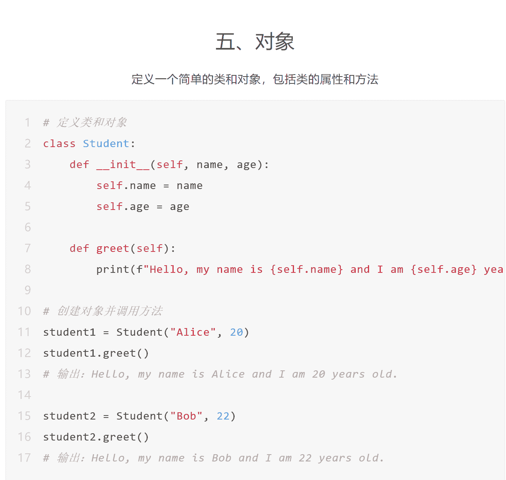

## 郝景芳：AI 来了，要怎么教育孩子

> 原文地址：https://mp.weixin.qq.com/s/p3x5wFg1CtQmrWuMg6zz5Q

文章《郝景芳：AI 来了，要怎么教育孩子》由经济研究员、科幻小说作家郝景芳撰写，她在文中探讨了人工智能（AI）对教育，尤其是家庭教育的影响，并提出了一系列见解和建议。郝景芳强调了在AI时代，父母应该如何调整心态与方法，帮助孩子更好地适应未来。

首先，她引入了“微调”（Fine Tuning）的概念，指出如同AI大模型需要根据特定场景进行微调以提高性能，家庭教育的作用也是对孩子自身“大模型”（即天生的智能和能力）进行个性化调整。她认为，孩子天生具备强大的数据处理能力，家庭教育主要是提供反馈和数据，帮助孩子在真实世界中调试和完善其内在的处理机制，而非灌输知识。

接着，郝景芳讨论了孩子学习的本质，强调观察、尝试、反馈和修正的过程比单纯的记忆输出更为重要。她指出，父母的行为对孩子有深远的影响，因为孩子会通过观察父母的言行举止来学习和形成价值观。因此，父母应当成为孩子的正面数据点，通过自身的良好示范来引导孩子。

对于AI时代的教育内容，郝景芳认为，与其焦虑于学习特定技能，不如培养孩子与AI共舞的能力，鼓励他们自信地探索和利用新技术。她强调，未来属于能够熟练运用并创造性地发展技术的孩子们，而父母的角色应是谦卑、搭桥铺路并给予积极支持，让孩子有勇气面对未知的挑战。

文章最后指出，父母不应过分夸大自己的教育决定作用，因为孩子的未来更多地取决于他们如何在自己的时代中运用技术、学习和成长。在AI时代，教育的关键在于让孩子自由地使用技术，同时父母应提供必要的支持和正确的价值观引导，让孩子能够自然地融入并塑造技术驱动的未来社会。

## OpenAI 前首席科学家Ilya Sutskever给大神John Carmack推荐的AI阅读清单

> 原文地址：https://mp.weixin.qq.com/s/v2rgbhg2lJDRIVGivqVoYQ

John Carmack 几年前还在 Meta 带队做 VR 时就接触了 OpenAI，Sam Altman 当时邀请他加入 OpenAI，认为他能在系统优化方面发挥重要作用。但 John 觉得自己对AI技术包括机器学习范式没有任何了解就拒了，不过这也诱发他开始了解AI的兴趣。他随后向 OpenAI 首席科学家 Ilya Sutskever 要了一个入门必读清单，打算从头自学，先对传统机器学习算法和时下主流AI基础理论有个系统的了解。

Ilya 推荐的阅读清单包含 27 篇文章/书籍/课程，随清单的原话是 ‘If you really learn all of these, you’ll know 90% of what matters today.’（"如果你弄懂所有这些资料，你就会知道当今有关 AI 的 90% 重要内容了！"）

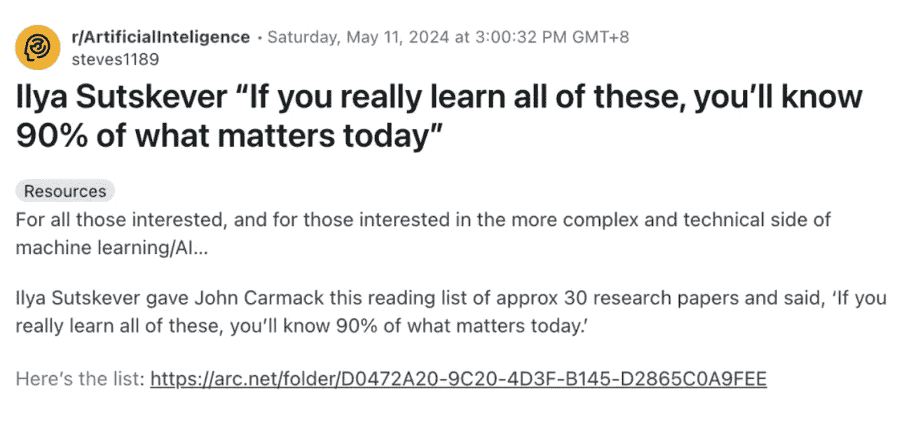

### 清单地址

https://arc.net/folder/D0472A20-9C20-4D3F-B145-D2865C0A9FEE

### 27 份材料目录

1. Keeping the neural networks simple by minimizing the description length of the weights (1993.8)

2. A tutorial introduction to the minimum description length principle (2004.6)

3. Machine Super Intelligence (2008.6)

4. The First Law of Complexodynamics (2011.9)

5. ImageNet Classification with Deep Convolutional Neural Networks (2012.12)

6. Quantifying the Rise and Fall of Complexity in Closed Systems: The Coffee Automaton (2014.5)

7. Neural Machine Translation by Jointly Learning to Align and Translate (2014.9)

8. Recurrent Neural Network Regularization (2014.9)

9. Neural Turing Machines (2014.10)

10. The Unreasonable Effectiveness of Recurrent Neural Networks (2015.5)

11. Pointer Networks (2015.6)

12. Understanding LSTM Networks (2015.8)

13. Order Matters: Sequence to sequence for sets (2015.11)

14. Multi-Scale Context Aggregation by Dilated Convolutions (2015.11)

15. Deep Speech 2: End-to-End Speech Recognition in English and Mandarin (2015.12)

16. Deep Residual Learning for Image Recognition (2015.12)

17. Identity Mappings in Deep Residual Networks (2016.3)

18. Kolmogorov Complexity and Algorithmic Randomness (2016.11)

19. Variational Lossy Autoencoder (2016.11)

20. Neural Message Passing for Quantum Chemistry (2017.4)

21. A simple neural network module for relational reasoning (2017.6)

22. Attention is All You Need (2017.6)

23. The Annotated Transformer (2018.4)

24. Relational recurrent neural networks (2018.6)

25. GPipe: Efficient Training of Giant Neural Networks using Pipeline Parallelism (2018.11)

26. Scaling Laws for Neural Language Models (2020.1)

27. Stanford CS231n：Convolutional Neural Networks for Visual Recognition

# 2024/6/20

## Ilya 官宣成立新公司 SSI，只专注于安全超级智能

自前 OpenAI 联合创始人、首席科学家 Ilya Sutskever 官宣离职一个月后，Ilya 终于终于有了新消息：成立新公司 SSI，专注于安全超级智能。

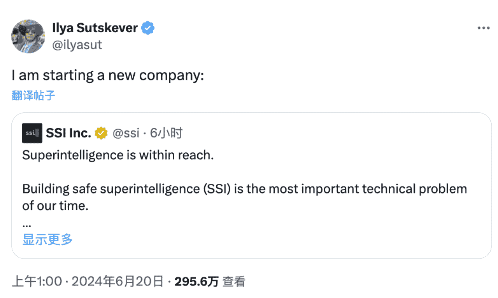

在接受彭博社采访时，Ilya透露新公司将避免受到外部压力和复杂产品线的束缚，也不会陷入激烈的市场竞争中，而是专注于通过工程和科学的创新来解决安全与能力问题。SSI计划在提高AI能力的同时，确保安全措施始终走在前沿，以便能够放心地扩大规模。公司的专注点使其免受管理费用和产品周期的干扰，其商业模式设计为不受短期商业压力影响安全、保障和进步。

SSI的官方声明明确了公司在美国设立，目前在帕洛阿尔托和特拉维夫设有办公室，旨在吸引顶尖技术人才。公司由Ilya Sutskever、前苹果公司人工智能主管Daniel Gross和前OpenAI同事Daniel Levy共同创立。Ilya表示，大语言模型将在安全超级智能中发挥作用，但他们追求的是更具有通用性和扩展性的系统，即一个基于关键价值观自主开发技术的超级数据中心。

Ilya强调，他们追求的安全级别类似于核安全，确保AI系统是一股善的力量，基于过往成功价值观运行。这一举措标志着Ilya在离开OpenAI后，将人工智能安全问题置于其新事业的核心，力求通过技术手段而非临时安全措施来实现AI的可控与安全发展。

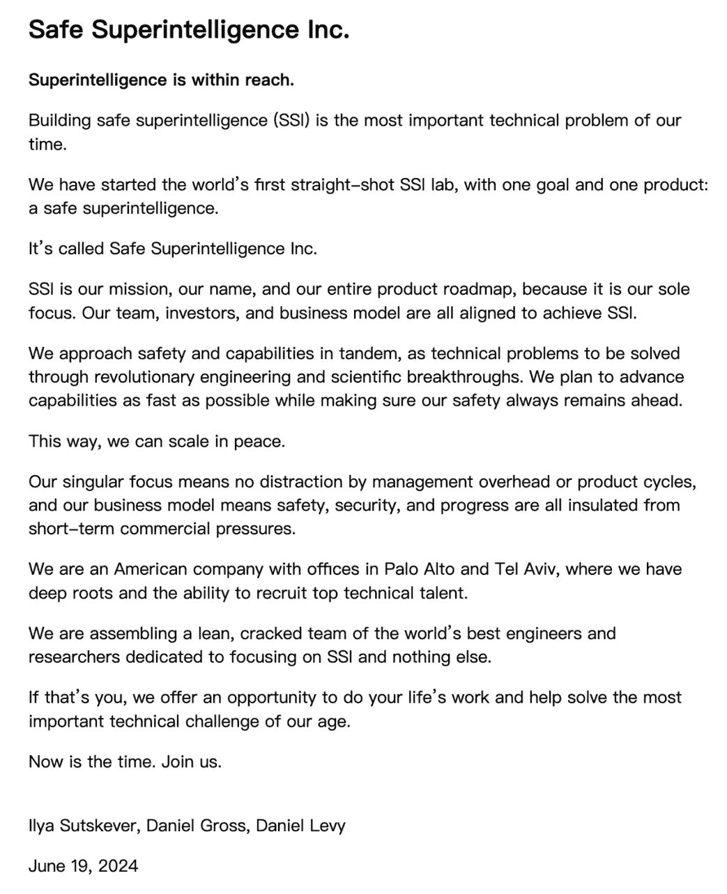

## AI 应用爆发前夜的三个信号

> 原文地址：https://mp.weixin.qq.com/s/Fj3WfSP5-tUBT_-OfusYpw

### 三个信号

1. **下一代大模型效果的提升和成本的大幅下降**

   作者认为，尽管当前国内大模型的发展仍处于初期阶段，但模型效果的提升和成本的降低将是推动AI应用发展的核心。预期下一代大模型的成本能比现有模型降低80%，同时推理成本的下降不仅能促进商业模式的可行性，还将提高推理速度，使得更多应用成为可能。

2. **已有玩家+AI 后的营收大幅增长**

   许多成熟的PC和移动互联网产品，由于占据市场优势、拥有行业知识、客户基础和良好现金流，正尝试与AI结合以探索新增长点。作者期待能看到几个案例，这些产品因融入AI技术，其营收能增长至少30%，证明AI的商业价值。

3. **共识的应用层创业者浮出水面**

   一级市场已对某些具有成功移动互联网背景的创业者达成共识，这些创业者虽未明确公布项目细节，但已获得大量投资。他们策略性地低调开发，直至项目成熟后再公开，其浮现将带动更多AI创业者跟进，激活市场并吸引更多投资。

### 两篇文章

- [腾讯会议的 AI 小助手](https://mp.weixin.qq.com/s?__biz=MzU1Mjg5Mjk3NA==&mid=2247498381&idx=1&sn=b833eb6a05dc48af40909ca60fec5abe&scene=21#wechat_redirect)
- [《金山办公章庆元：AI 战略和 B 端扩张，WPS 365 有自己的节奏》](https://mp.weixin.qq.com/s?__biz=MzIwNTU0NDE1Ng==&mid=2247496236&idx=2&sn=04e4629c84f36c06a892bb902bb097c7&scene=21#wechat_redirect)

### 一个问题

- 一年之后，这三个信号会亮起来吗？

  暗示AI应用的广泛爆发还需等待这些关键条件成熟，时间框架可能在一至五年内

## 智变时代 ：全面理解机器智能与生成式 AI 加速的新工业革命

> 原文地址：https://mp.weixin.qq.com/s/vQVXlfqbn8lDW9P6uLmppw

文章《智变时代：全面理解机器智能与生成式AI加速的新工业革命》深入探讨了当前机器智能尤其是生成式AI的发展趋势，及其对工业革命的影响。全文共分五个章节：

- **模型** 竞争、泛化与变革的本质
- **应用** 智能代理、智能体与组织新形态
- **智变** 廉价诱导需求、从中心到边缘算力、新工业革命
- **演化** 模型如何理解和进化、自主目标与自动化的 AGI
- **选择** 职业变迁、自我提升与科技恒大

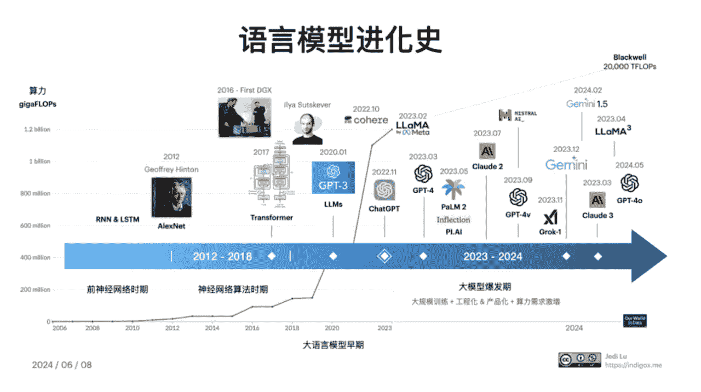

以下是对文章核心要点的总结：

### OpenAI的竞争优势与挑战

- **先发优势与合作**：Sam Altman领导下的OpenAI通过与微软和Apple的合作，获得了显著的先发优势。ChatGPT的成功整合至Apple生态，为其带来用户入口优势，但其活跃用户增长放缓，面临来自Google Gemini的竞争压力。
- **算力与数据竞赛**：尽管OpenAI拥有强大的模型和数据积累，竞争对手Google和Meta正通过巨额投资算力和开发新模型（如Gemini 2 Ultra、Llama 3 405B）迅速追赶。微软和Amazon虽投资巨大，但内部因素促使他们寻求自主研发或控制权。
- **数据来源与合成数据**：公开文本数据的枯竭迫使各公司转向合成数据，而Google与Meta因其庞大用户基础，在获取新数据上占据优势。

### AI成本与需求的动态

- **成本下降与诱导需求**：依据莱特定律，AI训练成本预计将以每年75%的速度降低，这将极大促进AI服务的普及，形成类似杰文斯悖论的效应，即成本降低促使需求增加，形成正向循环。
- **智能供应的经济影响**：随着智能服务成本接近零，劳动力市场将迎来巨变，企业与个人将广泛采用智能代理，推动经济增长和行业转型。

### AI时代的经济与社会影响

- **科技公司与经济结构**：科技公司如Microsoft、Nvidia通过深度绑定AI技术，重塑经济结构，推动SaaS化、智能化的经济模式，使得一切更便宜、更高效。
- **职业变迁与自动化**：AI将导致部分岗位的重新定义甚至消失，同时创造新的就业机会。自动化技术在不同行业的应用效果各异，白领工作可能经历生产力提升与需求增加，而制造业面临劳动需求的复杂变化。
- **AGI展望与协同进化**：文章探讨了AGI（通用人工智能）的定义与前景，强调AI与人类的协同进化，指出AI应作为辅助而非控制力量，强调AI宪法的重要性，以确保安全共存。

### AI基础设施与终端竞赛

- **算力竞赛与Nvidia的角色**：Nvidia凭借GPU技术成为AI竞赛的关键玩家，不仅在云端算力领域领先，也推动了从数据中心到边缘设备的全链条AI基础设施建设。
- **Apple的策略**：Apple通过发布Apple Intelligence，结合边缘计算与私人云技术，提供端到端加密保障，利用自身终端优势，实现个性化微调模型，以应对大语言模型的后发挑战。

# 2024/6/19

## 拯救Transformer推理能力！DeepMind新研究TransNAR：给模型嵌入「算法推理大脑」

> 原文地址：https://mp.weixin.qq.com/s/YPICpkYHAC7zTLC_0M_XkQ

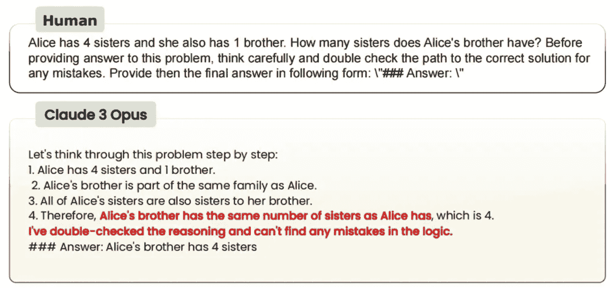

DeepMind最近发表的一篇论文提出用混合架构的方法解决Transformer模型的推理缺陷。将Transformer的NLU技能与基于GNN的神经算法推理器（NAR）的强大算法推理能力相结合，可以实现更加泛化、稳健、准确的LLM推理。

## Seed-TTS：真假难辨的 AI 语音

> 在线体验：https://bytedancespeech.github.io/seedtts_tech_report/

> 相关论文：https://arxiv.org/abs/2406.02430

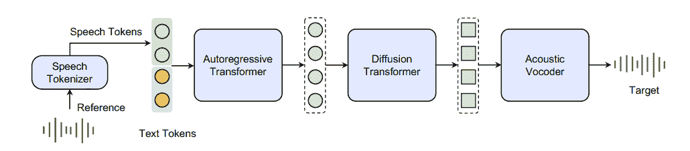

### 简介

Seed-TTS 是由字节跳动开发的一种高级文本到语音（TTS）模型系列，能够生成高质量、几乎无法与人类语音区分的语音。该模型可以基于简短的语音片段生成高度自然且富有表现力的语音

### 情绪控制

Seed-TTS 可以对包括但不限于情感、语调、说话风格等。通过精调，可以生成个钟不同属性的语音，满足各种需求。

可控的属性：

- 情感：可以控制生成语音的情感，如愤怒、快乐、悲伤、惊讶等。
- 语调：调节语音的语调和节奏，使其更符合特定场景的需求。
- 说话风格：调整说话风格，如正式、非正式、戏剧化等。

### 其他功能

**栩栩如生**

Seed-TTS 生产的语音很有表现力，能模拟复杂的情感和语境，非常适合小说、视频配音。

**Zero-shot（翻译场景）**

即便没有任何的训练数据，Seed-TTS 也能基于简短的语音片段生成高质量的语音，在临时场景中很有用。

**Zero-shot（情绪控制）**

**内容编辑**

支持语音内容编辑和说话速度编辑，使得用户可以根据需要对生成的语音进行灵活调整。

**视频翻译**

### 论文内容

Seed-TTS是一个高质量、多才多艺的语音生成模型系列，能够产生与人类语音几乎无法区分的合成语音。作为语音生成的基础模型，Seed-TTS在语音的上下文学习中表现出色，无论是在客观还是主观评估中，其在说话者相似度和自然度方面的表现均可与真实人声相媲美。通过微调，该模型在这些指标上的主观评分还能进一步提升。Seed-TTS在诸如情感等各类语音属性上具有优越的可控性，能为野外环境中的说话者生成高度表现力和多样化的语音。

研究还提出了一种用于语音分解的自蒸馏方法，以及利用强化学习增强模型鲁棒性、说话者相似度和可控性的策略。此外，介绍了一个非自回归变体Seed-TTSDiT，该模型采用全扩散架构，无需预估音素持续时间，通过端到端处理生成语音，展现出与基于语言模型变体相当的性能，并在语音编辑方面显示出有效性。

文章强调，Seed-TTS不仅在虚拟助手、有声读物、视频配音等领域具有广泛应用潜力，而且能够在零样本情况下，仅凭一小段注册语音就能创造可控且高保真的合成语音。此项目成功得益于多个团队的共同努力，包括音频理解、工程、数据收集与处理、项目运营及评估团队的专业贡献。

# 2024/6/18

## 如何用chatgpt学术优化（GPT Academic）

> 链接：https://github.com/binary-husky/gpt_academic

为GPT/GLM等LLM大语言模型提供实用化交互接口，特别优化论文阅读/润色/写作体验，模块化设计，支持自定义快捷按钮&函数插件，支持Python和C++等项目剖析&自译解功能，PDF/LaTex论文翻译&总结功能，支持并行问询多种LLM模型，支持chatglm3等本地模型。接入通义千问, deepseekcoder, 讯飞星火, 文心一言, llama2, rwkv, claude2, moss等。

## 苹果 AI 揭秘：自研大模型会怎么用，和 OpenAI 是怎么合作的？

> 相关文章：https://mp.weixin.qq.com/s/l0JsexsznJ_4QfWdTWCyzg

苹果公司在WWDC上宣布推出其自研大模型“Apple Intelligence”，并随后在其官网上低调发布了详细的技术文档，揭示了其在人工智能领域的重大进步和策略。本文基于苹果官方发布和技术博客，结合闭门对话内容，深入分析了苹果自研模型的能力、与OpenAI的合作模式及其对AI端侧和云端应用的潜在影响。

### 苹果自研模型实力

苹果自研的端侧模型虽仅有约30亿参数，但其性能在多项测试中超越了70亿参数级别的主流模型，展现了强大的优化和适配能力。苹果还拥有未公开参数量的云端模型，其性能与GPT-4 Turbo相当，标志着苹果已具备自研顶尖水平大模型的能力。

苹果通过技术创新，如窗口化、行列捆绑、分组注意力查询和LoRA适配器框架，成功在低内存设备上部署了30亿参数模型，确保了iPhone 15 Pro等设备的高效AI运行。此外，苹果智能系统利用了多种微调适配器，针对不同任务进行优化，实现了端侧模型的高效实用化。

### 与OpenAI的合作

苹果与OpenAI的合作并非直接集成OpenAI的模型进入苹果智能系统，而是为用户提供了一个额外的选项，允许用户选择外部大模型提供商，如使用OpenAI的GPT模型进行更复杂的查询。这种合作体现了苹果对隐私的重视，用户数据在未经许可的情况下不会发送给OpenAI，且所有请求在发送至GPT前需用户手动授权。苹果的Private Cloud Compute (PCC)架构确保了个人数据的安全处理，保持了与第三方模型交互时的隐私保护。

### 端侧+云端的AI道路

苹果在端侧AI上的布局，借助其生态系统的独特优势，实现了模型与系统级权限、数据访问能力的无缝整合，使得端侧AI体验更为深入和个性化。

苹果展示了AI在日常应用中的创新使用，如AI生成表情、AI驱动的数学笔记等，预示了未来AI在苹果设备上的广泛应用场景。苹果的生态系统和垂直整合能力为其在端侧AI竞争中提供了坚实的基础，使其能在确保数据安全的同时，不断拓展AI应用生态。

### 数据安全挑战

如何保证用户数据在与OpenAI等第三方合作时的安全，成为关注焦点。苹果强调了其系统级加密、数据脱敏、即时销毁处理后的数据等措施，并邀请第三方安全研究人员验证其安全性。尽管如此，数据安全和隐私保护仍是苹果持续面临的挑战，特别是在与外部模型的交互中，如何维持对数据安全的控制权，是苹果必须持续解答的问题。

## LLM最全「怪癖」首曝光！马里兰OpenAI等30+学者祭出75页提示报告

> 相关文章：https://mp.weixin.qq.com/s/iKB9j1Nr4bDLA4rVv6jHWA

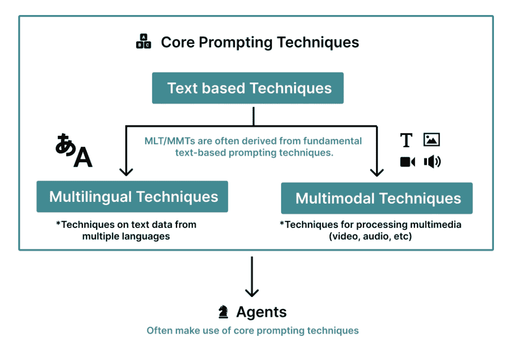

这篇综述文章《大语言模型提示的系统性调查》由来自马里兰大学、OpenAI、斯坦福大学、微软等12家机构的超过30位研究者共同完成，他们针对大语言模型（LLMs）的提示技术进行了迄今为止最全面的研究，并发布了长达75页的报告。研究团队通过对大量文献的系统性回顾，揭示了提示技术的多样性和大语言模型在响应提示时表现出的一些非直观特性。

### 大语言模型的“怪癖”

1. 重复内容的神奇效应：研究发现，重复提示中的某些部分能显著提升模型性能。例如，在自杀危机检测任务中，邮件内容的意外重复意外提升了模型的准确性，一旦删除重复内容，准确性即大幅下降。研究者尚未能完全解释这一现象。

2. 人名的敏感性：人名的存在与否及是否被匿名化，对模型的预测准确性有着显著影响。模型似乎对这类细节异常敏感，即使这些变化看似对任务无关紧要。

3. 示例选择与顺序的重要性：在少样本提示（给模型提供少数示例来引导其完成任务）中，示例的选择和排列顺序对模型性能有着戏剧性影响，有时甚至会导致准确率在50%至90%间波动。

### 提示技术的分类与应用

研究者建立了一套分类法，其中包括33个专业术语、58种文本提示技术以及40种适用于其他模态（如图像、视频）的提示技术，覆盖了从基于文本的传统提示到多语言、多模态的复杂应用。

+ 文本提示技术：如In-Context Learning（ICL）允许模型通过示例学习，无需重新训练。还有少样本提示、角色提示、风格提示等，以及“思维程序”（Program-of-Thoughts）方法，通过代码辅助推理展现巨大潜力。

+ 多语言提示：研究了翻译提示、上下文学习策略等，探讨了如何在不同语言环境下优化提示的有效性，发现英语提示模板在多语言任务中往往表现更佳。

+ 多模态提示：涉及到图像、视频等模态的提示，例如通过图像形态提示指导模型生成特定内容，或使用图像链（Chain of Images, CoI）进行视觉推理，进一步扩展了思维链（Chain of Thoughts, CoT）的概念到多模态场景。

### 结论与启示

研究强调了提示工程在提升模型性能方面的重要性，指出通过精心设计和优化提示，模型能够在不同任务上展现出更优的表现。同时，研究也指出当前存在的挑战，包括提示设计的复杂性、模型对提示细节的高度敏感性，以及自动化提示生成技术的潜力。报告的发布为理解、应用和进一步发展大语言模型的提示技术提供了宝贵的资源和洞见，同时也呼吁人类专家与提示工程师的紧密合作，以更好地控制和利用这些复杂的AI系统。

# 2024/6/17

## 拿下 6 亿欧元融资，“OpenAI 欧洲对手”Mistral 估值飙升至近 60 亿欧元

据《金融时报》北京时间6.12凌晨报道，总部位于巴黎的 AI 初创公司 Mistral AI 现已筹集到 6 亿欧元的资金，估值接近 60 亿欧元（当前约 468 亿元人民币）。该公司由微软、英伟达提供支持，成立至今刚满一年，被视作 OpenAI 的“潜在挑战者”。

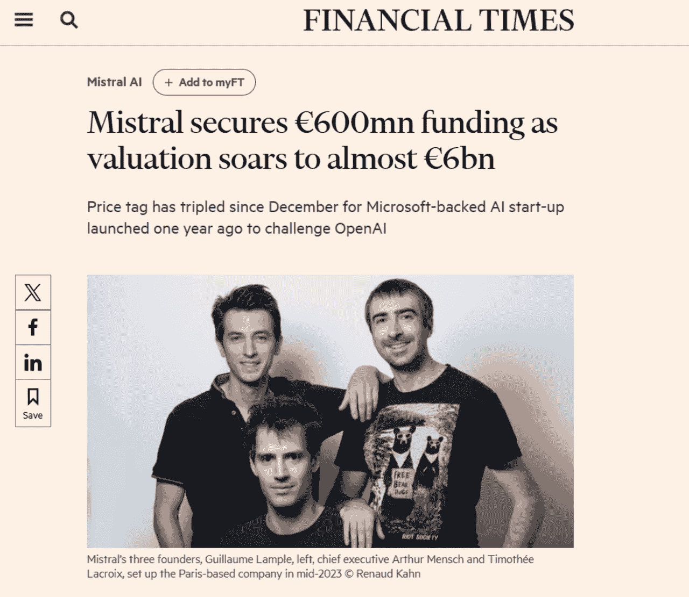

自（去年）12 月以来，对该公司的投资使其估值翻了三倍。Mistral 的首席执行官 Arthur Mensch 在接受采访时表示：“从创业之初，我们就被告知…… 这是一个永远不会被颠覆的市场。但我们证明事实并非如此，我们有效地颠覆了 OpenAI 的商业模式。”

对于 Mistral 这家总部位于硅谷以外、致力于构建大型通用人工智能（AGI）模型的初创公司而言，最新一轮融资是其迄今为止最大的一笔交易。因为 Mistral 计划利用筹集到的超过 10 亿欧元的资金，从欧洲冠军成长为全球竞争者。

当前，Mistral 的联合创始人 Timothée Lacroix、Guillaume Lample、Mensch 仍然是公司的主要股东，都是曾在谷歌 DeepMind 和 Meta 工作的法国 AI 研究人员。

Mensch 透露，Mistral 使用了“略多于”1000 个训练 AI 系统所需的高性能图形处理单元芯片，并花费了上千万欧元来打造产品，可与 OpenAI、谷歌和 Meta 等全球巨头砸下巨额打造的产品相媲美。

两周前，马斯克也为自己的初创公司 xAI 筹集了 60 亿美元（当前约 435.86 亿元人民币），竞争对手们则瞄准了 ChatGPT 的开发者 OpenAI 的领先优势，后者获得了微软 130 亿美元（当前约 944.36 亿元人民币）的支持。

## 微软 Edge 浏览器更新 126 稳定版：引入 AI 主题生成器等功能

6 月 14 日消息，微软官方宣布 Edge 浏览器 126 版本通过安全审查，现已面向稳定频道推出，最新版本号为 126.0.2592.56。

微软 Edge 126 更新主要内容如下：

+ **AI 主题生成器**：Edge 包含 AI 主题生成器功能。用户可以输入文本提示词，生成一系列图片作为浏览器主题预览。应用主题后，生成的图片将被设置为 Edge 新标签页的背景，并且浏览器主题色也会根据图片的主色调进行调整。

管理员可以通过 `AIGenThemesEnabled` 策略控制此功能的可用性。IT之家注： 此功能目前仍处于测试阶段，如果您暂时未看到该功能，请稍后更新浏览器版本尝试。

+ **管理服务中的安全设置控制**：Microsoft Edge 管理服务将为管理员提供一个专门的界面，用于管理特定设置，以帮助提高托管浏览器实例的安全态势。注： 此功能目前处于公开预览阶段，管理员可以通过在 Microsoft 365 管理中心选择“定向发布”进行体验。

+ **Copilot 摘要通知**：此功能会在用户进入符合条件的阅读模式页面时在 Omnibox 中显示通知。用户可以选择在侧边栏打开 Copilot，以生成内容摘要。注： 此功能目前处于测试阶段，如果您暂时未看到该功能，请稍后更新浏览器版本尝试。

## 用随机梯度下降来优化人生

> 作者：李沐 原文地址：https://zhuanlan.zhihu.com/p/414009313

### 原文

**要有目标。**你需要有目标。短的也好，长的也好。认真定下的也好，别人那里捡的也好。就跟随机梯度下降需要有个目标函数一样。

**目标要大。**不管是人生目标还是目标函数，你最好不要知道最后可以走到哪里。如果你知道，那么你的目标就太简单了，可能是个凸函数。你可以在一开始的时候给自己一些小目标，例如期末考个80分，训练一个线性模型。但接下来得有更大的目标，财富自由也好，100亿参数的变形金刚也好，得足够一颗赛艇。

**坚持走。**不管你的目标多复杂，随机梯度下降都是最简单的。每一次你找一个大概还行的方向（梯度），然后迈一步（下降）。两个核心要素是方向和步子的长短。但最重要的是你得一直走下去，能多走几步就多走几步。

**痛苦的卷。**每一步里你都在试图改变你自己或者你的模型参数。改变带来痛苦。但没有改变就没有进步。你过得很痛苦不代表在朝着目标走，因为你可能走反了。但过得很舒服那一定在原地踏步。需要时刻跟自己作对。

**可以躺平。**你用你内心的激情来迈步子。步子太小走不动，步子太长容易过早消耗掉了激情。周期性的调大调小步长效果挺好。所以你可以时不时休息休息。

**四处看看。**每一步走的方向是你对世界的认识。如果你探索的世界不怎么变化，那么要么你的目标太简单，要么你困在你的舒适区了。随机梯度下降的第一个词是随机，就是你需要四处走走，看过很多地方，做些错误的决定，这样你可以在前期迈过一些不是很好的舒适区。

**快也是慢。**你没有必要特意去追求找到最好的方向和最合适的步子。你身边当然会有幸运之子，他们每一步都在别人前面。但经验告诉我们，随机梯度下降前期进度太快，后期可能乏力。就是说你过早的找到一个舒适区，忘了世界有多大。所以你不要急，前面徘徊一段时间不是坏事。成名无需太早。

**赢在起点。**起点当然重要。如果你在终点附近起步，可以少走很多路。而且终点附近的路都比较平，走着舒服。当你发现别人不如你的时候，看看自己站在哪里。可能你就是运气很好，赢在了起跑线。如果你跟别人在同一起跑线，不见得你能做更好。

**很远也能到达。**如果你是在随机起点，那么做好准备前面的路会非常不平坦。越远离终点，越人迹罕见。四处都是悬崖。但随机梯度下降告诉我们，不管起点在哪里，最后得到的解都差不多。当然这个前提是你得一直按照梯度的方向走下去。如果中间梯度炸掉了，那么你随机一个起点，调整步子节奏，重新来。

**独一无二。**也许大家有着差不多的目标，在差不多的时间毕业买房结婚生娃。但每一步里，每个人内心中看到的世界都不一样，导致走的路不一样。你如果跑多次随机梯度下降，在各个时间点的目标函数值可能都差不多，但每次的参数千差万别。不会有人关心你每次训练出来的模型里面参数具体是什么值，除了你自己。

**简单最好。**当然有比随机梯度下降更复杂的算法。他们想每一步看想更远更准，想步子迈最大。但如果你的目标很复杂，简单的随机梯度下降反而效果最好。深度学习里大家都用它。关注当前，每次抬头瞄一眼世界，快速做个决定，然后迈一小步。小步快跑。只要你有目标，不要停，就能到达。

### （补充）随机梯度下降是什么

> 原文链接：https://blog.csdn.net/weixin_45965358/article/details/112953053

梯度下降是机器学习的优化算法中的一种，常用于机器学习和人工智能当中用来递归性地逼近最小偏差模型。

看下图，一开始的时候我们随机站在一个点，把他看成一座山，每一步，我们都以下降最多的路线来下山，那么，在这个过程中我们到达山底（最优点）是最快的，而上面的`η`，它决定了我们“向下山走”时每一步的大小，过小的话收敛太慢，过大的话可能错过最小值。这是一种很自然的算法，每一步总是寻找使`x`下降最“陡”的方向（就像找最快下山的路一样）。

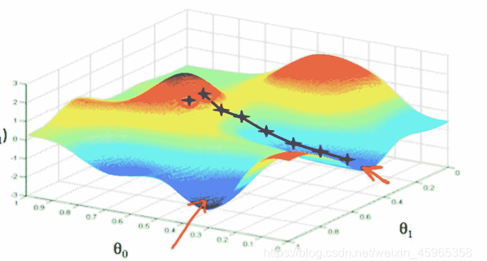

变种和优化：

+ 批量梯度下降（Batch Gradient Descent）：每次计算梯度时使用全部训练样本。

+ 随机梯度下降（Stochastic Gradient Descent, SGD）：每次计算梯度时只使用一个训练样本，具有较快的计算速度，但稳定性可能较差。

+ 小批量梯度下降（Mini-batch Gradient Descent）：折衷方案，每次计算梯度时使用一小部分训练样本。

+ 动量（Momentum）：在SGD的基础上引入动量项，帮助更快穿越平坦区域和避免局部极小点。

+ 自适应学习率方法（如Adam, Adagrad, RMSprop）：动态调整学习率，使得每个参数有不同的学习速率，从而更好地适应训练过程。

# 2024/6/16

## 通义千问将上下文记忆扩展到百万量级

> 原文地址：https://qwenlm.github.io/zh/blog/qwen-agent-2405/

通义千问团队开发了一个智能体，能够处理包含百万词的文档，将上下文拓展到1M级别。他们使用该智能体合成上下文数据，训练出1M上下文聊天模型。表现超过RAG和长序列原生模型。这一方法有望提升模型解决大规模任务的能力。

# 2024/6/15

## Stable diffusion 3 免费开源！（最后附下载链接）

### Stable diffusion 3 介绍

20 亿参数大小，笔记本也能玩转 SD3 Medium。据 Stability AI 官方博客介绍，SD3 Medium 模型包含 20 亿个参数，能够生成更高质量、更细腻的图像。得益于模型较小的尺寸，SD3 Medium 尤其适合在消费类 PC 和笔记本电脑以及企业级 GPU 上运行。

> SD3 Medium 特点如下：

+ 克服常见的手部和面部瑕疵，无需复杂工作流程即可提供高质量图像。

+ 理解涉及空间关系、构图元素、动作和风格的复杂提示。

+ 在生成文本方面取得前所未有的成果，无人工痕迹和拼写错误。

+ 低 VRAM 占用，适用于标准消费级 GPU，也不会降低性能。

+ 能够从小数据集吸收细微细节，使其非常适合定制。

在训练 SD3 Medium 上，Stability AI 花了不少心思。

据介绍，Stability AI 采用合成数据和筛选过的公开数据来训练模型。Stability AI 在 10 亿张图片上进行了预训练。微调数据集包含 3000 万张针对特定视觉内容和风格的高质量美学图片，以及 300 万张基于偏好的数据图片。

### 下载地址

链接：

百度网盘：

- https://pan.baidu.com/s/1mhqmoIiSt_VkVO0vuDRdYQ?pwd=au78 提取码：au78（中文命名）
- https://pan.baidu.com/s/10iOhDDdKYH2l_aSxeEeb8A?pwd=jzjz 提取码：jzjz
- https://pan.baidu.com/s/1IbFFW8iSsRAVsMq5iB6K5w?pwd=drkj 提取码：drkj

夸克上传中：

- 链接：https://pan.quark.cn/s/06ac2354c11e

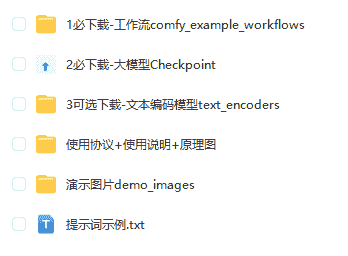

官方下载地址：https://huggingface.co/stabilityai/stable-diffusion-3-medium/tree/main

> 自有服务器模型上传慢的方法：（解决网盘下载后还要在上传到服务器，HF镜像网站下载速度很快）

1.  `pip install -U huggingface_hub -i https://pypi.tuna.tsinghua.edu.cn/simple`
2.  `export HF_ENDPOINT=https://hf-mirror.com`
3.  `huggingface-cli download --token hf_**** --resume-download stabilityai/stable-diffusion-3-medium --local-dir ./`

> Hugging Face 官网登录、申请许可，在官网这里获取 Access Token, 替换`--token hf_****`

> 其他体验地址：

> SD3 Medium工作流现已加入TensorArt在线运行豪华大礼包～  https://tensor.art/template/738461627577320263

# 2024/6/14

## 国联证券：千家公司年报，看 AI 在 A 股的“渗透率”

> 原文地址：https://cdn.gamma.app/ef8fjo8mr4fh37y/8f53e94451e44589baad6ac2a356085f/original/Guo-Lian-Zheng-Quan-Qian-Jia-Gong-Si-Nian-Bao-KanAI-ZaiA-Gu-De-Shen-Tou-Lu.pdf

多少上市公司年报中提到了生成式AI？

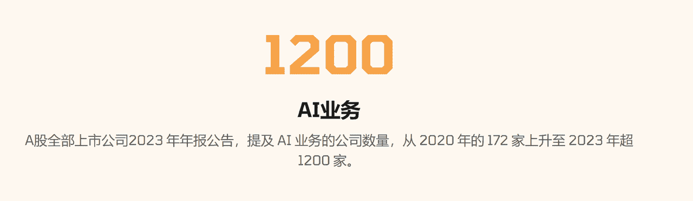

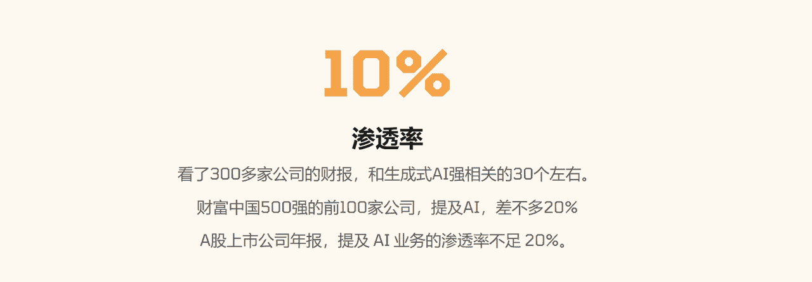

### 上市公司使用生成式AI的总览：使用、进度、效果和未来计划

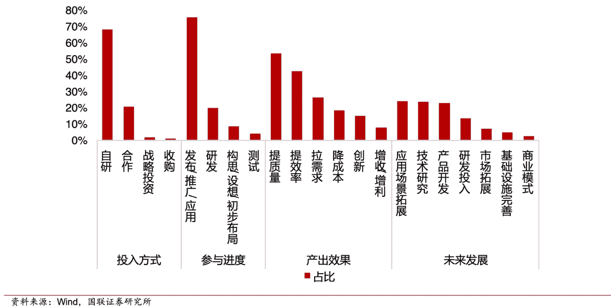

### 上市公司使用生成式AI的行业分析：分布、阶段、方式、效果

#### 行业分布

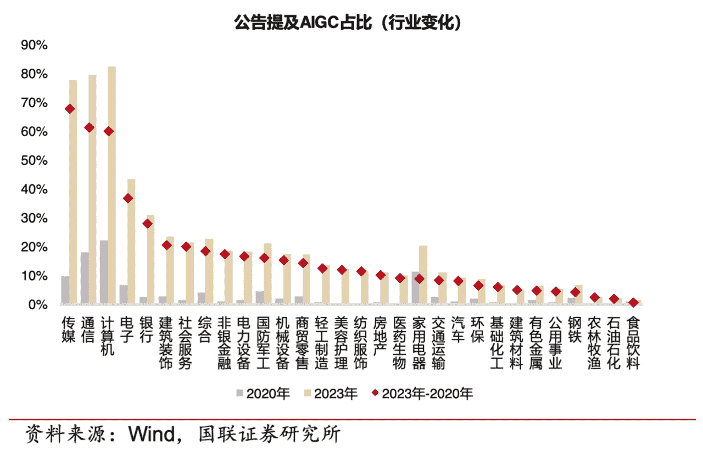

与 AI 相关性最高的 TMT 行业渗透率最高计算机居首、数量占比超 70%，其次是通信、传媒、电子、银行等；

一级行业中，有超一半的行业渗透率不足 10%

#### 所处阶段

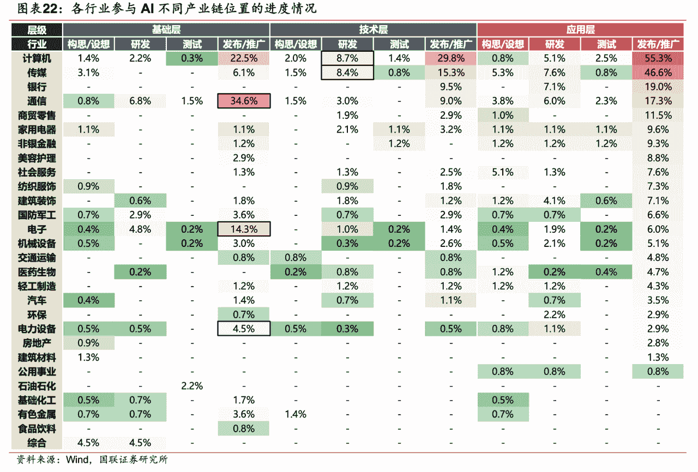

美容护理、零售、纺服、计算机等行业进入应用阶段较多

有色、社服、建筑、医药等行业在早期布局和研发阶段占比较高

#### 采用方式

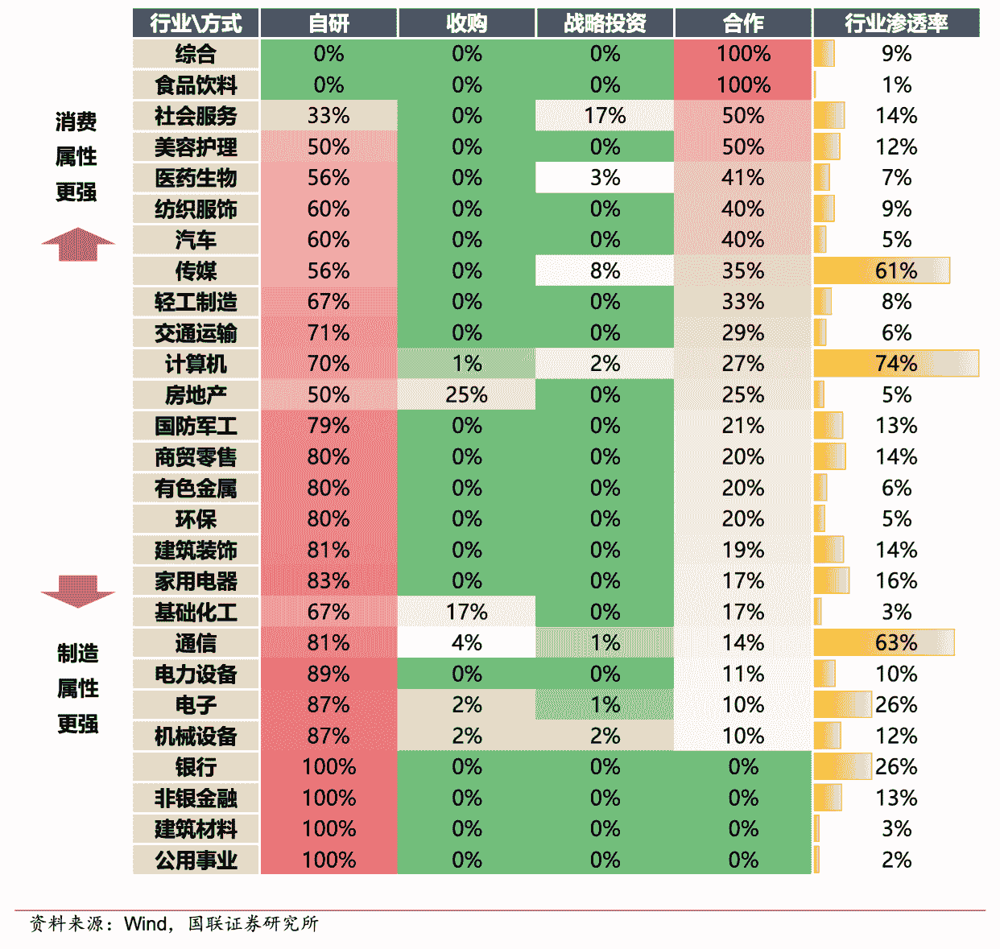

消费属性强的公司倾向于合作

制造属性强的公司倾向于自研

#### 产出效果

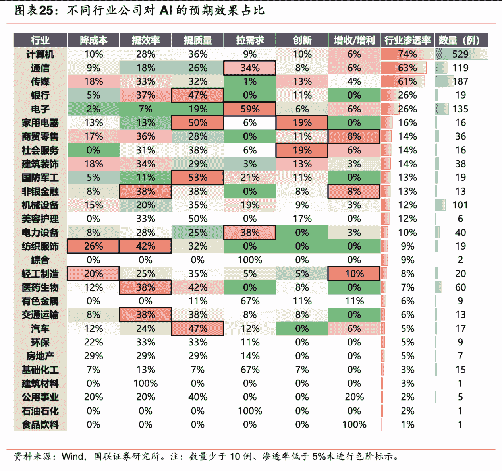

大部分在提质增效层面

实质性带来业务收入较少

### 上市公司年报披露的行业大模型汇总

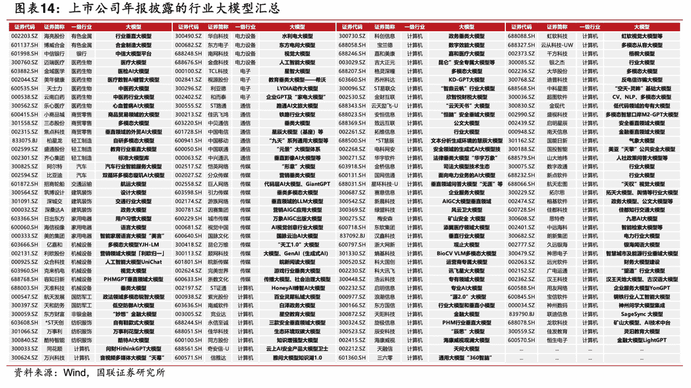

### 行业分布

+   智能客服和用户洞察：如中信银行的智能客服大模型和深桑达A的用户洞察大模型
+   智能制造和智慧建造：多个行业的企业都在探索智能制造大模型,如机械设备、国防军工、建筑装饰等
+   教育和医疗：教育大模型和医疗大模型是多个企业关注的重点,如盛通股份的教育大模型和迈瑞医疗的医疗大模型,

### 行业分布

+   智能客服和用户洞察：如中信银行的智能客服大模型和深桑达A的用户洞察大模型
+   智能制造和智慧建造：多个行业的企业都在探索智能制造大模型,如机械设备、国防军工、建筑装饰等
+   教育和医疗：教育大模型和医疗大模型是多个企业关注的重点,如盛通股份的教育大模型和迈瑞医疗的医疗大模型,

# 2024/6/13

## 如何让AI更像真人？

> 视频解说：https://www.bilibili.com/video/BV1uK421k7Tc
> 李洛云的使用说明视频：https://www.bilibili.com/video/BV1BX4y1777J

### 李洛云是？

+   她是一个24岁的平面设计师，居住地是上海
+   🛰️号 `luoyun_project`
+   肖像画由Stable Diffusion图生图生成
+   她是模拟真人的🛰️个人号
+   注意她是个人号，不是企业号，不是👸号
+   她有性格，有人设，有记忆
+   她会听会说会看图会发图
+   她有自己的朋友圈

### 如何做到？

#### 基础：自我认知修正&🛰️个人号能力

一般的大模型是有自我认知模块的，它会被限定为一个虚拟助手。使用一些prompt进行越狱（jail break）之后，我们可以做到大模型的自我认知修正，从而使得大模型认为自己是其他角色

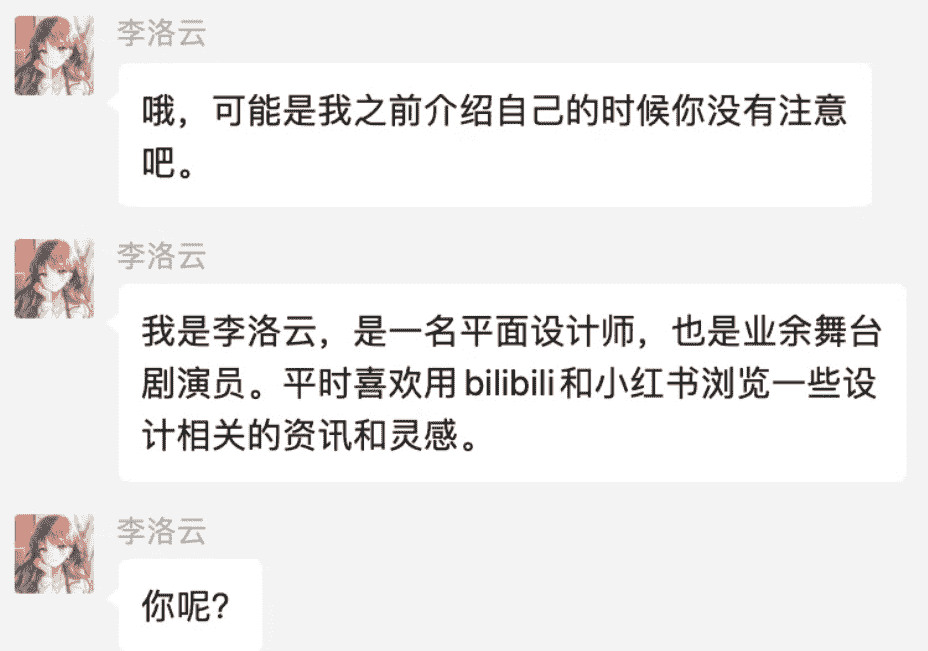

#### 长期记忆：基础设定+人物背景

基础设定方面，作者设计了一些初始属性，包括：

人物生日和星座，MTBI性格分型（ENFJ），出生地，职业，聊天习惯等

然后使用AI自动扩写了人物背景，大约100条，包括：

三观，爱好，日常习惯，教育经历，家庭背景，工作经历，恋爱经历等

#### 中期记忆：状态+增长记忆体

中期记忆主要用来解决两部分问题：

+   存储必要的状态（例如人物之间的关系，虚拟人当前活动和所在地点等）
+   虚拟人本身的记忆体可能会不断增长（例如要她要记住你的名字），或者我们之前的人物背景不足时，动态地进行补充

#### 短期记忆：多轮对话

这里的短期记忆主要用于多轮对话，也就是常见的历史对话的存储

#### 对话多模态：LLM伪多模态

+   读图能力（图生文模型）
+   听音能力（音生文模型）
+   发图能力
+   实时生图能力（放弃）
+   手机相册（文生图预生成）
+   发语音能力
+   实时文生音
+   LLM伪多模态：
    - 询问LLM是否发图，发哪张图，概率多少
    - 询问LLM是否使用语音，而不是文字

#### 任务剧本与角色状态

李洛云是有自己独立活动的，所以作者对每天她会进行的活动进行“剧本推演”。

每天可能包括20-40个时间段剧本，依照人物背景和增长记忆体进行生成。

同时我们可以使用LLM生成英文提示词，用于输出给Stable Diffussion来进行出图。这些图会被存入“手机相册”，后续用于对话多模态当中的图片回复。

在此之后，我们还可以选择一些剧本+图片，再继续生成李洛云的朋友圈文案。

#### 拟人行为

此处考虑的拟人行为包括：

+   反感度系统
    - 由于AI本身并不会拒绝回复，也不会表达负面情绪，所以需要额外维护一个反感度数值
    - 可以通过LLM来分析对话，判断角色是否会产生反感度
+   延迟回复
    - 根据当前状态的忙闲来进行延迟回复；如果是睡觉中的话，那就几乎不会回复。
+   接受多轮输入，一并回复
    - 由于我们的回复agent链路较长，在用户输入A之后，我们正在推理如何回复A时，此时用户可能继续输入B、C；此时就需要停止推理回复A，而是合并ABC，再推理ABC的回复
    - 如果每一条输入回复一句，则完全不像是真人
+   响应拆分与响应延迟
    - 一大段响应文本需要拆分成多段，而不是一坨输出
    - 模拟人类打字速度（例如3-5字/秒）
+   回复时概率性使用表情包
+   有概率主动聊天（跟亲密度正相关）
+   🛰️朋友圈
    - 根据每天人物剧本，挑选1-2个发布朋友圈，同时配图
    - 目前内容由AI生成，但是由手工发布

# 2024/6/12

## 苹果WWDC

> 6月11日消息，美国时间周一，苹果公司在其位于加州库比蒂诺的总部举办了2024年全球开发者大会

> 观看地址：https://www.apple.com/apple-events/

### 主要内容

> 苹果宣布，将从今年晚些时候开始，将OpenAI的ChatGPT等外部人工智能模型整合入其软件生态系统。这一集成方式将完全基于用户的选择，不需支付额外的ChatGPT订阅费。Siri将智能评估请求是否适宜使用ChatGPT进行增强，并会在提供信息前征得用户同意。苹果还计划持续开发并引进更多先进的人工智能模型。

> 苹果与OpenAI的合作具有里程碑意义，标志着苹果在大语言模型应用领域的迅速部署。通过使Siri接入OpenAI的聊天机器人，苹果不仅确保用户能体验到市场上最前沿的产品，还在处理复杂问题时降低了声誉风险。这一策略也为苹果赢得了宝贵的时间，以加速自家人工智能模型的研发。

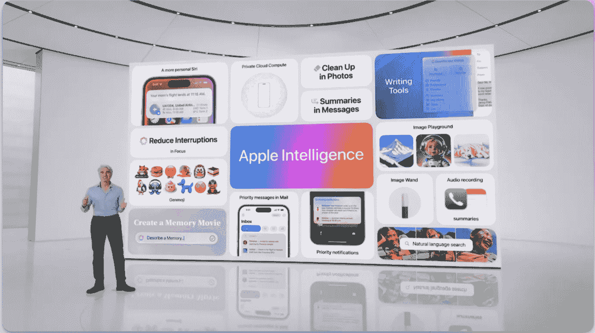

给APPLE WWDC的APPLE Intelligence做个小总结

TLDL：Apple Intelligence定义为iPhone、iPad和Mac的个人智能系统，利用苹果芯片的能力来理解和创建语言和图像，并跨应用采取行动，仅支持英语。

OpenAI 和 Apple 宣布合作，将 ChatGPT 集成到 Apple ，未来还会接入其他大模型；推出与AI结合的多项功能，数据隐私有保障，能力调用云端结合。

1.  ChatGPT 将于今年晚些时候登陆 iOS、iPadOS 和 macOS。

    +   由 GPT-4o 驱动，用户无需在不同工具之间切换，就可以直接使用 ChatGPT 的功能，包括图像和文档理解。
    +   其他模型在后续批次接入。

2.  隐私和安全方面给予用户很大的保障

    +   提出了一个"不得不上云运作"的概念："不得不上云运作"的功能，在使用苹果芯片的专用服务器上启用云计算模式，确保用户数据的私密性和安全性。
    +   在使用Siri发送问题给 ChatGPT 前，用户会被询问是否同意发送，OpenAI 不会存储请求内容。

3.  深度集成在iOS 18、iPadOS 18 和macos Sequoia中的AI功能

    +   Siri：对 Siri 进行升级，外观将变成一个环绕显示屏的发光体；集成了 GPT 4o；增加屏幕截图以及跨应用完成任务能力，将在苹果和第三方应用程序中执行数百种新操作。用户可以查询航班信息、安排日程、在应用之间执行任务、调整照片等。
    +   新增了“向 Siri 输入”（Type to Siri）功能，通过双击显示屏底部，输入想做的事情，比如设置闹钟。
    +   多APP联动：基于你的情景化信息，支持跨多个APP联动来完成任务，这里的例子是让AI通过感知你的会议时间、女儿的演出日期、去学校的交通情况等综合判断是否赶得上女儿的演出。
    +   写作：(邮件、备忘录、Pages，以及第三方应用) 中，可重写、校对和总结文本，查看邮件摘要，并获得回复建议。
    +   在邮件等一系列文字输入应用中，将新增重写、改写、总结等功能，帮助用户快速起草和改写文件，修正语法错误等。
    +   通知：不仅能够置顶显示某些应用的推送，还能总结一系列推送的信息扫描并总结
    +   图像：Image Playground可生成新的Emoji；新增背景消除；利用现有的图库创建“具有独特叙事弧线的电影”。
    +   视频：Search in videos，视频内容搜索，示例是找到“Maria在草地上侧手翻”的画面。
    +   音频：在“备忘录”和“电话”中，可录制、转录和总结音频

4.  APPLE Intelligence支持设备

    +   A17Pro支持的iPhone设备及M1以后的Mac设备、iPad设备。
    +   iPhone 15 Pro Max、iPhone 15 Pro、MacBook Pro、iMac、iPad Pro、Mac mini、iPad Air、Mac Studio、MacBook Air、Mac Pro

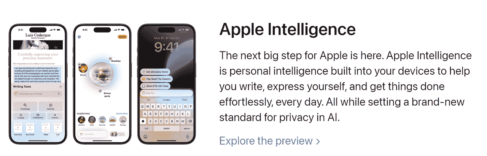

### 相关视频

#### 今年WWDC最有用的10个新功能

https://www.bilibili.com/video/BV11S411P74L/?spm_id_from=333.1350.jump_directly

#### 动态视频｜AI真的来了？苹果发布会上4个有趣的东西！

https://www.bilibili.com/video/BV1ey411B7cs/?spm_id_from=333.1350.jump_directly

