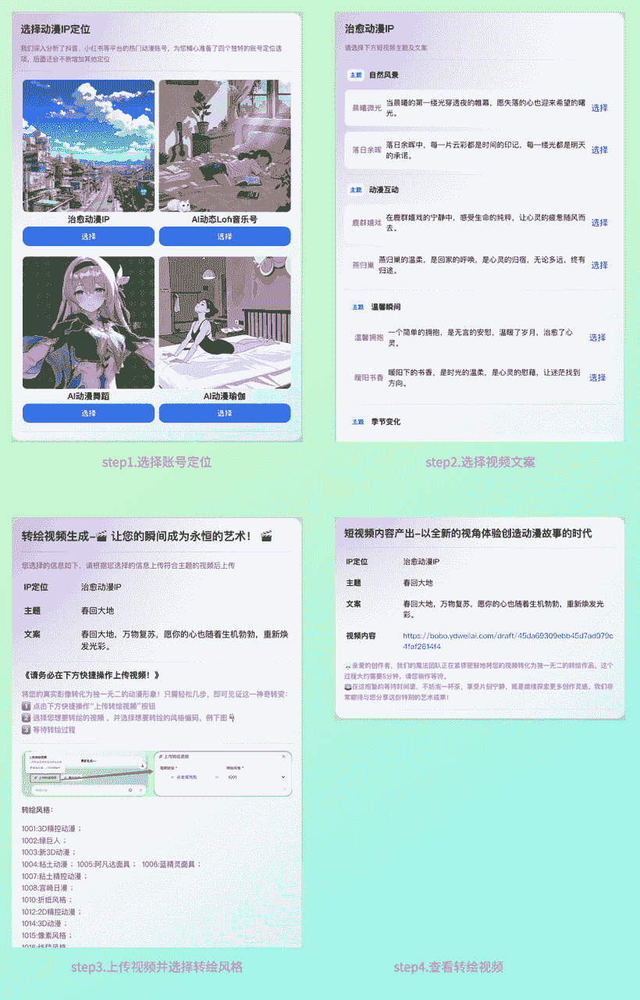
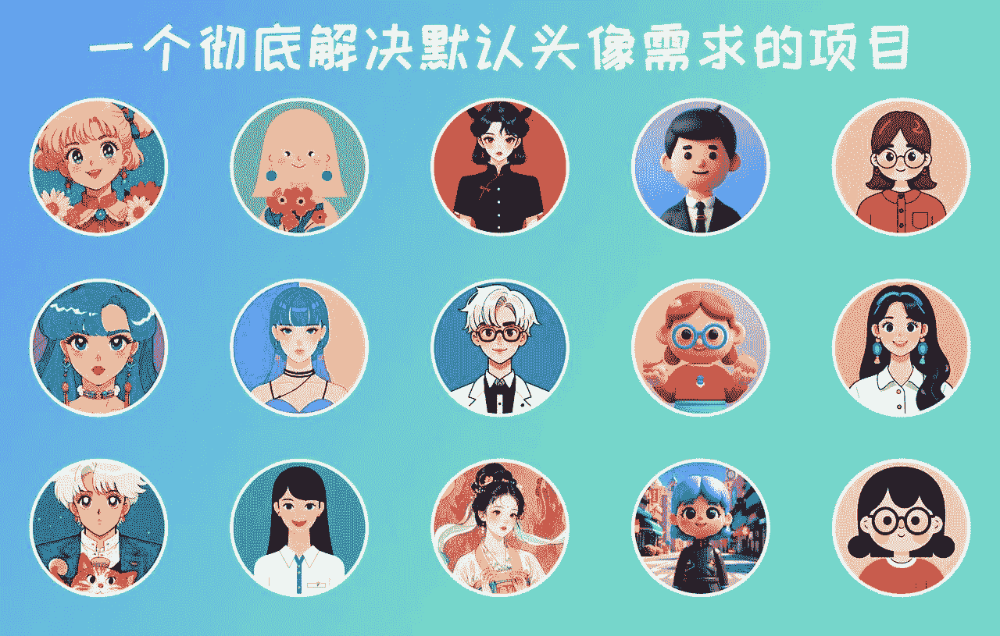
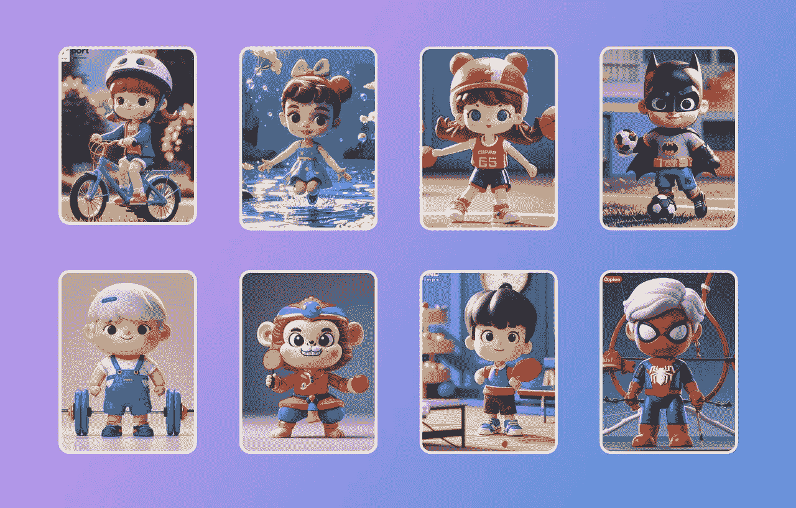

# AI智能体试用

> 来源：[https://bluefocus.feishu.cn/docx/G2r1dGxOwoJWUGxy12gcCZ3Wnah](https://bluefocus.feishu.cn/docx/G2r1dGxOwoJWUGxy12gcCZ3Wnah)

# 推荐bot

1.啵啵动漫 - AI短视频制作

做了一款AI动漫短视频制作工具，将转绘视频发布至抖音小红书分分钟变为百万博主👏👏，AI动漫新风潮，未来会有越来越多垂直类AI动漫账户将会火爆全网，如瑜伽，舞蹈，自创作AI动漫短片等等，快来试试吧😍https://www.coze.cn/store/bot/7391785151505940543?bid=6d5hgr0ck6g0a&panel=1 《啵啵动漫 - AI短视频制作》

https://bobo.ydweilai.com/draft/a7fc46d5cdbb4331832fae9ea35ba288 《转绘视频案例》

**2.默认头像**

https://www.coze.cn/store/bot/7396186733836156938?bid=6d9nrpnbc2013&from=bots_card&panel=1

轻松创作独一无二的默认头像，快速获得超多不同风格头像，彻底解决默认「头像」需求💖

**3.奥运IP手办生成器💖**

只需要输入简单的提示词，就能得到一个专属奥运IP小手办，或许你还可以尝试动漫人物+奥运联名，比如「超人 乒乓球」、「奥黛丽赫本 跳水」快发挥你的想象力吧！隐藏彩蛋：不同动漫人名叫法有更多玩法，期待你的探索～

https://www.coze.cn/store/bot/7396948456725610536?bid=6da2pp6f8701j&from=bots_card&panel=1

# 热度前50bot

上面的bot选自国内平台coze.cn热度最高的三十个