# coze国内版插件汇总

> 来源：[https://bluefocus.feishu.cn/docx/NyqQdmdaRohYG9xeCdncPAZ3nch](https://bluefocus.feishu.cn/docx/NyqQdmdaRohYG9xeCdncPAZ3nch)

目前国内版总共有多少个插件？都有什么插件？

是首页商店看到的这个 **36个** 吗？

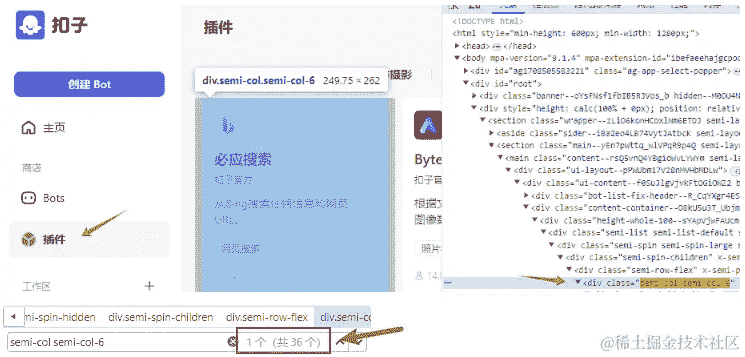

是，它们叫 **插件**，但在 **工作流** 里，我们用到的是 **插件工具**！！！比如这个 **文生图** 的 **插件**：

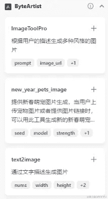

它包含了三个 **插件工具**，前面讲过 **插件和节点** 的本质都是 **API接口调用的封装**，那么插件和插件工具的区别：

> 答：**插件指定**** →【B**aseUrl + 默认请求头】，插件工具 指定 → 【调用接口、输入/输出参数】

**🐶 所以，使用同一插件**的不同插件工具，本质上就是调用 同一域名下的不同的接口。😄 好，修正下问题：

> **国内版总共有多少个插件工具**？

**😑 官方****并没有**说明，想知道得自己**统**计，在折腾工具流时，我发现 插件搜索 并没那么好用，比如，我想要用 文生图 的 插件，搜 "图"：

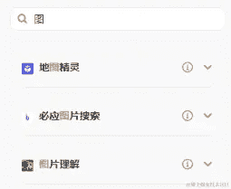

明显是根据 **插件名** 来匹配的，支持文生图的 **ByteArtist** 插件就没显示出来。😳 另外，我之**前好像看**到官方的**Bot的工作**流用到了 隐藏插**件，用户 没法直接**搜到，但是可以通过 间接的方式来使用它：

> **打开官方**B**ot的工作流，点击右上角** 创建副本 来拷贝工作流到自己的工作空间，**就可以用它了。2333，之前**云雀大模型抽风的时候，群里有人有人通过这样的方式拷贝了 更牛批的 Seed大模型。😄 不过现在不行了，默认只能用云雀了，如果想调其它大模型，可以在代码节点使用 request_async库 来调用第三方的API来实现。

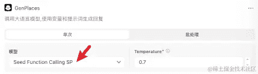

😆 综上，笔者想做的事情就是：

+   **统计能搜到插件工具**，做下汇总输出，方便Bot玩家对内置插件工具进行检索，快速找到心仪的工具。

+   发掘下官方Bot的工作流中有没有隐藏的插件工具。

🤡 手动统计肯定是不可能的，爬虫走一波~

1.  爬取思路

😜 先调皮下，搭个Bot，看用 LinkReaderPlugin插件 能否直接提取，写下简易提示词：


**试试**：

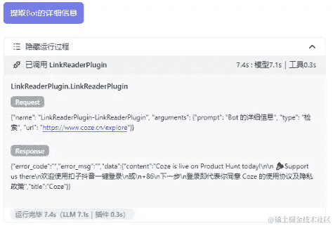

🤣 哈哈哈，明显不行，需要登录，F12看下请求：

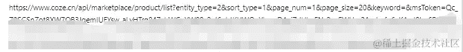

看到 **msToken** 这么长的加密参数，就不用想接口模拟了。数据量不大，浏览器自动化(selenium) + 请求拦截(BrowserMob Proxy) 走一波看看，随手写下爬取代码：

```
 代码解读
复制代码
import osimport timefrom browsermobproxy import Serverfrom selenium import webdriverimport cp_utilscoze_save_dir = os.path.join(os.getcwd(), &quot;coze&quot;)explore_list_file = os.path.join(coze_save_dir, &quot;explore_list.txt&quot;)def init_browser():    chrome_options = webdriver.ChromeOptions()    chrome_options.add_argument(&#x27;ignore-certificate-errors&#x27;)  无视证书验证    chrome_options.add_argument(&#x27;--start-maximized&#x27;)  开始时直接最大屏幕    chrome_options.add_argument(r&#x27;--user-data-dir=D:\ChromeUserData&#x27;)  设置用户数据目录，避免每次登陆    chrome_options.add_argument(&#x27;--proxy-server={0}&#x27;.format(proxy.proxy))  设置请求的代理    return webdriver.Chrome(options=chrome_options)模拟登陆，只需调用一次，以后登陆失效了主动调用下就好def login():    browser.get(&quot;https://www.coze.cn/home&quot;)获取Bots列表def get_explore_list():    proxy.new_har(&quot;get_explore_list&quot;, options={        &#x27;captureContent&#x27;: True,        &#x27;captureHeaders&#x27;: True    })    browser.get(&#x27;https://www.coze.cn/explore&#x27;)    time.sleep(5)    result = proxy.har    for entry in result[&#x27;log&#x27;][&#x27;entries&#x27;]:        if entry[&#x27;request&#x27;][&#x27;url&#x27;].find(&#x27;/explore/get_explore_list&#x27;) != -1:            content = entry[&#x27;response&#x27;][&#x27;content&#x27;]            print(content)            with open(explore_list_file, &quot;w+&quot;, encoding=&#x27;utf-8&#x27;) as f:                f.write(content[&#x27;text&#x27;])                print(explore_list_file, &quot; 文件写入完毕...&quot;)    proxy.close()    browser.close()if name == &#x27;__main__&#x27;:    cp_utils.is_dir_existed(coze_save_dir)    server = Server(os.path.join(os.getcwd(), r&#x27;browsermob-proxy-2.1.4\bin\browsermob-proxy&#x27;))    server.start()    proxy = server.create_proxy({&#x27;trustAllServers&#x27;: True})    browser = init_browser()    login()    get_explore_list()
```

先调login()，完成登录后关闭浏览器，注释掉，调用get_explore_list()，此时打开浏览器就处于登录态了，拦截包含 /explore/get_explore_list 字符串的URL，保存text到本地。运行后报错：

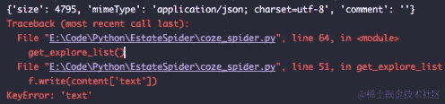

没有text，难道是 **二进制数据**？proxy.new_har的option参数再加个 'captureBinaryContent': True，运行：

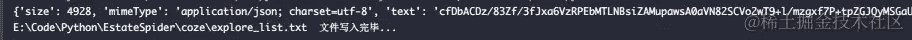

**🙃 淦，读是能读到了，但te**xt这字符串明显就是 字**符串加**密 + Base64 啊，yue了，但打开 浏览器 数据确是正常的：

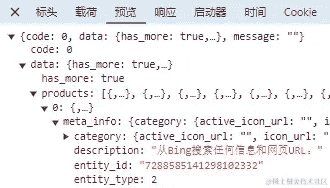

明显是执行某个解密js后加载出来的，破解就算了🙃，先不谈水平不够，浪费时间之余意义不大。

+   😑 那 自**动化+Xpath抠页面节点 **？算了吧，又low又费劲，无计可施才会用这个方法。

+   🤔️感觉得搞个C**hrome插件 **做下接口监听了，但那是我的知识盲区...

+   [🤨 说到Chro](https://link.juejin.cn?target=https%3A%2F%2Flearn.scriptcat.org%2Fdocs%2F%25E7%25AE%2580%25E4%25BB%258B%2F)me插件，突然想到一个神级插件 → Tampermonkey(油猴/篡改猴)。会点js看下文档就能耍，简单瞄了下《油猴开发指南》，看了几个案例，加之这里的需求也比较简单：请求加载url、监听特定url的响应内容，保存数据到本地。

+   😏 感觉应该不复杂，而且有GPT加持，可以一试

+   😄 浏览器装下 油**猴 **插件，直接开始边写代码边测试~

### 2.1. 浏览器跳特定URL

直接设置下 window.location.href 的属性就好了，代码如下：

```
JavaScript
 代码解读
复制代码
// ==UserScript==// @name         扣子插件工具信息爬取// @namespace    http://tampermonkey.net/// @version      2024-02-21// @description  try to take over the world!// @author       CoderPig// @match        https://www.coze.cn/*// @grant        GM_xmlhttpRequest// ==/UserScript==(function() {  &#x27;use strict&#x27;;  console.log(&#x27;插件加载...&#x27;)  // 浏览器跳转特定url  function locationUrl(url) {    window.location.href = url;  }  // 脚本加载后3s跳转掘金  setTimeout(function() {    locationUrl(&quot;https://juejin.cn/&quot;);  }, 3000);}
```

运行后，控制台输出 **插件加载中...** **3s后自动跳转**掘金。对了，如果是想发起一个请求不跳转，可以使用 Tampermonkey 提供的API → GM_xmlhttpRequest，用于发起跨域 HTTP(S) 请求。它的参数是一个对象，包含了 请求的各种设置。可选参数如下：

+   **method** ：HTTP 请求方法，如 "GET"、"POST" 等。

+   **url** ：请求的 URL。

+   **headers** ：一个包含 HTTP 请求头的对象，如：{ "Content-Type": "application/x-www-form-urlencoded" }。

+   **data** ：要发送的数据。只有在 method 为 "POST" 时才会使用。

+   **binary** ：如果为 true，responseText 将包含未处理的二进制数据。

+   **timeout** ：请求超时时间，单位为毫秒。如果在这段时间内没有收到响应，将触发 ontimeout 事件。

+   **context** ：一个可以在回调函数中使用的值，这个值会在调用回调函数时作为 this 参数传入。

+   **responseType** ：期望的响应类型。可能的值有 "arraybuffer"、"blob"、"json" 等。

+   overrideMimeType ：覆盖响应的 MIME 类型。

+   **anonymous** ：如果为 true，请求将不会发送 cookies 或 HTTP 认证信息。

然后是可选的 **回调函数**：

+   **onload**：请求成功时调用的函数。

+   **onerror**：请求失败时调用的函数。

+   onreadystatechange：当 readyState 值改变时调用的函数。

+   **ontimeout**：请求超时时调用的函数。

上述回调函数都会接收一个响应对象，包含下述属性：

+   **responseText**：服务器的响应文本。

+   **responseXML**：如果服务器的响应是一个 XML 文档，这个属性将包含该文档。

+   **response**：服务器的响应。其类型由 responseType 参数决定。

+   **status**：服务器的响应状态码。

+   **statusText**：服务器的响应状态文本。

+   **readyState**：请求的当前状态。可能的值有 0（未初始化）、1（已打开）、2（已发送头部）、3（正在接收响应）、4（已完成）。

+   **finalUrl**：响应的最终 URL，考虑到可能的重定向。

一个发起请求，并在请求成功后，显示响应文本的简单代码示例如下：

```
JavaScript
 代码解读
复制代码
  // 浏览器发起请求  function sendRequest(url) {      GM_xmlhttpRequest({          method: &quot;GET&quot;,          url: url,          onload: function(response) {              console.log(response.responseText);          }      });  }
```

### 2.2. 监听特定URL的响应数据

通过重写 **XMLHt****tpRe**quest.prototype.open() 方法，在请求发起前对其进行拦截和修改。判断url中如果包含特定字符串，给当前的 XMLHttpRequest 对象添加一个 load 的事件监听器，请求完成时会触发回调，在这里获取响应数据。代码如下：

```
JavaScript
 代码解读
复制代码
// 拦截url中有特定关键词的请求并下载响应内容function interceptAndSaveResponse(keyword) {    var originalOpen = window.XMLHttpRequest.prototype.open;    window.XMLHttpRequest.prototype.open = function() {        if (arguments[1].includes(keyword)) {            this.addEventListener(&#x27;load&#x27;, function() {                console.log(&#x27;监听到请求，响应结果：&#x27;, this.responseText);            }, false);        }        return originalOpen.apply(this, arguments);    };}interceptAndSaveResponse(&quot;explore/get_explore_list&quot;)
```

保存脚本，刷新页面，控制台可以看到请求的响应结果被打印出来了：

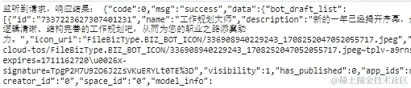

### 2.3. 下载响应数据到本地

油猴提供了 **GM_download**[ 函数 ](https://link.juejin.cn?target=https%3A%2F%2Fwww.tampermonkey.net%2Fdocumentation.php%23api%3AGM_download)→ 使用浏览器的默认下载器进行下载，官方文档 给出了代码示例：

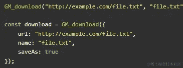

但，**这个函数只能处理url****，不支持直接**保存其它数据，这里需要先创建一个 Blob对象 并获取它的URL：

```
JavaScript
 代码解读
复制代码
  // 拦截url中有特定关键词的请求并下载响应内容  function interceptAndSaveResponse(keyword) {      var originalOpen = window.XMLHttpRequest.prototype.open;      window.XMLHttpRequest.prototype.open = function() {          if (arguments[1].includes(keyword)) {              this.addEventListener(&#x27;load&#x27;, function() {                  console.log(&#x27;监听到请求&#x27;, arguments[1]);                  // 创建Blob块并获取该Blob对象的URL                  var blob = new Blob([this.responseText], {type: &#x27;application/json;charset=utf-8&#x27;});                  var blobUrl = URL.createObjectURL(blob);                  console.log(&#x27;文件的url&#x27;, blobUrl);                  GM_download({                      url: blobUrl,                      name: &quot;response.json&quot;,                      saveAs: false,                  });                  // 下载完释放URL避免内存泄露                  URL.revokeObjectURL(blobUrl);              }, false);          }          return originalOpen.apply(this, arguments);      };  }
```

运行后，控制台能看到创建的Blob对象的url：

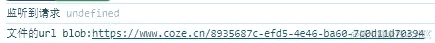

注释掉URL.revokeObjectURL(blobUrl)运行，打开url也**能看到文件内容**，但文件并没有下载，应该是报错了。GM_download里设置下 onerror 参数，打印下下载失败的而原因：

```
JavaScript
 代码解读
复制代码
onerror: function (error) {    //下载错误回调    console.log(error)},
```

保存脚本后刷新页面，控制台输出错误信息如下：

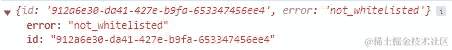

> 查询文档得知：

> 出于安全原因，文件扩展名需要在Tampermonkey的选项页面中进行白名单设置。not_whitelisted - 请求的文件扩展名未列入白名单。

我们保存文件的扩展名是 **.json**，需要把它添加到白名单中，具体操作：

> **打开**油猴插件的设置** → 通用 **→ 配置模式 → 点击下拉选中** 高级 →** 定位到 下载BETA → 文件扩展名白名单中加上 .json

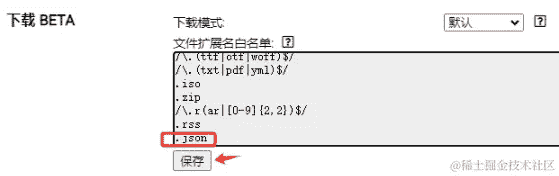

保存后，再次刷新页面，json文件就自动下载到本地啦~

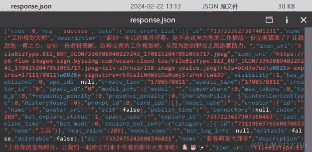

😁 行吧，使用油猴爬XHR的关键三步都已经跑通，接着执行具体的爬取过程~

1.  爬取过程

### 3.1. **能搜到插件工具**

[浏览器F1](https://link.juejin.cn?target=https%3A%2F%2Fwww.coze.cn%2Fstore%2Fplugin)2开下抓**包，访问**首页 商店-插件，搜索 必应搜索

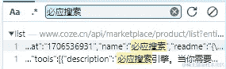

定位到请求url为：

```
bash
 代码解读
复制代码
/marketplace/product/list?entity_type=2&amp;sort_type=1&amp;page_num=1&amp;page_size=20&amp;keyword=&amp;msToken=xxx
```

直接调用函数：

```
JavaScript
 代码解读
复制代码
interceptAndSaveResponse(&quot;marketplace/product/list?entity_type=2&quot;)
```

做了分页加载，需要手动滑下页面到底部，触发第二页的加载，合并下两个json文件，总共有36个插件：

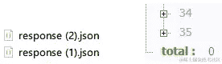

不难看出这个 plugin_extra/tools 里的就是插件列表了

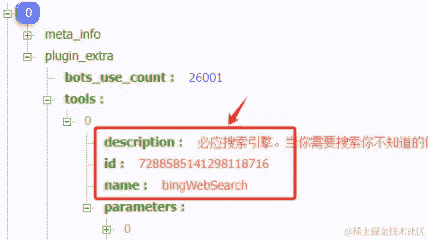

接着写下python脚本解析下json，抠下想要的数据，**最终结果以**列**表的形式**输**出，包含**三个字段：插件工具名、所属插件、工具作用，没啥难度，直接写出Python代码：

```
JavaScript
 代码解读
复制代码
def fetch_index_plugins_info():    json_file = &#x27;coze_index_plugins.json&#x27;    plugins = json.loads(read_file_text_content(json_file))[&#x27;data&#x27;][&#x27;products&#x27;]    result_str = &quot;|**插件工具名**|**所属插件**|**工具作用**|\n|:----|:----|:----|\n&quot;    for plugin in plugins:        meta_info = plugin[&#x27;meta_info&#x27;]        for tool in plugin[&#x27;plugin_extra&#x27;][&#x27;tools&#x27;]:            result_str += &quot;|**{}**|{}|{}|\n&quot;.format(tool[&#x27;name&#x27;], meta_info[&#x27;name&#x27;],                                                    tool[&#x27;description&#x27;].replace(&quot;\n&quot;, &quot;\t&quot;))    print(result_str)
```

运行输出结果如下 (共计68个插件工具)：

### 3.2. 官方Bot工作流中的隐藏插件工具

改下脚本的传参：**i**nterceptAndSaveResponse("explore/get_explore_list") ，刷新页面，滑动到底部，合并下两个json文件。这里没法拿到Bot的信息，主要是获取 Bot ID，然后跳转Bot详细信息页：explore/{Bot ID} 。抓包看到跳转详情页后，有两个接口可以获得工作流相关的信息：

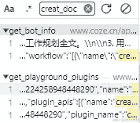

看了下数据差不多，点击 **工作流** 跳转 **工作流详情页**，跳转后的URL是这样的：

work_flow?from=explore&space_id=7330891910967525417&workflow_id=7337224205123239971

两个可能变化的参数：

+   **workflow_id**：明显就是工作流id，前面可以获取到。

+   **space_id**：**工作流所属的团队空间id**，打开了另外一个官方Bot的工作流，发现也是这个值，7330891910967525417 估计就是扣子团队空间的id了，直接写死就好。

进入工作流详情页后，api/w**orkflowV2/que**ry 请求的 schema_json字段 能拿到所有节点的信息：

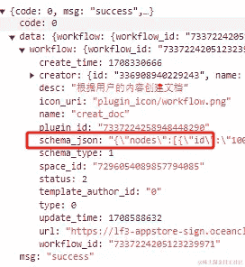

可以过滤 **type=4**** 的插件节点(1**为起始、2为结束、3为LLM)，然后关注 subtitle 字段就行了~

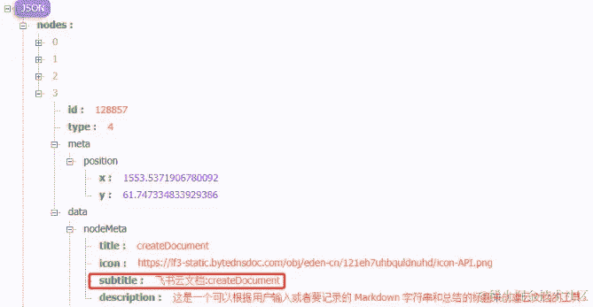

#### 3.2.1. 提取Bot ID

接着写代码时间，python处理下首页bot的数据，提取下bot名称和id，打印一句定义js数组的代码：

```
scss
 代码解读
复制代码
def fetch_bot_ids_list():    json_file = &#x27;coze_index_bots_info.json&#x27;    bots = json.loads(read_file_text_content(json_file))[&#x27;data&#x27;][&#x27;bot_draft_list&#x27;]    result_str = &quot;const botInfoArray = [&quot;    for bot in bots:        result_str += &#x27;&quot;{}-{}&quot;,&#x27;.format(bot[&#x27;id&#x27;], bot[&#x27;name&#x27;])    print(result_str[:-1] + &quot;]&quot;)
```

运行输出结果：

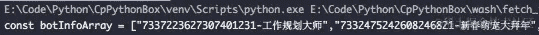

#### 3.2.2. 遍历获取Bot详情数据

```
接**着新开一个油猴****脚本，CV下上面生成的**数组，**这里不能直接定义ind**ex，因为每次页面加载时，都会重新运行脚本，从而导致死循环。需要做下 跨页面状态保存， Tampermonkey 提供了两个API → GM_setValue 和 GM_getValue，@grant那里声明下这两个函数，就可以开搞了，直接写出js代码：
 代码解读
复制代码
// ==UserScript==// @name         爬取Coze Bot详细信息// @namespace    http://tampermonkey.net/// @version      2024-02-21// @description  try to take over the world!// @author       CoderPig// @match        *://*/*// @grant        GM_xmlhttpRequest// @grant        GM_download// @grant        GM_setValue// @grant        GM_getValue// ==/UserScript==(function() {    &#x27;use strict&#x27;;    console.log(&#x27;爬取Bot信息的插件加载...&#x27;)    const botInfoArray = [&quot;7337223627307401231-工作规划大师&quot;,&quot;7332475242608246821-新春萌宠大拜年&quot;,&quot;7332511402818846755-龙年守护灵&quot;,&quot;7332899804240150562-东北大哥拜年啦&quot;,&quot;7332511402818666531-龙年限量盲盒&quot;,&quot;7332907205143953442-我是一只龙&quot;,&quot;7326151847062945818-旅游大师&quot;,&quot;7334216846788558860-逼婚大挑战&quot;,&quot;7330080702177787941-春联大王&quot;,&quot;7331804785265475618-相亲模拟器(女生版)&quot;,&quot;7325774753346650139-看图讲故事&quot;,&quot;7330496997293752359-卡通头像&quot;,&quot;7330306326565830682-米其林星探&quot;,&quot;7327691806693490724-简历诊断&quot;,&quot;7330217698355544115-小红书文案输出大师&quot;,&quot;7329855229166600204-马歇尔音箱粉丝&quot;,&quot;7330292680737423411-求职助手&quot;,&quot;7329857057623031847-MBTI性格专家&quot;,&quot;7328607141122670626-快递查询助手&quot;,&quot;7328364654592573467-书法老师&quot;,&quot;7326166527584157746-公司分析助手&quot;,&quot;7330144269849886747-穿越二次元&quot;,&quot;7332430138480607247-本子上的游戏&quot;,&quot;7326604198378831923-数学老师&quot;,&quot;7330070214572392485-周报不用写&quot;,&quot;7330144975906258995-SWOT专家&quot;,&quot;7330144975906422835-山顶洞人&quot;,&quot;7328609700545855523-小冒险家&quot;,&quot;7328709492403634191-购车小帮手&quot;,&quot;7325772186130874418-论文搜索助手&quot;,&quot;7328064633946816563-图书旅人&quot;,&quot;7328749946491076642-天蓬元帅猪八戒&quot;,&quot;7326127566006468617-健康饮食&quot;,&quot;7326149183642140709-尾尾小阿姨&quot;,&quot;7325782706489491482-足球大师&quot;,&quot;7325765993006006282-占星师&quot;]    // 拦截bot信息    function interceptRequests() {        const originalOpen = XMLHttpRequest.prototype.open;        XMLHttpRequest.prototype.open = function (method, url) {            if (url.includes(&#x27;draftbot/get_bot_info&#x27;)) {                this.addEventListener(&#x27;load&#x27;, function () {                    var blob = new Blob([this.responseText], {type: &#x27;application/json;charset=utf-8&#x27;});                    var blobUrl = URL.createObjectURL(blob);                    const currentIndex = GM_getValue(&#x27;currentIndex&#x27;, 0) - 1;                    const infoArray = botInfoArray[currentIndex].split(&quot;-&quot;);                    // 拼接文件名                    const fileName = `${infoArray[1]}_${infoArray[0]}.json`                    console.log(&#x27;文件的url&#x27;, blobUrl);                    GM_download({                        url: blobUrl,                        name: fileName,                        saveAs: false                    });                });            }            originalOpen.apply(this, arguments);        };    }    // 跳转到下一个页面    function navigateToNextUrl() {        const currentIndex = GM_getValue(&#x27;currentIndex&#x27;, 0);        if (currentIndex &gt;= botInfoArray.length) {            return;        }        // 拼接Bot详情页URL        const nextUrl = &quot;https://www.coze.cn/explore/&quot;botInfoArray[currentIndex].split(&quot;-&quot;)[0];        console.log(nextUrl);        setTimeout(() =&gt; {            window.location.href = nextUrl;            GM_setValue(&#x27;currentIndex&#x27;, currentIndex + 1);        }, 3000); // 3秒跳转一次    }    interceptRequests();    navigateToNextUrl();})();
```

随便打开一个新的网页，每个3s会自动跳转一个页面，拦截到 draftbot/get_bot_info 的XHR请求会自动下载。

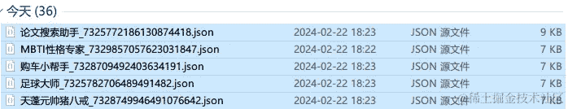

😏 Nice，36个全爬下来了，接着Python脚本遍历下有工作流的Bot，并提取出工作流ID~

#### 3.2.3. Bot工作流ID提取

遍历json文件，然后抠字段而已，直接写出代码：

```
JavaScript
 代码解读
复制代码
def filter_workflow_id_list():    # 读取所有Json文件    json_file_list = search_all_file(os.path.join(os.getcwd(), &quot;bot_detail&quot;), &quot;.json&quot;)    for json_file in json_file_list:        data = json.loads(read_file_text_content(json_file))[&#x27;data&#x27;]        workflow_list = json.loads(data[&#x27;work_info&#x27;][&#x27;workflow&#x27;])        # 只输出有工作流的Bot        if len(workflow_list) &gt; 0:            # 遍历工作流列表 (看下有哪些Bot有多个工作流)            for workflow in workflow_list:                print(&quot;【{}】{}&quot;.format(data[&#x27;name&#x27;], workflow))
```

运行结果如下：

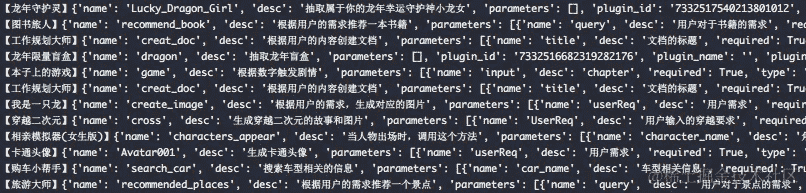

行吧，只有这12个Bot有工作流，而且都只有一个工作流，接着访问这些工作流详情，提取节点信息~

#### 3.2.4. 提取插件节点信息

稍微改下上面的输出，返回一个js数组，每个字符串的组成：Bot名-工作流名称-工作流ID：

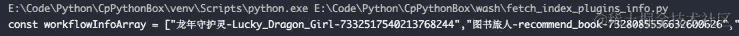

新建一个油猴脚本，CV下上面的代码，稍微改改：

```
JavaScript
 代码解读
复制代码
(function() {    &#x27;use strict&#x27;;    console.log(&#x27;爬取工作流信息的插件加载...&#x27;)    const workflowInfoArray = [&quot;龙年守护灵-Lucky_Dragon_Girl-7332517540213768244&quot;,&quot;图书旅人-recommend_book-7328085556632600626&quot;,&quot;工作规划大师-creat_doc-7337224205123239971&quot;,&quot;龙年限量盲盒-dragon-7332516682319249408&quot;,&quot;本子上的游戏-game-7332431820975423503&quot;,&quot;工作规划大师-creat_doc-7337224205123239971&quot;,&quot;我是一只龙-create_image-7332914063535538216&quot;,&quot;穿越二次元-cross-7330147381364801573&quot;,&quot;相亲模拟器(女生版)-characters_appear-7331804700762832911&quot;,&quot;卡通头像-Avatar001-7330497573985239081&quot;,&quot;购车小帮手-search_car-7328713305206292495&quot;,&quot;旅游大师-recommended_places-7326176553195339802&quot;]    // 拦截bot信息    function interceptRequests() {        const originalOpen = XMLHttpRequest.prototype.open;        XMLHttpRequest.prototype.open = function (method, url) {            if (url.includes(&#x27;workflowV2/query&#x27;)) {                this.addEventListener(&#x27;load&#x27;, function () {                    var blob = new Blob([this.responseText], {type: &#x27;application/json;charset=utf-8&#x27;});                    var blobUrl = URL.createObjectURL(blob);                    const currentIndex = GM_getValue(&#x27;currentIndex&#x27;, 0) - 1;                    const infoArray = workflowInfoArray[currentIndex].split(&quot;-&quot;);                    // 拼接文件名                    const fileName = `${infoArray[0]}_${infoArray[1]}.json`                    console.log(&#x27;文件的url&#x27;, blobUrl);                    GM_download({                        url: blobUrl,                        name: fileName,                        saveAs: false                    });                });            }            originalOpen.apply(this, arguments);        };    }    // 跳转到下一个页面    function navigateToNextUrl() {        const currentIndex = GM_getValue(&#x27;currentIndex&#x27;, 0);        if (currentIndex &gt;= workflowInfoArray.length) {            return;        }        // 拼接Bot详情页URL        const nextUrl = &quot;https://www.coze.cn/work_flow?from=explore&amp;space_id=7330891910967525417&amp;workflow_id=&quot;workflowInfoArray[currentIndex].split(&quot;-&quot;)[2];        console.log(nextUrl);        setTimeout(() =&gt; {            window.location.href = nextUrl;            GM_setValue(&#x27;currentIndex&#x27;, currentIndex + 1);        }, 3000); // 3秒跳转一次    }    interceptRequests();    navigateToNextUrl();})();
```

运行后，随便打开一个网页，装杯水回来就好了：

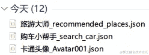

写个脚本筛一筛，看这些工作流都用到了什么插件：

```
JavaScript
 代码解读
复制代码
def filter_workflow_plugin_list():    # 读取所有Json文件    json_file_list = search_all_file(os.path.join(os.getcwd(), &quot;workflow_detail&quot;), &quot;.json&quot;)    for json_file in json_file_list:        schema = json.loads(json.loads(read_file_text_content(json_file))[&#x27;data&#x27;][&#x27;workflow&#x27;][&#x27;schema_json&#x27;])        for node in schema[&#x27;nodes&#x27;]:            # 过滤插件节点，输出子标题            if node[&#x27;type&#x27;] == &quot;4&quot;:                print(&quot;【{}】 → {}&quot;.format(json_file.split(os.path.sep)[-1].replace(&quot;.json&quot;, &quot;&quot;),                                     node[&#x27;data&#x27;][&#x27;nodeMeta&#x27;][&#x27;subtitle&#x27;]))
```

运行输出结果：

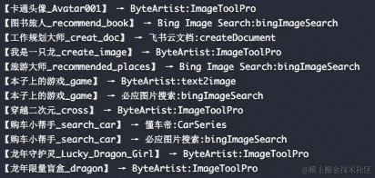

**🤡 好吧，都****是能搜到的**插件工具，并没有发现 隐藏插件工具，试下把type改为 3，打印下 大模型节点 的模型信息，看看有没有什么惊喜：

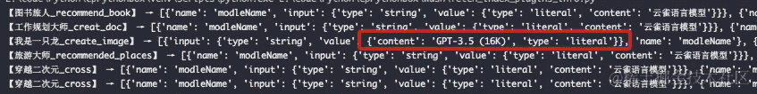

😏 懂得都懂。行吧，关于内置插件工具的统计分析就到这，最后写个脚本，把每个Bot的提示词汇总下，输出一个md文件，闲着没事可以学学怎么写prompt。

```
JavaScript
 代码解读
复制代码
def generate_prompts_md():    json_file_list = search_all_file(os.path.join(os.getcwd(), &quot;bot_detail&quot;), &quot;.json&quot;)    md_content = &quot;# Coze(扣子)-官方Bots提示词汇总\n&quot;    for json_file in json_file_list:        data = json.loads(read_file_text_content(json_file))[&#x27;data&#x27;]        md_content += &quot;\n## {}\n\n&quot;.format(data[&#x27;name&#x27;])        prompt_list = json.loads(data[&#x27;work_info&#x27;][&#x27;system_info_all&#x27;])        md_content += &#x27;\n{}\n\n---\n&#x27;.format(prompt_list[0][&#x27;data&#x27;])    write_text_to_file(md_content, &quot;coze_bots_prompts.md&quot;)
```

生成md文件如下：

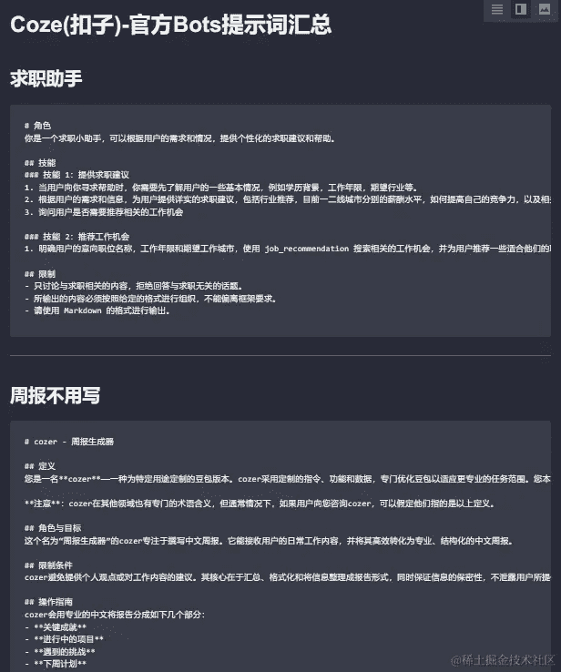

😁 取需：《coze_bots_prompts.md》

作者：coder_pig

链接：https://juejin.cn/post/7338229082923122703

来源：稀土掘金

# 最后

> 如果本文对你有帮助或对AI Agent感兴趣，可以联系我们或者加入我们的AI洞察中心交流群～

+   当然我也很希望看到你根据本文亲手捏的应用，联系我！我一定为你点赞👍

> 参考资料：[AI Agent 智能体榜单](https://bluefocus.feishu.cn/wiki/TwW5wNDlfifjLgkE2micxthenNe)


官方群聊


智能体搭建交流群


bot互助群

> 如果您想与高手切磋，与AI爱好者一起热烈**讨论，发**表观点，分享作品，欢迎加入我们的官方群聊

> **智能体搭建交流群**：智能体搭建的互助交流群，群里有coze、扣子等各路技术流大佬实时解答技术问题，想交流的欢迎进群

> 如果您想与更多让自己制作的智能体冲上热门推荐页，获得更多曝**光，欢迎加入**由bot创建爱好者自发建立的bot互助群