# 大语言模型（LLM）阶梯学习

> 来源：[https://bluefocus.feishu.cn/docx/YStOdhUaYo4RvVxrHkyctypHncg](https://bluefocus.feishu.cn/docx/YStOdhUaYo4RvVxrHkyctypHncg)

# AI大模型

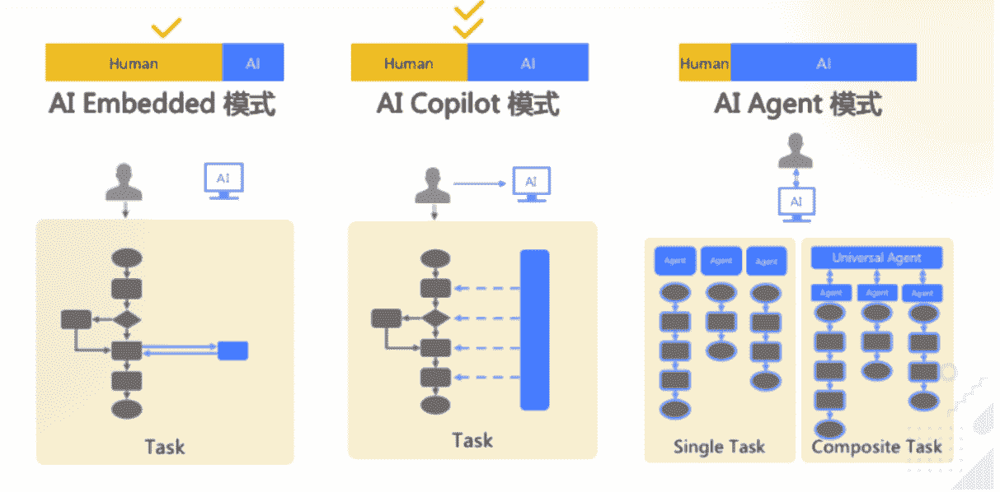

**大模型能干什么？**

大模型，全称「大语言模型」，英文「Large Language Model」，缩写「LLM」。例如以下这些都是目前访问量较高的大语言模型，我们能够看到越来越多的头部公司、创业公司开始布局大模型，给大家放了访问地址，大家可以自行体验：

ChatGPT：https://chatgpt.com/

Bing Chat：https://www.bing.com/

文心一言：https://yiyan.baidu.com/

讯飞星火：https://xinghuo.xfyun.cn/

智谱清言：https://chatglm.cn/

> 推荐视频:

> [速通AI大模型原理](https://www.bilibili.com/video/BV17t4218761/?vd_source=3cc4af77a2ef185635e8097d3326c893)

> 大语言模型介绍原理视频(李宏毅)

# LLM概述

大语言模型（Large Language Model, LLM）是一种具有许多参数的人工神经网络构成的模型，不熟悉神经网络的读者可以看下面一篇回答，对于神经网络这里就不再赘述：

机器学习，深度学习，神经网络，深度神经网络之间有何区别？

大语言模型通常指的就是这些参数量在成亿的深度学习模型，并且这些模型是通用的，在多个基准测试（benchmark）上都表现出色，并不止对一个特定任务有效。并且通常它们的训练方式是自监督或者半监督的。

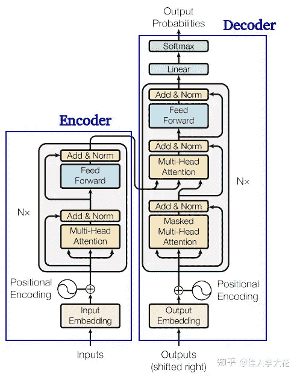

## LLM的能力

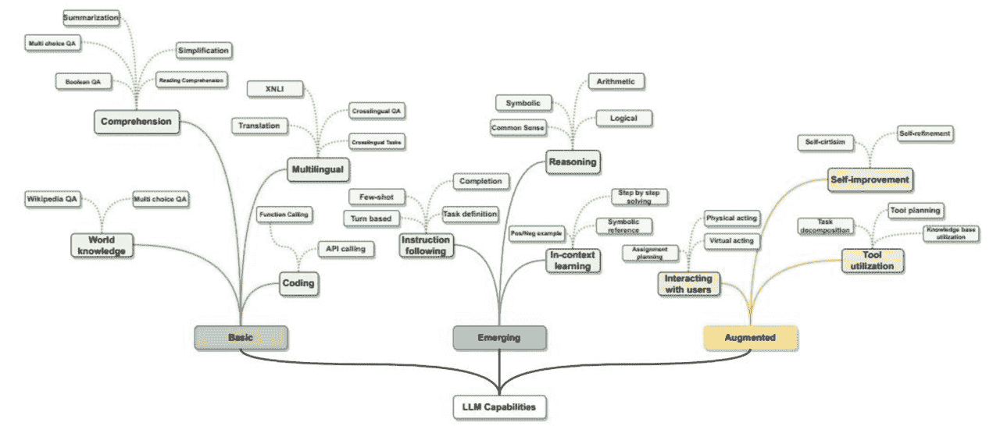

+   比如说几乎所有大模型都具备的基本能力：

+   语言理解能力，如维基百科问答、布尔问答、多选题等任务；

+   语言生成能力，如文本简化、摘要、问题生成等；

+   跨语言能力，如机器翻译、跨语言问答等。

+   还有不少扩展能力：

+   世界知识：很多大模型可以利用其储备的背景知识来回答问题，无需额外提供知识。

+   工具使用：大模型可以学会使用外部工具，如计算器、搜索引擎等，拓展其能力边界。

+   少样本学习：大模型展现出了强大的少样本学习能力，可以从寥寥几个示例中学习新任务。

+   指令遵循：经过指令微调后,大模型可以遵循自然语言指令执行任务。

+   此外，还有一些新兴的前沿能力：

+   推理能力，包括逻辑推理、符号推理、常识推理、算术推理等；

+   任务规划和分解能力与用户交互的能力与外部环境交互的能力，如对虚拟或现实环境采取相应的行动自我修正和迭代优化的能力

当然，目前这些能力还并不完善，其中只有推理能力可以初窥门径，任务规划、环境交互、自我迭代则是通向通用人工智能（AGI）的一些必经之路，仍然有很长的探索之路要走。

> 详细介绍：https://zhuanlan.zhihu.com/p/645045642

## LLM as Controller

ChatGPT、GPT-4等LLM模型最强的能力其实是语言理解力，不需要让一个LLM做任何事情，只需要它能够准确无误的理解人类说的语言，再按照人类的语言去执行对应的任务即可。假如LLM的理解能力可以达到100分，那么只需要准确无误的调取最精确的工具就可以解决任何问题。

**上述处理任务的流程总结为以下这个过**程，LLM在这个流程中实际上充当的是Controller的角色，或者说是大脑。

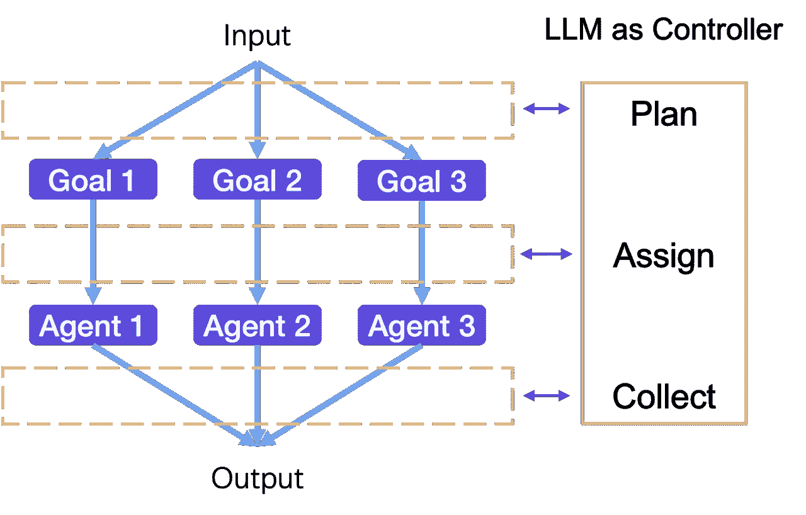

任何复杂任务都可以包含在上述流程之中，给定一个输入(包含需要做的事情以及条件)，就能通过LLM控制一系列的agent来达成目标，并且得到输出结果。并且agent的数量和多样性是可以无限拓展的，假设LLM的语言理解能力是100分，那么就可以无限拓展LLM的能力边界。另外从算法的角度来理解，plan其实就是split，collect其实就是merge，整个流程就是分治思想的集中体现。

其中从Input到Output会进行3层处理，第一层会对输入目标进行拆解，并且得到一系列有顺序的目标，第二层会对每个子目标安排最合适的agent来进行处理，第三层会对所有的agent得到的结果进行汇总整合。其中agent可以理解为各种能力，可以是模型，可以是网页，也可以是工具，其中LLM作为这3层的总控制，去理解input的含义，并且给出最优的plan、assign和collect的处理。这个过程像极了一个庞大的组织架构的正常运转。

有了上述统一的概念理解之后，下文对最近最流行的LLM as Controller的项目做一个拆解，不同项目的主要差别在于LLM as Controller的逻辑以及各个专项Agent的能力，主要包含Visual ChatGPT、HuggingGPT、Toolformer、AutoGPT等项目。

### 项目拆解

#### Visual ChatGPT

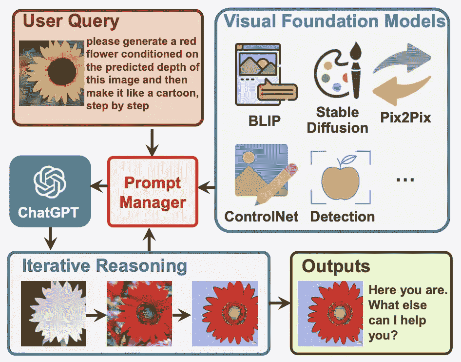

实际上Visual ChatGPT的agent的范围是各种视觉的Foundation Models。

Visual ChatGPT实际上是最简单的一种LLM as Controller的项目，范围仅限于Visual Foundation Models，这种形态的项目，虽然能力边界小，但是LLM的负担是最轻的，每一个步骤以及流程是更加的可控，可能总共就只需要十几二十个流程。未来这种形态的工具或者产品对于各种垂直领域来说可能是更为常见的。

#### HuggingGPT

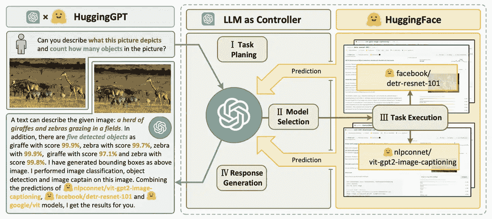

实际上HuggingGPT的agent的范围是huggingface所有模型。

HuggingGPT将LLM as Controller整个过程总结为4步：

+   任务规划：利用ChatGPT分析用户的请求，了解用户的意图，通过提示分解成可能解决的任务。

+    模型选择：为解决计划任务，ChatGPT 根据模型描述选择托管在Hugging Face 上的专家模型。

+   任务执行：调用并执行每个选定的模型，并将结果返回给ChatGPT。

+   生成结果：最后，使用ChatGPT整合所有模型的预测，为用户生成答案。

HuggingGPT的模式可控性也比较高，而且模型都是放在HuggingFace上进行托管的，输入输出的形式上也是一致的，用户使用以及代码维护都更为方便一些。

#### Toolformer

实际上Toolformer的agent的范围是各种外部工具。

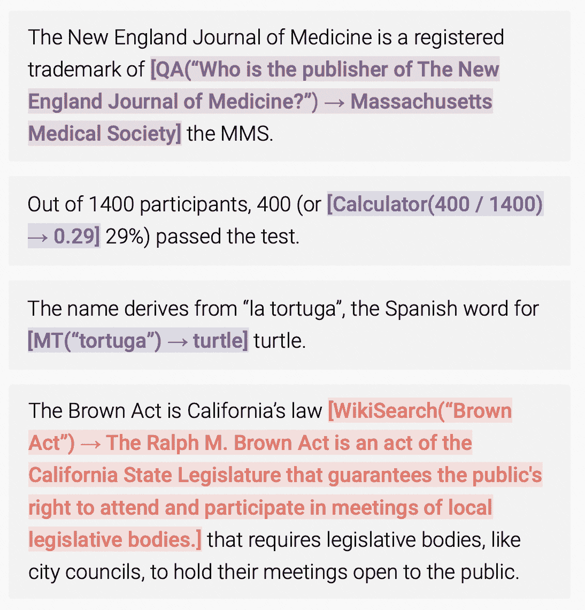

上图中是Toolformer一种典型的用法，Toolformer可以自主决定调用不同的 API（从上到下：问答系统、计算器、机器翻译系统和维基百科搜索引擎）以获取对完成一段文本有用的信息。这个工作实际上也为后续的AutoGPT和BabyAGI等项目提供了灵感。

#### AutoGPT

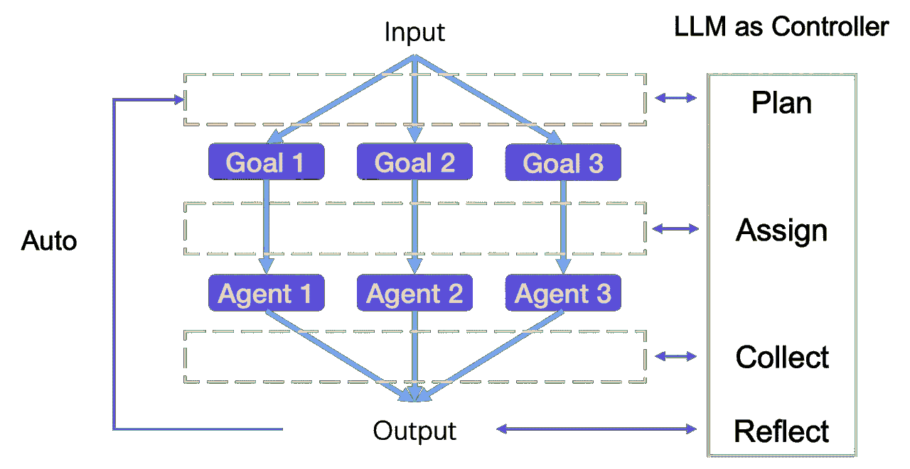

AutoGPT其实就是在上述的基础之上，通过LLM反思input->plan->assign->collect->output整个过程，并且重新规划plan，从而产生一直迭代的auto效果。从外部的表现形式上来看，整个系统不断的交替进行plan和reflect，已经出现了自我思考自我迭代的过程。这实际上已经到了autonomous agents的范畴了。

实际上AutoGPT的agent的范围就是各种网页以及各种工具。

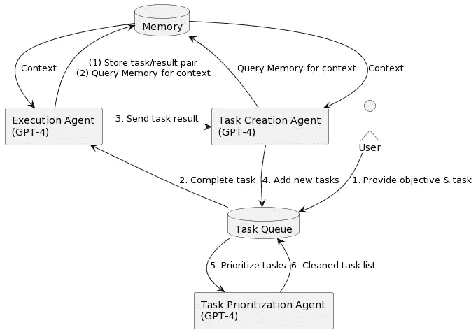

上述流程图来自BabyAGI，下面举一个简单的例子来阐述Autonomous Agent的思想：

假设有一个可以帮助研究的autonomous agent，并且我们想要关于某个主题的最新消息的总结，比如说“关于 Twitter 的新闻”，我们告诉agent你的目标是找出有关 Twitter 的最新消息，然后向我发送摘要”。

1.  agent查看目标，使用 OpenAI 的 GPT-4 等LLM模型，使其能够理解正在阅读的内容，并提出第一个任务。 “任务：在谷歌上搜索与 Twitter 相关的新闻”。

1.  然后agent在谷歌上搜索 Twitter 新闻，找到热门文章，并返回一个链接列表。 第一个任务完成。

1.  现在agent回顾它的主要目标（找到关于 Twitter 的最新消息，然后发送摘要）和它刚刚完成的事情（得到一堆关于 Twitter 的新闻链接）并决定它的下一个任务需要是什么 .

1.  agent提出了两个新任务。 1）写新闻摘要。 2) 阅读通过谷歌找到的新闻链接的内容。

1.  现在agent在继续之前停止了一秒钟，它需要确保这些任务的顺序正确。 真的应该先写摘要吗？ 不，它决定了最优先阅读通过google找到的新闻链接的内容。

1.  agent从文章中读取内容，然后再次返回待办事项列表。 它想添加一个新任务来总结内容，但该任务已经在待办事项列表中，所以它没有添加它。

1.  agent检查待办事项列表，唯一剩下的项目是总结它阅读的内容，所以它这样做了。 它会按照您的要求向您发送摘要。

目前autonomous agent还比较初级，因为agent的范围太大了，无边无际，非常的不可控，但是这个概念非常的强大，随着不断的发展和实验，未来会慢慢的融入我们的日常生活。

### 系统稳定性

上文的阐述中都是基于假设LLM语言理解能力为100分的情况，能力边界是可以无限拓展的，但事实上LLM仍然会存在一定的事实性错误。这会影响整个系统的稳定性，并且稳定程度取决于LLM的语言理解能力，以及各个Agent的专项能力。

另外值得注意的是，goal之间、agent之间可以引入相互影响，但是个人认为这样子会使得不同流程的处理变的更加复杂，整个系统的稳定性会下降不少。

### 自然语言编程

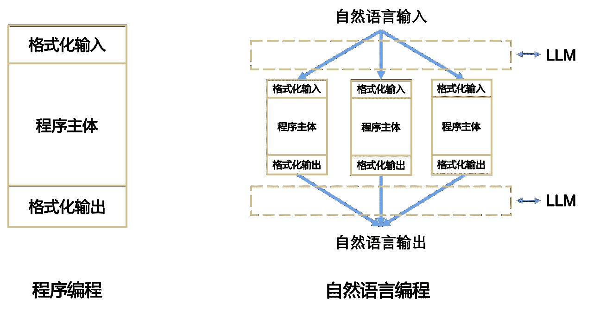

以往的编程方式通常是左边这张图的形式，规范好函数的格式化输入和格式化输出，程序主体可以执行特定的功能，而随着LLM的能力不断增强，事实上未来会发生右图编程形态的转变，自然语言输入通过LLM并行控制多个函数的调用，并且通过LLM将多个函数的调用结果进行总结，最终返回自然语言输出，而LLM在其中的执行方式通常是通过Prompt的形态来执行的，Prompt也是自然语言，这个过程可以认为是自然语言编程。

并且其中的格式化输入、格式化输出以及简单的程序主体通常是标准化的，LLM也可以同时去做所有的标准化任务，未来人类可能只需要编写复杂的、非标准化的程序主体。换句话说，LLM可以用自然语言编程的方式去统一所有标准化的内容。右图中的橙色部分可能都会变成自然语言编程的一部分。

### AI操作系统的雏形

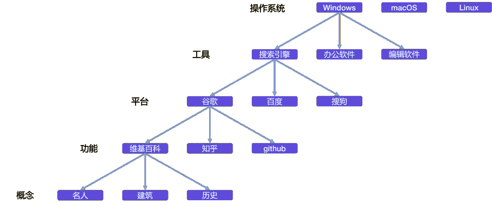

首先从原来的Windows/macOS/Linux等操作系统的模式说起，比如Windows操作系统上可能有搜索引擎/办公软件/编辑软件等等，然后搜索引擎有谷歌/百度/搜狗等等，谷歌可以搜索到维基百科/知乎/github等等网站，维基百科可以找到名人/建筑/历史等信息。上图的划分方式是为了下文阐述的简化表达。

+   办公软件比如office全家桶，office全家桶有ppt、word等等，ppt里面又有很多功能点。

+   编辑软件比如adobe全家桶，adobe全家桶有PS、AE、AI等等，PS里面又有很多功能点。

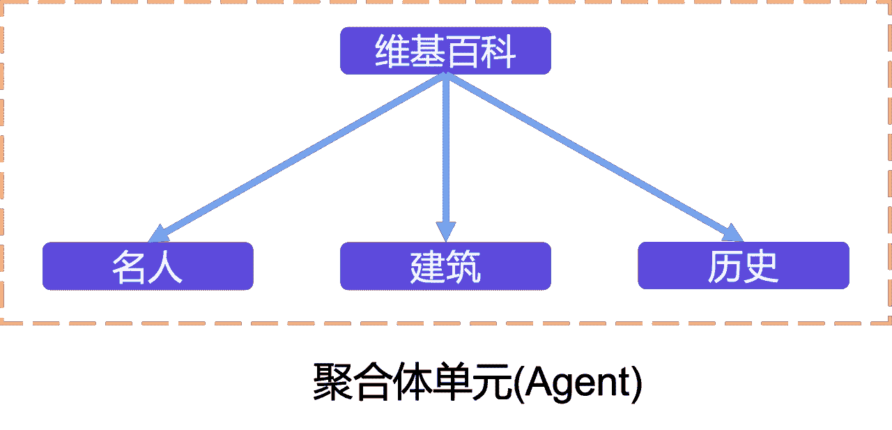

其中每个分叉都可以认为是一个聚合体单元，其实就是对应最开始描述框架下的Agent，只不过Agent在不同层次的概念粒度以及复杂程度是不同的。比如上图中的维基百科就可以认为是各种概念信息的聚合体。

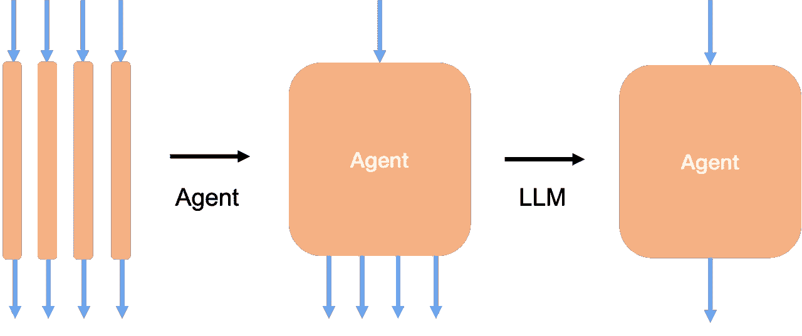

在搜索**引擎出**现之前，人们找需要的信息时，需要从对应的网站找对应的信息，这是多个输入对应多个输出的情况；而搜索引擎就是通过更强大的搜索算法对各种网站进行了聚合，即出现了更大概念的Agent，这个时候输入口变成了1个，但是输出仍然需要跳转到各个网站上去获取；而LLM的出现会使得输入输出都变成1个口，并且对输入的精确表达程度要求更低。从这个演化过程来看，LLM会导致完全统一输入输出的Agent的出现，这个时候用户可以无需关心Agent内部的具体构造(即Agent内部完全黑盒化，由LLM自己决策中间过程)，只需要输入并获取想要的输出。

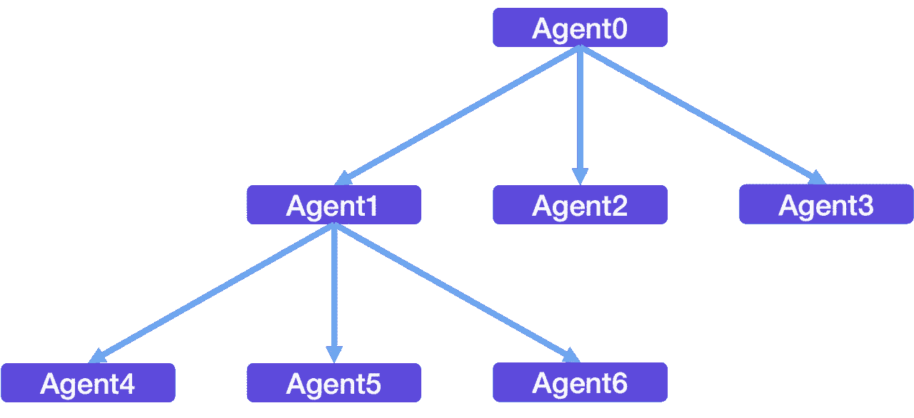

从上述Agent单元的阐述来看，Windows/macOS/Linux等操作系统都可以简化成上图，即不同概念粒度Agent组成的多层Agent树。每个概念粒度的Agent都会逐渐标准化。从Agent的角度来看，HuggingGPT、Visual ChatGPT实际上就是模型管理功能的Agent。

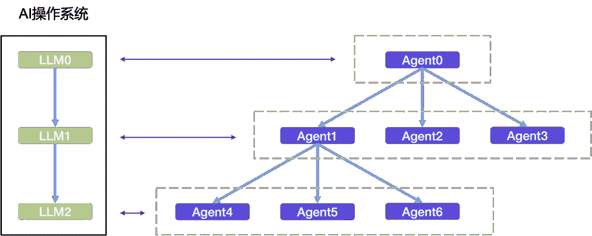

如果在每一层或者每一个Agent单元配备一个LLM作为控制器，并且所有LLM都是信息互通的，并且LLM的语言理解能力是100分，那么可能就会出现真正的AI操作系统。通过AI操作系统中的所有LLM联动控制，可以将一个复杂任务拆分成不同层次的子任务，然后通过所有的Agent联动处理，最后输出想要的结果。

Windows/macOS/Linux等操作系统通过程序编程给出UI界面，然后用户通过鼠标点击和UI界面进行交互完成工作；而AI操作系统可能会变成只需要理解用户的语言就能完成工作。这个转变可能会导致鼠标点击和UI界面进行交互的方式可能会变得越来越冗余。

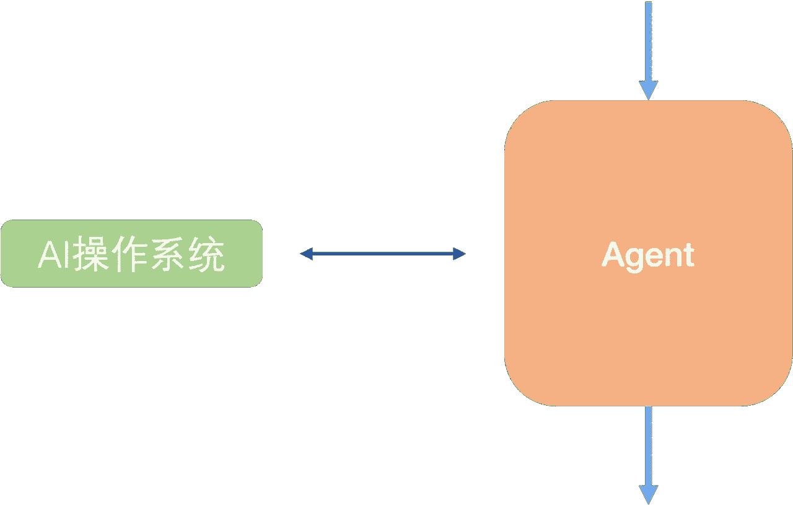

如果AI操作系统只需要理解用户的语言就能完成工作，那么所有不同粒度的Agent就能看成一个黑盒子(因为中间的所有决策环节都由LLM决定了)，即一个最大聚合体Agent，而它的内核就是AI操作系统。

从AI操作系统的角度来看，实际上AutoGPT试图自顶向下的构建最大范围的Agent，正是因为范围过于广阔，导致中间过程非常的不可控；而类似HuggingGPT、Visual ChatGPT更倾向于自底向上搭建更可控的Agent，Agent能做的事情都是事先知道的。

### Reference

> https://zhuanlan.zhihu.com/p/626736120

> [https://www.mattprd.com/p/the-compl](http://www.mattprd.com/p/the-complete-beginners-guide-to-autonomous-agents)ete-beginners-guide-to-autonomous-agents

> [t](https://zhuanlan.zhihu.com/p/624182268)hinkthinking：NexusGPT——目前为止看到的最有创意的Autonomous Agents类项目！附该领域进展概览

> 字节：AutoGPT与LLM Agent解析

> [BabyAGI](http://yoheinakajima.com/task-driven-autonomous-agent-utilizing-gpt-4-pinecone-and-langchain-for-diverse-applications/)

> [Toolformer](https://arxiv.org/abs/2302.04761)

> [NexusGPT](https://link.zhihu.com/?target=https%3A//nexus.snikpic.io/)

> Generative Agents

> [Visual ChatGPT](https://arxiv.org/abs/2303.04671)

> [HuggingGPT](https://arxiv.org/abs/2303.17580)

> [AutoGPT](https://github.com/Significant-Gravitas/AutoGPT)

## LLM未来研究方向

未来大模型研究的一些重要方向可能包括：

+   更小更高效的语言模型。虽然目前的发展趋势是模型越来越大，很多人“迷信”模型越大，参数越多，性能越好，但随之而来的，却是超高的训练和使用成本。未来一个方向或许是研究如何在保持性能的同时压缩模型体积，提高效率，其中知识蒸馏等技术或将扮演重要角色。

+   超越attention的新型架构。Transformer的attention机制虽然强大，但在处理长文本时却出现效率较低等问题。因此势必要探索新的更有效的机制，来高效的建模长距离依赖。目前已经有一些新的尝试，包括S4，Mamba等架构。

+   多模态大模型。未来大模型不仅需要流畅的处理文本，肯定还要满足流畅的处理图像、视频、语音等多种形态数据的需求，这将极大拓展大模型的应用场景。但是从Sora直到现在仍然不能公测也可以推断，多模态模型对于资源和能源的需求恐怕大到难以想象。

+   改进大模型的使用方法及扩展技术。时至今日，大模型仍然有很多局限性，比如如何解决顽固的幻觉问题，以及如何更好的将大模型用于下游任务，仍然需要大量的研究。提示工程、知识检索、工具使用等领域都有很多工作可以做，基于大模型的智能体研究终会走向通用人工智能。

仅仅发展了短短时间的大模型已经给了我们很多震撼，未来到底会发展到怎样的程度真的很难预测。绘画生成模型的“现世”，让不少小画师心有惴惴，生怕自己哪天被AI淘汰；Suno的惊讶让200多位“音乐人”联合发信抵制。但是不管多么不愿意看到大模型“入侵”自己的领域，大模型的发展脚步终究是无人可以阻止的。

**作为一个普通人，我们能做的就是努力跟上时代，跟上大模型发展的步伐，当大模型**来到面前的那一天，努力的应用它，让它成为自己的助手，而不是成为它的“手下败将”。

# 前导知识

## python学习

> 首先要先对python有一个大体的了解，至少要能看懂代码是什么，对应哪个步骤

> 10 段代码，学会基础 python

> 在深入学习 AI 时，许多朋友发现需要编程，变得头大。

> 同时，各类教程都默认了你会打命令行，导致入门十分困难。

> 鉴于此，就有了这份简明入门，旨在让大家更快掌握 Python 和 AI 的相互调用。

> 写给不会代码的你：20分钟上手 Python + AI

## 神经网络和深度学习框架

除此之外，神经网络的知识也是必须掌握的，否则不能理解大语言模型运行的内在逻辑。在前文已有对神经网络的叙述，这里也不再赘述。

那么在代码层面，必须掌握的就是神经网络的框架，比较著名的框架就有 Pytorch，Tensorflow，Caffe 等。都是目前炙手可热的深度学习框架

什么是深度学习框架，和大语言模型又有什么关系呢？

实际上深度学习框架提供了一系列的 API 和工具，用于处理神经网络结构、优化算法、数据加载等任务。每个框架都有自己的风格，下面是以构建单层的神经网络为例子，体现 Pytorch 构建神经网络和 Tensorflow 的不同：

### Pytorch 构建

```
import torch
import torch.nn as nn

# 定义单层全连接模型
class SimplePerceptron(nn.Module):
 def __init__(self, input_size, output_size):
 super(SimplePerceptron, self).__init()
        self.fc = nn.Linear(input_size, output_size)

 def forward(self, x):
 # 前向传播
 return self.fc(x)

# 创建模型实例
input_size = 10
output_size = 1
model = SimplePerceptron(input_size, output_size)

# 输入数据
input_data = torch.randn(1, input_size) # 示例输入数据

# 前向传播
output = model(input_data)

print(output)
```

### Tensorflow 构建

```
import tensorflow as tf

# 定义输入特征和输出大小
input_size = 10
output_size = 1

# 定义单层全连接模型
model = tf.keras.models.Sequential([
    tf.keras.layers.Dense(output_size, input_shape=(input_size,))
])

# 编译模型
model.compile(optimizer=&#x27;sgd&#x27;, loss=&#x27;mean_squared_error&#x27;)

# 创建示例输入数据
input_data = tf.random.normal((1, input_size))

# 前向传播
output = model(input_data)

print(output)
```

可以看见，比如全连接层的调用，就体现了两种框架的不同风格，首先是函数名，Pytorch 叫做 Linear，Tensorflow 叫做 Dense。其次就是函数参数的不同。另外，它们的前向传播的函数名也不同，Pytorch 叫做 forward，Tensorflow 叫做 call。

这只是两种框架在构建模型时候的不同，更多的还会体现在优化算法，数据读取和构建数据集上，都有所不同。二者保存模型的文件名和方式也不同，在我们调用别人训练好的预训练模型的时候，需要跟其保存时的框架相同。这就是为什么我们需要学习深度学习框架的原因。两种框架没有绝对的好坏，但是根据某调查数据，现在发表的高质量论文中，Pytorch 的比例已经超过其他框架。

## 现有大语言模型

### Transformer

Transformer 可以说是后续大语言模型的基石，Bert 和 GPT 都是其的衍生物，可以说是继承了 Transformer 不同的部分。类似于家族企业有两个继承人，每个人都分走了一部分产业。Transformer 的原结构图长这样，左边是 Encoder，右边是 Decoder：

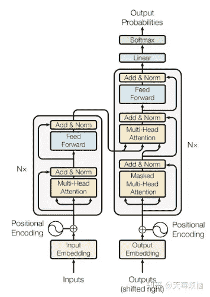

被 BERT 和 GPT 分家的情况长这样：

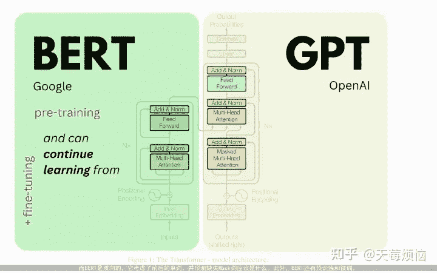

一个继承了**Encoder **部分，一个继承了** Decoder **部分。它们分别将这两个部分发扬光大了。

所以刚入门大语言模型的话，还是从这几个模型开始学起。

### 其他大语言模型

#### 为什么现在的LLM都是Decoder only的架构？

> 原文地址：https://www.zhihu.com/question/588325646/answer/3383505083

Encoder-Decoder架构和Decoder only架构的主要区别，在于它们的灵活性和专业性有所差别。

Encoder-Decoder架构通常用于处理一些需要在输入和输出间建立精确映射的任务，比如机器翻译、文本摘要是。在这类任务中，理解输入的精确内容并据此生成特定的输出是非常重要的。而基于这种架构训练出来的模型，一般只能应用于某种特定的任务，比如一个专为机器翻译训练的Encoder-Decoder模型可能不适合直接用于文本摘要或其他类型的任务。

相比之下，Decoder only架构则具有更强的灵活性。基于这种架构训练得到的模型可以处理多种不同类型的文本生成任务，如聊天机器人、内容创作、问答、翻译等等，不需要针对每一种任务进行专门的训练或调整，也不需要在输入和输出间构建严格的映射关系。

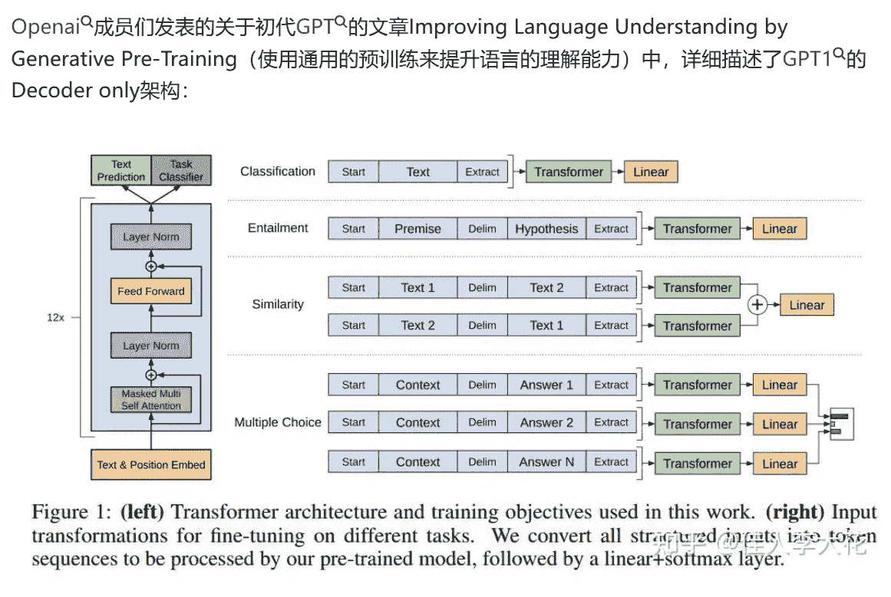

#### LLaMA

LLaMA也是 Decoder-Only 的结构，本质上也是和 GPT 一脉相承。其比上面几个模型更引人注目的地方，莫过于其数据集来源都是公开数据集，无任何定制数据集，保证了其工作的开源性和可复现性。

> 相关链接：

> Llama 3技术剖析、微调、部署以及多模态训练

> 基于 MLX 的 LLAMA2-13B 的详细分析

## 大模型库

那[么学会了构建模型，我们也](https://www.zhihu.com/search?q=hugging%20face&search_source=Entity&hybrid_search_source=Entity&hybrid_search_extra=%7B%22sourceType%22%3A%22answer%22%2C%22sourceId%22%3A3248469249%7D)需要知道去哪里下载公布的大语言模型，以及如何调用他们。这里就要介绍一个比较知名的模型库——hugging face。

在这个网站里，几乎有着你想要的所有已发布的大语言模型。在上面下载大语言模型的参数和一些必须的配置，即可轻松调用大语言模型。具体的代码实战放在最后来给大家展示。

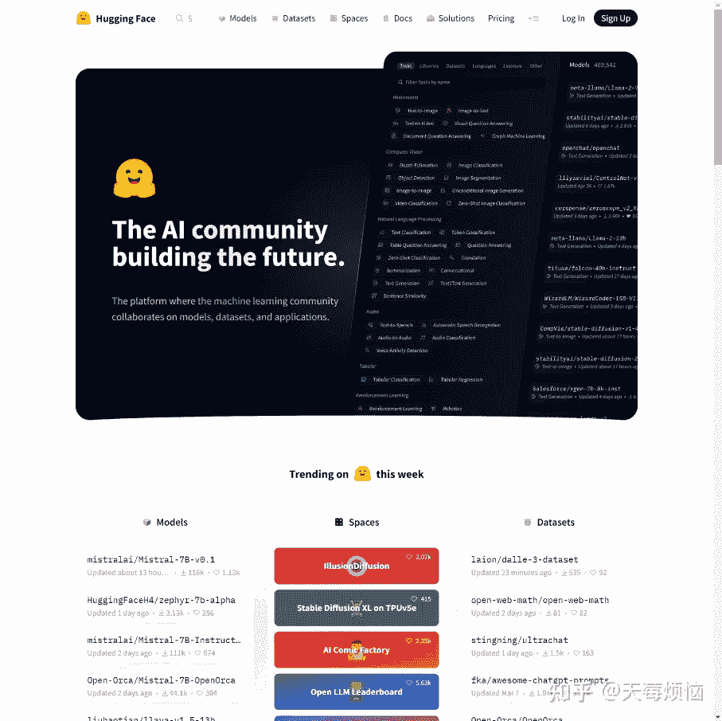

#  大语言模型实战

以 Bert-base 为例子，给大家讲解一下如何使用开源模型并进行微调。

## 下载开源模型

首先，我们上 hugging face 搜索我们所需要的 bert-base 版本的模型，点击第一个选项。

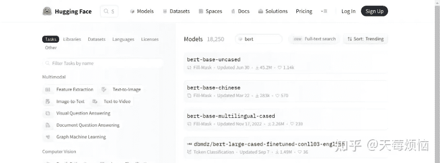

然后点击 Files，就能看到该模型的所有文件了。

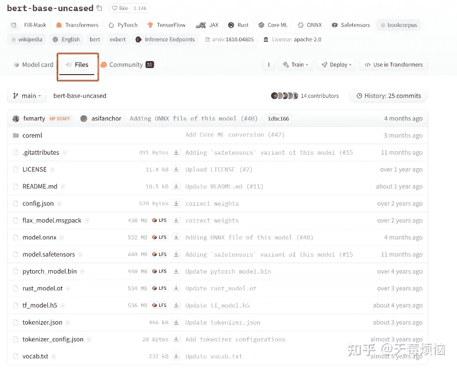

如果只是加载模型的话，就需要下载两个文件，模型文件和配置文件。配置文件就[是 config.j](https://www.zhihu.com/search?q=tensorflow&search_source=Entity&hybrid_search_source=Entity&hybrid_search_extra=%7B%22sourceType%22%3A%22answer%22%2C%22sourceId%22%3A3248469249%7D)son。而模型文件则不同的框架有不同的对应文件。如果是使用 tensorflow 框架的话，要下载 .h5 文件，如果是 Pytorch 的话，下载 .bin 文件。

另外，如果你的数据还没有转换成序列的话，还需要下载 tokenizer 的有关文件。

下载好之后，按如下路径进行组织：

## 加载模型

接下里就是加载我们所需要的模型。

```
from transformers import BertModel
import torch
model = BertModel.from_pretrained(&#x27;models/pretrained_bert&#x27;).cuda()
```

##  微调

剩下的事情就是组织我们的数据，然后输入到模型当中了。

```
output = model(input_ids=token_ids, attention_mask=input_mask)
```

# 相关学习推荐

> LLM（大语言模型）无法对数字进行准确运算的底层原因是什么？

> [吴](https://www.bilibili.com/video/BV1Gm421p7DL/?spm_id_from=333.337.search-card.all.click&vd_source=5f510a92cb4ba60bca1f45dfcdcac992)恩达大模型系列教程：2024吴恩达LLM大模型教程，手把手带你实现大模型预训练和模型微调，中英字幕（附学习课件）

> [中英软字幕《从零开始用Python搭建LLM|Create a ](https://www.bilibili.com/video/BV1vp421o7Ys/?spm_id_from=333.337.search-card.all.click&vd_source=5f510a92cb4ba60bca1f45dfcdcac992)LLM from Scratch with Python – Tutorial》

> Llama3大模型快速入门实战教程