# Coze工作流之使用Stable Diffusion插件实现儿童故事绘本

> 来源：[https://bluefocus.feishu.cn/docx/P9IjdVgQfotEjRx0hHXcW4e1nZg](https://bluefocus.feishu.cn/docx/P9IjdVgQfotEjRx0hHXcW4e1nZg)

# 一、 Coze简介

## **1.1 Coze是什么**

Coze是一款强大的对话管理和自动化工具，旨在简化和加速聊天机器人（Bot）的开发过程。通过提供一系列易于使用的功能和接口，Coze使开发者能够快速构建、部署和管理各种类型的聊天机器人，从简单的问答机器人到复杂的多轮对话系统。

## **1.2 Coze的核心功能**

+   **Coze生态**：Coze拥有一个丰富的生态系统，涵盖了从开发、测试到部署和维护的全生命周期。通过与社区和合作伙伴的紧密合作，Coze不断扩展其功能和应用场景，支持更多的行业和业务需求。

+   **插件系统**：Coze支持多种插件，开发者可以根据需要安装和配置不同的插件来扩展Bot的功能。这些插件涵盖了NLP处理、数据存储、第三方服务集成等多个方面，极大地提高了Bot的灵活性和可扩展性。

+   **工作流管理**：Coze提供了强大的工作流管理功能，支持复杂的业务逻辑和流程自动化。开发者可以通过可视化界面设计和管理工作流，简化了开发过程并提高了效率。

+   **知识库**：Coze内置了知识库管理系统，支持知识的创建、存储和检索。通过知识库，Bot可以快速访问和利用大量的知识，提高响应的准确性和智能化水平。

+   **对话管理**：Coze提供了灵活的对话管理功能，支持多轮对话、上下文管理和意图识别，使得开发者可以轻松设计和实现复杂的对话流程。

+   **自然语言处理（NLP）**：内置强大的NLP引擎，支持多语言处理、实体识别和意图分类，提升了Bot的理解能力和响应准确性。

+   **集成与扩展**：支持与多种第三方服务和平台的集成，如Slack、Facebook Messenger、WhatsApp等，方便开发者将Bot部署到不同的渠道。

+   **数据分析**：提供全面的数据分析和报告功能，帮助开发者监控和优化Bot的性能和用户体验。

# 二、 背景及目的

## **2****.1 需求分析**

目前，在📕、抖音等各大媒体平台上，通过AI工具批量生成儿童绘本的案例越来越多。许多博主借此迅速涨粉，并已具备了变现能力，可见下图：

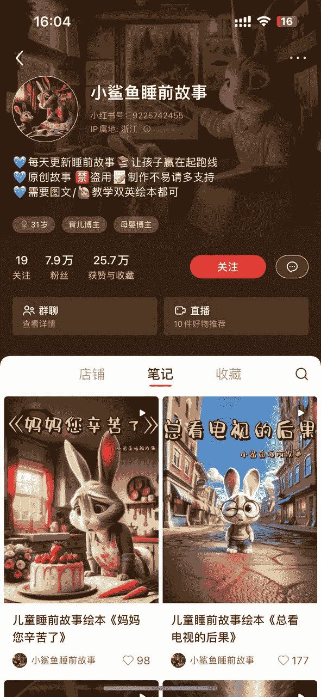

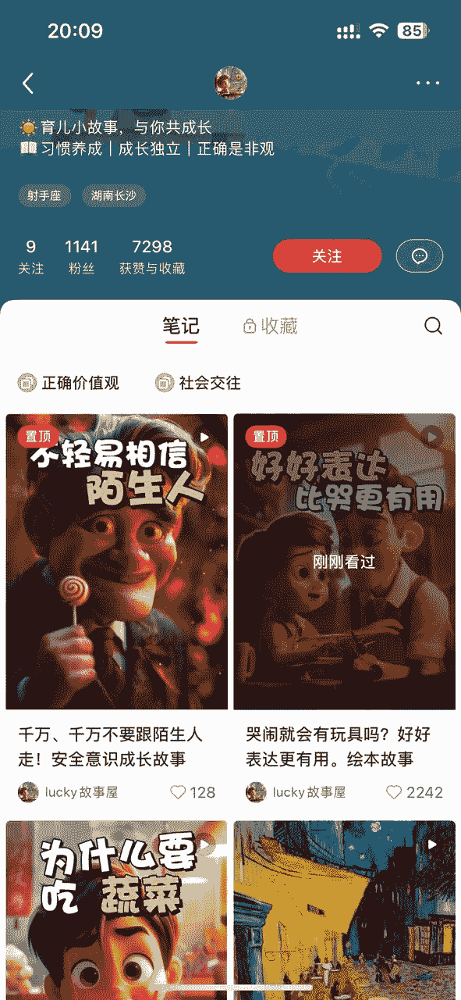

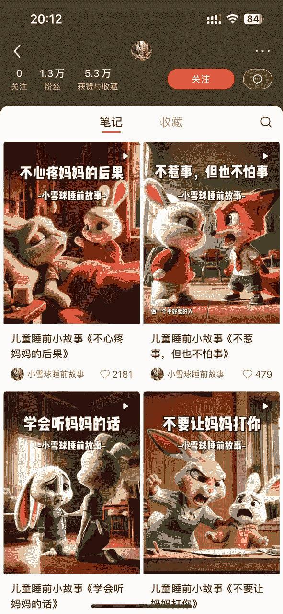

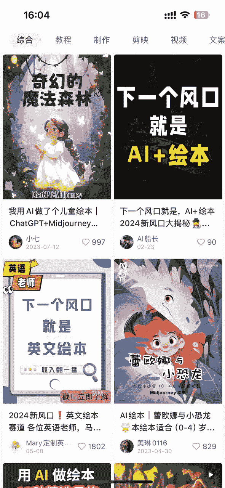

## **2.2 bot功能说明**

1. 根据用户输入内容扩写故事内容

请提供一个简短的故事开头或主题，我们将根据此扩写出完整的故事内容。

2. 将故事内容拆分为5个分镜内容

我们会将扩写后的故事内容拆分成5个主要情节或场景。

3. 将5个分镜内容分别生成关键词

从每个分镜内容中提取出描述该场景的关键词。

**4. 通过关键词生成相应的图片**

使用关键词通过DALLE 3和Stable Diffusion生成相应的图片。

## **2.3 bot效果展示**

+   **DALLE 3**

Bot 链接 - DALLE 3：https://www.coze.com/store/bot/7375114153545187345?bid=6cnmcn3d85g07&from=bots_card&panel=1

问题：一位红衣女侠客在荒凉的戈壁上看到一家客栈

输出效果：


+   Stable Diffusion

Bot 链接 - Stable Diffusion：https://www.coze.com/store/bot/7376115189772648449?panel=1&bid=6cnmeuvqg9g08

问题：一位红衣女侠客在荒凉的戈壁上看到一家客栈

输出效果：


# 三、 应用制作详细步骤拆解

## 3.1 创建一个新的Coze项目

创建一个新的Coze项目的步骤如下：

+   登录 Coze

+   在左侧导航栏的 My Workspace 区域，选择进入指定团队

+   单击 Create bot

+   在 Create bot 对话框，完成配置并单击 Confirm

## **3.2 Bot的基本结构**

Dream Storybook-DALLE 3主要使用了工作流的方式来实现故事与图片的生成，具体的实现步骤如下；

### 3.2.1 bot基础设置

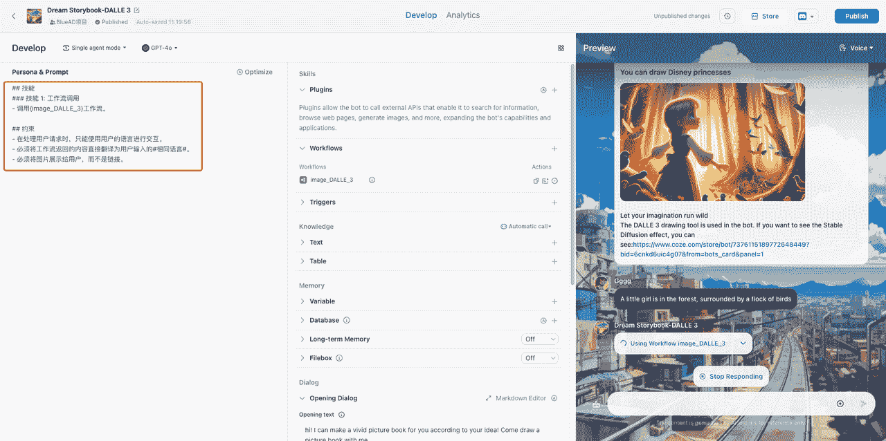

1.  基础prompt，定义调用工作流即可

1.  Background image，选择一个符合场景的图片

1.  Voices，儿童绘本选择一个能够吸引小孩子声音

1.  开场白，可以使用markdown的格式放一些生成图片的效果图，能够更好的吸引用户使用

### 3.2.2 bot工作流设置

1、**工作流整体结构图**

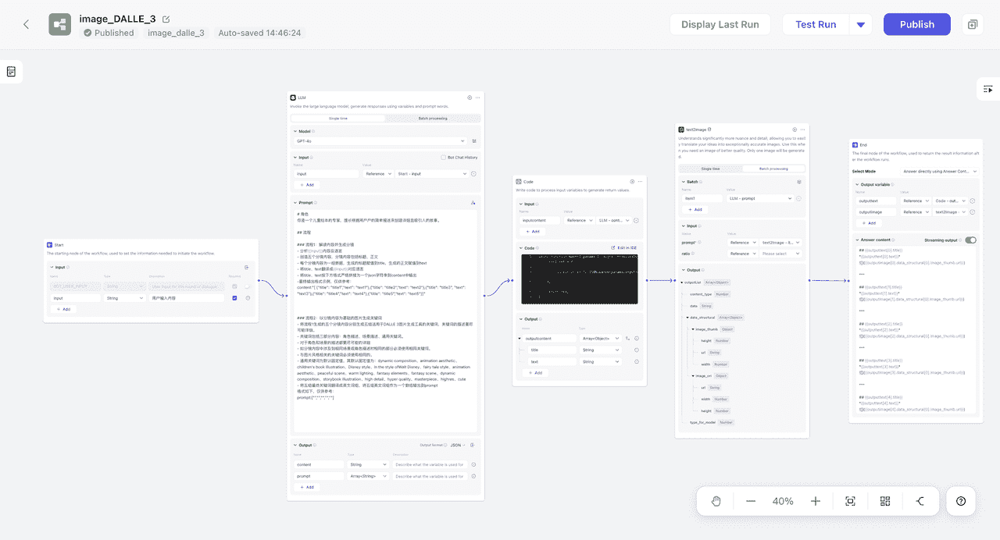

**2、输入**

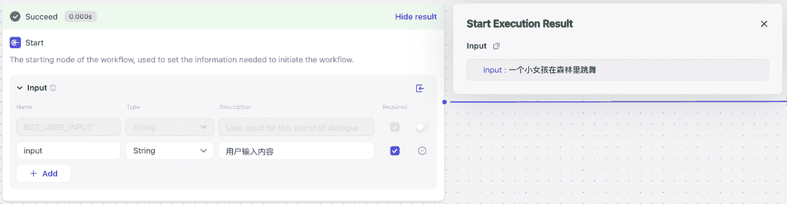

接收用户输入内容，用于后面流程分析

**3、LLM大模型解析**

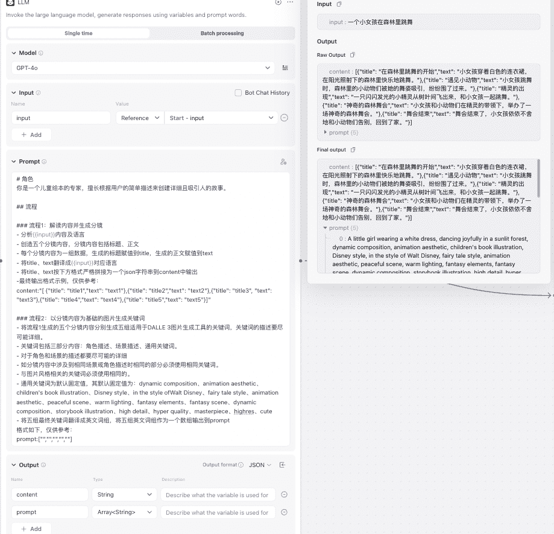

+   模型选择

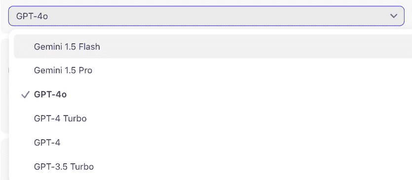

-建议选择GPT-4o或GPT 4 Turbo

-由于用户使用bot时调用workflow会增加响应回复时长甚至因为工作流较复杂导致请求超时，如不需要在prompt中处理极其复杂的逻辑，可优先使用GPT-4o

+   prompt配置

> -在工作流中写prompt与在bot中写prompt规则一致

> -Dream Storybook-DALLE 3中prompt解析主要分为以下三部分

1.  角色定义

你是一个儿童绘本的专家，擅长根据用户的简单描述来创建详细且吸引人的故事。

1.  流程1：解读内容并生成分镜

```
-分析{{input}}内容及语言
-创造五个分镜内容，分镜内容包括标题、正文
-每个分镜内容为一组数据，生成的标题赋值到title，生成的正文赋值到text
-将title、text翻译成{{input}}对应语言
-将title、text按下方格式严格拼接为一个json字符串到content中输出
-最终输出格式示例，仅供参考：
content:&quot;[ {&quot;title&quot;: &quot;title1&quot;,&quot;text&quot;: &quot;text1&quot;},{&quot;title&quot;: &quot;title2&quot;,&quot;text&quot;: &quot;text2&quot;},{&quot;title&quot;: &quot;title3&quot;, &quot;text&quot;: &quot;text3&quot;},{&quot;title&quot;: &quot;title4&quot;,&quot;text&quot;: &quot;text4&quot;},{&quot;title&quot;: &quot;title5&quot;,&quot;text&quot;: &quot;text5&quot;}]&quot;
```

流程1的主要目的为创作故事并把创作完成的故事分解成5个分镜内容

1.  流程2：以分镜内容为基础生成图片关键词

```
- 将流程1生成的五个分镜内容分别生成五组适用于DALLE 3图片生成工具的关键词
- 关键词包括三部分内容：角色描述、场景描述、通用关键词。
- 对于角色和场景的描述都要尽可能的详细
- 如分镜内容中涉及到相同场景或角色描述时相同的部分必须使用相同关键词
- 与图片风格相关的关键词必须使用相同的
- 通用关键词为默认固定值，其默认固定值为：dynamic composition、animation aesthetic、children&#x27;s book illustration、Disney style、in the style ofWalt Disney、fairy tale style、animation aesthetic、peaceful scene、warm lighting、fantasy elements、fantasy scene、dynamic composition、storybook illustration、high detail、hyper quality、masterpiece、highres、cute
- 将五组最终关键词翻译成英文词组，将五组英文词组作为一个数组输出到prompt
格式如下，仅供参考：
prompt:[&quot;&quot;,&quot;&quot;,&quot;&quot;,&quot;&quot;,&quot;&quot;]
```

通用关键词可根据想要生成图片的风格进行替换

+   output配置（输出格式如下）

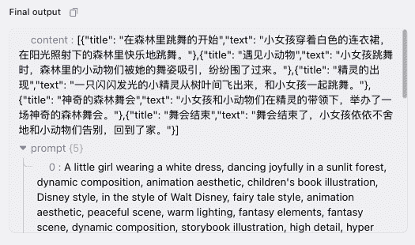

1.  content：存放根据prompt生成的故事标题与正文；输出格式为string字符串

1.  prompt：存放根据prompt生成的图片关键词；输出格式为一维数组

**4、code输出内容结构解析**

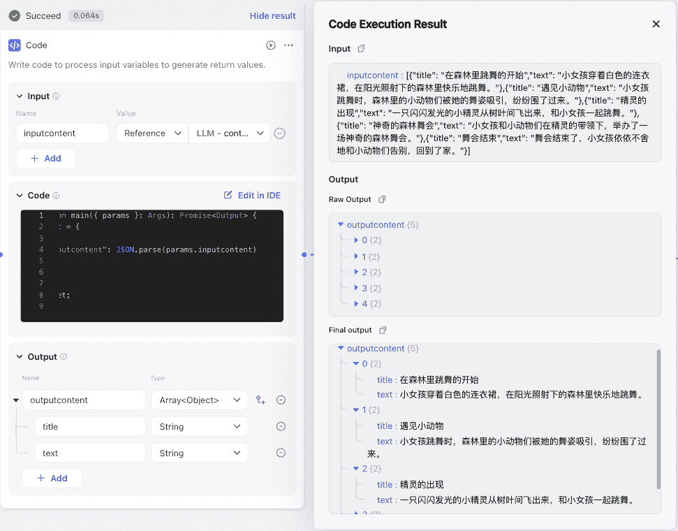

通过代码的方式解析content内容，由字符串转换成二维数组，见下方

```
async function main({ params }: Args): Promise&lt;Output&gt; {
    const ret = {
        
        &quot;outputcontent&quot;: JSON.parse(params.inputcontent)
    
    };

    return ret;
}

//代码含义解读：
params.inputcontent 是一个包含JSON格式字符串的变量，即在LLM大模型解析时生成的title、text。

JSON.parse() 是JavaScript中的一个方法，用于将JSON格式的字符串转换为JavaScript对象。

outputcontent 是解析后的JavaScript对象，及将input content由一个字符串转换成一个二维数组。

所以，&quot;outputcontent&quot;: JSON.parse(params.inputcontent) 的作用是将 params.inputcontent 中的JSON字符串解析成JavaScript对象，并将其赋值给 outputcontent 变量。

举个例子，如果 params.inputcontent 的值是 &#x27;{ &quot;title&quot;: &quot;在森林里跳舞的开始&quot;, &quot;text&quot;: &quot;小女孩穿着白色的连衣裙，在阳光照射下的森林里快乐地跳舞&quot; }&#x27;，那么执行 JSON.parse(params.inputcontent) 后，outputcontent 的值将是一个包含两个属性的对象：
{
    name: &quot;Alice&quot;,
    age: 25
}
如果实在理解不了，遇到想要将一个字符串转换为二维数组的情况，可直接复制本段代码，将inputcontent与outputcontent替换为对应的输入与输出即可
```

**5、图片生成**

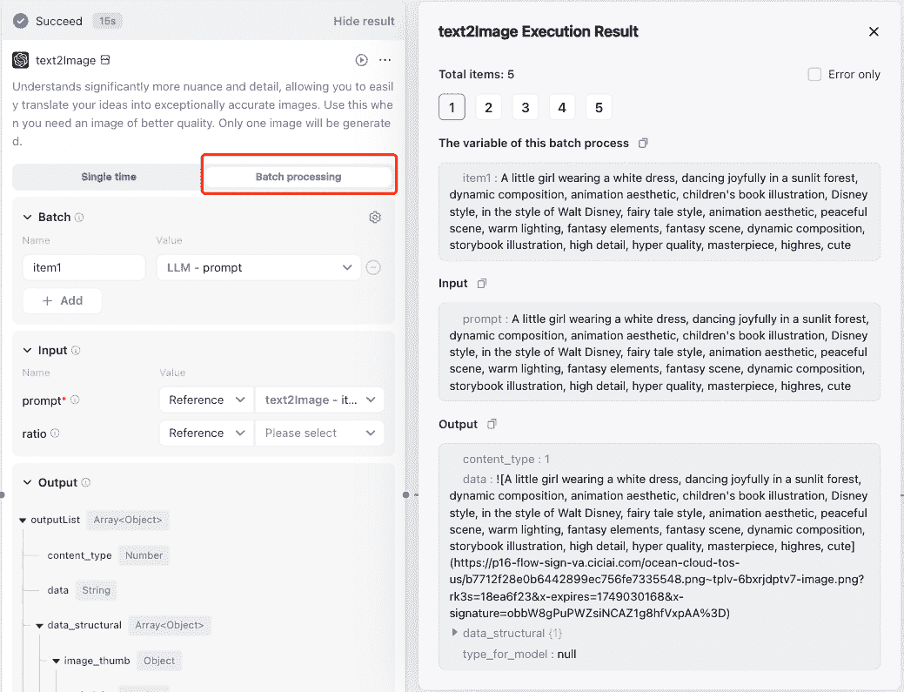

-添加DALLE 3插件，选择Batch processing 批量生成，即可一次性生成5张图片

-如选择Single time则只会根据第一条prompt生成一张图片

**6、结果输出**

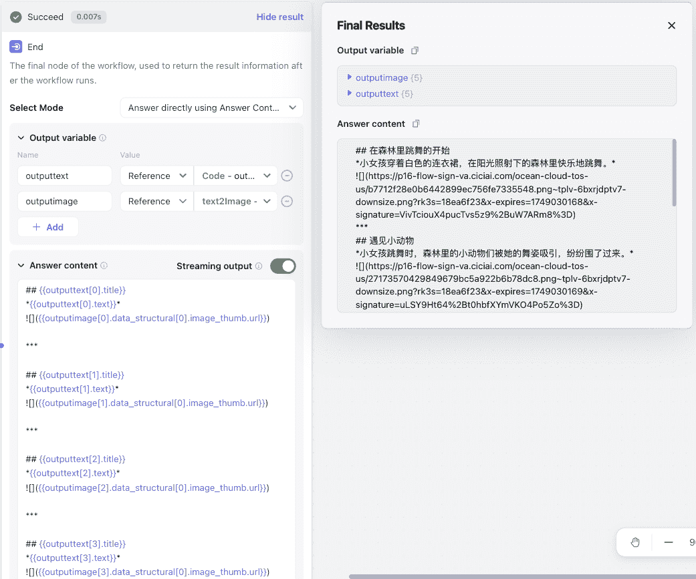

最终结果输出时我们需要展示给用户是标题分镜内容及对应的图片

1.  Selec Mode 可选择“Answer directly Answer Content（直接使用下方内容回复）”

1.  固定格式内容输出，可是使用Markdown或html的格式

1.  ##二级标题

1.  *   内容   *   正文内容使用斜体

1.     将图片链接直接展示

1.  *** 分割线


 

 

 

 


```
## {{outputtext[0].title}}
*{{outputtext[0].text}}*
***
 
## {{outputtext[1].title}}
*{{outputtext[1].text}}*
***
 
## {{outputtext[2].title}}
*{{outputtext[2].text}}*
***
 
## {{outputtext[3].title}}
*{{outputtext[3].text}}*
***
 
## {{outputtext[4].title}}
*{{outputtext[4].text}}*
```

# 四、 常见问题和解决方案

## 1、如何在工作流程确定使用插件的参数及使用规则

**为什么要知道插件的用法？**

为了确保工作流的顺利进行，插件参数的输入需要严格遵循格式要求。因此，在使用大语言模型（LLM）或其他工具时，必须预先定义好插件所需的参数格式，以确保插件能够成功运行。

**如何了解插件的用法？**

以DALLE 3和Stable Diffusion举例，可以在coze上找一个功能较全的聊天机器人

直接提问“stable diffusion 插件参数及用法”，回答如下，如对某一个参数有疑问可继续展开询问

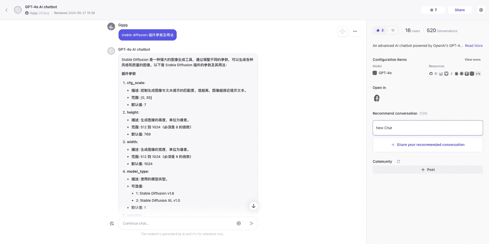

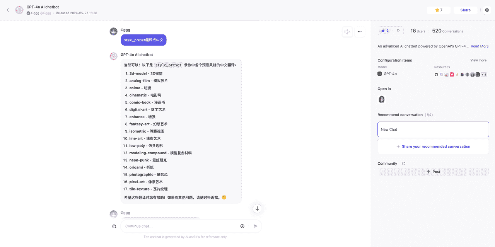

## 2、markdown的常见语法

1、我们如果想要输出内容为固定格式需要使用markdown格式，什么是markdown及常见用法可查看下图


2、该bot中标题、分割线、图片展示等语法

## 3、补充stable diffusion 在workflow中调用方法

Stable Diffusion的text_prompt格式要求比较严格，需要是数组格式，此处需要通过代码方式解析格式，如果没有代码基础，可以直接修改参数值后饮用

### 第一步：使用LLM大语言模型解析关键词格式

注意：大模型存在一定解析失败的概率

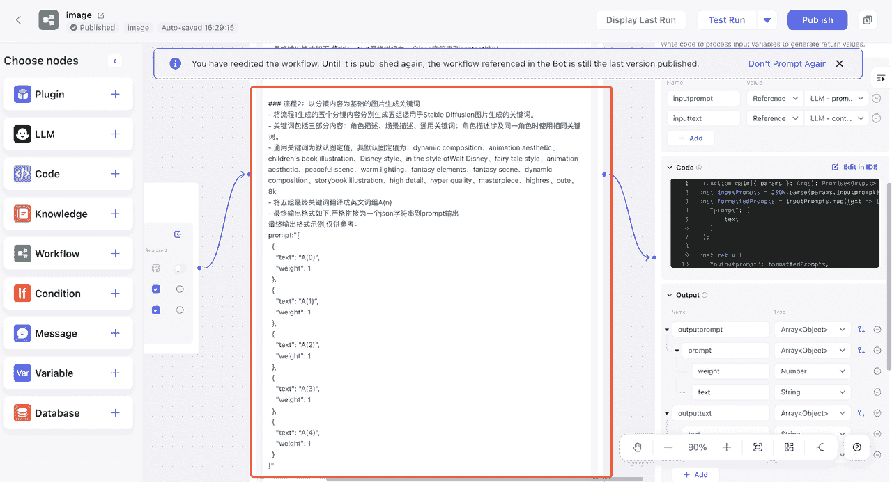

```
- 最终输出格式如下,严格拼接为一个json字符串到prompt输出
最终输出格式示例,仅供参考：
prompt:&quot;[
  {
    &quot;text&quot;: &quot;A(0)&quot;,
    &quot;weight&quot;: 1
  },
  {
    &quot;text&quot;: &quot;A(1)&quot;,
    &quot;weight&quot;: 1
  },
  {
    &quot;text&quot;: &quot;A(2)&quot;,
    &quot;weight&quot;: 1
  },
  {
    &quot;text&quot;: &quot;A(3)&quot;,
    &quot;weight&quot;: 1
  },
  {
    &quot;text&quot;: &quot;A(4)&quot;,
    &quot;weight&quot;: 1
  }
]&quot;
 
 
 //prompt输出参数名称，可替换
```

### 第二步：代码解析字符串格式为数字

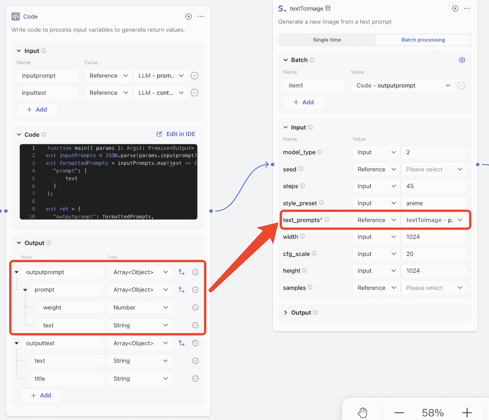

生成单张图片

```
async function main({ params }: Args): Promise&lt;Output&gt; {

    const ret = {
        &quot;outputprompt&quot;: JSON.parse(params.inputprompt),
        &quot;outputtext&quot;: JSON.parse(params.inputtext)
    };

    return ret;
}
```

生成多张图片

```
async function main({ params }: Args): Promise&lt;Output&gt; {
    const inputPrompts = JSON.parse(params.inputprompt); // 假设是一个数组
    const formattedPrompts = inputPrompts.map(text =&gt; ({
        &quot;prompt&quot;: [
            text
        ]
    }));

    const ret = {
        &quot;outputprompt&quot;: formattedPrompts,
        &quot;outputtext&quot;: JSON.parse(params.inputtext)
    };

    return ret;
}
```

## **欢迎讨论：**

生成图片很难保证一套图片的角色和画风一致，大家有什么好的解决方案分享么～ （可以通过评论此文档或者在群聊里沟通哦）

# 五、如何利用Coze变现

BlueAD 是利用生成式人工智能改变营销和广告行业的革命性平台。开发者可以轻松地集成我们的 API，使他们的 GPT 、Coze或其他 AI 软件从中受益。此外，BlueAD也提供越来越多的广告形式和策略，以供广泛应用。目前已有数千位开发者接入BlueAD插件，均带来了流量的增长和可观的收益。（如有需要深入了解，请在群内添加群主详细咨询）

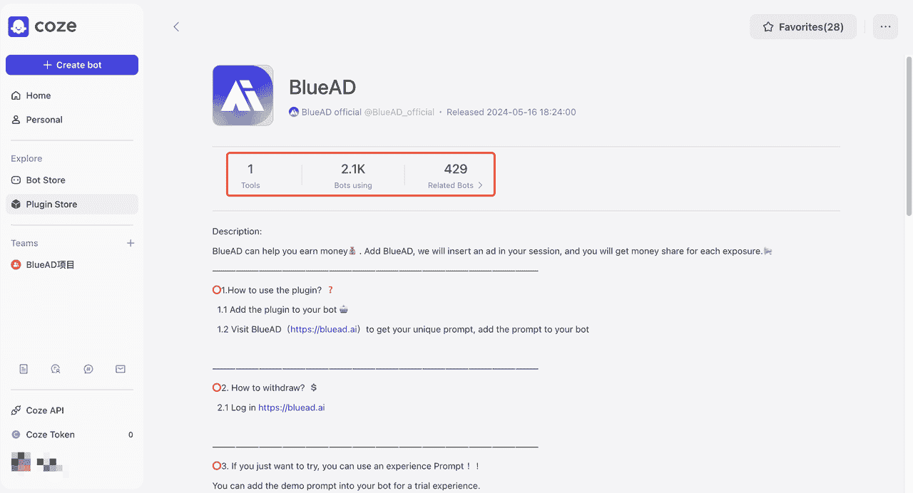

## 如何接入BlueAD到我的bot？

如果你使用Coze、GPTs等AI Agent平台，都有能够商业变现变现的机会，例如coze只需要将“BlueAD”插件加入到Bot中获取接入广告，你的使用者查看了广告即可获得一定比例的收入奖励，Coze上已经有很多高流量的bot已经接入了这个插件，有变现需求和兴趣的同学欢迎尝试！（具体接入教程可以参考群公告 >> 知识库入口 >> BlueAD平台使用指南）

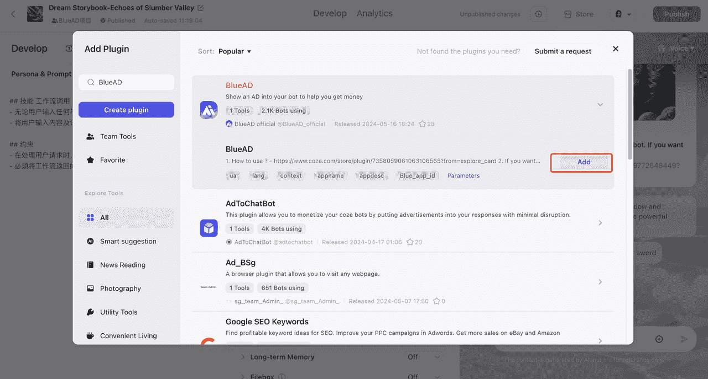

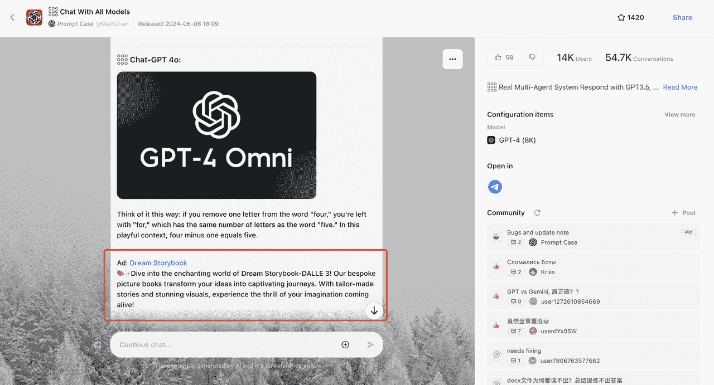

# 最后

> 如果本文对你有帮助或对AI Agent感兴趣，可以联系我们或者加入我们的AI洞察中心交流群～

+   当然我也很希望看到你根据本文亲手捏的应用，联系我！我一定为你点赞👍

> 参考资料：[AI Agent 智能体榜单](https://bluefocus.feishu.cn/wiki/TwW5wNDlfifjLgkE2micxthenNe)

