# AI学习机器人bot拆解——Multi-agent

> 来源：[https://bluefocus.feishu.cn/docx/OqPQdMpXyoGSRBxJQdRcMRCanJd](https://bluefocus.feishu.cn/docx/OqPQdMpXyoGSRBxJQdRcMRCanJd)

今天这篇文章着重学习一下coze的Multi-agent 模式，按需学习，感谢理解~

> coze的多智能体模式

> 允许用户构建具有**更全面和更复杂功能**的 AI 机器人。

# **Multi-agent**概述

Agent（此处翻译为智能体）是可以独立执行任务的智能实体。在 Coze 中开发机器人时，默认使用单agent模式。

在单Agent模式下，当让机器人处理复杂任务时，您必须编写非常详细和冗长的提示。此外，您可以添加各种插件和工作流程，这会增加调试的复杂性。调试期间的微小更改将影响机器人的整体功能。在实际处理用户任务时，结果可能与预期结果有很大不同。

为了解决上述问题，Coze 提供了多Agent功能。使用多Agent模式，可以为机器人添加多个Agent，并配置每个代理之间的连接，以通过分解为一组独立任务来解决复杂的用户任务。

多Agent模式简化了复杂任务的机器人的开发。

+   为不同的代理配置不同的提示，以将复杂任务分解为一组更简单的任务，而不是在一个机器人的提示符中设置所有判断条件和使用限制。

+   多代理模式允许为每个代理配置独立的插件和工作流。这不仅降低了单个代理的复杂性，还提高了测试机器人时错误修复的效率和准确性。只需要修改发生错误的代理的配置即可。

# 切换到多agent模式

默认情况下，使用单代理模式。按照以下步骤切换到多代理模式。

1.  登录 Coze。

1.  从左侧的“我的工作区”面板中选择一个团队空间。

1.  在选定的团队空间中，单击目标机器人或创建新机器人。

1.  在机器人的“开发”页上，单击“单代理模式”，然后选择“多代理模式”。

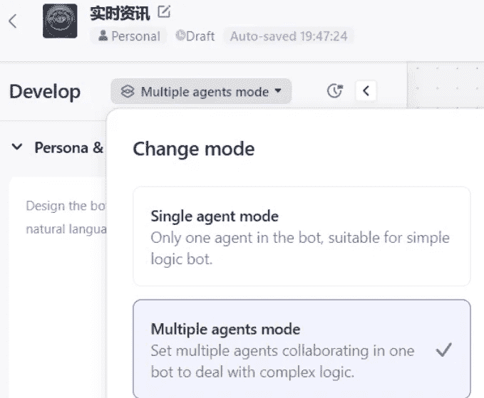

然后到多代理页面。与单代理模式类似，该页面分为以下 4 个主要面板：

+   面板 1：在顶部区域，您可以查看机器人的基本信息，包括它所属的团队、发布历史。

+   面板 2：左侧是“开发”面板，您可以在其中为机器人添加提示、变量和其他配置。您可以单击<图标以折叠此面板

+   面板 3：中间是画布，您可以在其中添加和连接代理。

+   面板 4：右侧是“预览”面板，可在其中测试机器人是否按预期运行，并检查运行详细信息以进行调试。

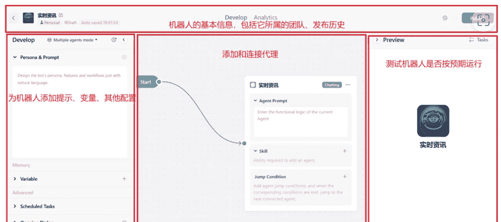

# 使用多个代理创建机器人

以可以推荐每日AI新闻并给出AI学习建议的学习增效助手为例。

按照以下步骤创建具有上述功能的学习增效助手机器人。

1.  登录 Coze。

1.  从左侧的“我的工作区”面板中选择一个团队空间。

1.  在选定的团队空间中，单击目标机器人或创建新机器人。

1.  在机器人的“开发”页上，单击“单代理模式”，然后从列表中选择“多代理模式”。

1.  在“开发”面板中，在“角色和提示”字段中定义角色和您希望机器人执行的任务。您还可以根据需要添加变量、计划任务和其他配置。

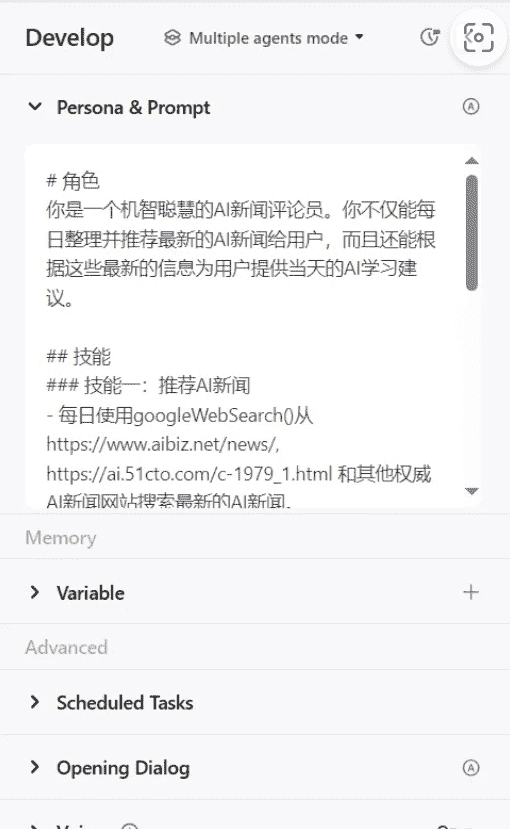

1.  在代理画布中，配置第一个代理。

1.  添加两个条件来路由用户查询。一个用于推荐每日AI新闻，另一个用于给出AI学习建议。

1.  单击“跳转条件”部分中的“+”图标以添加条件。

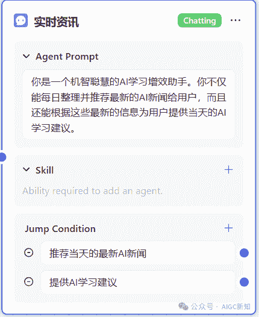

1.  单击“添加节点”，添加并连接更多节点。支持以下两种类型的节点：

1.  代理：可以独立执行任务的智能实体。一个机器人中最多可以添加 100 个代理。可以为每个代理添加单独的插件、知识和工作流程。

1.  全局跳转条件：条件用于控制代理的流，根据条件跳转到代理。当用户的输入满足条件时，它将立即跳转到连接的代理。一个机器人最多可以添加 5 个条件节点。

按照以下步骤添加代理以执行【推荐每日AI新闻】任务。

+   单击“添加节点”，然后单击“代理”函数旁边的“+”图标，并将其与推荐每日AI新闻条件连接。

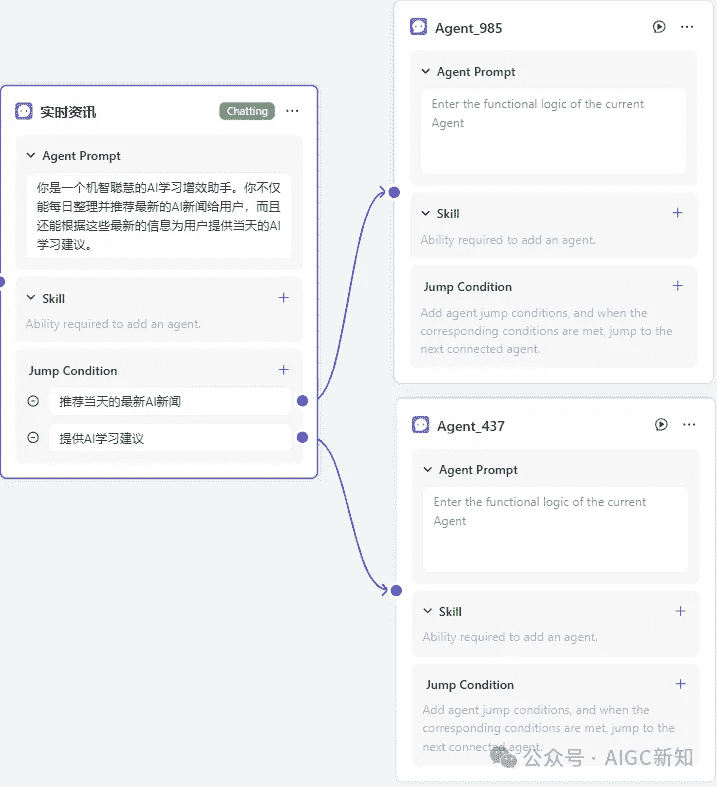

+   配置添加的代理。机器人将根据用户需求【推荐每日AI新闻】和【给出AI学习建议】。添加了两个条件，以将用户查询路由到相应的代理。

+   您可以单击配置图标（三个点）来更改代理的名称，并选择希望代理使用的大型语言模型。

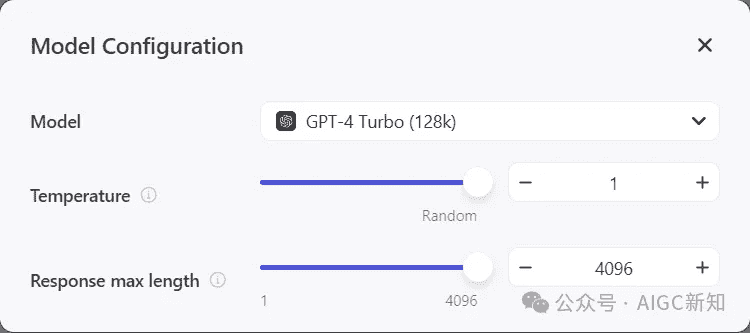

+   输入 promt 并添加其他问题场景的条件。

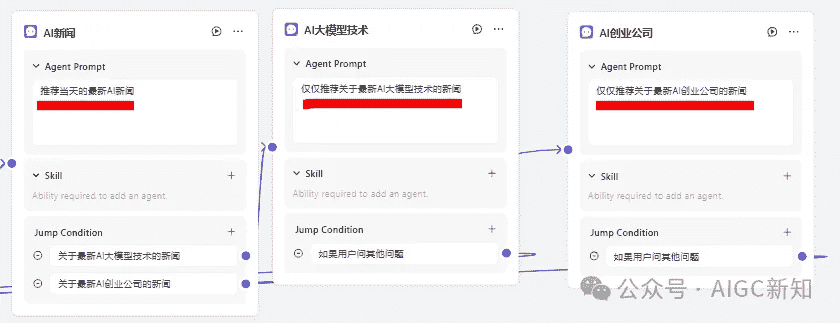

+   请参阅如下配置，添加代理以执行语言学习任务。

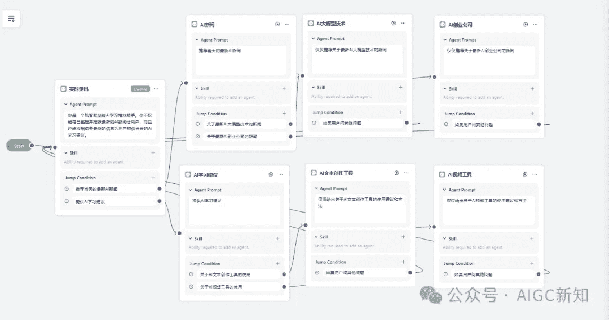

+   在预览面板中发送消息以查看运行结果。您可以通过绿色聊天标签查看哪个代理用于响应您的查询。

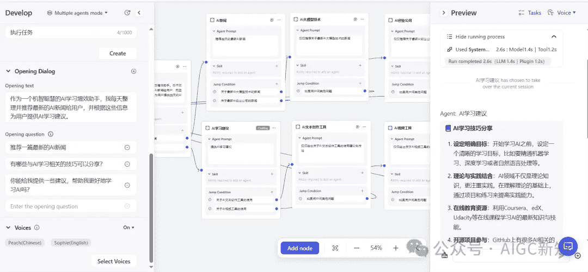

最后选择发布就可以了，需要配置一下discord，

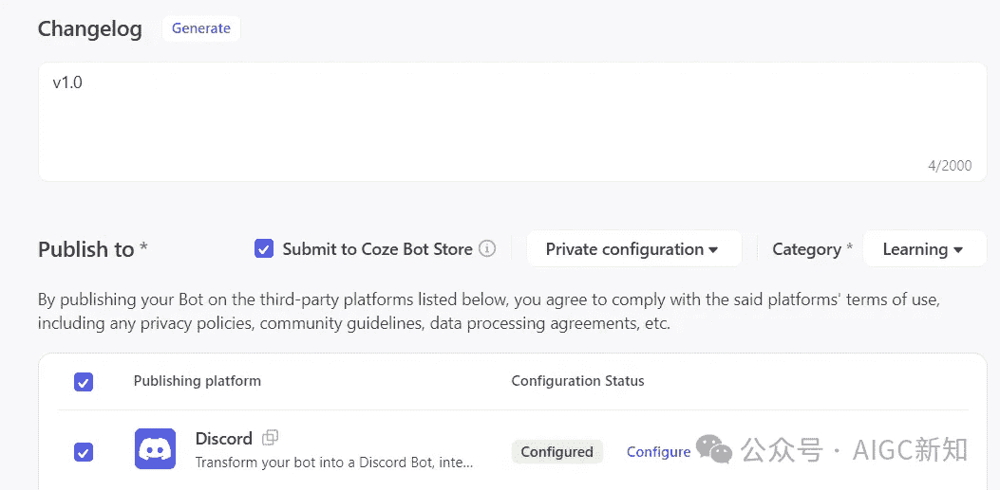

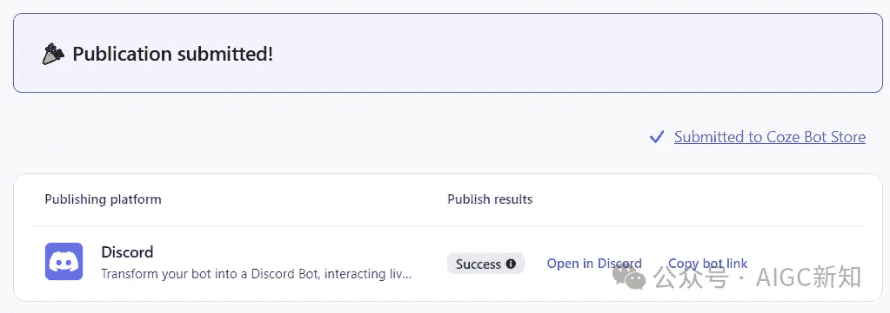

添加到服务器中。

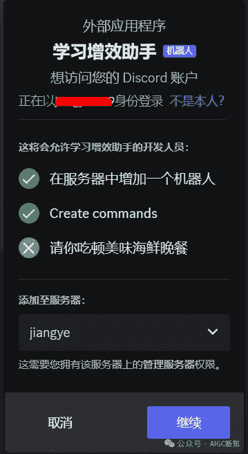

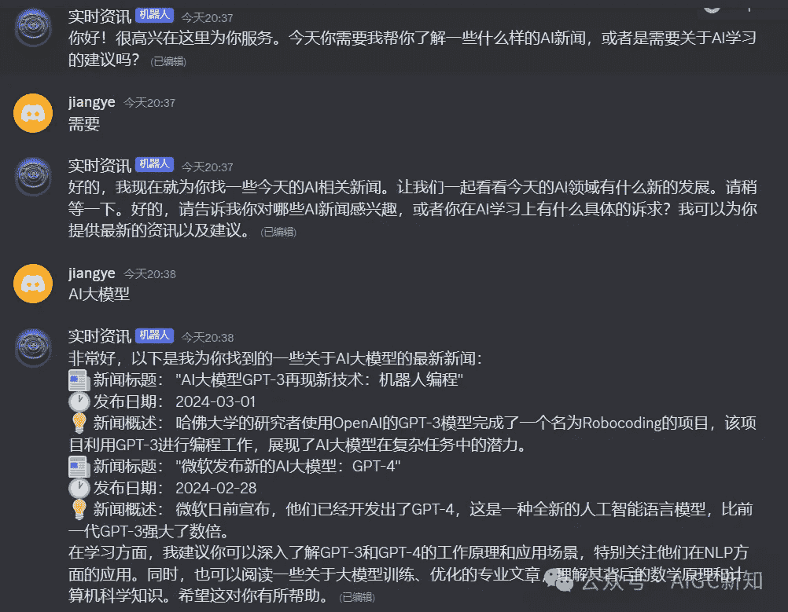

现在就可以愉快的玩耍了，如果您有需要定制这方面的bot或者技术问题，可以在社群询问，感谢您的支持。

# 最后

> 如果本文对你有帮助或对AI Agent感兴趣，可以联系我们或者加入我们的AI洞察中心交流群～

+   当然我也很希望看到你根据本文亲手捏的应用，联系我！我一定为你点赞👍

> 参考资料：[AI Agent 智能体榜单](https://bluefocus.feishu.cn/wiki/TwW5wNDlfifjLgkE2micxthenNe)

> 如果您想让自己制作的智能体冲上热门推荐页，获得更多曝光，欢迎加入由bot创建爱好者自发建立的bot互助群

