# coze卡片的制作和使用

> 来源：[https://bluefocus.feishu.cn/docx/DYKSdg0BLojxIbxlOcOcTZeRnge](https://bluefocus.feishu.cn/docx/DYKSdg0BLojxIbxlOcOcTZeRnge)

**最**近，有很多同学问扣子中的卡片有什么用？怎么很少用到，那今天本文就为大家讲解一下扣子中的卡片是做什么的，到底有什么妙用？

> 话不多说，上干货。😊

**本文重点**

**1****扣子中的卡片是什么**

**2****卡片的组成**

**3****卡片使用范围**

**4****制作卡片**

**5****使用卡片**

接下来让我们详细一一讲解。

# 一、**什么是卡片**

扣子平台中的「卡片」简单说就是让输出的格式更好看。例如你在扣子上通过插件或工作流返回一篇新闻，如果直接输出，就是一行标题，一段内容，可能有的还会有一个链接。但如果在大模型输出之前，你把这些信息按设定好的格式做成一个好看的卡片，是不是更能提供应用的用户体验，例如下面这样：


当然，也可以有列表形式的卡片：

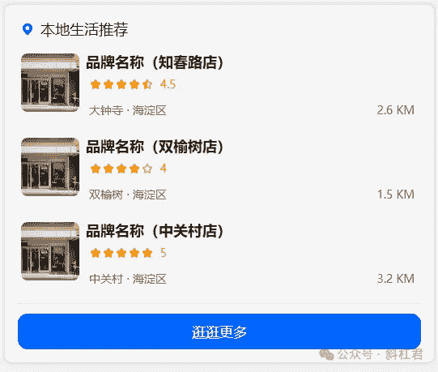

# 二、**卡片的组成**

组成卡片的元素叫做组件。

组件一共分两种：

1.  **布局组件**

1.  **基础组件**

**布局组件**就是用来划分整体区域的，布局组件有如下几种：

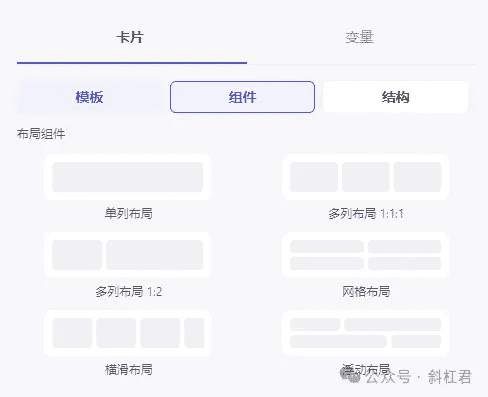

对于每一个布局，都可单独进行参数的设置，这样就能组合出很多不同的布局。

例如这个布局：

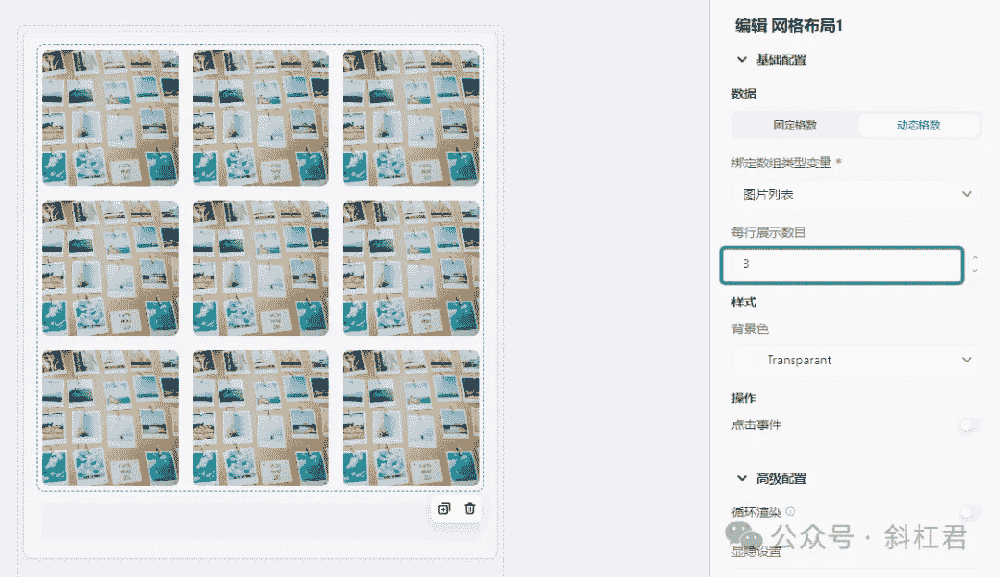

原始的每行展示数目是3个，我可以改成4个，就变成这样了。

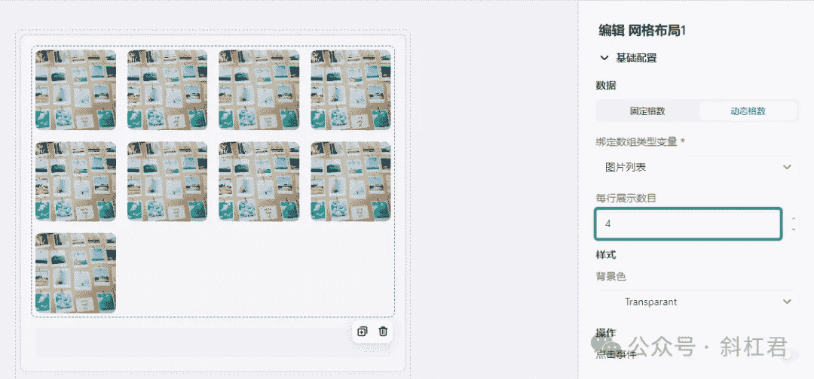

基础组件是具体的展示信息的类型，例如是图片，还是文本，还是按钮等。

基础组件有如下几种：

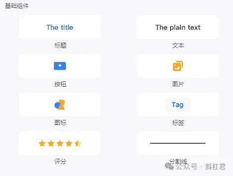

如下这个卡片就由一个图片和两个文本元素组成。

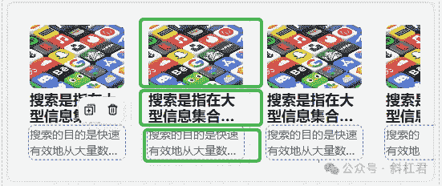

接下来让我们动手制作一个卡片，然后再使用这个制作好的卡片。通过本节课学习，彻底让大家掌握扣子卡片的使用，让你的应用与众不同。

# 三、**卡片的使用范围**

目前消息卡片仅在豆包客户端、飞书客户端内生效。

仅工作流和插件功能支持添加消息卡片。

# 四、**制作卡片**

接下来我们来通过一个实际的案例来学习卡片的制作。

这个案例的作用是：调用知乎热榜插件，然后用卡片列表的形式展示给用户。

## **01**** 设置布局**

形式如下图所示：

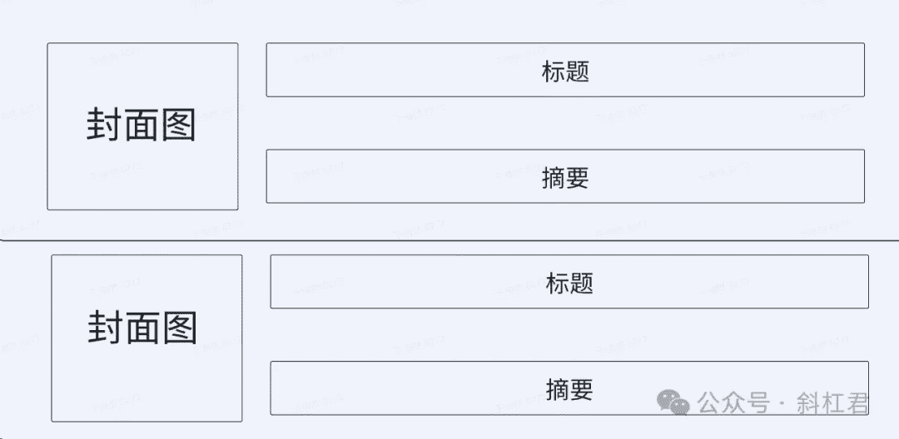

我们要做上面这种类型的卡片，首先要对内容进行分解。从图中可以看出这是一个新闻列表的循环。

所以首先要做出一条新闻的样式，再通过循环就可以展示出多条新闻的列表形式了。

也就是先做出这部分：

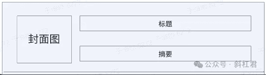

上面的这个结构，可以看出，是一个两列布局，有左右两部分内容。左侧是图片，右侧是信息。

那我们首先在画布上添加二列布局组件：

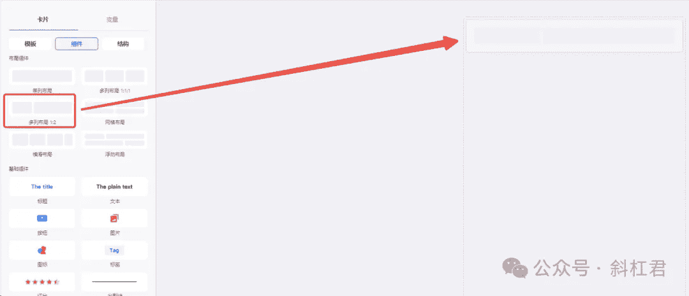

然后在这个布局里加入一个图片组件：

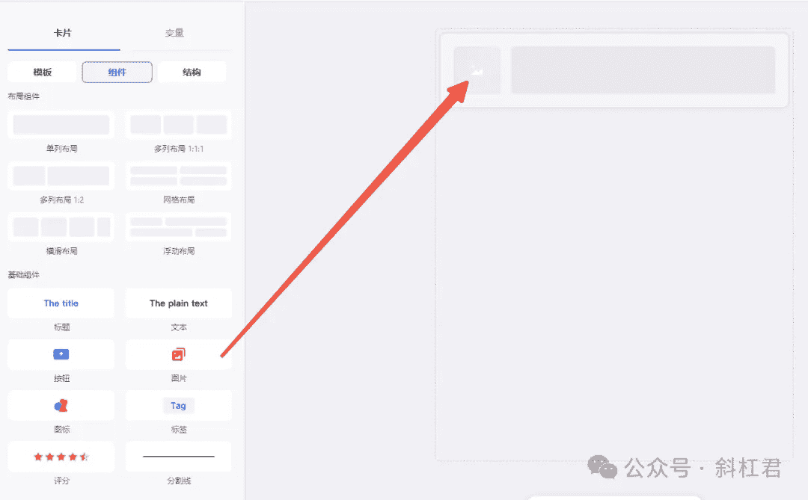

因为我们想要的图片是正方形，这么布局的话，比例不对。应该把1的宽度变小。

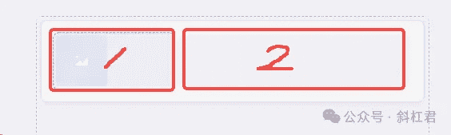

例如下图这样，把这个宽度再多分几份，实际是6份：

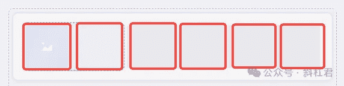

这时让图片的部分占1分，让文字的内容占5份，这样就能达到我们的效果了。

那该应该如何设置呢？

只需要调整信息部分宽度比例即可，改为5：

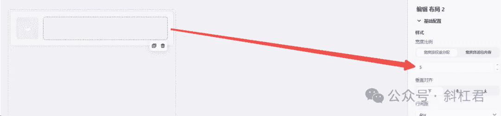

这样比例就调整好了。

## **02**** 添加组件**

先添加图片组件：


再添加文本组件。文字部分有上下两行，一行是标题，给行是摘要。

那么我们需要添加两个文本组件。

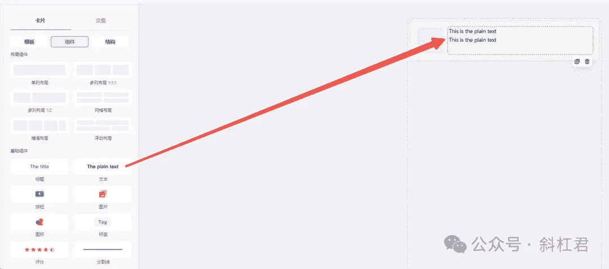

这样结构就准备好了。通过点击结构的按钮，可以看到当前卡片的结构。如下图：

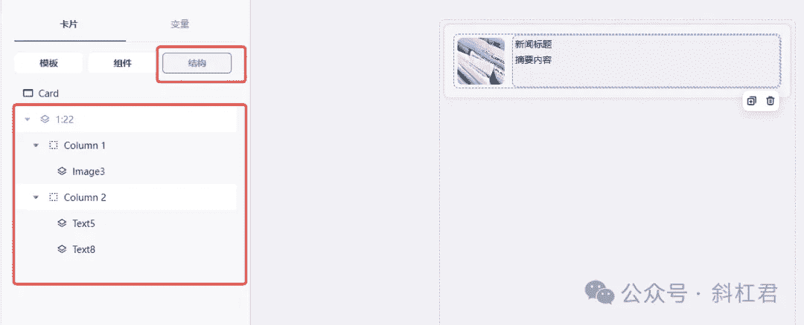

## **03**** 新建变量**

因为列表是循环的展示的。正常情况下，循环的数据是接口返回的。在我们这个例子中，就是知乎返回的一个热榜数组。所以在没有调用接口之前，我们需要先通过模拟一个数组来展示这循环列表。

通过变量选项卡新建一个变量：

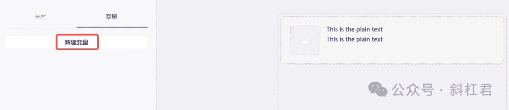

这里要注意，如下图所示，变量类型要选择数组：

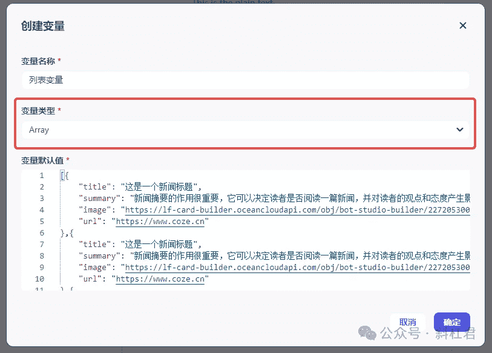

数组变量的值如下，一共有三个元素，也就是对应展示出来的新闻列表也应是三条。

大家可以复制以下数组使用：

```
[{      &quot;title&quot;: &quot;这是一个新闻标题&quot;,      &quot;summary&quot;: &quot;新闻摘要的作用很重要，它可以决定读者是否阅读一篇新闻，并对读者的观点和态度产生影响。&quot;,      &quot;image&quot;: &quot;  https://lf-card-builder.oceancloudapi.com/obj/bot-studio-builder/2272053001466355_1709225232250572891.jpg  &quot;,      &quot;url&quot;: &quot;  https://www.coze.cn  &quot;  },{      &quot;title&quot;: &quot;这是一个新闻标题&quot;,      &quot;summary&quot;: &quot;新闻摘要的作用很重要，它可以决定读者是否阅读一篇新闻，并对读者的观点和态度产生影响。&quot;,      &quot;image&quot;: &quot;  https://lf-card-builder.oceancloudapi.com/obj/bot-studio-builder/2272053001466355_1709225232250572891.jpg  &quot;,      &quot;url&quot;: &quot;  https://www.coze.cn  &quot;  },{      &quot;title&quot;: &quot;这是一个新闻标题&quot;,      &quot;summary&quot;: &quot;新闻摘要的作用很重要，它可以决定读者是否阅读一篇新闻，并对读者的观点和态度产生影响。&quot;,      &quot;image&quot;: &quot;  https://lf-card-builder.oceancloudapi.com/obj/bot-studio-builder/2272053001466355_1709225232250572891.jpg  &quot;,      &quot;url&quot;: &quot;  https://www.coze.cn  &quot;  }]
```

设置好以后，接下来我们为卡片元素绑定变量。

## **04**** 绑定变量**

选中最外层组件，打开右侧高级配置中的循环渲染开关。如下图：

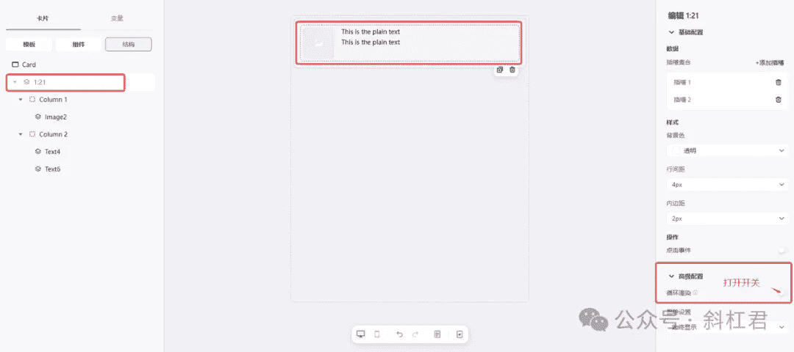

选择刚才我们创建的列表变量：

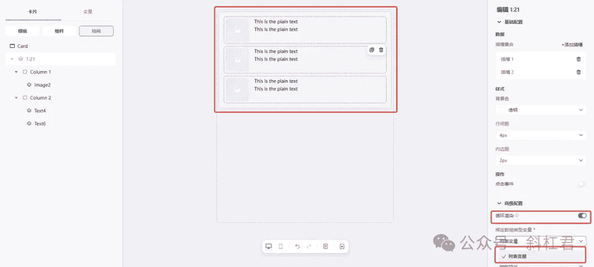

可以看到，列表循环展示出来了。循环的数量(三条数据)和我们设置的变量也是一一对应的。

接下来绑定元素（图片、标题、摘要）对应的变量。

**图片：**

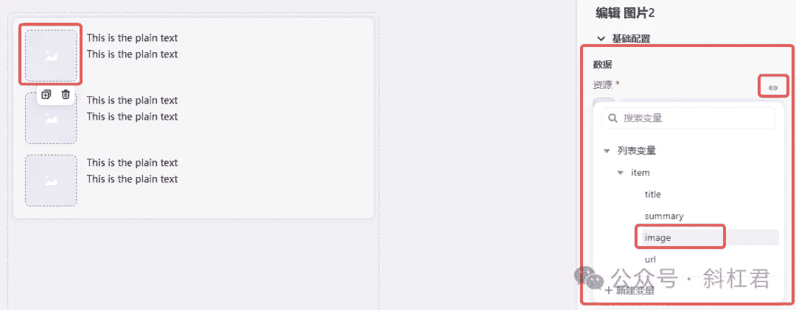

**标题：**

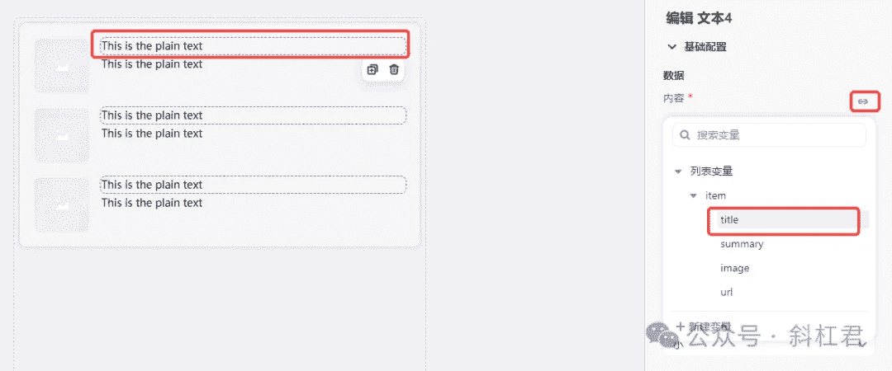

**摘要：**

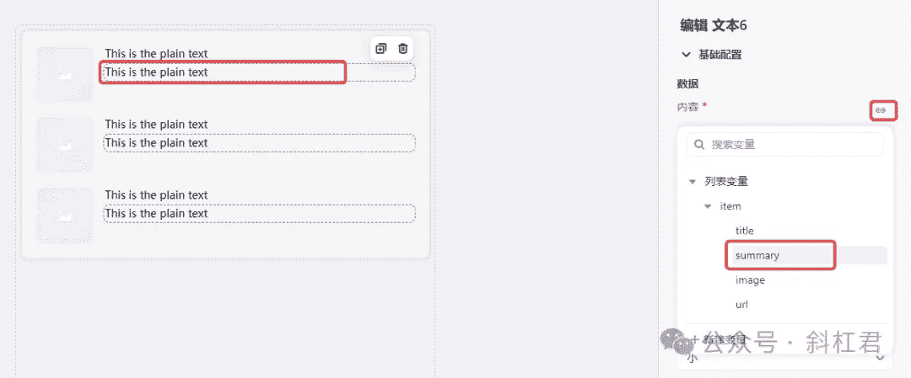

设置好以后是这样的：

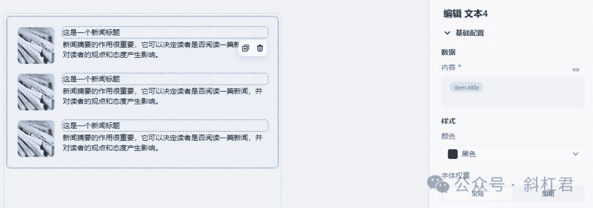

到这里，我们的卡片制作工作就完成了。接下来让我使用这个卡片小试牛刀~ 😄

**05**** 保存模板**

注意：这个不是必须的。但为了下次制作卡片时可以直接引用，一般会保存为模板。

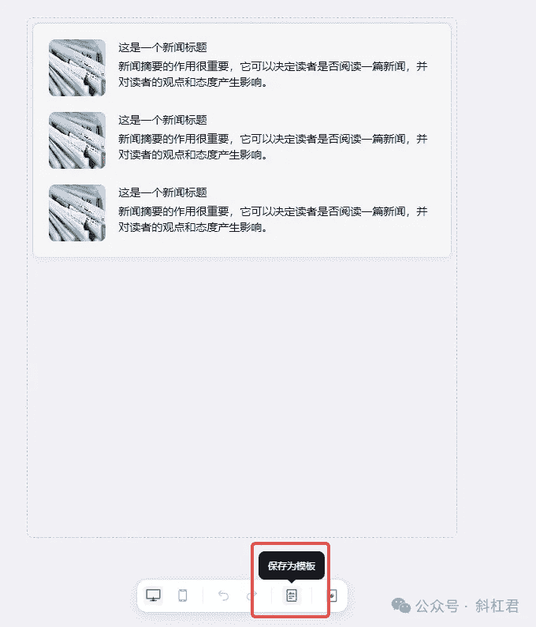

起一个卡片模板名称：

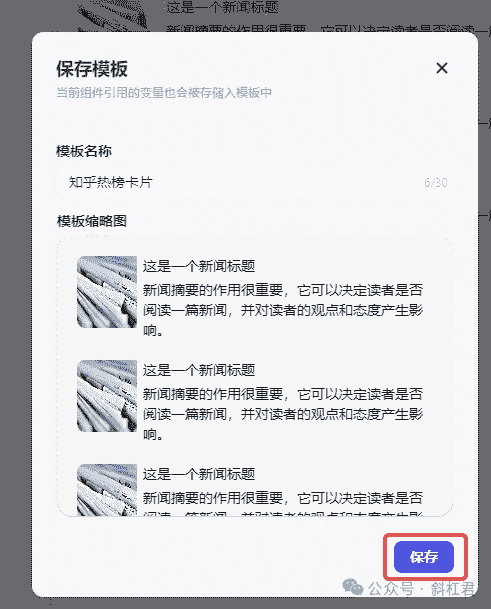

**06**** 发布卡片**

卡片只有发布以后才能被插件或工作流使用。

点击发布按钮发布一下，如下图：

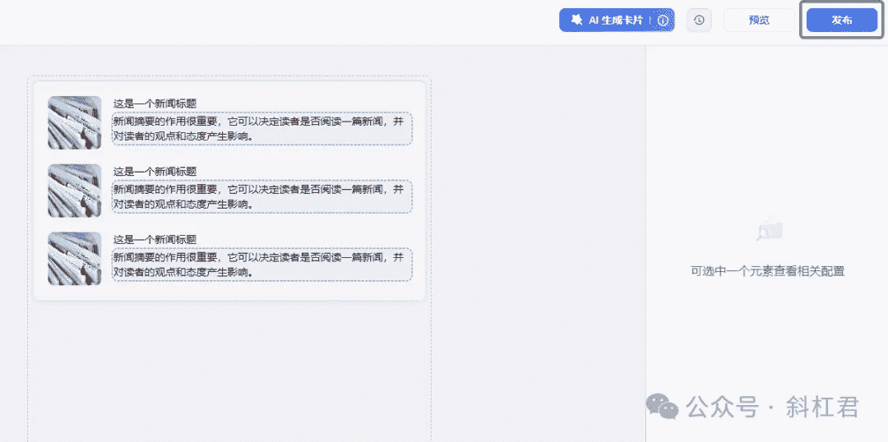

点击确定按钮，就发布好了。

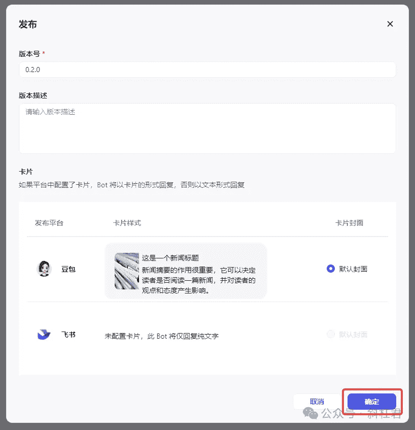

# 五、**使用卡片**

在第三节我们讲过，工作流和插件功能支持添加消息卡片。那么我们就通过插件的方式了使用卡片。

注: 如果有同学对插件的使用不了解，可以看第三章的详细教程。

## **01**** 创建Bot**

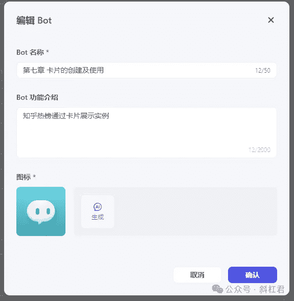

## **02****添加插件**

因为我们这个例子是要调用知乎热榜的数据，所以这里我们在插件中心搜索知乎热榜插件。

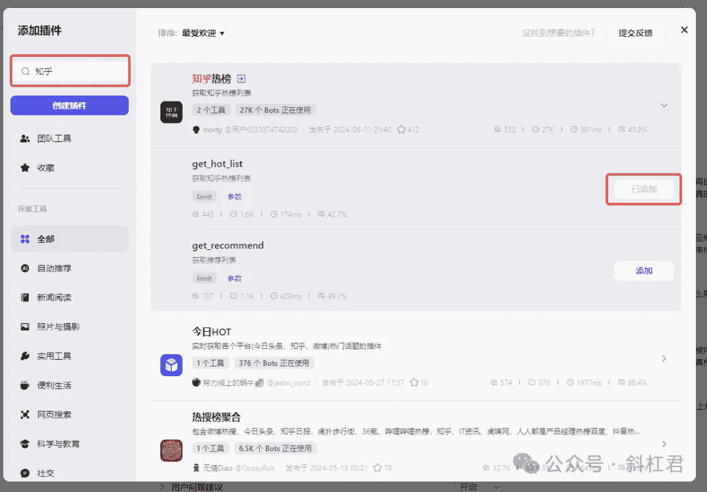

点击添加以后就加好了。

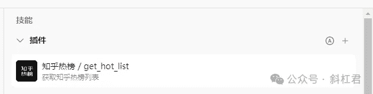

## **03**** 配置卡片**

点击 绑定卡片数据按钮 绑定卡片。

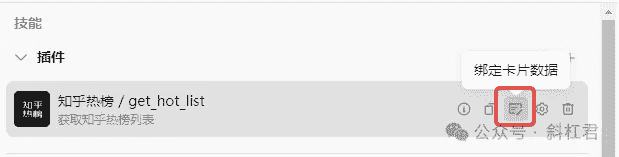

选择「团队卡片」选项卡，并选择刚才我们发布的卡片。

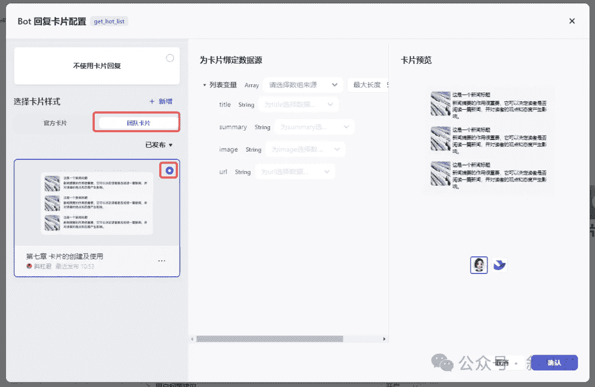

绑定数据源。按以下方式，依次绑定插件返回的数据：

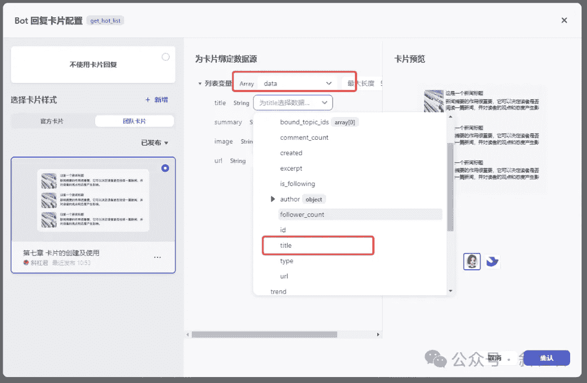

绑定之后的数据如下图所示：

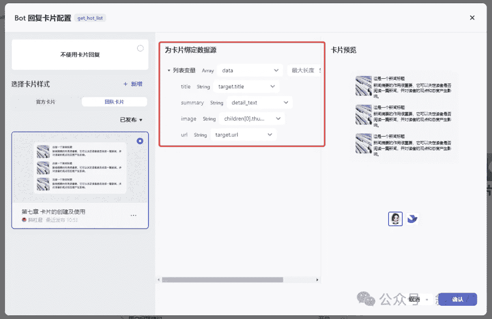

## **04**** 测试卡片**

卡片设置好了，接下来让我们测试一下吧。

输入查询知乎热榜：

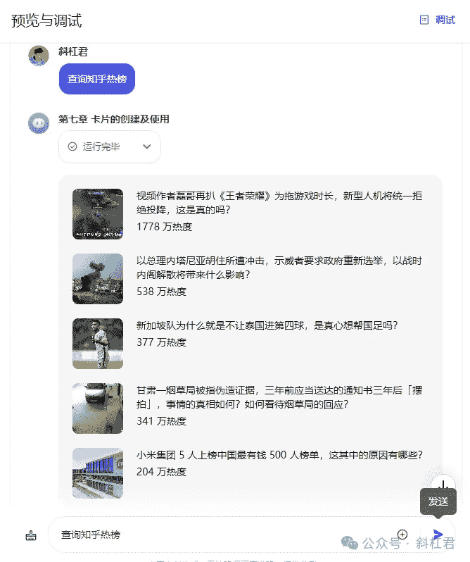

可以看到，消息以卡片的形式展现出来了。

好了，到这里，我们就把卡片的制作及使用学习完了，希望大家多多使用卡片的形式展现更好的的效果。愿大家在本文中能有所收获。😊

参考文章：https://mp.weixin.qq.com/s/qtgBHPOggldgWs_mZQoQVw

# 最后

> 如果本文对你有帮助或对AI Agent感兴趣，可以联系我们或者加入我们的AI洞察中心交流群～

+   当然我也很希望看到你根据本文亲手捏的应用，联系我！我一定为你点赞👍

> 参考资料：[AI Agent 智能体榜单](https://bluefocus.feishu.cn/wiki/TwW5wNDlfifjLgkE2micxthenNe)


官方群聊


智能体搭建交流群


bot互助群

> 如果您想与高手切磋，与AI爱好者一起热烈**讨论，发**表观点，分享作品，欢迎加入我们的官方群聊

> **智能体搭建交流群**：智能体搭建的互助交流群，群里有coze、扣子等各路技术流大佬实时解答技术问题，想交流的欢迎进群

> 如果您想与更多让自己制作的智能体冲上热门推荐页，获得更多曝**光，欢迎加入**由bot创建爱好者自发建立的bot互助群