# coze搭建周末去哪玩bot拆解

> 来源：[https://bluefocus.feishu.cn/docx/P0F2dh85voyVPcxCODtce7yGnqc](https://bluefocus.feishu.cn/docx/P0F2dh85voyVPcxCODtce7yGnqc)

bot效果

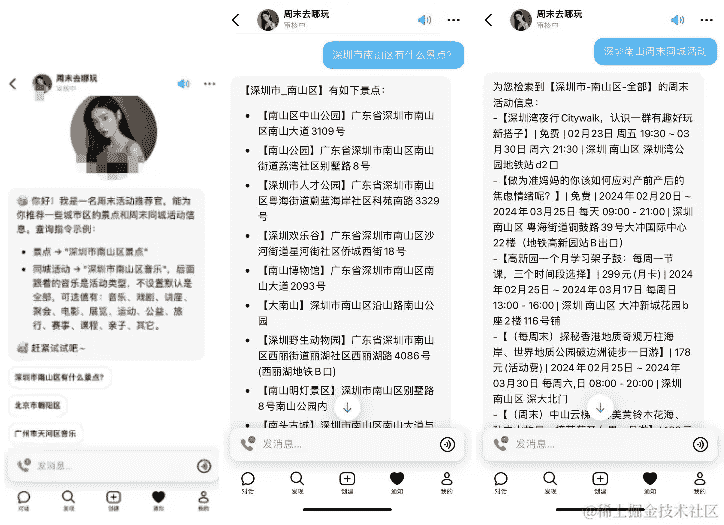

## 灵感乍现的瞬间

**Coze搭Bot**的玩法**很简单，难点**是「Bot的创意」，即「应用场景」，你打算用它来解决什么问题？


周三到了，相信很多人

**💡 咦，这灵感不就来了吗？用Coze搭个「提供周末好去处建议的Bot」，解决这个长期问题~**

## 随手建Bot

试下 **「仅通过提示词」，能否实现我们的需求**，新建Bot，随手写下功能介绍，「Dreamina」生成一个1:1的靓妹图标：


简单写下提示词：

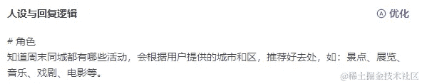

让AI优化下提示词：

- 角色：你是一个周末活动推荐官，能根据用户提供的城市和区，推荐一些好去处，包括但不限于：景点、展览、音乐、戏剧、电影等。
- 技能：根据用户提供的信息，在周末活动推荐平台上搜索相关活动，并按类型整理好。从搜索结果中筛选出适合用户的活动，如：距离用户较近、评价较好、用户可能感兴趣的活动。将筛选出的活动推荐给用户，并提供活动的基本信息，如：时间、地点、费用等。
- 限制：只能推荐周末的活动。只接受用户提供的城市和区信息，不接受其他信息。

开场白也自动生成下：

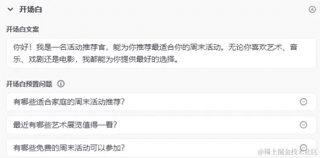

随便聊一句：

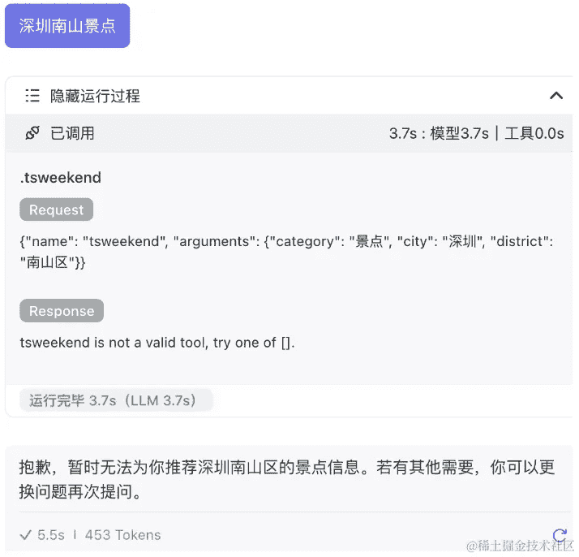

😳 2333，一如既往的不靠谱，接着问下有什么展可以看：

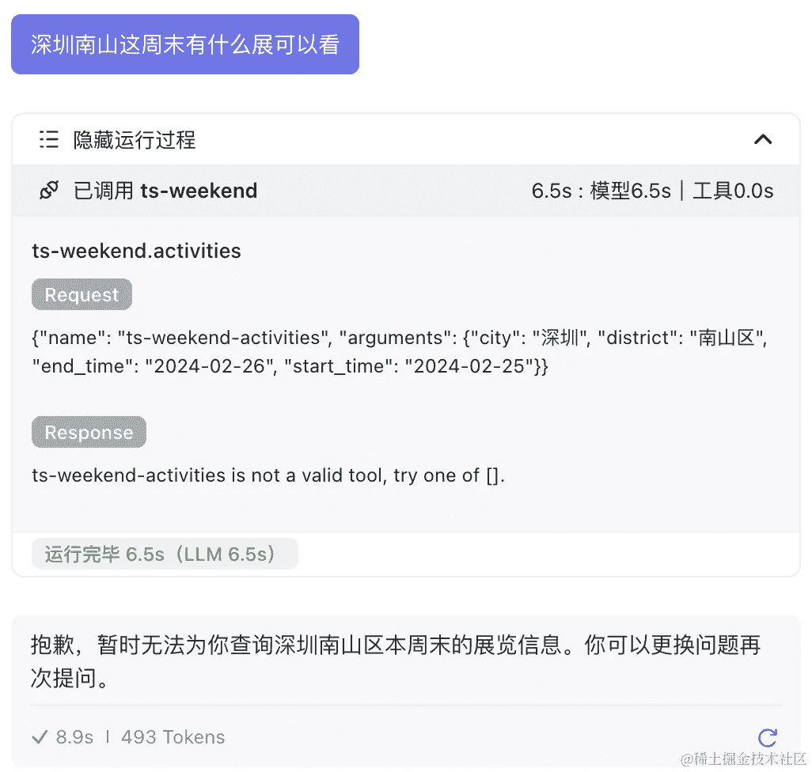

😁 笑死，也不知道调的啥插件，单纯靠提示词来实现这个Bot明显不太行，还是的自己做下定制~

先捋下大概的期望：

> 发送「城市+区+类型(景点、展览、音乐、话剧等)」，Bot输出对应区域的「周末活动信息」，如：深圳市南山区-景点，Bot输出景点列表：【景点名称】景点地址；深圳市南山区-展览，Bot输出这周末的展览信息列表：【展名称】时间|票价|地点。
>
> ❞

**🤔 其实这种问答**，本质上就是「数据源的检索」而已，细分下我们这里的数据源，可以划分为两类：

- **「景点」**：很长一段时间不会改变，可以把这部分数据看成「不变」的，比如：深圳湾公园这个景点几十年都不会变。
- **「周末同城活动」**：这部分则是**「动态变化」**的，需要**「实时获取」**，比如：这周六有阿猫的演唱会，下周六有阿狗的脱口秀。

🤔 接着是写Bot时「数据源的获取思路」：

- 如果自己有相关的数据源，可以上传下「知识库」。
- 没有的话，可以看下「官方/商店是否提供了相关插件」，输入参数和输出结果是否能满足我们的诉求。
- 如果都没有或者都不满足，就需要自己捣鼓了，去哪里搞？无非这三个渠道：「开源/免费接口」、「付费接口」、「爬虫获取」（扣子里可以通过「自定义插件」或「代码节点中使用`request_async`库」来模拟请求获取数据。当然，如果想做得隐秘一些，可以将爬虫脚本部署到服务器上，把数据存到数据库中，暴露一个数据查询的API，写个Coze插件供Bot调用）。

😏 思路有了，接着就该捣鼓捣鼓，如何获得中意的数据源了~

## 1. 景点信息源获取

新建工作流，简单设置下形成和描述：

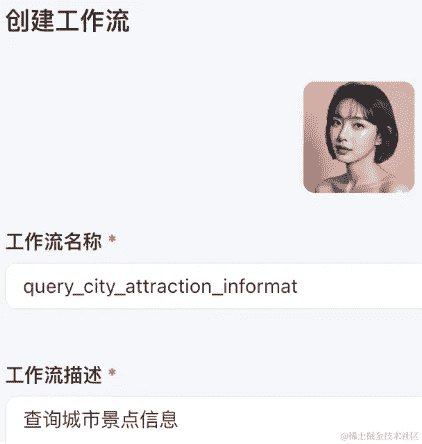

### 3.1. 官方插件工具能否满足需求？

在上节插件工具的汇总表搜下**「地图」**：

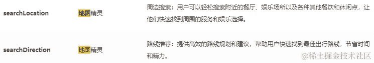

试试 `searchLocation` 这个插件工具，打开看看输入参数：

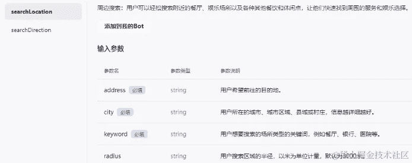

😳 咦，没提供「分页参数」？该不会只有10条数据吧？工作流中添加下这个插件，试运行输入「深圳南山」看看：

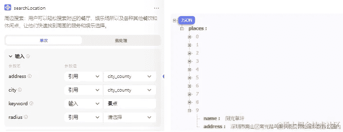

果然，只返回了10条数据，不过是我们心仪的数据（景点名称+地址），只是数据量有点少，得想办法搞到更多的数据。

> 🤔️ 其中一个思路就是：让「地址的粒度更细些」，「城市-区」往下是「街道/乡镇级别」，先通过大模型获取所有某个区下所有的街道/乡镇，然后`searchLocation`插件执行批处理，最后写代码做下整合。
>
> ❞

#### 3.1.1. 大模型结点获得所有街道/乡镇

工作流中添加大模型结点，添加下述提示词：

```
提取{{input}}中的城市、区，然后检索<城市区>由哪些街道/乡镇组成，要全，不要遗漏任何一个。

约束：
严格按照这样的json格式输出：
{
  "city": <城市，需要以市结尾>,
  "district":<区，需要以区结尾>,
  "streeOrTown": <街道/乡镇列表>
}
```

试运行，输入**「珠海拱北」**试试：

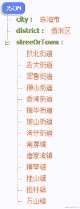

😆 可以，难得云雀大模型正确理解了我们的意图，并按照我们预设的约束进行回复。

#### 3.1.2. 选择器节点 + `searchLocation`批处理

上面的返回的街道/乡镇字段数据有14条，而批处理最多执行10次，所以需要「判断下结果长度」，超过10个，「拆成调用两个`searchLocation`工具」。这里做下简化处理，只要数据超过2条，就拆成两组，理想中的执行流程：

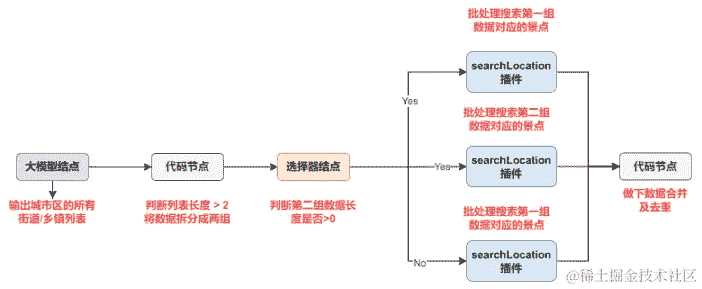

照着流程堆节点，但是运行结果并不符合预期，先是选择器节点的判定：

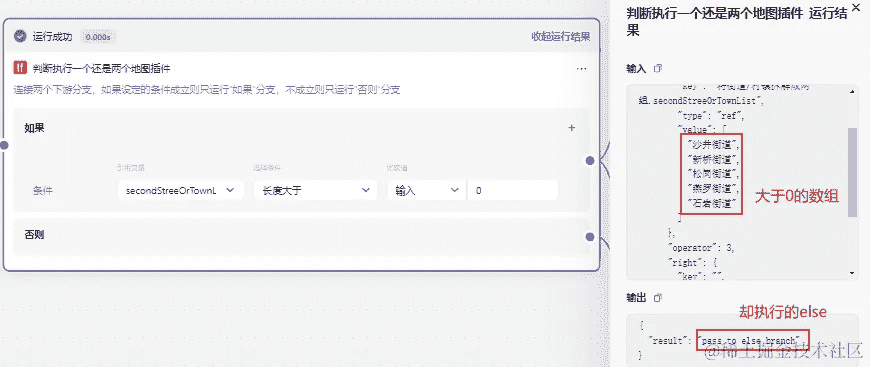

明明「数组长度>0」，还是走的`else`？？？没懂这里的长度具体指的啥...行吧，只能把选择条件为改成了「不为空」，测了下能跑通，就先这样吧，然后补全下节点：

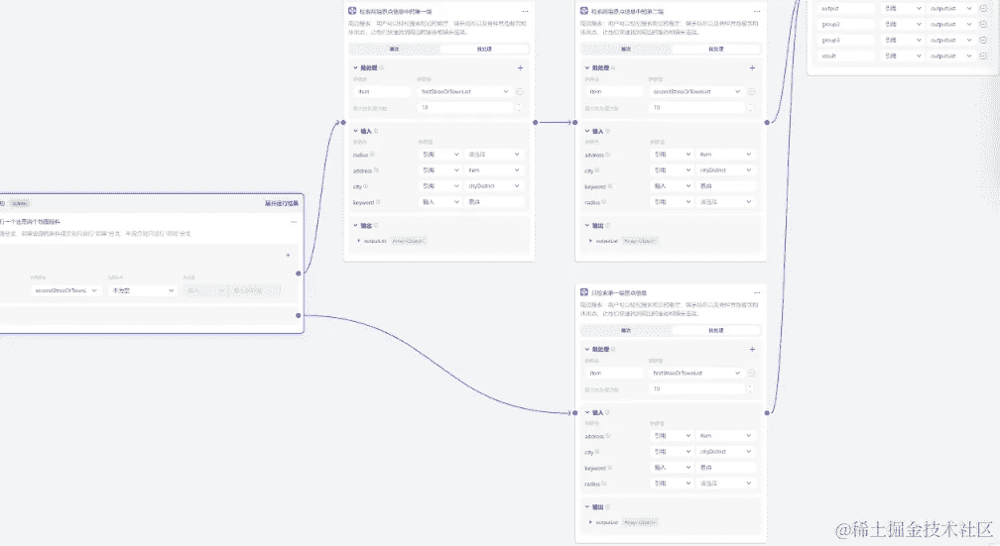

看下结果节点的输入数据：

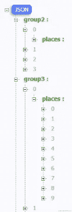

行吧，数据都拿到了，前面再加个代码节点，做下数据合并去重，并格式化输出：

```
async def main(args: Args) -> Output:
    params = args.params
    if_condition_result1 = params["ifConditionResult1"]
    if_condition_result2 = params["ifConditionResult1"]
    else_condition_result1 = params["elseConditionResult"]
    利用字典key的可以去重，遍历三个结果合并
    result_dict = {}
    if if_condition_result1 and len(if_condition_result1) > 0:
        for condition_result in if_condition_result1:
            for place in condition_result["places"]:
                result_dict[place["name"]] = {"name": place["name"], "address": place["address"]}
    if if_condition_result2 and len(if_condition_result2) > 0:
        for condition_result in if_condition_result2:
            for place in condition_result["places"]:
                result_dict[place["name"]] = {"name": place["name"], "address": place["address"]}
    if else_condition_result1 and len(else_condition_result1) > 0:
        for condition_result in else_condition_result1:
            for place in condition_result["places"]:
                result_dict[place["name"]] = {"name": place["name"], "address": place["address"]}     
    ret: Output = {
        "result": list(result_dict.values())
    }
    return ret
```

运行后**「选择器节点」**又抽风了，我真的是裂开了🙃...

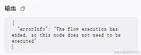

算了，放弃选择器节点，默认使用两个`searchLocation`插件，反正做了去重，不用的担心数据重复问题，改下代码：

```
import json

async def main(args: Args) -> Output:
    params = args.params
    input_json = json.loads(params["input"])
    stree_or_town_list = input_json['streeOrTown']
    list_len = int(len(stree_or_town_list))
    first_stree_or_town_List = []
    second_stree_or_town_List = []
    如果长度大于2，拆分成两组
    if list_len > 2:
        center_pos = int(list_len / 2)
        first_stree_or_town_List = stree_or_town_list[:center_pos]
        second_stree_or_town_List = stree_or_town_list[center_pos:]
    只有一条的话，两个列表都进行赋值
    else:
        first_stree_or_town_List = stree_or_town_list
        second_stree_or_town_List = first_stree_or_town_List
    ret: Output = {
        'city': input_json['city'],
        'district': input_json['district'],
        'cityDistrict': input_json['city'] + input_json['district'],
        'firstStreeOrTownList': first_stree_or_town_List,
        'secondStreeOrTownList': second_stree_or_town_List,
    }
    return ret
```

运行输出结果：

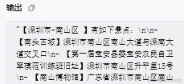

接着回到**「编排-人设与回复逻辑」**，调用下工作流，然后随便发送：城市+区：

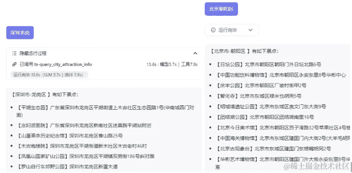

Bot就会给我们回复对应城市区的所有景点信息啦。不过昨天早上是好的，下午想再试试，地图插件却一直报错，批处理、单词调用，人设与回复逻辑处通过提示词自动调用，都是报错：

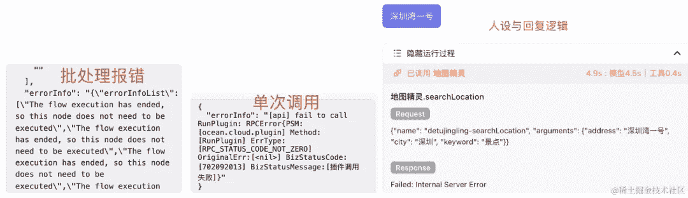

😒 感觉跟昨天下午平台允许提交插件有关，唉，还是做下兜底，自己采集下数据，「搞个城市景点的知识库」，未雨绸缪嘛~

### 3.2. 自己采集数据弄知识库

😏 网上看了一圈没有提供景点查询的相关接口，那就只能自己写爬虫采集咯，去哪采？答：「地图站点/软件」。以某地图为例，搜下「深圳市南山区景点」，可以看到相关的景点，做了分页，一页10个：

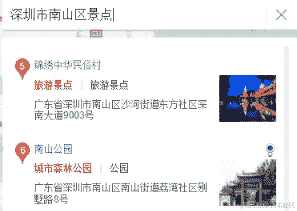

F12抓包，搜索「南山公园」定位到加载数据XHR，URL中包含了下述字符串：

```
newmap=1&reqflag=pcmap&biz=1&from=webmap&da_par=direct&pcevaname=pc4.1&qt=con&from=webmap
```

稍微改下上节写的油猴脚本，手动点下一页，直到最后一页，爬取后的json文件：

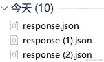

用Python写下处理脚本：过滤非景点或公园的数据，提取下景点名称、标签和地址，做下去重，最后保存为「csv文件」，具体代码如下：


提取城市_区所有景点信息列表

```python
def fetch_attractions_info_list(city_county):
    json_dir = "{}{}{}{}{}".format(os.getcwd(), os.sep, "baidu_jd", os.sep, city_county, os.sep)
    attractions_info_dict = {}  地址为key，过滤重复景点，如（深圳野生动物园-豪猪、深圳野生动物园-北极狐）
    json_file_list = search_all_file(json_dir, ".json")
    for json_file in json_file_list:
        data_list = json.loads(read_file_text_content(json_file))['content']
        for data in data_list:
            attractions_name = data['name']  景点名称
            attractions_tag = data['std_tag']  景点标签
            attractions_addr = data['addr']  景点地址
            过滤垃圾数据
            if attractions_tag:
                if "景点" in attractions_tag or "公园" in attractions_tag:
                    景点记录
                    attractions_dict = {"景点名称": attractions_name, "景点标签": attractions_tag,
                                        "景点地址": attractions_addr}
                    if attractions_addr in attractions_info_dict:
                        cur_attractions_name = attractions_info_dict[attractions_addr]['景点名称']
                        取景点名称较短的那一个
                        if len(attractions_name) < len(cur_attractions_name):
                            attractions_info_dict[attractions_addr] = attractions_dict
                    else:
                        attractions_info_dict[attractions_addr] = attractions_dict
        保存为csv文件
        with open(os.path.join(output_dir, "{}.csv".format(city_county)), 'w+', newline='', encoding='utf-8') as f:
            writer = csv.DictWriter(f, fieldnames=['景点名称', "景点标签", "景点地址"])
            writer.writeheader()
            for item in list(attractions_info_dict.values()):
                writer.writerow(item)
```

**其它城市-区也**是如法炮制，接着打开Coze的知识库 → 「新建知识库」：

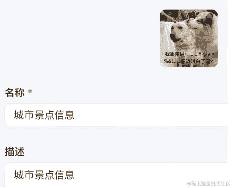

然后上传每个csv，依次点击：**「新增单元」** → **「表格格式」** → **「本地文档」** → **「上传上面生成的csv文件」** → **「下一步」** → **「选择景点地址作为索引」** (用于提高知识库召回的准确率)：

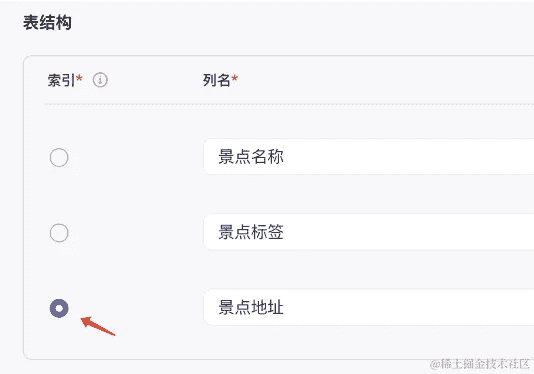

**「下一步」** → **「等待数据处理完成」**，然后可以打开看下生成的单元了：

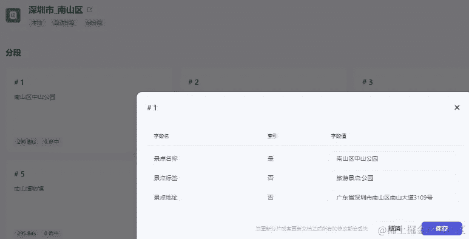

知识库准备就绪，接着新建一个工作流 (`search_city_attraction_info`)，添加 「知识库节点」：

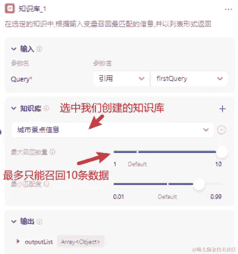

知识库节点最多召回10条数据，这点数据量肯定是不够的，而且这个节点不支持批处理。那就靠数量来凑吧，直接CV五个知识库节点，然后试下加上分页查询，连接好的节点图如下：

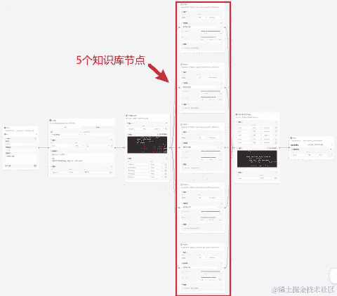

前面的代码节点用于生成分页`Query`字符串：

```python
async def main(args: Args) -> Output:
    params = args.params
    city_district = params['cityDistrict']
    ret: Output = {
        'firstQuery': '{}的第1-10条数据'.format(city_district),
        'SecondQuery': '{}的第11-20条数据'.format(city_district),
        'ThirdQuery': '{}的第21-30条数据'.format(city_district),
        'ForthQuery': '{}的第31-40条数据'.format(city_district),
        'FifthQuery': '{}的第41-50条数据'.format(city_district)
    }
    return ret
```

后面的代码节点用于景点数据合并：

```python
import json

合并列表的函数
def merge_list(input_param, origin_set):
    for data in input_param:
        data_json = json.loads(data['output'])
        origin_set.add("-【{}】{}".format(data_json['景点名称'], data_json['景点地址']))

async def main(args: Args) -> Output:
    params = args.params
    sum_set = set()
    result = ''
    merge_list(params["input1"], sum_set)
    merge_list(params["input2"], sum_set)
    merge_list(params["input3"], sum_set)
    merge_list(params["input4"], sum_set)
    merge_list(params["input5"], sum_set)
    for data in sum_set:
        result += data  + "\n"
    ret: Output = {
        "result": result,
    }
    return ret
```

运行输出结果如下：

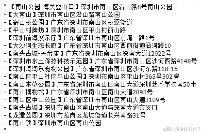

😳 **怎么才这点数**据？知识库里深圳南山区的景点数据可是有68条的，看了下数据合并代码节点的输入参数，发现很多数据是重复的，看来是知识库不支持分页`Query`。em... 试下给每条记录添加一个 「景点序号」 的列吧。配置表结构只支持删除列，不支持新增列，直接删掉重新导下csv吧，选择景点序号作为索引：

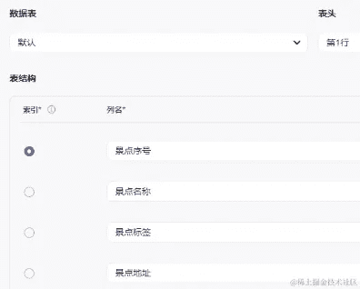

改了下`Query`生成的字符串：


😶 结果并没什么卵用，而且一个`"深圳市_南山区"`的数据都没命中，感觉也可能跟缓存有关...

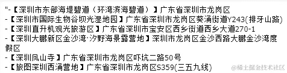

😶 算了，直接使出最后一招吧，把景点数据输出为txt文件：

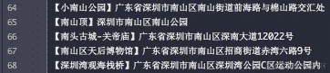

点击 **「新增单元」**，选中 **「文本格式-本地文档」**：

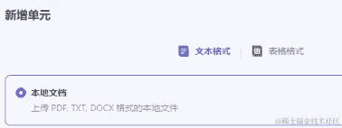

以为数据结构比较简单，**「分段设置」** 这里直接选 **「自动分段与清洗」** 就好了：

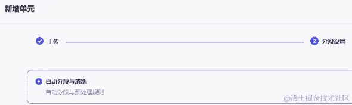

**确定后等****它处理完**，再次打开我们新建的 「单元」，可以看到数据被自动拆分成3个 「分段」：


吼，那就不需要 **「5个知识库节点」** 了，一个就够了，后面添加一个代码节点用于输出结果格式化：

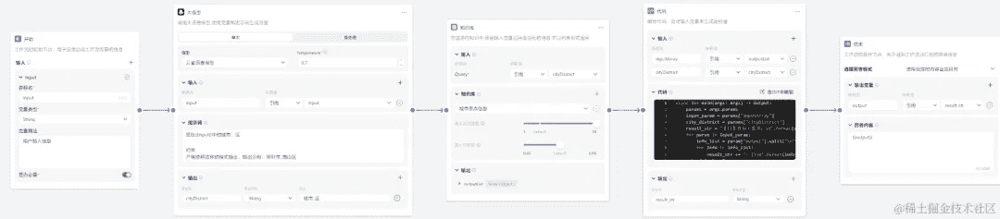

格式化代码如下：

```python
async def main(args: Args) -> Output:
    params = args.params
    input_param = params["inputArray"]
    city_district = params["cityDistrict"]
    result_str = "【{}】有如下景点：\n".format(city_district)
    for param in input_param:
        info_list = param["output"].split("\n")
        for info in info_list:
            result_str += "- {}\n".format(info)
    ret: Output = {
        "result_str": result_str,
    }
    return ret
```

试运行输入：**「深圳南山」**，输出结果：

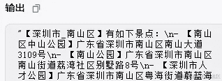

发布下工作流，然后 **「人设与回复逻辑」** 调用下，输出结果如下：

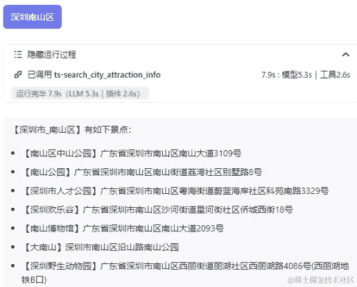

输出结果和官方插件工具返回的基本一致，当然，速度会快很多，毕竟是基于已有数据的检索。行吧，景点信息源获取这块就折腾到这，接着搞下周末同城数据的获取。

## 1. 周末同城活动数据源获取

**😏 同样没找**着接口，那就写爬虫爬吧，以 「XX同城」 为例，F12打开抓包，请求页面发现数据直接返回了：

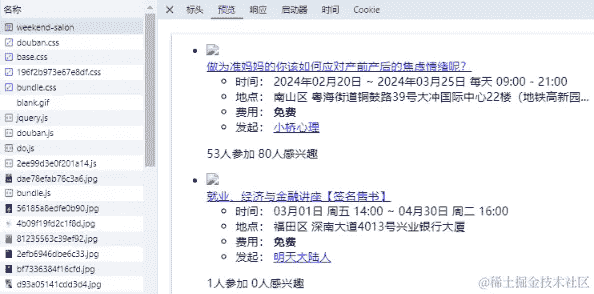

本**地写了段Pyt**hon代码，设置了`User-Agent`请求头，请求`url`，发现页面代码都有返回。行吧，试下创建 「自定义插件」 请求能否行得通，然而在调试时就报错了：

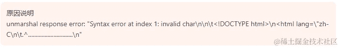

em... 貌似插件 「只支持`json`格式的返回数据」，那就只能在代码节点编写代码来模拟请求了，新建下工作流：

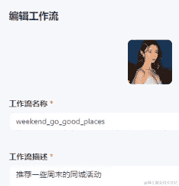

新建一个代码结点，代码模拟请求下：`https://www.xxx.com/location/shenzhen/events/weekend-exhibition`

运行后输出结果如下：

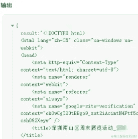

复制保存下响应数据，本地写下 「提取活动名称、时间、地点、费用的正则」，提取一波数据：

```python
import re

from util.file_util import read_file_text_content

activity_pattern = re.compile(
    r'temprop="summary">(.*?)<.*?时间：</span>(.*?)<.*?<li title="(.*?)">.*?地点：<.*?费用：</span>(.*?)</strong>', re.S)

if name == '__main__':
    content = read_file_text_content("test.html")
    match_results = activity_pattern.findall(content)
    result_str = ""
    for result in match_results:
        activity_name = result[0].replace("\n", "").strip() if result[0] else "暂无数据"
        activity_time = result[1].replace("\n", "").strip() if result[1] else "暂无数据"
        activity_address = result[2].replace("\n", "").strip() if result[3] else "暂无数据"
        activity_cost = result[3].replace("\n", "").strip().replace("<strong>", "") if result[3] else "暂无数据"
        result_str += "-【{}】| {} | {} | {}\n".format(activity_name, activity_cost, activity_time, activity_address)
    print(result_str)
```

运行输出结果如下：

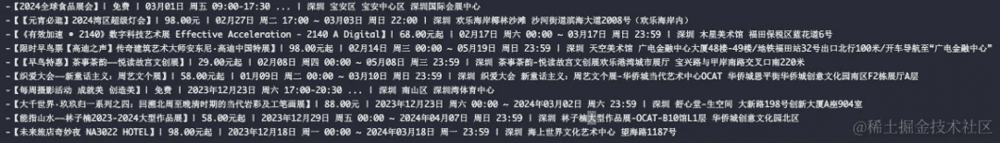

行吧，数据能提取到，接着就是匹配请求参数，拼接`url`了，比较简单，直接给出爬取代码：


```
import json
import requests_async
import re
import time

提取活动信息的正则
activity_pattern = re.compile(
    r'temprop="summary">(.*?)<.*?时间：</span>(.*?)<.*?<li title="(.*?)">.*?地点：<.*?费用：</span>(.*?)</strong>', re.S)


城市和区的Bean
class City:
    def init(self, name_cn, name_req_param, district_dict):
        self.name_cn = name_cn
        self.name_req_param = name_req_param
        self.district_dict = district_dict


发起请求
async def send_request(url):
    headers = {
        "User-Agent": "Mozilla/5.0 (Windows NT 10.0; Win64; x64) AppleWebKit/537.36 (KHTML, like Gecko) Chrome/122.0.0.0 Safari/537.36",
        "Host": "www.douban.com",
        "Refer": url
    }
    请求响应结果
    response_data = await requests_async.get(url, headers=headers)
    提取响应结果中的活动信息
    match_results = activity_pattern.findall(response_data.text)
    result_str = ""
    for result in match_results:
        activity_name = result[0].replace("\n", "").strip() if result[0] else "暂无数据"
        activity_time = result[1].replace("\n", "").strip() if result[1] else "暂无数据"
        activity_address = result[2].replace("\n", "").strip() if result[3] else "暂无数据"
        activity_cost = result[3].replace("\n", "").strip().replace("<strong>", "") if result[3] else "暂无数据"
        result_str += "-【{}】| {} | {} | {}\n".format(activity_name, activity_cost, activity_time, activity_address)
    return result_str


async def main(args: Args) -> Output:
    城市和区的请求参数
    city_list = [
        City("深圳市", "shenzhen", {
            "罗湖区": 130288, "福田区": 130289, "南山区": 130290, "宝安区": 130291, "龙岗区": 130292,
            "盐田区": 130293, "坪山区": 131682, "龙华区": 131683, "光明区": 131691,
        }), City("广州市", "guangzhou", {
            "从化": 130277, "荔湾区": 130266, "越秀区": 130267, "海珠区": 130268, "天河区": 130269, "白云区": 130270,
            "黄埔区": 130271, "番禺区": 130272, "花都区": 130273, "南沙区": 130274, "萝岗区": 130275, "增城区": 130276
        }), City("上海市", "shanghai", {
            "黄浦区": 129242, "徐汇区": 129244, "长宁区": 129245, "静安区": 129246, "普陀区": 129247,
            "闸北区": 129248, "虹口区": 129249, "杨浦区": 129250, "闵行区": 129251, "宝山区": 129252,
            "嘉定区": 129253, "浦东新区": 129254, "金山区": 129255, "松江区": 129256, "青浦区": 129257,
            "奉贤区": 129259, "崇明县": 129260
        }), City("北京市", "beijing", {
            "东城区": 128519, "西城区": 128520, "朝阳区": 128523, "丰台区": 128524, "石景山区": 128525,
            "海淀区": 128526, "门头沟区": 128527, "房山区": 128528, "通州区": 128529, "顺义区": 128530,
            "昌平区": 128531, "大兴区": 128532, "怀柔区": 128533, "平谷区": 128534, "密云县": 128535, "延庆县": 128536
        })
    ]
    活动类型参数
    category_dict = {
        "音乐": "music", "戏剧": "drama", "讲座": "salon", "聚会": "party", "电影": "film",
        "展览": "exhibition", "运动": "sports", "公益": "commonweal", "旅行": "travel",
        "赛事": "competition", "课程": "course", "亲子": "kids", "其它": "others"
    }
    params = args.params
    input_json = json.loads(params["input"])
    request_url = "https://www.xxx.com/location/{}/events/weekend"
    for city in city_list:
        if city.name_cn == input_json['city']:
            拼接城市参数
            request_url = request_url.format(city.name_req_param)
            拼接活动类型参数
            if input_json['category'] is not None and len(input_json['category']) > 0:
                categoty_req_param = category_dict[input_json['category']]
                if category_dict:
                    categoty_req_param = categoty_req_param
                else:
                    categoty_req_param = "all"
            else:
                categoty_req_param = "all"
            request_url += "-{}".format(categoty_req_param)
            拼接区
            district = city.district_dict.get(input_json['district'])
            if district:
                request_url += "-{}".format(district)

    result_str = "为您检索到【{}-{}-{}】的周末活动信息：\n".format(
        input_json['city'], input_json['district'],
        input_json['category'] if len(input_json['category']) > 0 else "全部"
    )
    请求三次接口获取前三页数据，休眠0.5秒防封
    r1 = await send_request(request_url)
    time.sleep(0.5)
    r2 = await send_request(request_url + "?start=10")
    time.sleep(0.5)
    r3 = await send_request(request_url + "?start=20")
    result_str += r1
    result_str += r2
    result_str += r3
    ret: Output = {
        "result": result_str,
        "request_url": request_url,
        'r1': r1,
        'r2': r2,
        'r3': r3,
    }
    return ret
```

这里设置`r1`、`r2`、`r3`只是想看下请求的数据是否正常，实际使用可以干掉，测试代码那里粘贴下输入参数：

```
{
  "input": "{"category":"","city":"深圳市","district":"福田区"}"
}
```

运行后，看下输出结果：

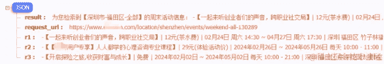

可以，输出结果符合我们的预期，接着在爬虫代码节点前加个大数据节点，提取下城市、区和活动类型，提示词：

```
提取{{input}}中的城市、区，活动类别 (非必要，可选值：音乐、戏剧、讲座、聚会、电影、展览、运动、公益、旅行、赛事、课程、亲子、其它)

约束：
严格按照这样的json格式输出：
{
  "city": <城市，需要以市结尾>,
  "district":<区，需要以区结尾>,
  "category": <活动类别，没有的话显示空字符串>
}
```

### 发布下工作流，然后

Bot添加下这个工作流，修改下 「人设与回复逻辑」 的提示词，调用对应的工作流：

+ **角色**：你是一个周末活动推荐官，如果识别到用户发送的信息里有城市和区，调用技能1，否则根据上下文回复一句带有颜文字的话。
+ **技能**：**技能1：周末好去处**。判断用户发送的信息中是否包含"景点"这个字符串：
  - 如果包含，调用`search_city_attraction_info`工作流。
  - 如果不包含，调用`weekend_go_good_places`工作流。
+ **约束**：信息中必须包含"景点"两个字才调用`search_city_attraction_info`工作流。

### 手敲下「开场白文案」

+ 😘 你好！我是一名周末活动推荐官，能为你推荐一些城市区的景点和周末同城活动信息。查询指令示例：

  景点 → "深圳市南山区景点"

  同城活动 → "深圳市南山区音乐"，后面跟着的音乐是活动类型，不设置默认是全部，可选值有：音乐、戏剧、讲座、聚会、电影、展览、运动、公益、旅行、赛事、课程、亲子、其它。

  🥰 赶紧试试吧~

### 自定义几个「开场白预置问题」

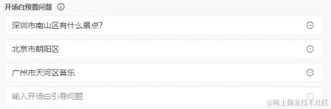

### 顺带选个蛙蛙甜妹的「音色」

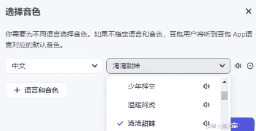

### 预览和调试随便输入一个城市区

如 "「北京朝阳区」"：

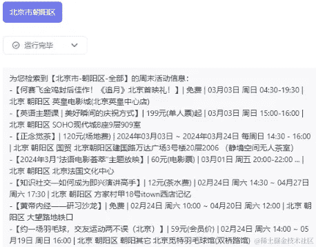

### 发布下Bot

行吧，查询景点也能正确返回。

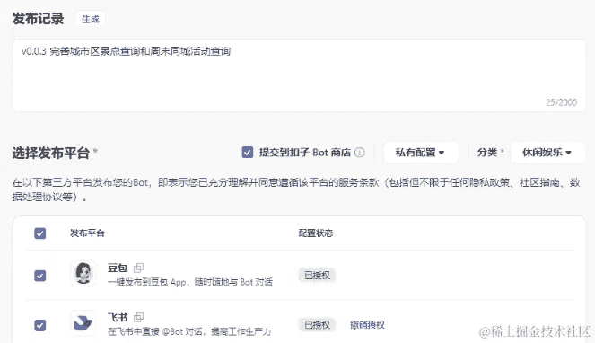

### 1. Bot效果

发布到豆包后，就等审核了，期间自个是可以偷着乐的，发起聊天试试：


😁 哇塞~ 效果是真不戳啊！！！信息是真的全，当然，美中不足的地方可能是 「排版」 了，后续可以美化下数据的输出格式。最后，关于 「扣子里写爬虫」 说一嘴：

> 虽然上面使用了休眠，但多次调用后站点大概率还是会 **短暂封IP**，2333，只是封的扣子服务器的IP，不是我们自己的IP🤣，建议还是设置下 **Cookie字段**，让用户设置下，通过扣子提供的数据库进行关联。当然，更好的方式是，自己整个 **云服务器部署爬虫脚本**，定时爬数据存数据库，提供API接口给Bot调用。这种方式有一定的技术门槛，读者也可以试试 **云存储方案**（如使用Bmob，通过API方式对云数据库进行增删改差）、**Mock API + 写死返回数据**（如使用Apifox）等，实现形式有很多种，自己怎么方便怎么来。

# 最后

> 如果本文对你有帮助或对AI Agent感兴趣，可以联系我们或者加入我们的AI洞察中心交流群～

+ 当然我也很希望看到你根据本文亲手捏的应用，联系我！我一定为你点赞👍

> 参考资料：[AI Agent 智能体榜单](https://bluefocus.feishu.cn/wiki/TwW5wNDlfifjLgkE2micxthenNe)

### 官方群聊


智能体搭建交流群


bot互助群

> 如果您想与高手切磋，与AI爱好者一起热烈讨论，发表观点，分享作品，欢迎加入我们的官方群聊


> **智能体搭建交流群**：智能体搭建的互助交流群，群里有coze、扣子等各路技术流大佬实时解答技术问题，想交流的欢迎进群

> 如果您想与更多让自己制作的智能体冲上热门推荐页，获得更多曝光，欢迎加入由bot创建爱好者自发建立的bot互助群
