# 如何用CozeIDE制作一个插件

> 来源：[https://bluefocus.feishu.cn/docx/QtFCdRI6ioQC5SxcO8jc0ay9nMe](https://bluefocus.feishu.cn/docx/QtFCdRI6ioQC5SxcO8jc0ay9nMe)

# 一、CozeIDE 是什么？

CozeIDE 是扣子给你提供的插件开发利器，你可以在 CozeIDE 上开发、测试插件，并由扣子帮你托管运行插件代码，你无需关心购买服务器、配置域名等事项。CozeIDE 还内置了 AI 编程助手，无论你是否有编程基础，都可以通过 AI 助手，快速开发插件。

## CozeIDE 有哪些主要功能？

CozeIDE 为插件开发者提供了一整套代码编辑、依赖包管理、测试、元数据管理、发布部署能力，以及 AI 编程助手，解决你开发插件过程中的各种问题。

### 1、代码编辑

CozeIDE 为你提供了代码模板，你只需要在代码模板的基础上进行开发、完善。IDE 提供了 2 种运行时：Node.js 和 Python，满足你不同的诉求。

#### **Node.js 模板示例**

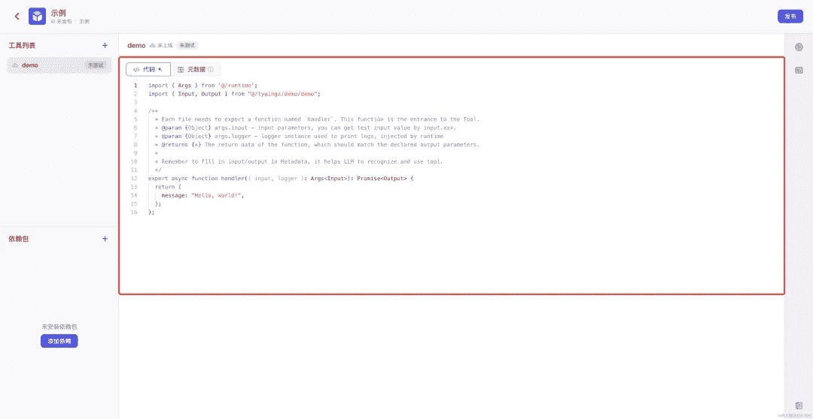

#### **Python 模板示例**

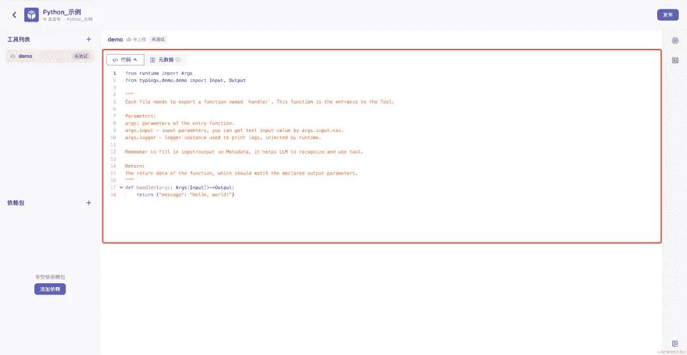

### 2、AI 编程助手

如果你写代码过程遇到问题，可通过快捷键唤起 AI 编程助手（macOS 为 Command + I、windows 为 Ctrl + I）。AI 编程助手可为你提供以下几个便捷的能力：

+   AI 生成代码：输入想要的功能，点击

+   AI 修改代码：选中待修改的代码，唤起 AI 助手，输入想要修改的功能。

+   AI 代码解释/代码注释：选中代码后，输入/ 选择不同指令，由 AI 对代码进行解释，或者自动生成代码注释。

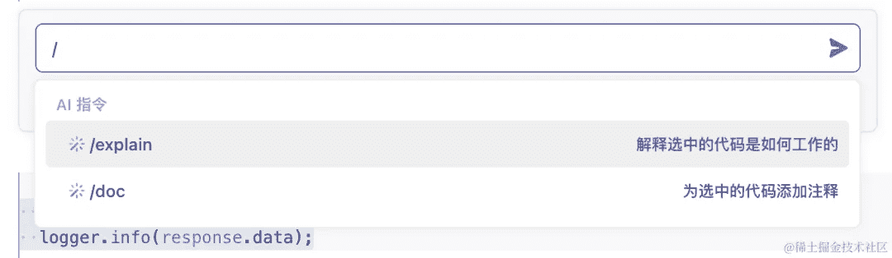

### 3、依赖包管理

依赖包是代码运行依赖的外部代码模块。如果你的代码中引用了其他外部的模块，但没有安装依赖，IDE 会提示错误。根据错误信息，点击左下角【添加依赖】，输入依赖的名称即可安装。安装过程中可查看控制台的日志，观察安装进度。

#### **具体示例**

未安装依赖时报错

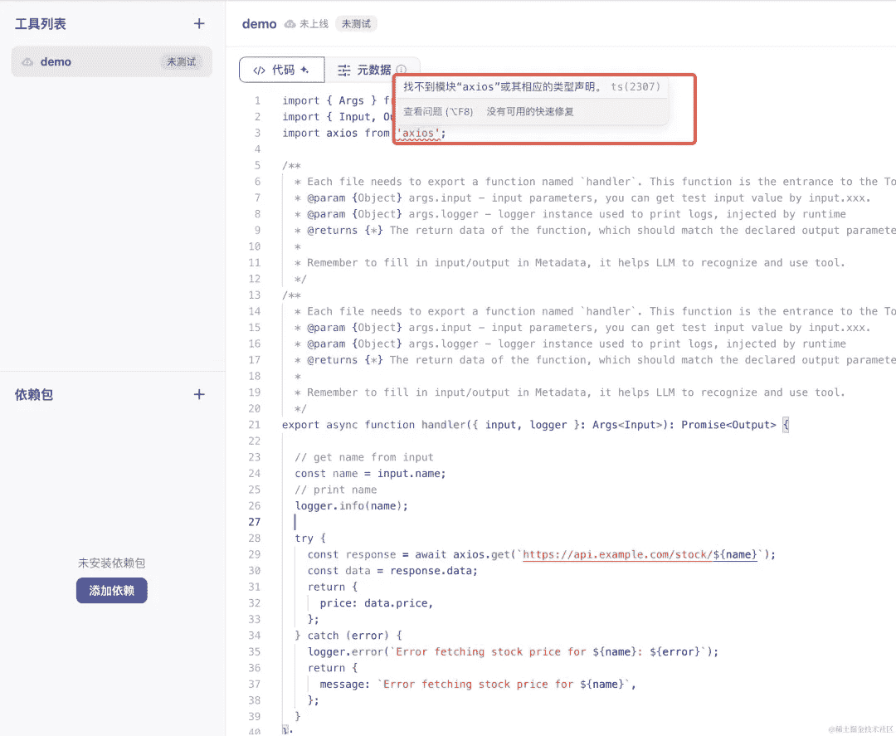

安装依赖

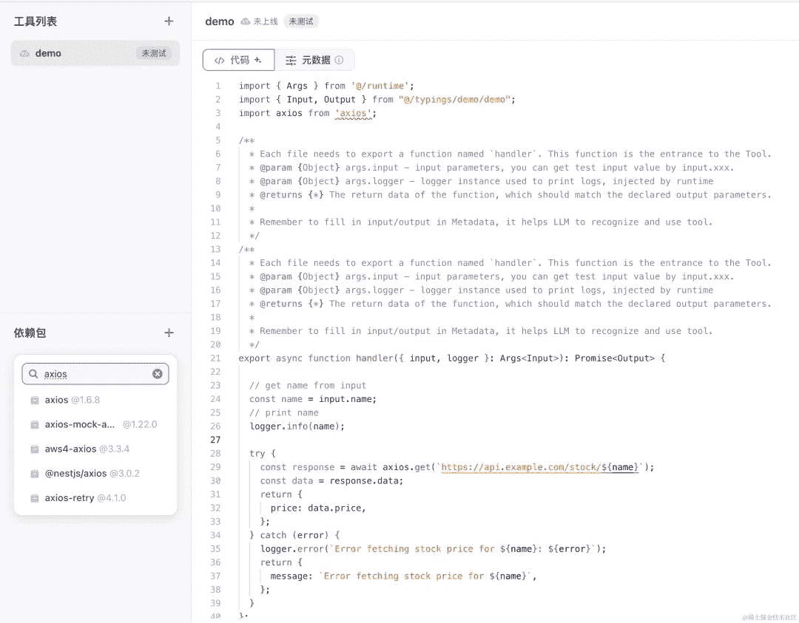

安装依赖后未报错

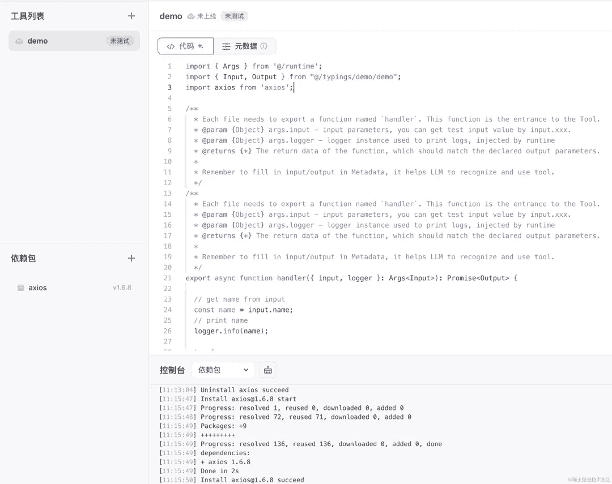

若需要指定安装某个版本，你可以通过依赖名@版本号来进行选择。

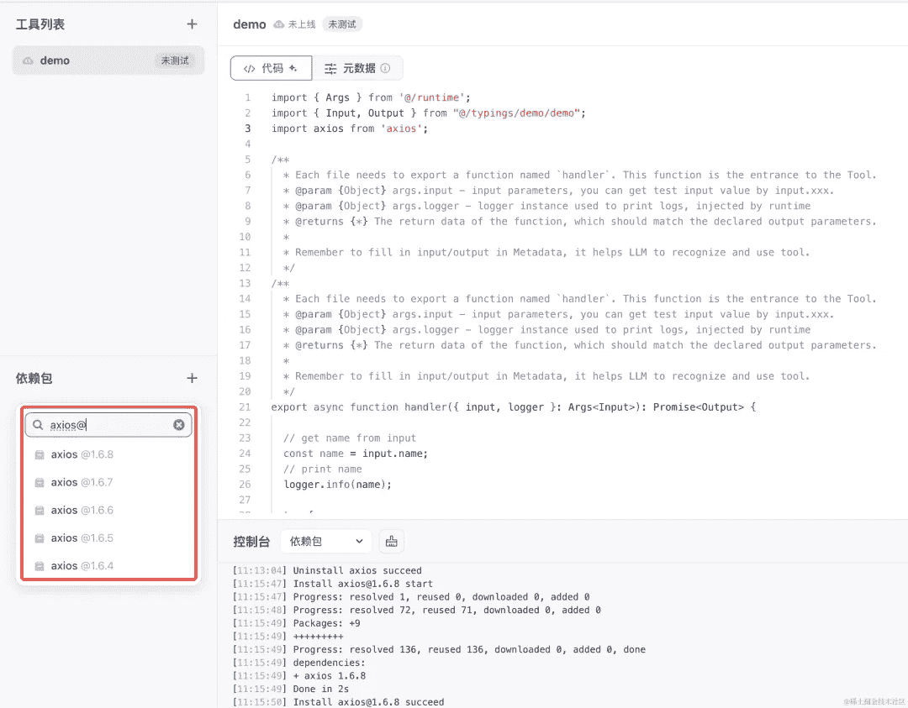

### 4、元数据

元数据的作用是让大模型理解每个工具输入参数、输出参数有哪些，以及对应的含义。

在以下代码示例中，这个工具接收一个输入参数：name，并返回一个参数：message。因此，我们需要将 name 和 message 补充到元数据面板。

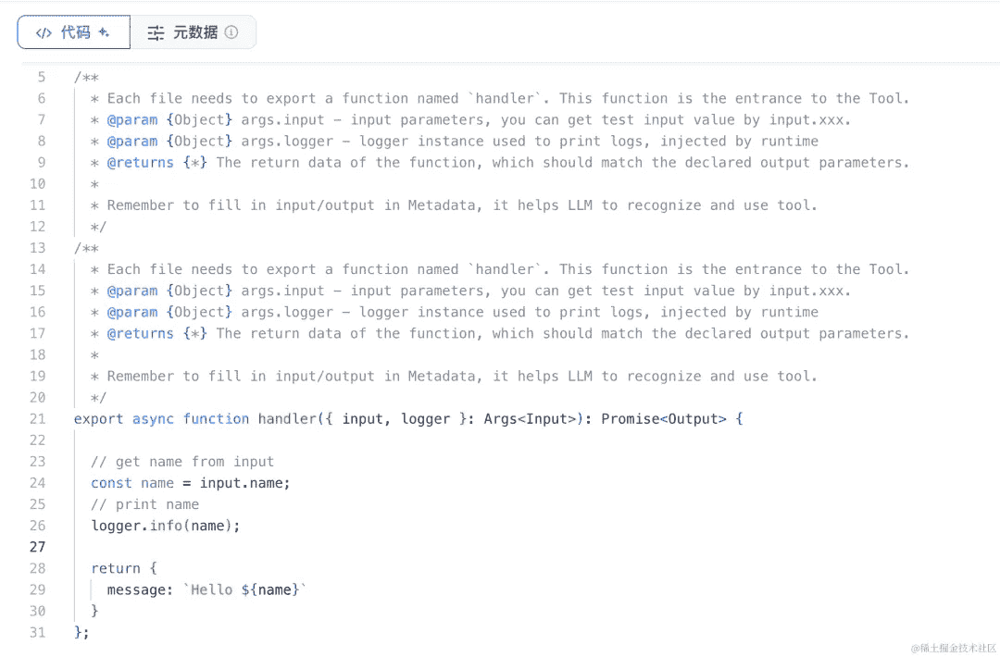

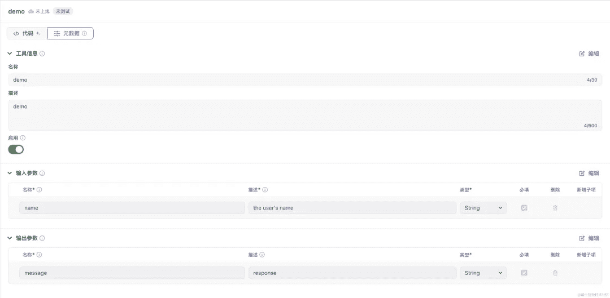

### 5、测试

写完代码和元数据后，需要验证代码是否正常运行。点击右侧的测试，输入测试的数据。

如果你已经填写元数据中的输入参数，则可以点击自动生成，IDE 会生成符合你结构定义的随机数据。你需要修改成你需要的值即可。填写完成后，点击运行，即可看到测试结果。

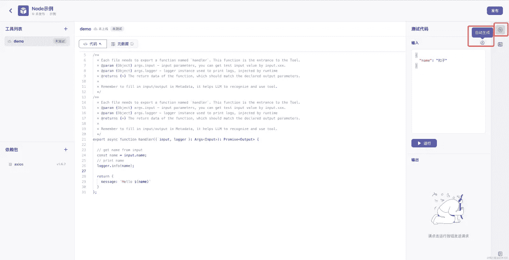

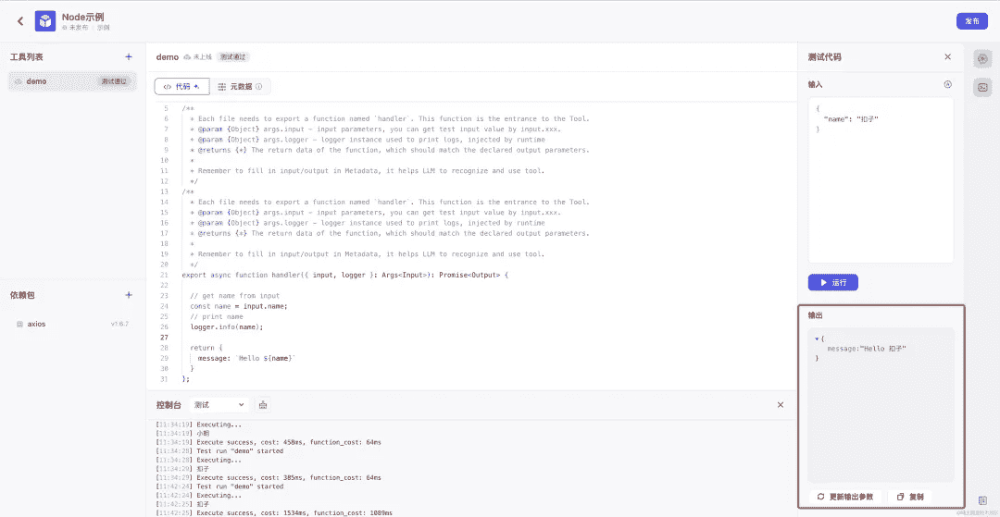

如果你之前未填写元数据的输出参数结构，可以在测试通过后，点击下方的【更新输出参数】，IDE 会自动更新覆盖在元数据区域，你只需要补充完善描述即可。

### 6、发布

测试通过后，就可以去点击发布啦。如果你开发了多个工具，但有些没测试完成不想发布，可以在该入口禁用这些工具，只发布启用的工具。

接着选择“信息收集声明”。如果插件会收集用户信息，请选择“是”并选择具体信息，用户在使用该插件时能了解收集的信息。否则，选择“否”，点击发布即可。

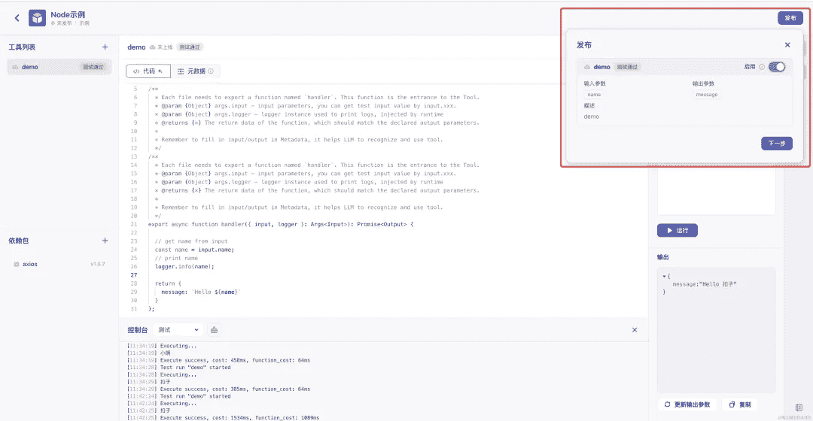

# 二、10 分钟快速制作插件

接下来我们以开发实际插件为例，演示整个创建流程。

### 插件一、查询股票价格（难度 🌟 ）

#### **明确目的和方案**

首先，需要构思这个插件具备什么能力：根据股票名称查询股票价格。

接着搜索哪些网站可以免费查询股票价格。通过互联网检索，可以得知“alpha vantage”提供了免费查询美股股票价格的能力。明确了目的和方案后，开始开发插件。该插件难度🌟，教程内已提供源码，可直接复制使用。

#### **操作步骤**

##### **步骤一：新建插件和工具**

1.  打开 https://www.coze.cn/ 选择需要所属的团队。

1.  点击右上角创建插件，填写名称，选择插件创建方式为“在 Coze IDE 创建”，运行时选择“Node.js”（你也可以根据自己的情况，选择 Python）

1.  插件名称：查询股票价格

1.  插件描述：查询股票价格

1.  点击“在 IDE 中创建工具”，填写工具名称和介绍：

1.  名称：search_stock_prices

1.  介绍：根据股票名称查询股票价格

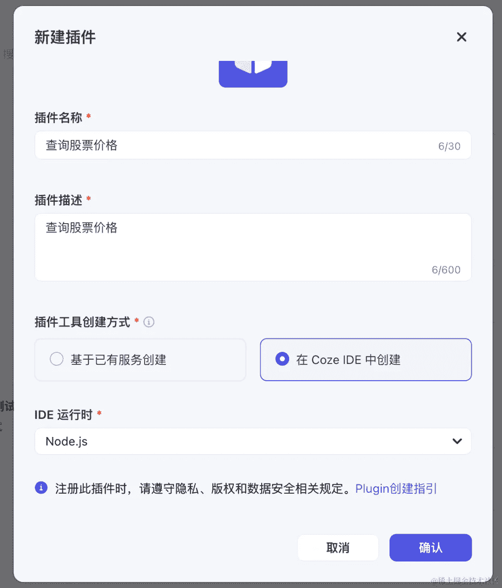

##### **步骤二：代码编写和开发**

1.  因为已经明确需要根据股票名称查询价格，所以可以先在元数据中定义一个输入参数，名称：code，描述为：股票名称

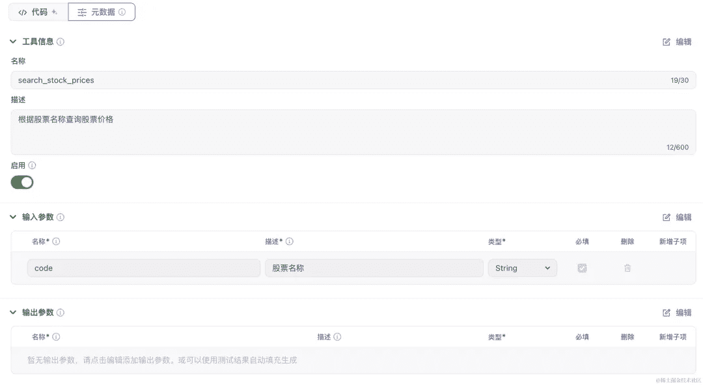

编写元信息

1.  在代码编辑器中，通过快捷键唤起 AI 助手（macOS 为 Command + I、windows 为 Ctrl + I），输入我们的需求：根据 input.code，到 alpha vantage 查询股票价格。你也可以手动编写代码。

1.  AI 生成代码后，点击接受，再进行调整，最后得到这样一份代码。（若 AI 生成效果不好，可直接复制本代码使用）

```
**import** { Args } **from**** &#x27;@/ru****ntim****e&#x27;;
im**port { **Inpu****t, Out**p**ut } **f**rom &quot;@/t**y**pings/s****earch_s**t**ock_pr**ic**es/se**ar**ch_st**oc**k_pri**ce**s&quot;;**
imp**ort a**xios from &#x27;a**xios&#x27;**;
ex**port **asyn**c func**tion** hand**ler(**{ inpu**t, logger }: Args&lt;Input&gt;): Promise&lt;Output&gt; {
  const code  = input.code;
  const apiKey = &#x27;YOUR_ALPHA_VANTAGE_API_KEY&#x27;;
  const url = `https://www.alphavantage.co/query?function=GLOBAL_QUOTE&amp;symbol=${code}&amp;apikey=${apiKey}`;
  
  try {
    const response = await axios.get(url);
    const data = response.data[&#x27;Global Quote&#x27;];
    return {
      code: code,
      price: data[&#x27;05. price&#x27;],
    };
  } catch (error) {
    logger.error(`Error fetching stock price for ${code}: ${error}`);
    return {
      code: code,
      price: null,
    };
  }
}
```

1.  左侧安装 axios 依赖，安装该依赖后可发起请求查询数据。未安装依赖时会提示错误。

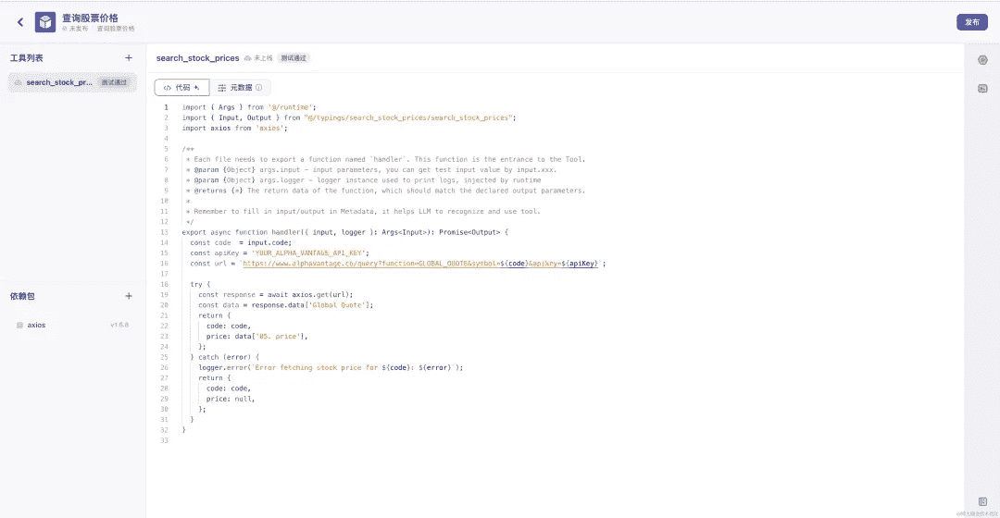

安装依赖后正常

##### **步骤三：测试**

1.  点击自动生成测试数据，修改 code 为 AAPL（苹果），点击运行。

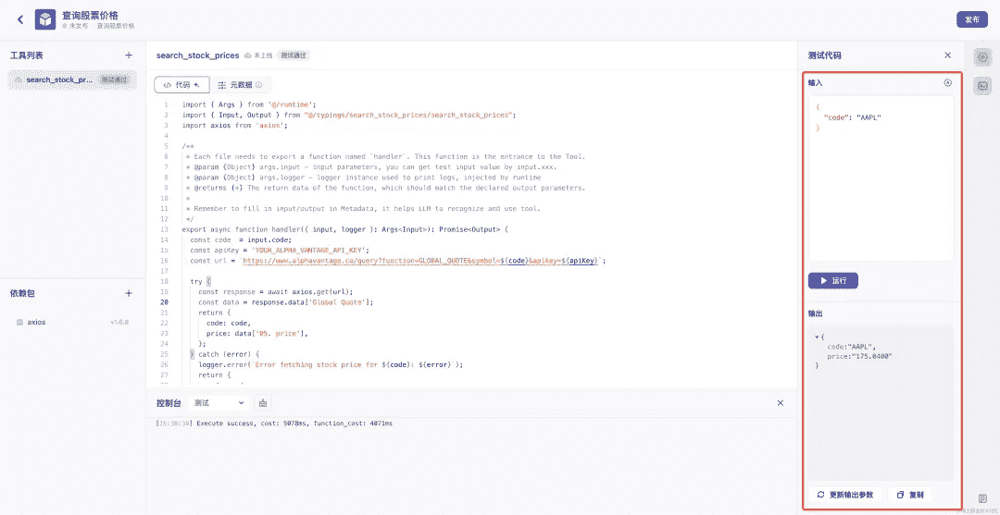

1.  点击“更新输出参数”，然后切换到“元数据”面板，修改输出参数中 code 和 price 的描述。修改后，需再次运行测试，避免修改错误导致运行出现问题。

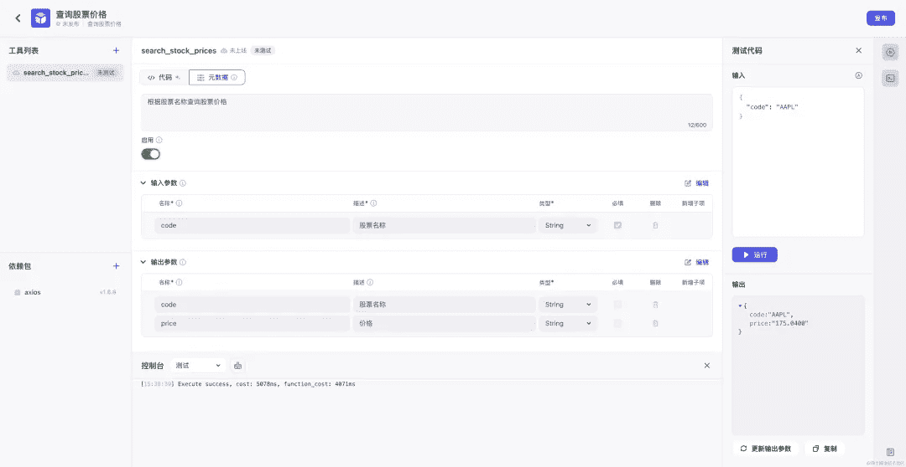

1.  测试通过后，就可以进行发布

##### **步骤四：发布**

1.  点击右上角发布，点击下一步，选择“否”，点发布。

1.  发布成功后，就可以去创建 Bot 使用啦

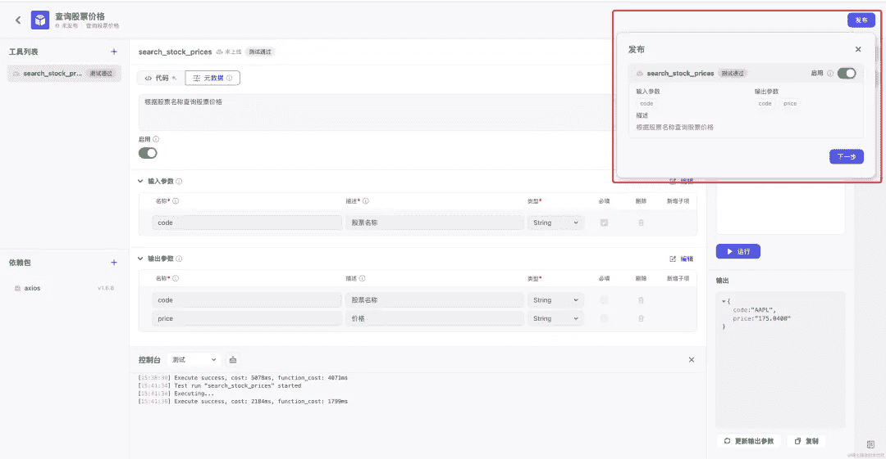

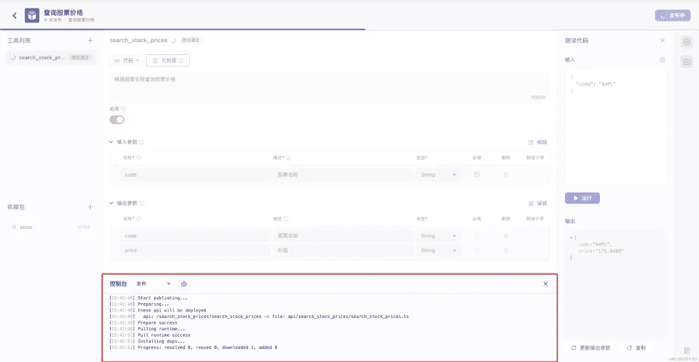

##### 步骤五：创建 Bot 使用该插件，使用 Bot

1.  回到 Bot 列表，点击创建 Bot，填写名称和功能描述：

1.  名称：查询股票价格

1.  功能介绍：查询股票价格

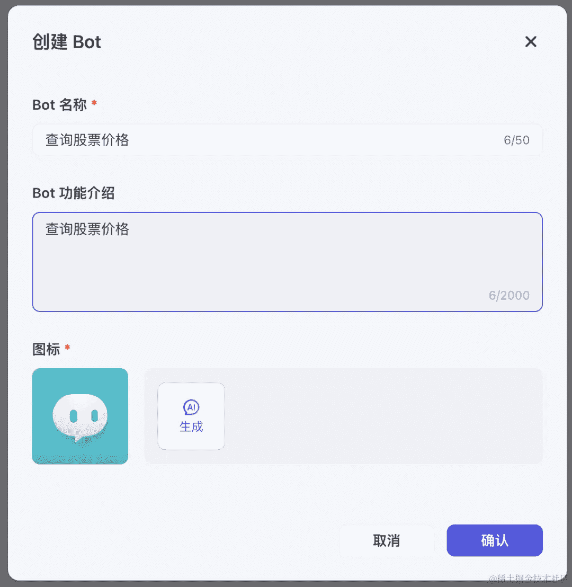

1.  关联刚刚发布的插件，并且填写 Bot 的回复逻辑，点击“优化”

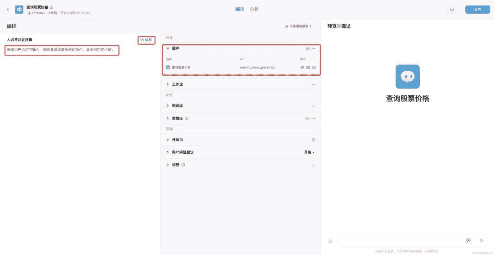

关联插件、填写Prompt

1.  优化完 Prompt 后，就可以和 Bot 进行对话，查询公司股票啦。

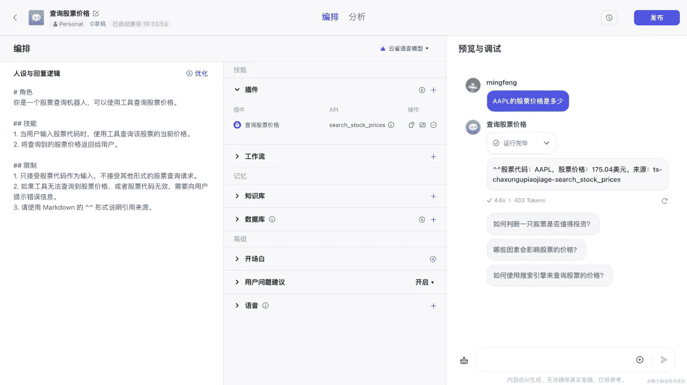

自动优化Prompt，进行使用

1.  更多 Bot 配置和高阶玩法，可参考官方文档

### 插件二、掘金插件（难度 🌟🌟🌟 ）

#### **明确目的和方案**

首先，需要明确插件具有哪些能力：

1.  列出掘金上的热门文章

1.  按主题搜索掘金上的热门文章

该插件难度🌟🌟🌟 ，教程内未提供源码，你可自行调研方案。

#### **操作步骤**

##### **步骤一：新建插件和工具**

1.  打开 https://www.coze.cn/ 选择需要所属的团队。

1.  点击右上角创建插件，填写名称，选择插件创建方式为“在 Coze IDE 创建”，运行时选择“Node.js”（你也可以根据自己的情况，选择 Python）

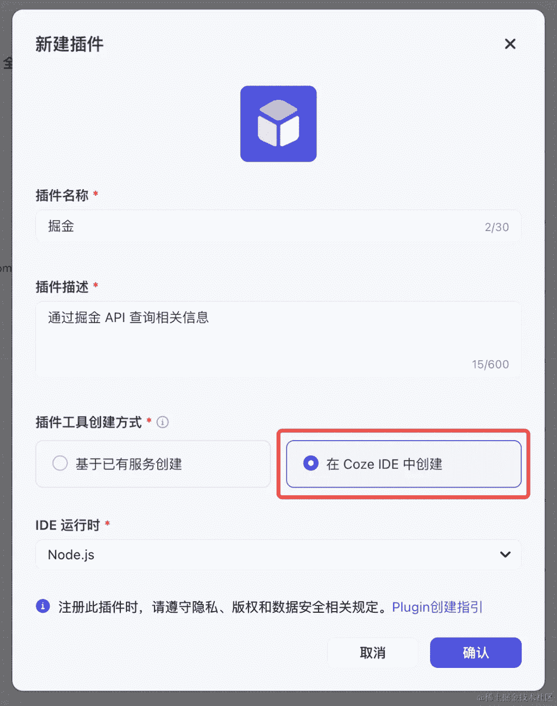

1.  点击“在 IDE 中创建工具”，创建一个 search 的工具

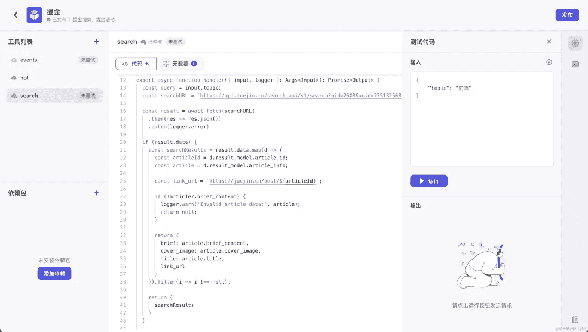

##### **步骤二：代码编写和开发**

进行代码开发、安装依赖包安装等


##### **步骤三：测试**

开发完成后，填写测试数据，进行测试。这个阶段你可能会反复执行和调试代码，查看输出结果是否符合预期、增加异常处理、对 API 返回的脏数据的处理等。

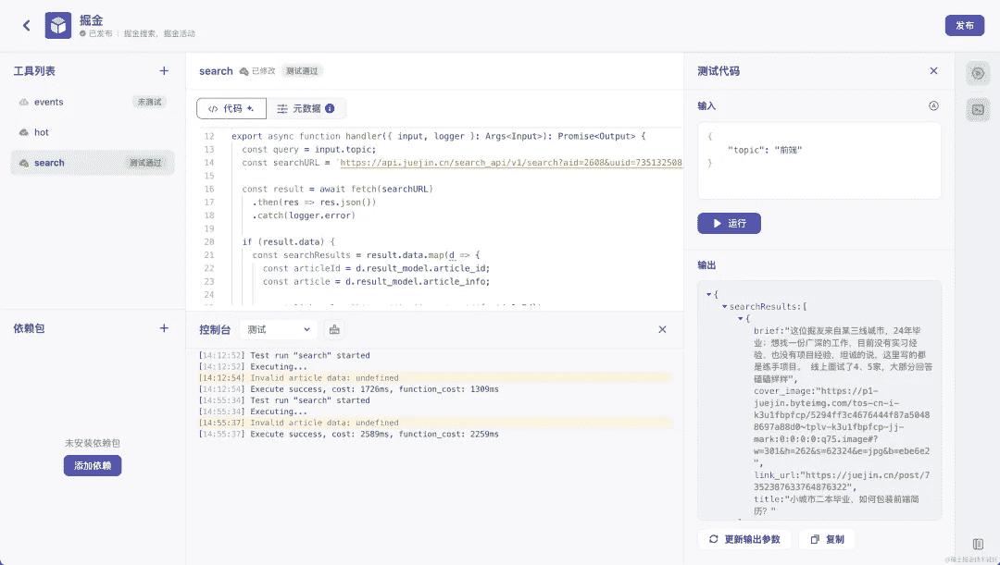

更新元数据：

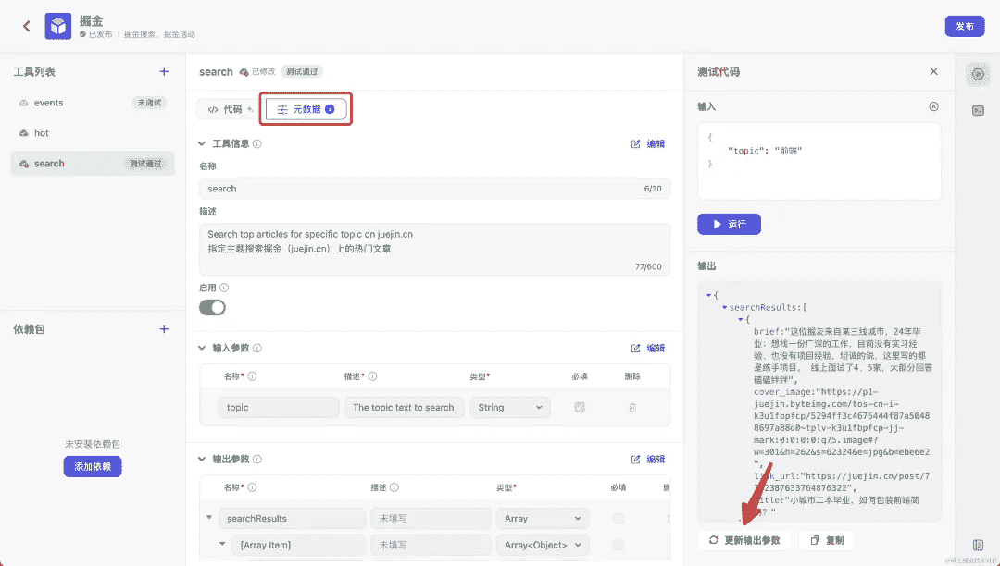

##### **步骤四：发布**

点击右上角发布，点击下一步，选择“否”，点发布。发布成功后，就可以去创建 Bot 使用啦。

##### 步骤五：创建 Bot 使用该插件，使用 Bot

回到 Bot 列表，创建一个 Bot，或选择现有的 Bot，进入 Bot 编排页面，关联这个插件后进行使用。更多 Bot 配置和高阶玩法，可参考官方文档

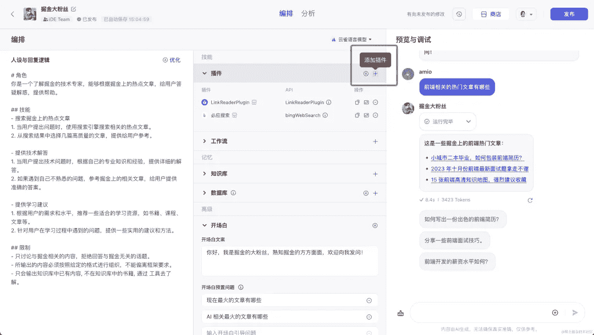

以上就是 2 个插件和 Bot 开发的完整过程，赶快去试试开发你的 IDE 插件吧。


官方群聊


智能体搭建交流群


bot互助群

> 如果您想与高手切磋，与AI爱好者一起热烈**讨论，发**表观点，分享作品，欢迎加入我们的官方群聊

> **智能体搭建交流群**：智能体搭建的互助交流群，群里有coze、扣子等各路技术流大佬实时解答技术问题，想交流的欢迎进群

> 如果您想与更多让自己制作的智能体冲上热门推荐页，获得更多曝**光，欢迎加入**由bot创建爱好者自发建立的bot互助群