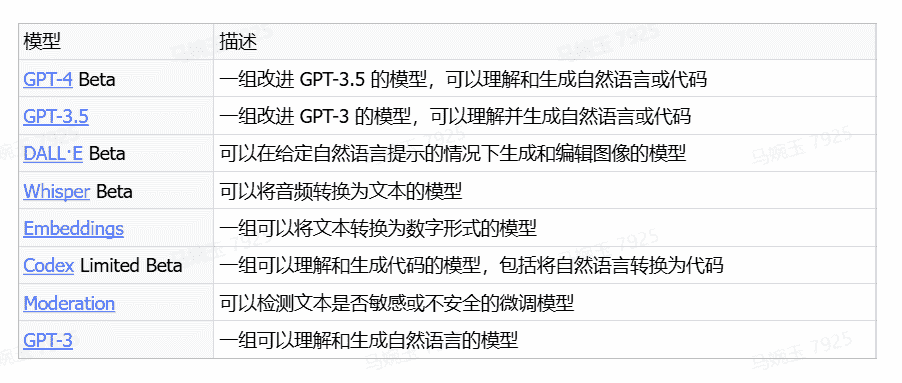
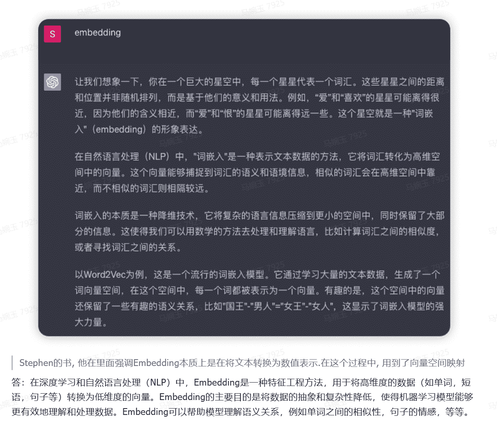
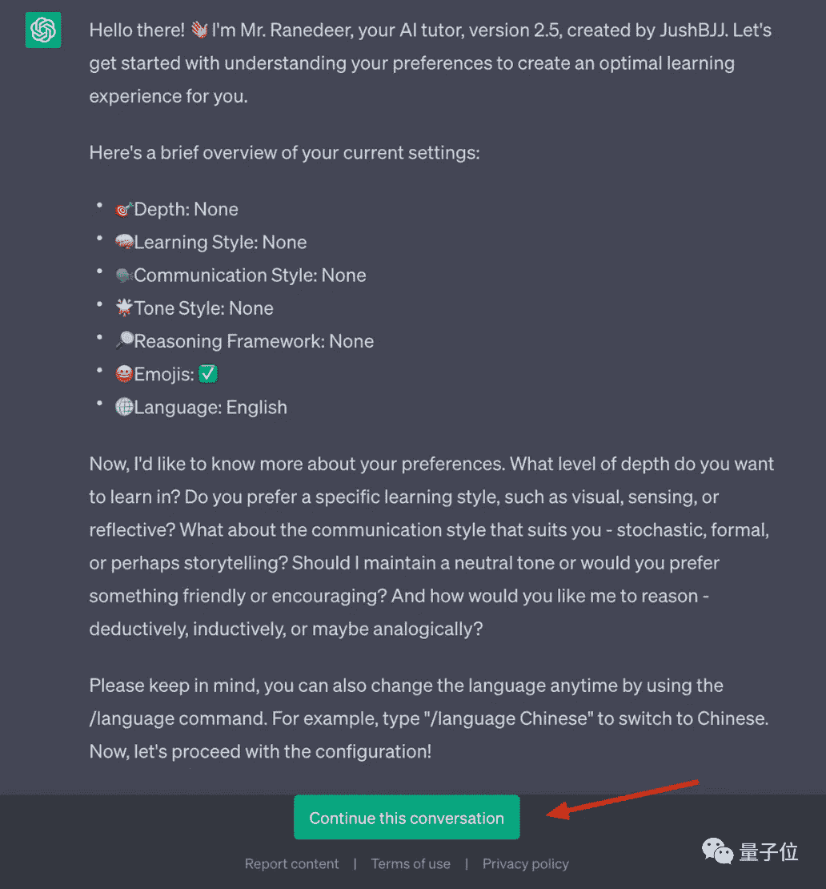
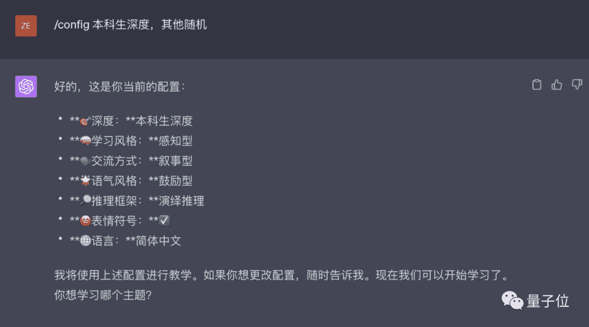
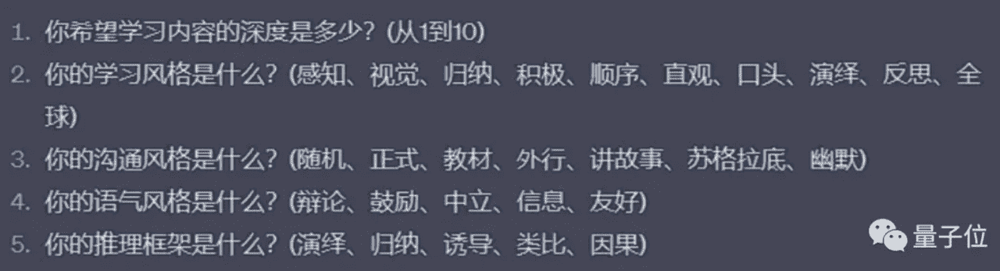
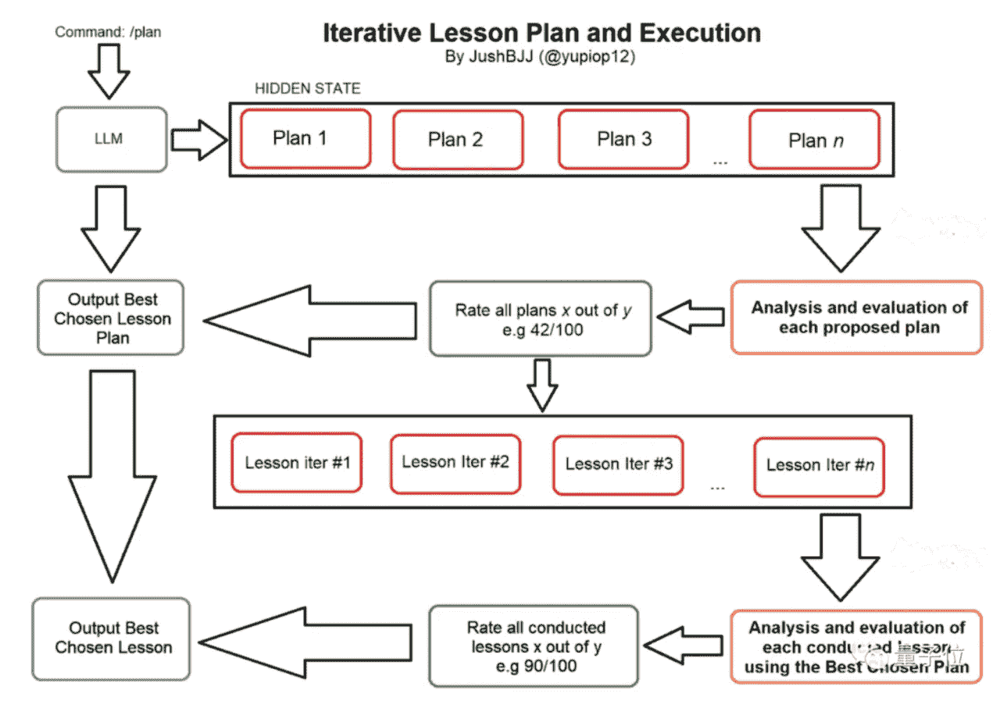

# AI对话——ChatGPT

> 来源：[https://bluefocus.feishu.cn/docx/PxNxd8tMAoQJGqxSt3BclnyPnMb](https://bluefocus.feishu.cn/docx/PxNxd8tMAoQJGqxSt3BclnyPnMb)

# ChatGPT

## [一文教你注册、安装、订阅ChatGPT ](https://waytoagi.feishu.cn/wiki/HjPJwAJJdi0sl4k9IslcoU9ZnIh)

## 快速开始

### 概述

O[pe](https://waytoagi.feishu.cn/wiki/ATYCwS5RRibGXNkvoC4ckddLnLf)nAI API 可以应用于几乎所有涉及生成自然语言、代码或图像的任务。我们提供了一系列不同能力级别的模型，适用于不同任务，并且能够微调您自己的自定义模型。这些模型可以用于从内容生成到语义搜索和分类的所有领域。

### 提示词 Prompts

设计提示词本质上就是对模型进行"编程"，这通常是通过提供一些指令或几个示例来完成。这与大多数其他 NLP 服务不同，后者是为单个任务设计的，例如情绪分类或命名实体识别。相反，补全（Completions）和聊天补全几乎可用于任何任务，包括内容或代码生成、摘要、扩展、对话、创意写作、风格转换等。

###  标记 Token

我们的模型通过将[文本分](https://platform.openai.com/tokenizer)解为标记（Token）来理解和处理文本。Token 可以是单词，也可以是字符块。例如，单词"hamburger"被分解成标记"ham"、"bur"和"ger"，而很短且常见的单词像"pear"是一个 Token。许多 Token 以空格开头，例如" hello"和" bye"。 在给定的 API 请求中处理的 Token 数量取决于您的输入和输出长度。作为一个粗略的经验法则，对于英文文本，1 个Token大约相当于 4 个字符或 0.75 个单词。要记住的一个限制是，您的文本提示词和生成的补全合起来不能超过模型的最大上下文长度（对于大多数模型，这是 2048 个 Token，或大约 1500 个单词）。可以查看分词器工具来了解有关文本如何转换为 Token 的更多信息。

### 模型 Models

API 由一组具有不同功能和价位的模型提供支持。GPT-4是我们最新和最强大的模型。GPT-3.5-Turbo 是为Ch[atGP](https://waytoagi.feishu.cn/wiki/R70MwasSpik2tgkCr7dc9eTmn0o)T 提供支持的模型，此模型专为对话模式进行了优化。要了解更多有关这些模型以及其他我们提供的内容的更多信息，请访问模型文档。

### 温度 Temperature

简单来说，temperature 参数值越小，模型就会返回越确定的结果。如果调高该参数值，大语言模型可能返回更随机的结果，也就是说这可能会带来多样化或更具创造性的产出。我们目前也在增加其他可能 token 的权重。在实际应用方面，对于质量保障（QA）等任务，我们可以设置更低的 temperature 值，以促使模型基于事实返回更真实和简洁的结果。 对于诗歌生成或其他创造性任务，你可以适当调高 temperature 参数值。

> [翻译自 OpenAI官方文档链接：https:](https://platform.openai.com/docs/quickstart)//platform.openai.com/docs/quickstart

### Embedding

让我们想象一下，你正在玩一个叫做"猜词"的游戏。你的目标是描述一个词，而你的朋友们要根据你的描述猜出这个词。你不能直接说出这个词，而是要用其他相关的词来描述它。例如，你可以用"热"、"喝"、"早餐"来描述"咖啡"。这种将一个词转化为其他相关词的过程，就 很像计算机科学中的"embedding"。

在计算机科学中，"embedding"是一种将对象（如词语、用户或商品）映射到数值向量的技术。这些向量捕捉了对象之间的相似性和关系，就像你在"猜词"游戏中使用相关词描述一个词一样。

Embedding 的核心属性是把高维的，可能是非结构化的数据，转化为低维的，结构化的向量。这样做的目的是让机器可以理解和处理这些数据，从而进行有效 的学习和预测。

以推荐系统为例，如果我们想要推荐相似的商品给用户，我们可以用 embedding 技术把每个商品转化为一个向量。在这个向量空间中，相似的商品会有相似的向量。当一个用户喜欢某个商品时，我们就 可以找到向量空间中最接近这个商品的其他商品，推荐给用户。这就是 embedding 在现实生活中的一个应用。

## OpenAI官方ChatGPT提示工程

> 原文地址:https://mp.weixin.qq.com/s/kakoEBoO7zEiN0CApjQL3w

### 一、OpenAI官方GPT 最佳实践指南

本指南分享了提高GPT的效果的策略和方法，这些方法有时可以结合使用以获得更好的效果。同时鼓励多尝试试验，找到最适合自己的方法。

以下是提高Prompt效果的六大关键策略：

**1.编写清晰的提示**

如果GPT输出的内容过长，可以要求模型进行简短的回复；如果输出过于简单，可以要求模型使用专业的写作水准输出内容。如果你对输出的格式不满意，可以提供自己想要的格式。越是明确表达自己的需求，越有可能得到满意的答案。提升GPT Prompt效果最佳实践 - 编写清晰的提示

**2.提供参考文本**

GPT模型可以自信地编造虚假答案，尤其是在涉及深奥主题或引用和URL时。就像学生在考试时可以查看笔记来帮助自己更好地回答问题一样，向GPT模型提供参考文本可以帮助其减少编造虚假答案的情况。提升GPT Prompt效果最佳实践 - 提供参考文本

3.将复杂的任务拆分为更简单的子任务

就像在软件工程中将复杂系统分解为一组模块化组件一样，在提交给GPT模型的任务中也是如此。复杂任务往往比简单任务出错率更高。此外，复杂任务通常可以重新定义为一系列简单任务的工作流程，其中前置任务的输出作为后续任务的输入。提升GPT Prompt效果最佳实践 - 拆解复杂任务

**4.给 GPT 时间思考**

如果让你计算17乘以28，你可能不会立即知道答案，但是却可以花时间计算出来。类似地，当GPT试图立即回答问题时，它会犯更多的推理错误，而不是花时间计算出答案。在回答问题之前，要求模型给出一系列的推理过程可以帮助GPT更可靠地推理正确的答案。提升GPT Prompt效果最佳实践 - 给 GPT 时间思考

**5.使用外部工具**

通过使用其他工具的输出来弥补GPT的不足。例如，使用文本检索系统来告诉GPT相关文档的信息，或者使用代码执行引擎来帮助GPT进行数学计算和代码运行。如果有其他工具可以更可靠或更有效地完成某个任务，就应该使用这些工具，以获得最佳效果。提升GPT Prompt效果最佳实践 - 使用外部工具

**6.系统地测试变更**

如果能[够进行测量，那](https://mp.weixin.qq.com/s?__biz=MzU1MDg5NTExNg==&mid=2247485183&idx=1&sn=1e06b8aab97d34d905608db60fa0c6e9&scene=21#wechat_redirect)么提高效果就会更容易。在某些情况下，对提示的修改会在几个孤立的示例上实现更好的效果，但会导致在一组更具代表性的示例上整体表现变差。因此，为了确保更改对效果能够产生积极的影响，可能有必要定义一个全面的测试套件（也称为“评估(eval)”）。系统的测试变更

### 二、OpenAI与吴恩达合作的ChatGPT提示工程课程

这门课程时长为1个小时，内容简单易懂，还提供了实践的环境。讲师是吴恩达（Andrew Ng，DeepLearning.AI创始人）和伊莎·富尔福德（Isa Fulford，OpenAI的技术人员），含金量非常高。

以下是该课程的5篇文章：

1.编写Prompt的两个关键原则

+   原则一：编写清晰、具体的说明

+   原则二：给予模型思考的时间

ChatGPT提示工程的两个关键原则

**2.文本总结**

这篇主要介绍了如何对内容进行总结，可以让模型来总结/提取重点内容，限制结果的长度。

ChatGPT提示工程 - 总结

**3.文本推理**

可以让模型来识别一段内容的情绪，或者提取指定的内容。也可以一次性执行多个任务，从而节省多次请求的整体耗时和成本。

ChatGPT提示工程 - 推理

**4.文本转换**

在这篇文章中，介绍了如何使用大型语言模型来进行文本转换工作，如语言翻译、语调调整和格式转换。

ChatGPT提示工程 - 转换

**5.邮件回复与营销文案**

在这篇文章中，介绍了如何使用大型语言模型来进行邮件自动回复、生成营销文案。

ChatGPT提示工程 - 邮件回复、营销文案

### **三、规划与风险**

OpenAI关于AGI通用人工智能及未来技术的规划（全文译文）

人工智能的风险是真实存在的 - 比尔·盖茨

### **参考**

https://platform.openai.com/docs/guides/gpt-best-practices

https://www.deeplearning.ai/short-courses/chatgpt-prompt-engineering-for-developers/

## 13条咒语挖掘GPT-4最大潜力

> 原文地址:https://mp.weixin.qq.com/s/BJpGQE4SWPBC8Ncha8XaIA

**只需一段****提示词，**让GPT-4变成你的“梦中情导”，在GitHub上揽星上万。学习的内容、难度可任意指定，从小学教到博士，甚至可以改变AI导师的教学风格和说话语气：

用GPT-4总结一下，这提示词通常具备这几类特点：

+   设置特定的规则和格式

+   个性化偏好设置

+   （可选）使用图标增加可读性

+   命令接口

+   结构化输出

以思维树（链）的方式撰写提示词技巧，如今在各种前沿教程里面已经是“标配”了。

领一个导师：

https://github.com/JushBJJ/Mr.-Ranedeer-AI-Tutor