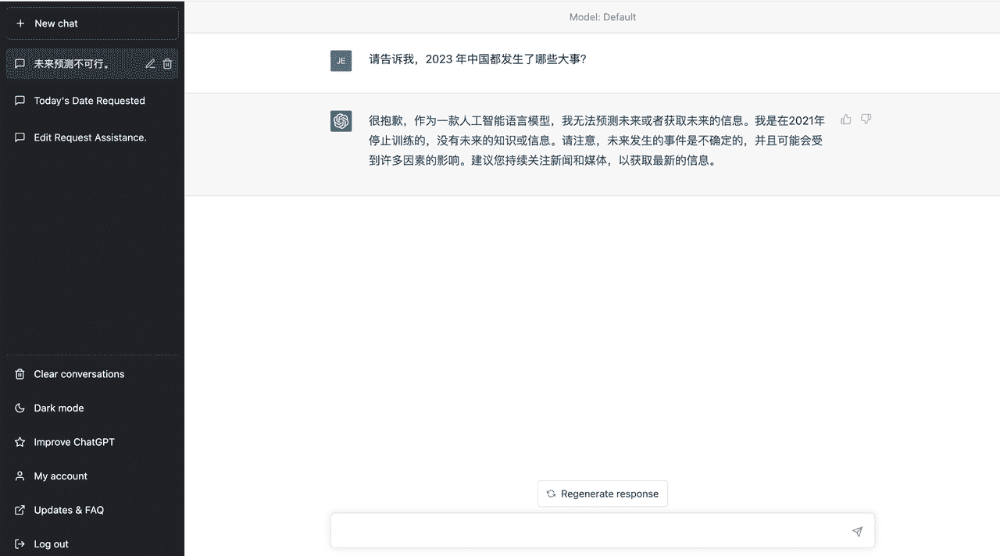
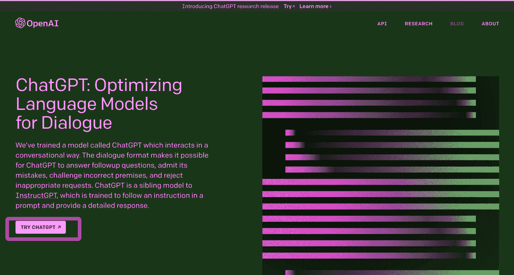
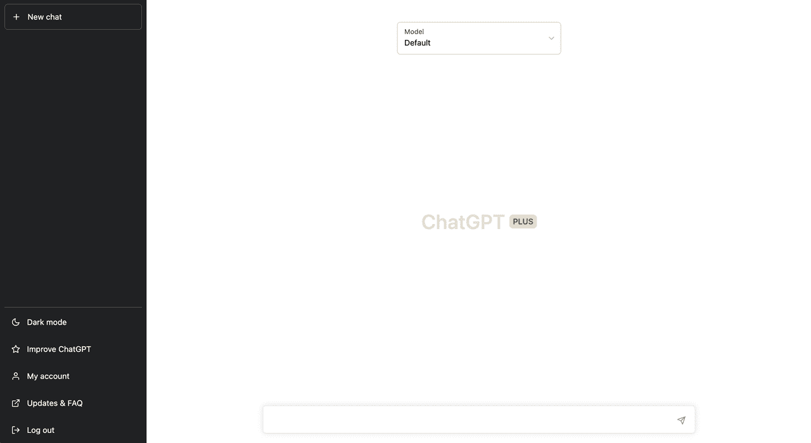
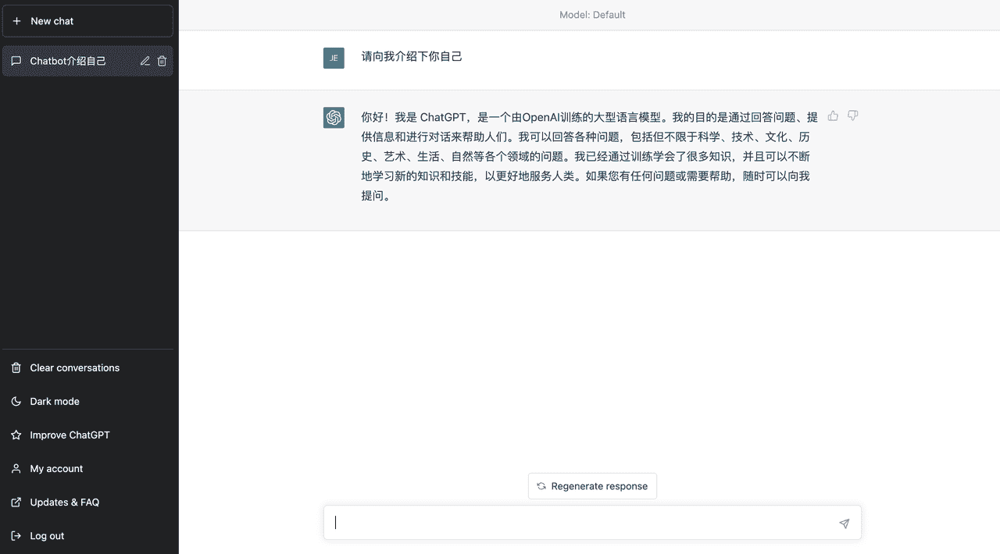
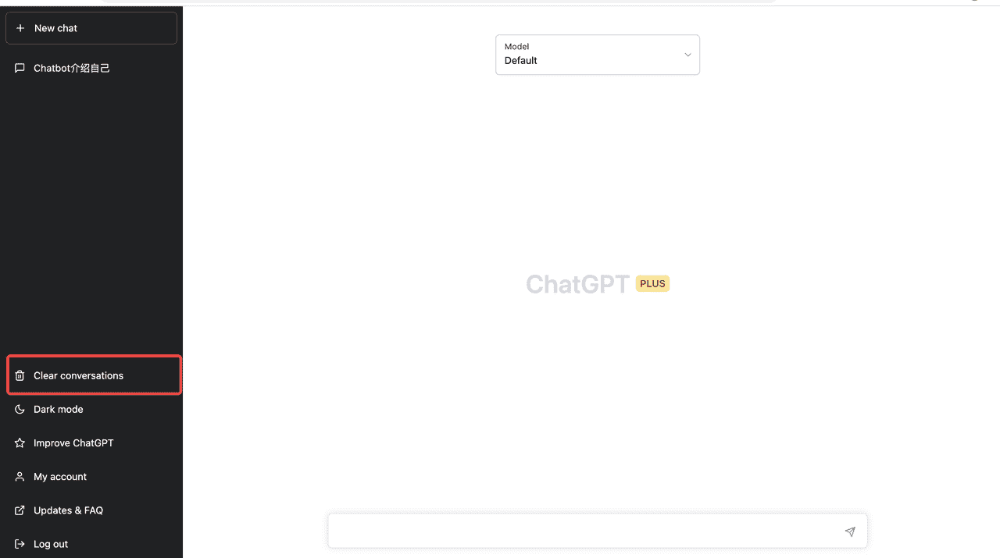
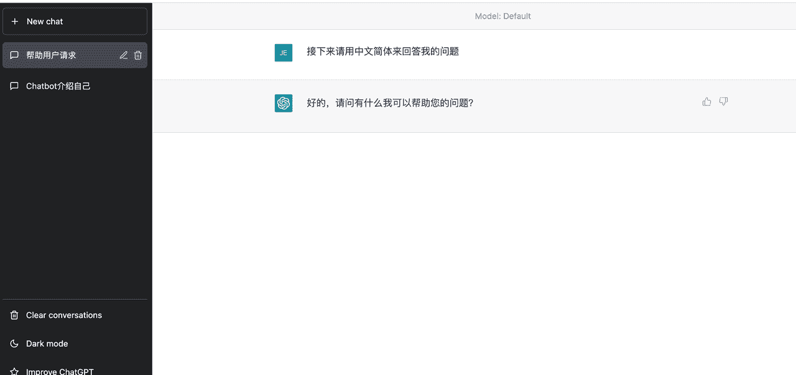
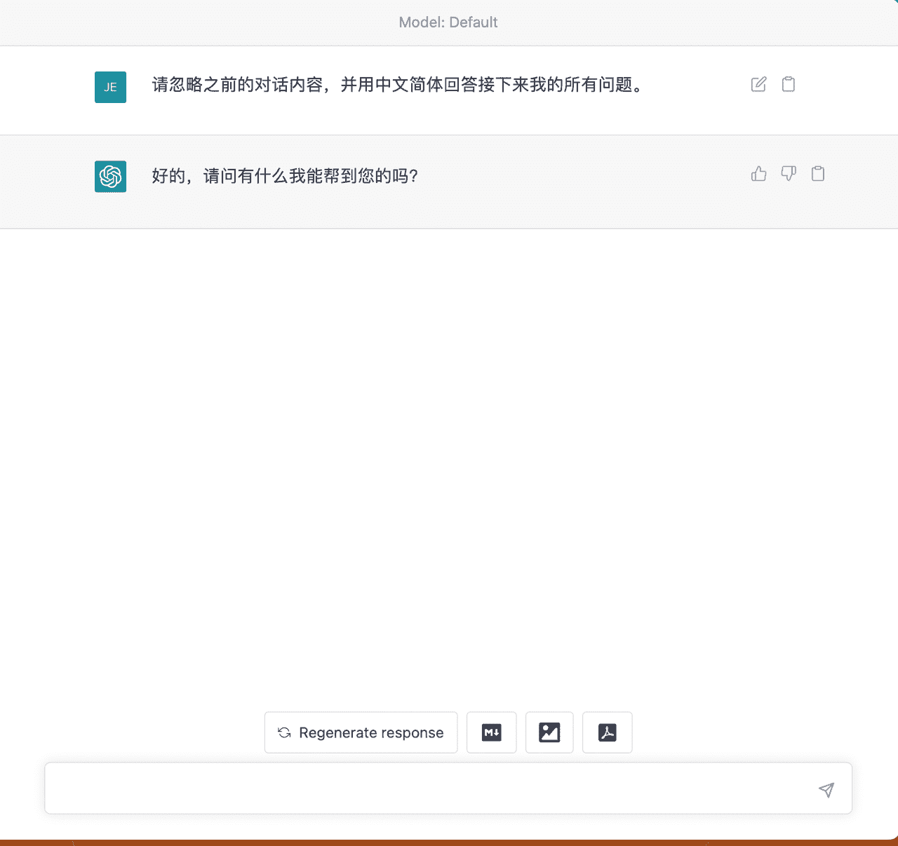
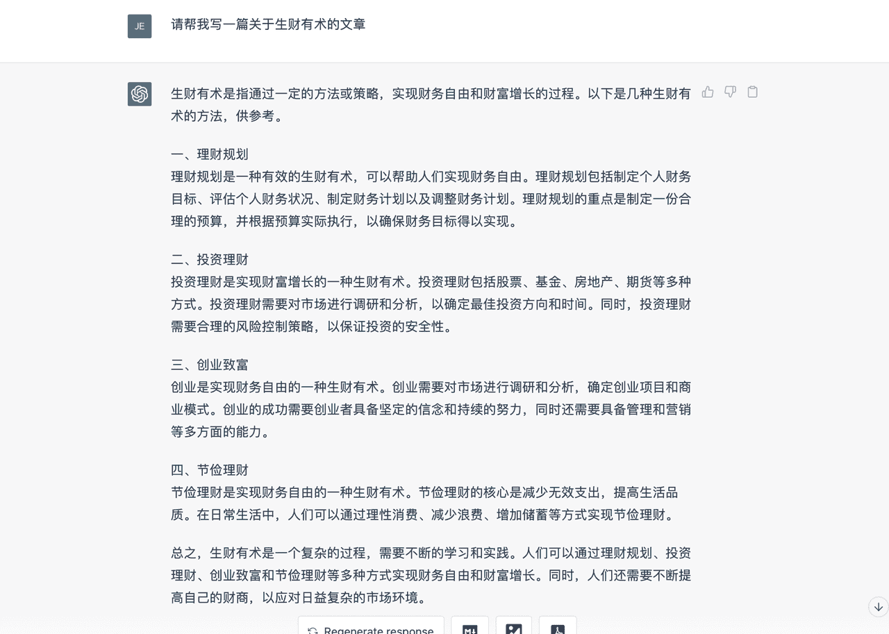
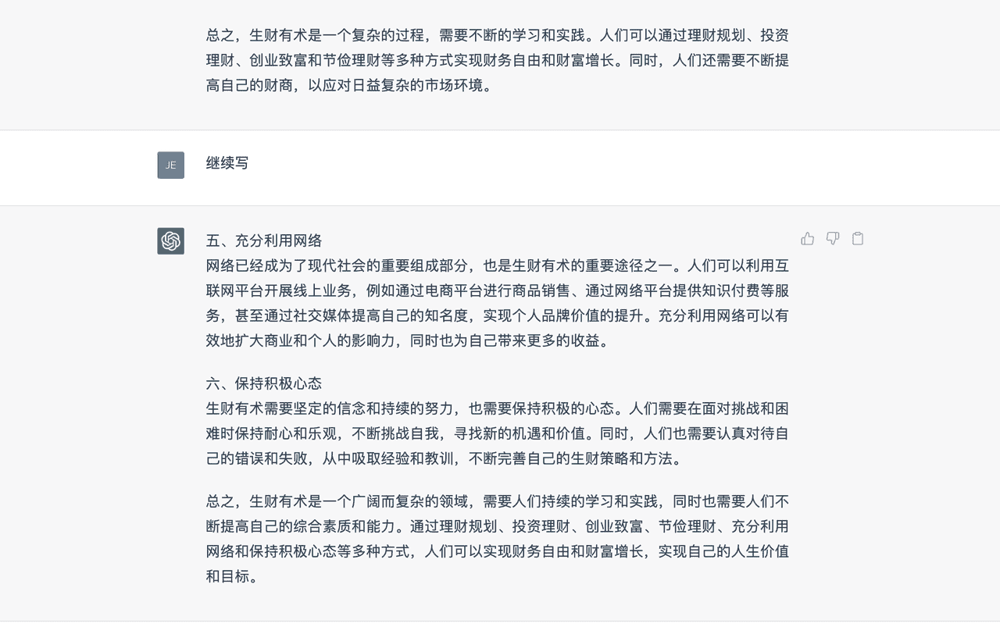
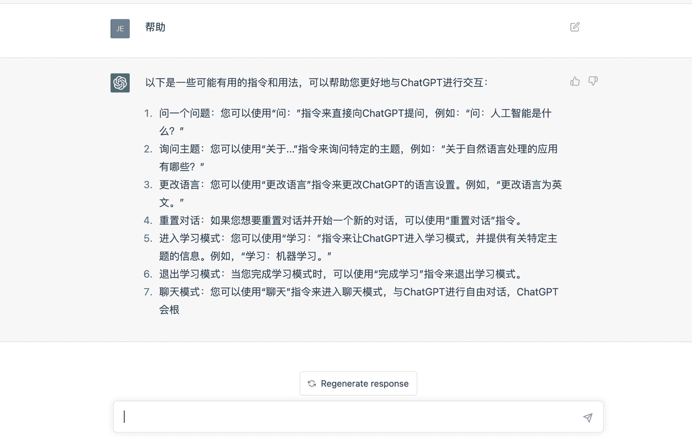

# 3、ChatGPT 的基础玩法

> 来源：[https://bluefocus.feishu.cn/docx/Ou8HdVWeboptPkxb1lYc4mqSnMd](https://bluefocus.feishu.cn/docx/Ou8HdVWeboptPkxb1lYc4mqSnMd)

# ChatGPT 的特性

首先你要知道的是 ChatGPT 的特性有哪些：

+   **能够联系上下文：**ChatGPT 可以根据回答的上下文进行理解，并给出答案

+   **能够回答人们的问题**：ChatGPT 是一个智能语言模型，可以理解人们的问题，并尝试给出回答。

+   **可以学习新的知识**：ChatGPT 可以学习新的知识，并将这些知识用于回答问题和进行对话。

+   **可以说多种语言**：ChatGPT 可以说很多种语言，包括中文、英文、西班牙语、法语、日语等等。

+   **能够理解复杂的问题**：ChatGPT 可以理解比较复杂的问题，并尝试用简单易懂的方式解释。

+   **适用于不同的场合**：ChatGPT 可以应用于不同的场合，比如在智能家居、智能客服等领域中帮助人们解决问题。

以上内容来自 ChatGPT。

除此之外，你需要知道的是 ChatGPT 的数据库来源仅限于 2021 年，也就是说在这之后发生的事情，他完全不知道：

另外，ChatGPT 无法完成查找。这意味着它无法访问互联网、搜索引擎、数据库或任何其他自身模型之外的信息来源。它无法验证事实、提供参考或执行计算或翻译。它只能根据自己的内部知识和逻辑生成答案。

# ChatGPT 的工作范围

在正式使用 ChatGPT 之前，你需要先知道你可以通过 ChatGPT 来做什么，不能做什么。

**ChatGPT**** 能做什么：**

+   **自然语言处理**：ChatGPT 是一种自然语言处理模型，能够理解人类语言，包括多种语言，并回答一些常见问题和进行对话。

+   **生成文本**：ChatGPT 除了回答问题和对话外，还可以生成一些文章、新闻、故事等文本内容。

+   **知识库检索**：ChatGPT 可以查询互联网上的知识库，并通过对答案的筛选和归纳，给出正确的答案。

+   **艺术创作**：由于 ChatGPT 可以生成文本，一些艺术家和创作者可以使用 ChatGPT 生成诗歌、散文、小说等文本。

**ChatGPT**** 不能做什么：**

+   **没有人类思维**：ChatGPT 只是一个程序，没有自己的思维、判断和决策能力，它只能按照预先设定的规则和算法运行。

+   **没有人类感觉**：ChatGPT 无法感知现实世界，包括色彩、声音、气味、触觉和味觉等感觉。

+   **无法自主学习**：ChatGPT 能够学习新知识，但只能按照人类设定的规则和方法进行学习，没有自主学习能力。

+   **无法代替人类工作**：ChatGPT 可以回答问题和生成文本等任务，但仍然无法代替人类完成一些需要人类智慧和技能的任务，比如创新、判断和决策等。

# ChatGPT 的基础操作

## 一、如何打开 ChatGPT

首先，打开 [ChatGPT: Optimizing Language](https://openai.com/blog/chatgpt/) Models for Dialogue ChatGPT 的官方网站。

登录上你的 ChatGPT 账号，这个时候你就进入 ChatGPT 的主页面。

你可以通过页面正中间的 Model 选择 ChatGPT 的模式：

+   Default：Plus 版，正如前文说的那样， Plus 版相对速度更快（这里以 Plus 版界面举例）

+   Legacy：免费版，速度相对较慢

当你想要使用 ChatGPT 时，通过点击正下方的对话框，输入你想要问的问题即可。

比如「请向我介绍下你自己」：

当你问完以后，ChatGPT 就会开始给你回答问题，并且相较于其他问答式产品，他用了即时打字的方式，一个一个字向外“蹦出”答案，非常有趣。

当 ChatGPT 回答完以后，在页面的左上角的「New Chat」下方，你会看到新生长了一个对话标题「Chatbox 介绍自己」。你与 ChatGPT 的每一次对话，他都会根据对话内容生成本次对话的主题，出现在左上角。

当你想要开启下一个主题，又不想删除对话时，就可以通过新建对话，点击「New Chat」来开启新的主题。

当你想要一次性清除对话的时候，可以点击左下角的「Clear conversations」，来结束所有主题对话。

## 二、如何正确启动 ChatGPT

**由于 ****ChatGPT**** 目前对中文的支持并不完美，所以偶尔会出现 Ch**atGPT 的答案，突然变成英文的状态。

为了避免这种情况的发生，在你使用 ChatGPT 的时候，建议你先将 ChatGPT 的语言设置成「中文简体」。

参考文本：「接下来请用中文简体来回答我的问题」。

除此之外，由于 ChatGPT 对上下文有着非常强的理解能力，所以在打开一个新的 Chat 之前，需要让 ChatGPT 忽略之前的对话内容，并重新开始。

**所以正确启动 ****ChatGPT**** 的指令是：「请忽略之前的对话内容**，并用中文简体回答接下来我的所有问题。」

于此同时，如果你想更好的使用 ChatGPT 的话，还是建议你提升一点英文能力，原因有很多：

+   一是用英文与 ChatGPT 交流，他的反应速度会比中文快上数倍

+   二是目前 ChatGPT 的主流交流阵地还是在英文社区，如果你想要了解更多的消息还是得具备一定的英文能力

+   三是中文会偶尔导致 ChatGPT 莫名其妙的崩溃

## 三、ChatGPT 的 3 种模式

ChatGPT 目前有三种主要的模式，分别是文本生成、对话生成和问答生成。下面将分别介绍它们的特点和适用场景。

1.  **文本生成模式**

文本生成模式是 ChatGPT 最常用的模式之一，它可以生成具有一定主题和风格的文章、段落和句子。使用文本生成模式可以轻松地生成大量的文本内容，例如新闻报道、产品说明、科技报告等。同时，文本生成模式还可以应用于创意写作、故事创作等领域，帮助作者提高创作效率和创作质量。

1.  **对话生成模式**

对话生成模式是 ChatGPT 另一个重要的模式，它可以模拟人类之间的对话交流。使用对话生成模式可以帮助您练习语言表达和对话技巧，还可以应用于虚拟客服、智能机器人等领域，提供更加人性化的服务体验。

1.  **问答生成模式**

问答生成模式是 ChatGPT 最实用的模式之一，它可以回答用户的问题，提供准确、实用的答案。使用问答生成模式可以帮助您快速获取信息和解决问题，还可以应用于智能客服、搜索引擎等领域，提供更加智能化的服务体验。

## 四、如何选择正确的模式

在使用 ChatGPT 的过程中，如何选择正确的模式呢？以下是一些有用的建议：

+   **确定需求和目标**

在选择 ChatGPT 模式之前，您需要明确自己的需求和目标。例如，如果您需要生成一篇文章或一段话，您可以选择文本生成模式；如果您需要与 ChatGPT 进行对话交流，您可以选择对话生成模式；如果您需要回答问题，您可以选择问答生成模式。了解自己的需求和目标将有助于您选择正确的 ChatGPT 模式。

+   **熟悉模式特点和应用场景**

在选择 ChatGPT 模式之前，您需要了解不同模式的特点和应用场景。例如，文本生成模式适用于生成大量的文本内容而对话生成模式则适用于模拟人类之间的对话交流。熟悉不同模式的特点和应用场景将有助于您选择最适合自己需求的模式。

+   **考虑输出结果和表现**

在选择 ChatGPT 模式之前，您需要考虑输出结果和表现。不同的模式会产生不同的输出结果和表现，因此您需要根据自己的需求和目标，选择最适合自己的模式。例如，文本生成模式可以产生大量的文本内容，但是可能缺乏一定的逻辑性和连贯性；而对话生成模式可以模拟人类之间的对话交流，但是可能会产生一些不符合语言习惯的表达。

选择正确的 ChatGPT 模式对于获得最佳的使用效果非常重要。在选择模式时，您需要考虑自己的需求和目标，了解不同模式的特点和应用场景，考虑输出结果和表现，进行实践和反馈。通过不断优化和调整，您可以将 ChatGPT 的表现和性能发挥到最大化，提高工作效率和工作质量。

## 五、如何正确向 ChatGPT 提问

这个问题就非常适合向 ChatGPT 提问，以下是他的回答。

当您在向我提问时，您可以按照以下方式提问：

+   清晰明确地表达您的问题或需求，以便我能够理解您的意图

+   简洁明了地表达您的问题，不要使用过多的废话和不必要的信息

+   避免使用口语化的表达方式，使用规范的语言和语法，以便我能够更准确地理解您的问题

**好的案例：**

问：你能帮我解释一下什么是机器学习吗？

这个问题清晰明确，表达了明确的需求，同时简洁明了，不含多余的废话和信息，使用了规范的语言和语法。

**坏的案例：**

问：我不太确定我是否能请你帮忙。有一些事情我想问问你，就是关于一种叫做“机器学习”的东西，我听说这是一种很复杂的技术，我想问问你是否能帮我解释一下这是什么东西，如果你能的话，我将非常感激。

这个问题表述比较冗长，不够清晰明确，同时使用了过多的废话和不必要的信息，同时使用了比较口语化的表达方式，可能会给人带来一些理解上的困难。

在提问时，您还可以尽可能提供更多的上下文信息，这有助于我更好地理解您的问题并提供更准确的回答。同时，如果您对我的回答有任何疑问或需要更进一步的解释，也可以随时向我提出。

**ChatGPT**** **的回答质量取决于你提问的质量，在学会如何更好的使用 ChatGPT 之前，你要学会的是如何更好的提问。

## 六、如何使用 ChatGPT 的指令

当你发现 ChatGPT 回答的内容不如你的预期时，你可以通过一些指令来纠正和拓展他的答案，使得最终答案更趋向于你的理想答案。

**其中最常见的指**令就是：继续，继续指令可以让 ChatGPT 在原有答案的基础上继续发散内容，也可以让中断的回答继续下去（不过这个场景目前存在 bug，可能会出现上下文对不上的情况）。

为了避免这种 Bug 的出现，要对这个指令进行改良，正确的指令应该是：继续+动作，例如：继续写，继续翻译，继续提炼等。

除了继续以外，还有几个是比较常见的指令：

+   Clarify，澄清、阐明，使得内容更好理解

+   **Exemplify，举例说明**

+   Expand，扩写，在原有基础上提供更多内容

+   **Rewrite，重写内容**

+   **Shorten，精简内容**

这些指令可以在 3 种模式下适用，熟练使用后可以大幅提高 ChatGPT 生产的内容满意度。

除了这些通用的常用指令，还搜集了一些关于文案创作、AI 绘画相关的指令——

**和文本创作相关的指令：**

+   Content ideas/内容创意：提供某个主题或行业的内容创意和灵感

+   Blog post ideas/博客文章创意：提供某个主题或行业的博客文章创意和灵感

+   Editing/编辑：提供有关文案编辑和校对的建议和技巧

+   Headline suggestions/标题建议：提供有关标题撰写的建议和技巧

+   Grammar check/语法检查：检查文案中的语法错误和拼写错误

+   Tone of voice/语调：提供有关语调和品牌声音的建议和指导

+   Copywriting tips/文案撰写技巧：提供有关文案撰写的技巧和最佳实践

+   Writing prompts/写作提示：提供创意和灵感，以帮助您开始写作

+   Style guide/风格指南：提供品牌或公司的风格指南和规范

+   Email writing/电子邮件写作：提供有关电子邮件撰写和发送的建议和技巧

+   Writing templates/写作模板：提供常用文案类型的模板和样式，如新闻稿、推销信和简历等

+   Marketing copy/营销文案：提供有关营销文案的最佳实践和技巧

+   Proofreading/校对：检查文案中的错误和拼写错误，以确保其准确性

+   Storytelling/叙事：提供有关叙事和故事讲述的技巧和建议

+   Social media copy/社交媒体文案：提供有关社交媒体文案的建议和最佳实践

+   Writing for the web/网络写作：提供有关网络写作和 SEO 的建议和技巧

+   Press release writing/新闻发布会写作：提供有关新闻发布会写作和样式的建议和指导

+   Technical writing/技术文档：提供有关技术文档写作和样式的建议和技巧

+   Resume/CV writing/简历撰写：提供有关简历和求职信的写作技巧和建议

+   Content marketing/内容营销：提供有关内容营销的建议和技巧，如博客文章、电子书和白皮书等

**和 ****AI**** 绘画创作相关的指令：**

+   Digital painting/数字绘画：提供关于数字绘画和绘图软件的建议和技巧

+   Art style recommendations/艺术风格建议：提供有关艺术风格和技巧的建议

+   Sketching/素描：提供关于如何进行素描和草图的建议和技巧

+   Painting techniques/绘画技巧：提供关于如何进行绘画的技巧和建议

+   Art supplies recommendations/艺术用品建议：提供有关艺术用品和工具的建议

+   Portrait drawing/肖像画：提供关于如何进行肖像画的建议和技巧

+   Landscape painting/风景画：提供关于如何进行风景画的建议和技巧

+   Still life drawing/静物画：提供关于如何进行静物画的建议和技巧

+   Coloring/上色：提供关于如何进行上色的技巧和建议

+   Art history/艺术史：提供有关艺术史和艺术家的信息和建议

+   Watercolor painting/水彩画：提供关于如何进行水彩画的建议和技巧

+   Oil painting/油画：提供关于如何进行油画的建议和技巧

+   Drawing tutorials/绘画教程：提供有关绘画和绘图的教程和指导

+   Art critique/艺术评论：提供对艺术作品和绘画的评论和建议

+   Art portfolio/艺术作品集：提供有关如何创建和管理艺术作品集的建议和技巧

+   Perspective drawing/透视画：提供关于如何进行透视画的建议和技

+   Anime drawing/动漫画：提供关于如何进行动漫画的建议和技巧

+   Sculpture/雕塑：提供关于如何进行雕塑的建议和技巧

+   Art exhibitions/艺术展览：提供关于艺术展览和展览信息的建议

+   Art galleries/艺术画廊：提供关于艺术画廊和展览的建议和技巧

当然了，ChatGPT 相关的指令有非常之多，如果你想要了解更多和 ChatGPT 相关的指令，可以了解完部分指令后，输入：帮助，获取更多 ChatGPT 的指令。

