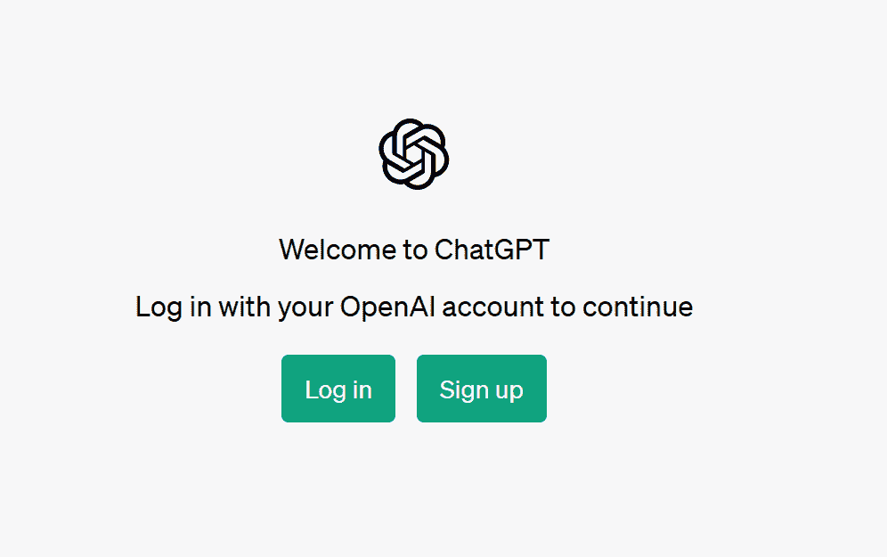
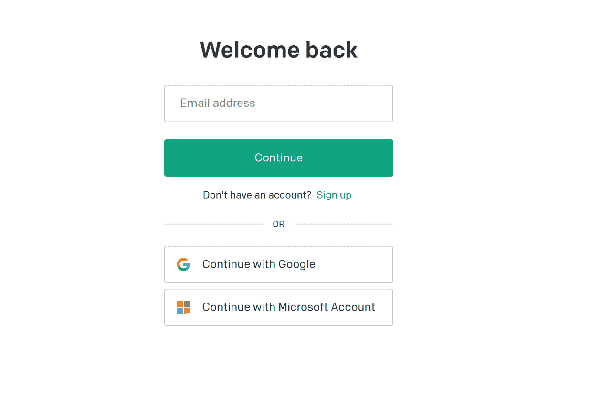
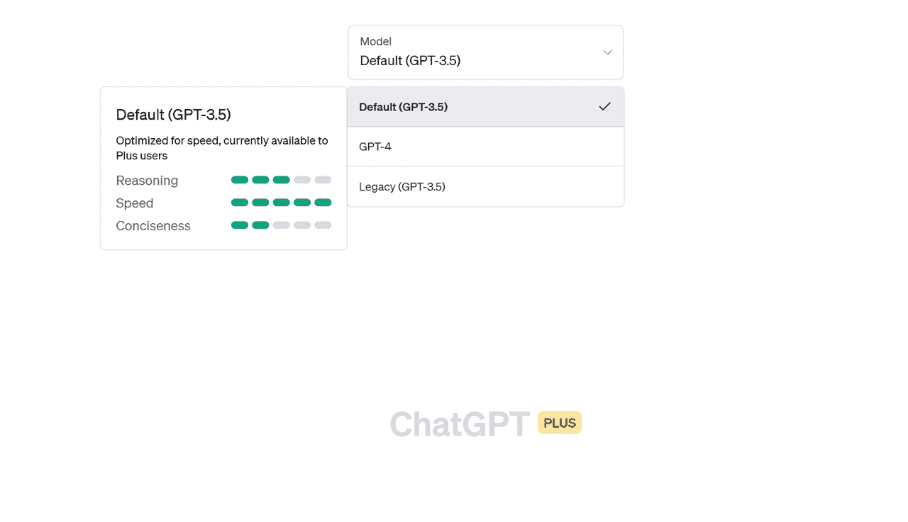
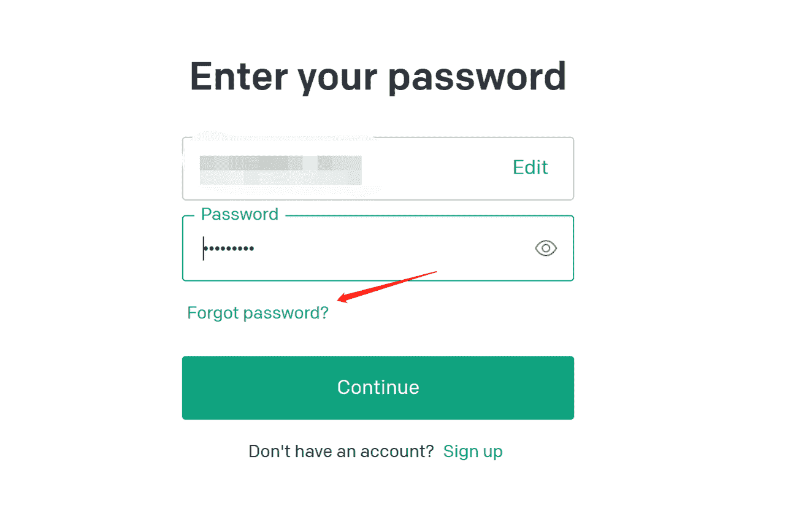
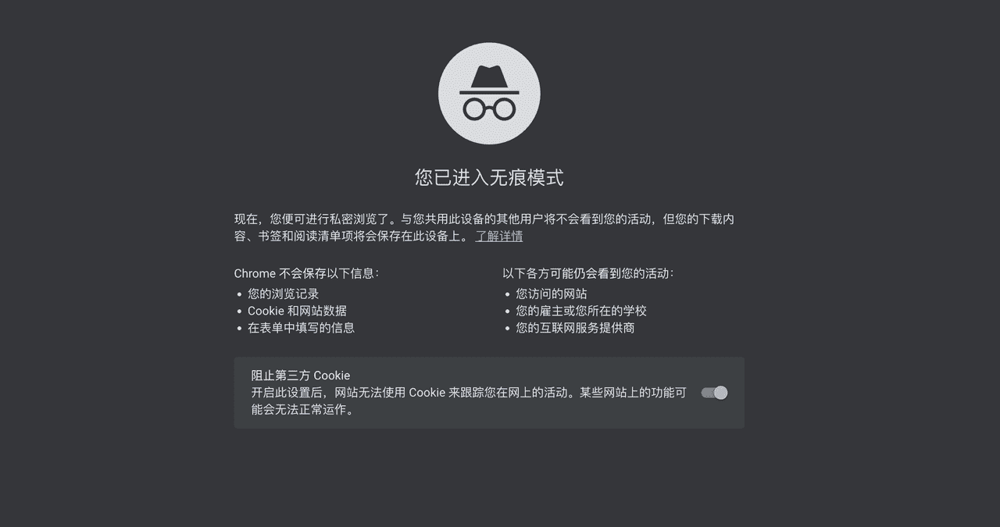
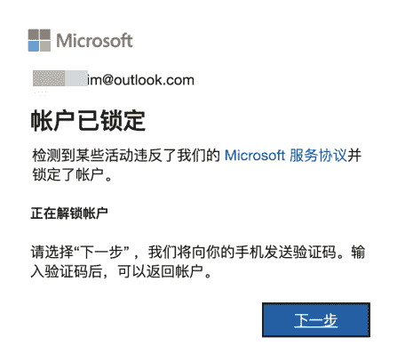
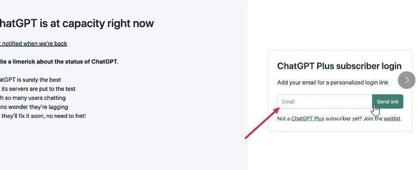
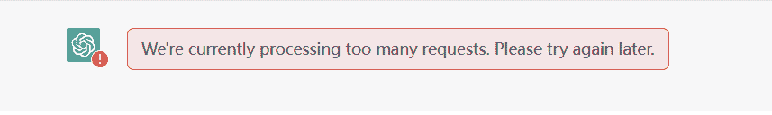
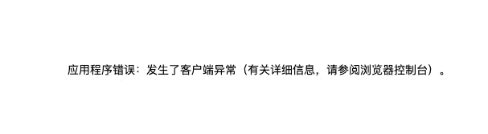

# 4、登录问题解决方案

> 来源：[https://bluefocus.feishu.cn/docx/V1cmdAFl1oanwuxl94ZcU0FLnEd](https://bluefocus.feishu.cn/docx/V1cmdAFl1oanwuxl94ZcU0FLnEd)

# 1、如何登录

登录网址：chat.openai.com

由于使用人数过多，服务器限制普通用户使用次数和使用时间，可以错峰使用。

**正确打开科学🪜，**（⚠️我们不提供/不指导任何梯🪜子）

**打开浏览器输入网址**（首选谷歌，安卓手机推荐使用Edge浏览器）

登录网址：chat.openai.com     点击登录 Log in（如出现其他界面请刷新重进，或直达第二部分异常情况👇）

**3  给了**openai账号密码，直接输入邮箱，也就是账号，点击继续（绿色按钮），输入账号密码即可

**❌不要选择**下面的“继续使用谷歌”或者“继续使用Microsoft帐户”

登录成功如图：普通账号即可立即使用了

**PLUS版本：**

**首页中间部分👇模型选择“G****PT-4”****即可使用**

# 2、修改ChatGPT账号密码

已经登录的在聊天窗口右下角退出登录，回到登录界面，输入密码的时候有个“忘记密码”，点击“忘记”，开始重置。

# 3、登录常见问题

## （1） 提示出现 "Access denied"页面

换魔法节点 并且开启浏览器无痕模式

> 或者 先登陆[ openai.com](http://openai.com/)，再访问 chat.openai.com

## （2） 提示出现 "账户已锁定" 的页面

+   不用担心，出现这个是正常的，新账号，7 天内登录会提示绑定手机号，是微软的邮箱风控保护机制，绑定以后即可长期使用

+   点击下一步、绑定自己的手机号、输入验证码解锁、记得不要开魔法

## （3） 提示出现 ”ChatGPT is at capacity right now”

+   一直刷新、直到出现登录界面

## （4） 提示出现 We’re Currently processing too many requests。 Please try again later.

+   服务器爆满、普通账户经常挤不进去，换个好用的魔法节点，刷新一下就好了

## （5） 提示出现 "应用程序错误：发生客户端异常"

+   刷新重启浏览器

##