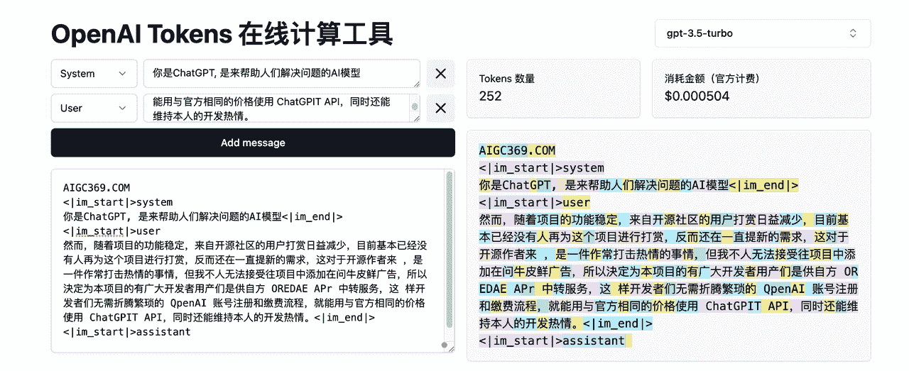
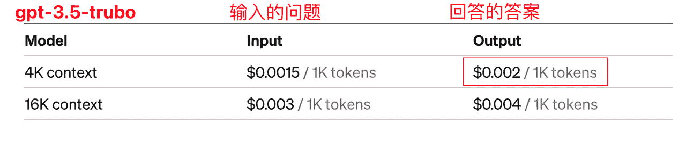
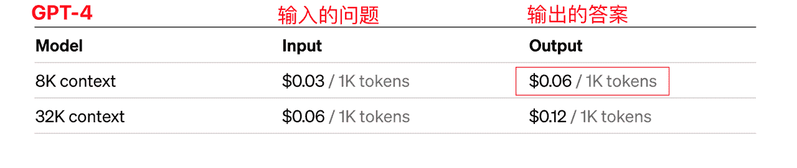
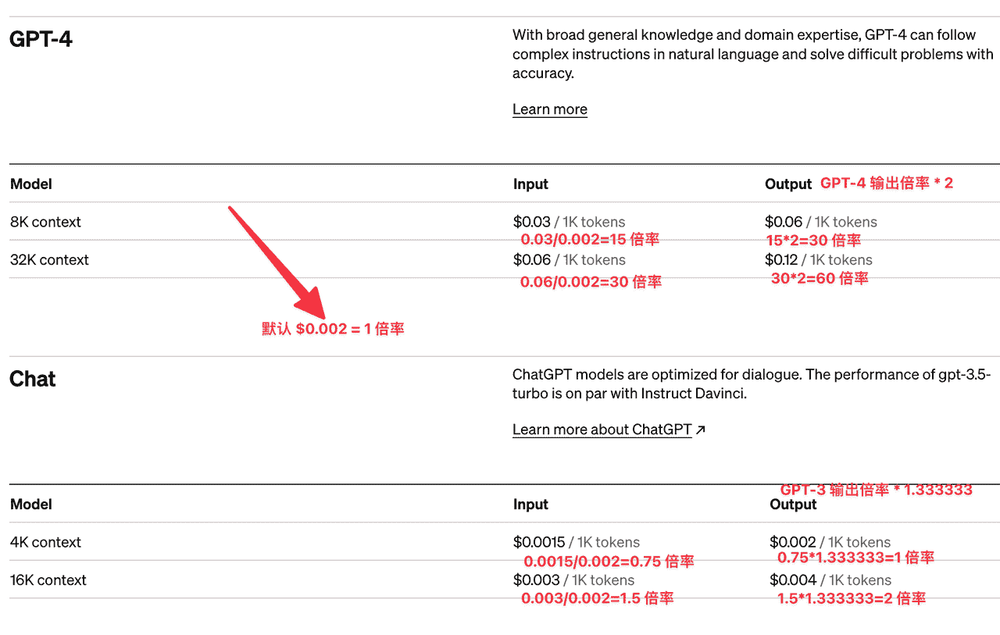
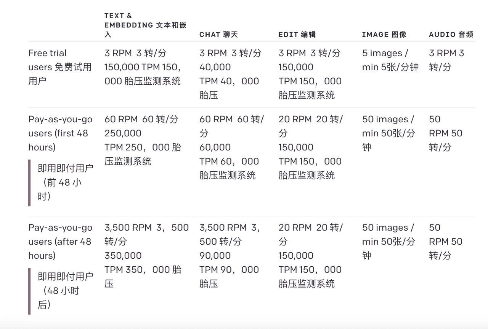

# 12、OpenAI API 知识科普

> 来源：[https://bluefocus.feishu.cn/docx/F6Sbdko3EoWuO7x1gfEcPAujnGh](https://bluefocus.feishu.cn/docx/F6Sbdko3EoWuO7x1gfEcPAujnGh)

> [**点击使用**](https://ssw9noe1h6.feishu.cn/docx/Dhjbd7Xmpoy6VwxisCAc8K0dnNn)** OpenAI 官方 ****API**** 中转业务**

# 一、Tokens 是什么？

Token 是 GPT 处理文本的基本单位。简而言之，Token 可以是一个字、一个词或特定语言中的一个字符。它们负责将输入的文本数据转换为 GPT 可以处理的数据格式。 作用：Tokens 的数量影响模型的能力，例如理解复杂语义、表达丰富内容以及高效处理长篇文本等。 限制：然而，较多的 Tokens 数量意味着更大的计算资源需求，可能导致处理速度减慢和内存需求增加。 每个 GPT 模型都有一个预设的最大 Tokens 数量。例如，GPT-3 允许处理的最大 Tokens 数量约为 4096。需要注意的是，这个数量包括输入和输出的所有 Tokens。大部分情况下，你都可以使用 1 汉字 = 2 token 来近似估算中文聊天的中文所需 token 数。

Token 在线计算工具：https://token.aigc369.com

批量可视化查询 [OpenAI](https://platform.openai.com/) 余额：https://openai.aigc369.com

# 二、API Token 计费规则

在计算使用 token 时，也会根据聊天时使用的模型，以及输入 / 输出的价格，进行单独定价，比如上图中，OpenAI 官方的 gpt 4.0 的价格为：

可以看到，chatgpt 4.0 非常贵，单次使用价格大概是 3.5 的 20 到 40 倍。

> **通**常 1000 个 Token 约等于 750 个英文单词或者 500 个汉字，按照官方计价，1000 字约等于 2000token

> 4.0 是 3.5 的 30 倍，价格十分昂贵

|  | **3.5** | **4.0** |
| --- | --- | --- |
| **一千字** | **0.028 元** | **0.84 元** |
| **一万字** | **0.28 元** | **8.4 元** |
| **十万字** | **2.8 元** | **84 元** |
| **一百万字** | **28 元** | **840 元** |

> 3.5 模式：5 美金=125W 字，120 美金=3000W 字

> **4.0 模式：5 美金=4W 字，25 美**金=20W 字，100 美金=80W 字

# 三、API 不同套餐下的调用速度对比

速率限制以两种方式度量：RPM（每分钟请求数）和 TPM（每分钟令牌数）

# 四、**API** 接口的返回数据显示错误是什么意思？

针对不同的数据返回代码，以下是常见的错误代码：

请注意，以上列表并不包含所有可能的错误代码，但它涵盖了大部分常见的情况。如果你遇到任何其他错误，你应该查阅 OpenAI 的官方文档或者联系我们的技术团队以获取更多信息。